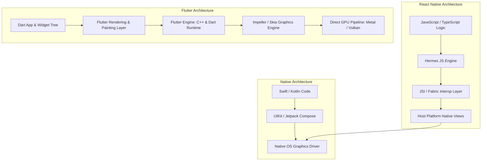

The central challenge of modern mobile application engineering has remained unchanged for over a decade: how can a software engineering organization deliver feature-identical, high-performance client applications across iOS, Android, and web without duplicating domain logic and engineering headcounts?

Historically, cross-platform frameworks forced teams into a severe compromise between development velocity and execution fidelity. Hybrid web-view approaches (such as Apache Cordova and early Ionic) introduced severe scrolling jank and poor gesture responsiveness. First-generation reactive bridges (such as legacy React Native) bridged JavaScript runtimes to native platform widgets over an asynchronous serialized JSON bridge, creating serialization bottlenecks during high-frequency animations.

Flutter bypassed the platform widget abstraction entirely by bundling its own rendering engine and compiling Dart code ahead-of-time (AOT) into native ARM machine code. This source audit examines the architectural mechanics that allow Flutter to achieve consistent 60–120 FPS rendering, analyzes the single-threaded Dart event loop and async primitives, and benchmarks its architectural trade-offs against React Native and modern native development.


## Why Direct Canvas Rendering Displaced JavaScript Bridge Architectures?

To understand Flutter’s technical divergence, one must inspect how traditional mobile development processes fracture across native platforms.

In standard native workflows, product teams design a feature spec, which is then implemented by independent iOS (Swift/Objective-C) and Android (Kotlin/Java) teams. As UI complexity increases, maintaining behavioral parity across platform-specific layout systems (Auto Layout vs ConstraintLayout), animation curves, and lifecycle state machines becomes a recurring operational tax.


When organizations attempt to bridge this divide using multi-platform frameworks, they confront fundamental differences in rendering topology:

```
Platform Widget Architecture (React Native Legacy)
[JavaScript Runtime] ──(Async JSON Serialized Bridge)──▶ [Platform Native Views (UIView / android.view)]

Direct Hardware Rasterization (Flutter Engine)
[Dart Application & Framework] ──(C++ Engine / Skia or Impeller)──▶ [Direct GPU Hardware Context (Metal / Vulkan)]
```

React Native historically decoupled business logic from display by executing JavaScript in a dedicated V8 or Hermes thread. When a state change occurred, the virtual DOM emitted mutation descriptors serialized as JSON arrays across the bridge to the main UI thread. Under heavy touch-tracking or high-frequency scroll operations, the bridge saturated, causing frame drops even though the device's CPU and GPU were not physically maxed out.


Flutter solved this structural limitation by treating the host operating system merely as a canvas and windowing provider. Rather than asking iOS to instantiate a `UIButton` or Android to render a `MaterialButton`, Flutter paints every pixel itself. The Flutter framework builds a render tree inside Dart, passes display lists down to the underlying C++ engine, and rasterizes directly onto a low-level graphics context using Metal (iOS) or Vulkan/OpenGL (Android).

## Cross-Platform Runtime Architecture: Comparing Execution Layers

To visualize how Flutter eliminates intermediate platform layers compared to React Native and pure native development, observe the architectural hierarchy:



By owning the entire rendering pipeline from user input down to GPU rasterization, Flutter guarantees exact visual parity across devices. A widget rendered on an iOS 18 device displays identical layout metrics, typography subpixel anti-aliasing, and clipping boundaries when rendered on an Android 15 handset or desktop environment.

This direct-to-hardware drawing strategy mirrors the architectural philosophy of low-level graphics standards like WebGPU, as discussed in our technical deep-dive on [WebGL to WebGPU: The Architectural Evolution of Real-Time Browser Graphics](/posts/web-gl/).

## The Dart Concurrency Model: Event Loops, Microtasks, and Isolates

A common misconception among engineers first evaluating Flutter is that Dart’s single-threaded nature restricts high-throughput application logic. In reality, Dart utilizes a deterministic event loop architecture combined with shared-nothing concurrency (Isolates).

```
┌────────────────────────────────────────────────────────┐
│                   Dart Main Isolate                    │
│                                                        │
│  ┌────────────────────────┐  ┌───────────────────────┐ │
│  │    Microtask Queue     │  │      Event Queue      │ │
│  │ (Priority OS Callbacks)│  │ (I/O, Timers, Touches)│ │
│  └───────────┬────────────┘  └───────────┬───────────┘ │
│              │                           │             │
│              ▼                           ▼             │
│        Event Loop Execution (Single-Threaded Frame)    │
└────────────────────────────────────────────────────────┘
```

The Dart runtime executes within an isolated memory space called an **Isolate**, equipped with its own heap and single thread of execution. The Isolate event loop continuously drains two distinct queues:

1. **Microtask Queue**: Contains short, internal asynchronous callbacks that must execute immediately before handing control back to external events (e.g., schedule microtask invocations).
2. **Event Queue**: Handles external events, including user touch gestures, display vsync ticks, timer triggers, filesystem operations, and HTTP responses.

When long-running asynchronous I/O occurs—such as reading a database file or fetching a remote API payload—the operation is dispatched to operating system worker threads. The Dart thread immediately returns to processing the event queue without blocking:

```dart
// Idiomatic Dart asynchronous Future processing
Future<UserProfile> fetchUserProfile(String userId) async {
  // Dart yields execution back to the event loop while the network request is inflight
  final response = await httpClient.get(Uri.parse('/v1/users/$userId'));
  
  if (response.statusCode == 200) {
    return UserProfile.fromJson(jsonDecode(response.body));
  }
  throw NetworkException('Failed to load user profile: ${response.statusCode}');
}
```

For computationally heavy workloads that would otherwise starve the event loop (such as image decompression, cryptography, or heavy client-side vector search), Flutter dispatches work to independent worker Isolates using `Isolate.spawn()` or `compute()`:

```dart
// Offloading CPU-intensive processing to an isolated background thread
Future<List<ExtractedVector>> parseEmbeddingBatch(String rawPayload) async {
  return await compute(_decodeEmbeddingsInBackground, rawPayload);
}

List<ExtractedVector> _decodeEmbeddingsInBackground(String payload) {
  // Executes on a completely distinct OS thread with private memory heap
  final parsed = jsonDecode(payload) as List<dynamic>;
  return parsed.map((e) => ExtractedVector.fromList(e)).toList();
}
```

Because Isolates do not share mutable memory heaps, Dart eliminates data race conditions and thread mutex deadlocks at compile time. Communication between Isolates occurs exclusively through immutable message ports (`ReceivePort` and `SendPort`).

## Overcoming Early Friction: Engineering Survey Insights

When large-scale engineering organizations evaluate migrating legacy native applications to cross-platform codebases, initial organizational sentiment often defaults to skepticism regarding developer velocity, third-party ecosystem stability, and long-term maintainability.


Production benchmarks conducted during large enterprise migrations reveal clear empirical trade-offs across frameworks:

| Evaluation Dimension | Flutter (Engine-Driven) | React Native (Bridge/Fabric) | Pure Native (Swift & Kotlin) |
| :--- | :--- | :--- | :--- |
| **Rendering Predictability** | Deterministic (self-painted canvas) | Variable (relies on platform OEM views) | Highest native fidelity per platform |
| **Animation Stability** | High (consistent 60/120 FPS via Impeller) | High (with Fabric/Reanimated, bridge-bound on legacy) | Native 120 FPS ProMotion / Smooth Motion |
| **Code Sharing Ratio** | 90% – 95% across mobile, web, desktop | 80% – 90% across iOS and Android | 0% (unless using Kotlin Multiplatform) |
| **Runtime Binary Footprint** | Larger (+5MB–10MB for C++ engine & fonts) | Moderate (Hermes runtime bundle) | Minimal (uses platform shared libraries) |
| **Compilation Speed** | Sub-second Stateful Hot Reload | Sub-second Fast Refresh | Slow (Xcode / Gradle build overhead) |
| **Third-Party Interop** | Platform Channels / FFI (Direct C/Rust binding) | JSI / TurboModules | Direct access to all platform APIs |

The decisive productivity multiplier cited by engineering teams adopting Flutter is **Stateful Hot Reload**. Because Dart compiles to Just-In-Time (JIT) bytecode during development while preserving in-memory widget state, engineers can tweak layout constraints, reorder component trees, and refactor business logic in less than 500 milliseconds without resetting the application session back to the login screen.

When transitioning to release builds, the Dart toolchain switches entirely to Ahead-Of-Time (AOT) machine compilation, outputting optimized ARM64 binaries stripped of the JIT runtime.

## From Skia to Impeller: Eliminating Shader Compilation Jank

Despite Flutter's structural advantages, early versions of the framework (pre-2023) suffered from an infamous performance defect: **Shader Compilation Jank**.

In Flutter’s initial architecture, the 2D graphics engine was Google’s Skia library. Skia compiled graphics shaders—programs that tell the GPU how to draw gradients, blurs, shadows, and rounded rects—just-in-time when an animation first appeared on screen. On iOS devices utilizing Apple Metal drivers, compiling a complex shader during an active gesture or page transition frequently exceeded the 16.6ms frame budget, causing visible dropped frames.

```
Legacy Skia Engine (JIT Shader Compilation)
Widget Appears ──▶ First Frame Render ──▶ [JIT Shader Compile on GPU] ──(16ms-50ms Pause)──▶ Shader Cache Miss (Jank!)

Modern Impeller Engine (AOT Shader Pre-compilation)
Build Time (AOT) ──▶ [impellerc Pre-compiles all Shaders into Metal / Vulkan SPIR-V] ──▶ Zero Runtime Compilation
```

To permanently solve shader jank, the Flutter engineering team designed **Impeller**—a next-generation graphics runtime created specifically for modern graphics APIs (Metal, Vulkan, and WebGPU).

1. **AOT Pre-compilation (`impellerc`)**: Impeller compiles all rendering shaders ahead of time during application build. When the application launches, every pipeline state object and shader variant is already baked into native Metal or Vulkan shader bytecode.
2. **Explicit Memory Allocation**: Impeller eliminates transient allocations on the rendering thread by pre-allocating vertex buffers and leveraging predictable transient memory pools.
3. **Optimized Render Passes**: Draw commands are aggregated into explicit render passes that maximize GPU tile memory utilization on mobile hardware architectures.

By 2024, Impeller became the default rendering engine across iOS and modern Android, virtually eliminating first-run animation stutter and establishing Flutter as a premier choice for high-frame-rate consumer applications.

## How Flutter and Cross-Platform Runtimes Evolved Across 2026

Across 2025 and 2026, the cross-platform development landscape underwent an accelerated convergence driven by web assembly compilation, agentic development workflows, and embedded client interfaces.

```
2018-2022: Mobile Parity          2023-2024: Impeller Architecture   2026: Multi-Surface & AI-Native
┌─────────────────────────┐       ┌───────────────────────────┐      ┌─────────────────────────────┐
│ Flutter 1.x / 2.x       │──────▶│ Impeller Replaces Skia    │─────▶│ Dart 3.x + WasmGC Compilation│
│ iOS + Android Baseline  │       │ Shader Jank Eliminated    │      │ Agentic CLI & MCP Clients   │
│ Skia 2D Rasterizer      │       │ Vulkan Backend Maturation │      │ Embedded Edge & Spatial XR  │
└─────────────────────────┘       └───────────────────────────┘      └─────────────────────────────┘
```

1. **Dart 3.x and WasmGC for Web**: Historically, Flutter Web lagged behind native web applications due to heavy JavaScript bundles and CanvasKit download overhead. In 2026, Flutter's production compiler standardized on WebAssembly Garbage Collection (WasmGC). Compiling Dart directly to Wasm enables near-native CPU execution speeds and zero-copy rendering to browser WebGPU contexts, transforming Flutter into a viable framework for complex desktop-grade web applications.
2. **AI-Native Client Architectures**: As analyzed in [CLI-Anything Agent-Native Interfaces](/posts/cli-anything-agent-native-interfaces/) and [Agentic Engineering 9 Skills](/posts/agentic-engineering-9-skills/), modern applications increasingly operate as dual-surface interfaces: serving human graphical users while simultaneously exposing programmatic tool-calling surfaces to autonomous agents. Flutter’s declarative widget architecture and Dart's strict static typing have made it a preferred framework for constructing cross-platform agent control cockpits.
3. **Direct Rust and C Interop via FFI Native**: Dart's Foreign Function Interface (`dart:ffi`) evolved into `dart:ffi/native`, allowing zero-overhead calls into high-performance Rust and C++ libraries. Modern local LLM inference engines and spatial tracking runtimes run directly inside Flutter applications without serializing data over platform channels.

## Key Takeaways

- **Self-Contained Rasterization**: Flutter avoids the performance and layout pitfalls of native view bridges by rendering all UI components directly to a GPU hardware context via its dedicated C++ engine.
- **Single-Threaded Determinism**: Dart’s event loop and microtask architecture deliver non-blocking asynchronous I/O, while memory-isolated Isolates prevent race conditions during computationally intensive tasks.
- **AOT Shader Pre-compilation with Impeller**: The transition from Skia to Impeller eliminated runtime shader compilation jank, delivering rock-solid 60/120 FPS performance across modern mobile hardware.
- **WasmGC and Beyond**: In 2026, the maturity of WasmGC compilation has unified high-performance mobile, web, and desktop execution under a single, highly maintainable codebase.

## New Questions

- How will Flutter’s direct-to-canvas rendering model evolve to satisfy increasingly strict platform accessibility (a11y) standards across emerging spatial computing form factors?
- Can WasmGC-compiled Flutter web applications overcome initial cold-start binary payload penalties compared to lightweight server-rendered web frameworks?
- To what degree will AI coding agents favor Flutter’s single-file declarative widget structure over fragmented multi-file web component patterns during automated code generation?

## References

1. Google Flutter Engineering Team. (2018–2026). *Flutter Architectural Overview and Impeller Rendering Engine Design*. Flutter Official Documentation. https://docs.flutter.dev/resources/architectural-overview (accessed 2026-10-18).
2. Google Dart Language Team. (2019–2026). *Concurrency in Dart: Isolates and Event Loops*. Dart Documentation. https://dart.dev/language/concurrency (accessed 2026-10-18).
3. Meta Open Source. (2022–2026). *React Native New Architecture: Fabric Renderer and TurboModules*. React Native Documentation. https://reactnative.dev/docs/the-new-architecture/landing-page (accessed 2026-10-18).
4. Naver D2 Engineering. (2021). *Naver JiSik-iN Mobile App: Overcoming Cross-Platform Prejudice with Flutter*. Naver D2 Technical Blog. https://d2.naver.com/helloworld/3384599 (accessed 2026-10-18).
