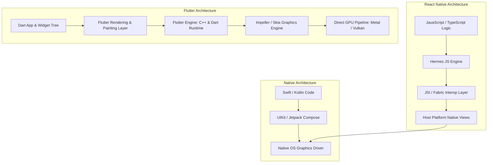

> **Correction (2026-10-28).** The earlier comparison table presented 90–95% code sharing, 60–120 FPS, a +5–10 MB footprint, and sub-500 ms hot reload as production benchmarks, but the linked references provided no reproducible app, device, build, or timing protocol for those numbers. I removed those values and replaced them with source-bounded decision guidance. Flutter’s documentation describes code reuse, frame-budget targets, Impeller’s shader strategy, hot reload behavior, and platform-specific size measurement; it does not guarantee those outcomes for every app. I also bounded the isolate, release-target, Wasm, and FFI wording to the official documentation.
{: .prompt-warning }

The central challenge of modern mobile application engineering has remained unchanged for over a decade: how can a software engineering organization deliver feature-identical, high-performance client applications across iOS, Android, and web without duplicating domain logic and engineering headcounts?

Historically, cross-platform frameworks forced teams into a severe compromise between development velocity and execution fidelity. Hybrid web-view approaches (such as Apache Cordova and early Ionic) introduced severe scrolling jank and poor gesture responsiveness. First-generation reactive bridges (such as legacy React Native) bridged JavaScript runtimes to native platform widgets over an asynchronous serialized JSON bridge, creating serialization bottlenecks during high-frequency animations.

Flutter bypasses the platform widget abstraction by bundling its own rendering engine and compiling Dart code ahead-of-time (AOT) into native machine code for release builds. This source audit examines the rendering architecture, the frame-budget guidance in Flutter's tooling, the single-threaded Dart event loop and async primitives, and the runtime trade-offs that still require measurement on a target device.


## Why Direct Canvas Rendering Displaced JavaScript Bridge Architectures?

To understand Flutter’s technical divergence, one must inspect how traditional mobile development processes fracture across native platforms.

In standard native workflows, product teams design a feature spec, which is then implemented by independent iOS (Swift/Objective-C) and Android (Kotlin/Java) teams. As UI complexity increases, maintaining behavioral parity across platform-specific layout systems (Auto Layout vs ConstraintLayout), animation curves, and lifecycle state machines becomes a recurring operational tax.


When organizations attempt to bridge this divide using multi-platform frameworks, they confront fundamental differences in rendering topology:

```
Platform Widget Architecture (React Native Legacy)
[JavaScript Runtime] ──(Async JSON Serialized Bridge)──▶ [Platform Native Views (UIView / android.view)]

Direct Hardware Rasterization (Flutter Engine)
[Dart Application & Framework] ──(C++ Engine / Skia or Impeller)──▶ [Direct GPU Hardware Context (Metal / Vulkan)]
```

React Native historically decoupled business logic from display by executing JavaScript in a dedicated V8 or Hermes thread. When a state change occurred, the virtual DOM emitted mutation descriptors serialized as JSON arrays across the bridge to the main UI thread. Under heavy touch-tracking or high-frequency scroll operations, the bridge saturated, causing frame drops even though the device's CPU and GPU were not physically maxed out.


Flutter solved this structural limitation by treating the host operating system merely as a canvas and windowing provider. Rather than asking iOS to instantiate a `UIButton` or Android to render a `MaterialButton`, Flutter paints every pixel itself. The Flutter framework builds a render tree inside Dart, passes display lists down to the underlying C++ engine, and rasterizes directly onto a low-level graphics context using Metal (iOS) or Vulkan/OpenGL (Android).

## Cross-Platform Runtime Architecture: Comparing Execution Layers

To visualize how Flutter eliminates intermediate platform layers compared to React Native and pure native development, observe the architectural hierarchy:



By owning the rendering pipeline, Flutter can make layout and painting behavior more consistent across targets, but it does not guarantee identical typography, accessibility behavior, plugin behavior, or platform integration. The official architecture overview still describes platform embedders as responsible for rendering surfaces, accessibility, input, and the operating-system event loop.

This direct-to-hardware drawing strategy mirrors the architectural philosophy of low-level graphics standards like WebGPU, as discussed in our technical deep-dive on [WebGL to WebGPU: The Architectural Evolution of Real-Time Browser Graphics](/posts/web-gl/).

## The Dart Concurrency Model: Event Loops, Microtasks, and Isolates

A common misconception among engineers first evaluating Flutter is that Dart’s single-threaded nature restricts high-throughput application logic. In reality, Dart utilizes a deterministic event loop architecture combined with shared-nothing concurrency (Isolates).

```
┌────────────────────────────────────────────────────────┐
│                   Dart Main Isolate                    │
│                                                        │
│  ┌────────────────────────┐  ┌───────────────────────┐ │
│  │    Microtask Queue     │  │      Event Queue      │ │
│  │ (Priority OS Callbacks)│  │ (I/O, Timers, Touches)│ │
│  └───────────┬────────────┘  └───────────┬───────────┘ │
│              │                           │             │
│              ▼                           ▼             │
│        Event Loop Execution (Single-Threaded Frame)    │
└────────────────────────────────────────────────────────┘
```

The Dart runtime executes within an isolated memory space called an **Isolate**, equipped with its own heap and single thread of execution. The Isolate event loop continuously drains two distinct queues:

1. **Microtask Queue**: Contains short, internal asynchronous callbacks that must execute immediately before handing control back to external events (e.g., schedule microtask invocations).
2. **Event Queue**: Handles external events, including user touch gestures, display vsync ticks, timer triggers, filesystem operations, and HTTP responses.

When long-running asynchronous I/O occurs—such as reading a database file or fetching a remote API payload—the operation is dispatched to operating system worker threads. The Dart thread immediately returns to processing the event queue without blocking:

```dart
// Idiomatic Dart asynchronous Future processing
Future<UserProfile> fetchUserProfile(String userId) async {
  // Dart yields execution back to the event loop while the network request is inflight
  final response = await httpClient.get(Uri.parse('/v1/users/$userId'));
  
  if (response.statusCode == 200) {
    return UserProfile.fromJson(jsonDecode(response.body));
  }
  throw NetworkException('Failed to load user profile: ${response.statusCode}');
}
```

For computationally heavy workloads that would otherwise starve the event loop (such as image decompression, cryptography, or heavy client-side vector search), Flutter dispatches work to independent worker Isolates using `Isolate.spawn()` or `compute()`:

```dart
// Offloading CPU-intensive processing to an isolated background thread
Future<List<ExtractedVector>> parseEmbeddingBatch(String rawPayload) async {
  return await compute(_decodeEmbeddingsInBackground, rawPayload);
}

List<ExtractedVector> _decodeEmbeddingsInBackground(String payload) {
  // Executes on a completely distinct OS thread with private memory heap
  final parsed = jsonDecode(payload) as List<dynamic>;
  return parsed.map((e) => ExtractedVector.fromList(e)).toList();
}
```

Because isolates do not share mutable memory, this model avoids shared-memory data races between isolates. Dart’s documentation describes communication through `ReceivePort` and `SendPort`, but it does not promise compile-time elimination of every race or deadlock in application logic, nor that every message is immutable.

## Why architecture alone cannot predict the migration outcome

Cross-platform adoption decisions combine rendering architecture with plugin coverage, platform APIs, team expertise, and measured app behavior. The sources below document the architecture and tooling; they do not establish a universal migration result.


## What the cited sources support—and what they do not

The earlier version of this section called the following figures “production benchmarks.” I could not trace them to a measured app, device matrix, build mode, or timing protocol in the linked references. The table therefore uses no invented percentages or sizes; it translates the sources into decisions to verify in a real project.

| Decision | Source-supported fact | Measurement or review required before choosing |
| :--- | :--- | :--- |
| Code reuse | Flutter’s architecture overview says the toolkit is designed to enable code reuse across iOS, Android, web, and desktop while allowing platform-specific integration. It does not define a universal sharing percentage. | Audit the app’s shared Dart, platform-channel, plugin, and platform-specific files per target. |
| Frame cadence | Flutter DevTools describes a 60 FPS target (~16 ms per frame) and 120 FPS on devices capable of 120 Hz. These are frame-budget targets, not a guaranteed app result. | Capture profile-mode traces on representative physical devices; test 120 Hz separately. |
| Rendering pipeline | Flutter’s Impeller documentation describes an objective of precompiling a smaller shader set and reflection offline, building pipeline state objects upfront, and controlling caching; it also documents availability by platform and version. | Check the target Flutter version, device API level, backend, and plugin compatibility; inspect jank in DevTools. |
| App size | Flutter’s size guide says the package contains code and assets and that store delivery is split by device; upload size is not end-user download size. | Compare release artifacts with `--analyze-size`, Play Console download/install reports, and iOS App Thinning reports. |
| Development loop | Hot reload injects updated Dart code, rebuilds the widget tree, and preserves state in debug mode. The docs show a 978 ms sample reload, not a universal sub-500 ms result. | Measure reload times in the project’s debug workflow and record changes that require restart. |
| React Native comparison | React Native’s New Architecture replaces the asynchronous bridge with JSI, but its docs caution that enabling it does not automatically improve every app’s performance or UX. | Benchmark the actual bottleneck and migration cost for the app instead of importing a cross-framework percentage. |

The decisive productivity feature here is Stateful Hot Reload, but it is a workflow capability rather than a universal speed benchmark. Flutter’s documentation says hot reload injects updated source into the Dart runtime, rebuilds the widget tree, and preserves app state; it works only in debug mode, and some changes require a hot restart or full restart. The docs show one sample reload of `1 of 448 libraries in 978ms`, so the earlier sub-500ms claim was not a general Flutter result. Treat reload speed as a project-specific measurement.

When transitioning to release builds, Flutter compiles native targets to target-specific machine code (for example, x64 or ARM) and compiles web targets to JavaScript. Release mode is optimized for startup, execution, and package size, with debugging disabled.

## How Impeller changes shader compilation work

Despite Flutter's structural advantages, early versions of the framework (pre-2023) suffered from an infamous performance defect: **Shader Compilation Jank**.

In Flutter’s initial architecture, the 2D graphics engine was Google’s Skia library. Skia could compile graphics shaders—programs that tell the GPU how to draw gradients, blurs, shadows, and rounded rects—when an animation first appeared on screen. Flutter’s performance guidance treats shader-compilation frames as a source of jank; the impact is workload- and device-dependent and should be measured in a trace.

```
Legacy Skia Engine (JIT Shader Compilation)
Widget Appears ──▶ First Frame Render ──▶ [JIT Shader Compile on GPU] ──▶ Shader Cache Miss ──▶ Potential Jank (measure in trace)

Modern Impeller Engine (AOT Shader Pre-compilation)
Build Time ──▶ [impellerc compiles and packages shader data] ──▶ Runtime uses the engine’s precompiled resources and explicit caches
```

To address shader compilation jank, the Flutter engineering team designed **Impeller**—a rendering runtime built around modern graphics APIs such as Metal and Vulkan. Flutter’s current documentation does not describe Impeller as the web renderer; Flutter Web currently uses Skia.

1. **Offline shader compilation (`impellerc`)**: Flutter’s Impeller documentation describes shader code and reflection being compiled offline at engine-build time, with pipeline state objects built upfront and caching controlled by the engine. That is an architectural objective for predictable performance, not a benchmark guarantee that every first-frame workload has zero runtime cost.
2. **Resource behavior**: Flutter’s documentation emphasizes instrumentable graphics resources and explicit engine-controlled caching; app-specific allocation and render-pass costs still require tracing on target devices.
3. **Render-pass cost**: The official guidance supports inspecting UI and raster timing in DevTools; it does not establish a universal allocation reduction or tile-memory gain.

Flutter’s current Impeller documentation says that, as of Flutter 3.27, Impeller is the default rendering engine on iOS and Android API 29+. On lower Android versions or devices without Vulkan support, Flutter can fall back to the legacy OpenGL renderer; Flutter Web currently uses Skia. Those availability details matter more to a platform decision than an unmeasured promise of “rock-solid” frame rates.

## How Flutter and Cross-Platform Runtimes Evolved Across 2026

Across 2025 and 2026, the cross-platform development landscape underwent an accelerated convergence driven by web assembly compilation, agentic development workflows, and embedded client interfaces.

```
2018-2022: Mobile Parity          2023-2024: Impeller Architecture   2026: Multi-Surface & AI-Native
┌─────────────────────────┐       ┌───────────────────────────┐      ┌─────────────────────────────┐
│ Flutter Web --wasm option │       │ Shader Jank Mitigation  │      │ Browser fallback path        │
│ iOS + Android Baseline  │       │ Offline Shader Work     │      │ Agentic CLI & MCP Clients   │
│ Skia 2D Rasterizer      │       │ Vulkan Backend Maturation │      │ Embedded Edge & Spatial XR  │
└─────────────────────────┘       └───────────────────────────┘      └─────────────────────────────┘
```

1. **Opt-in Wasm for Flutter Web**: Flutter’s current documentation describes WebAssembly as a web compilation target enabled with `flutter build web --wasm` (Flutter 3.24+). The build still emits JavaScript for fallback when WasmGC support is unavailable; supported browsers use `dart2wasm` with `skwasm`, while compatibility also depends on modern JS interop. This is a web deployment option, not evidence of a standardized compiler across mobile and desktop or zero-copy WebGPU rendering.
2. **AI-Native Client Architectures**: As analyzed in [CLI-Anything Agent-Native Interfaces](/posts/cli-anything-agent-native-interfaces/) and [Agentic Engineering 9 Skills](/posts/agentic-engineering-9-skills/), modern applications increasingly operate as dual-surface interfaces: serving human graphical users while simultaneously exposing programmatic tool-calling surfaces to autonomous agents. Flutter’s declarative widget architecture and Dart's strict static typing have made it a preferred framework for constructing cross-platform agent control cockpits.
3. **Direct native interop**: Dart’s `dart:ffi` library lets Dart Native applications call native C APIs. The sources here do not establish a `dart:ffi/native` library, universal zero-overhead Rust calls, or a guarantee that platform-channel serialization disappears; those integration costs remain design- and platform-dependent.

## Key Takeaways

- **Flutter-rendered content**: Flutter’s engine rasterizes its composited widget scenes, while platform embedders remain responsible for operating-system services such as accessibility, input, and rendering surfaces; embedded platform views and plugins still require target-specific review.
- **Dart concurrency boundaries**: Dart’s event loop and microtask architecture support asynchronous I/O, while memory-isolated Isolates avoid shared-memory data races between isolates; application-level race conditions still require careful design and testing.
- **Impeller’s measurable promise is architectural**: it precompiles shaders and pipeline state objects to make rendering more predictable, while actual frame timing remains app-, device-, and workload-dependent and should be profiled in profile mode.
- **Wasm is a web target, not a universal runtime**: `--wasm` enables the documented `dart2wasm`/`skwasm` path with browser feature detection and JavaScript fallback; platform-specific builds and measurements remain necessary.

## New Questions

- How will Flutter’s direct-to-canvas rendering model evolve to satisfy increasingly strict platform accessibility (a11y) standards across emerging spatial computing form factors?
- Can WasmGC-compiled Flutter web applications overcome initial cold-start binary payload penalties compared to lightweight server-rendered web frameworks?
- To what degree will AI coding agents favor Flutter’s single-file declarative widget structure over fragmented multi-file web component patterns during automated code generation?

## References

1. Flutter Documentation. (2026). *Flutter architectural overview*. https://docs.flutter.dev/resources/architectural-overview (accessed 2026-10-28).
2. Flutter Documentation. (2026). *Impeller rendering engine*. https://docs.flutter.dev/perf/impeller (accessed 2026-10-28).
3. Flutter Documentation. (2026). *Use the Performance view*. https://docs.flutter.dev/tools/devtools/performance (accessed 2026-10-28).
4. Flutter Documentation. (2026). *Hot reload*. https://docs.flutter.dev/tools/hot-reload (accessed 2026-10-28).
5. Flutter Documentation. (2026). *Flutter’s build modes*. https://docs.flutter.dev/testing/build-modes (accessed 2026-10-28).
6. Flutter Documentation. (2026). *Measuring your app’s size*. https://docs.flutter.dev/perf/app-size (accessed 2026-10-28).
7. Dart Documentation. (2026). *Concurrency in Dart*. https://dart.dev/language/concurrency (accessed 2026-10-28).
8. React Native Documentation. (2026). *About the New Architecture*. https://reactnative.dev/architecture/landing-page (accessed 2026-10-28).
9. Flutter Documentation. (2026). *Support for WebAssembly (Wasm)*. https://docs.flutter.dev/platform-integration/web/wasm (accessed 2026-10-28).
10. Dart Documentation. (2026). *C interop using dart:ffi*. https://dart.dev/interop/c-interop (accessed 2026-10-28).
