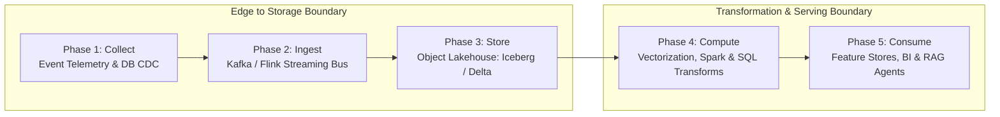
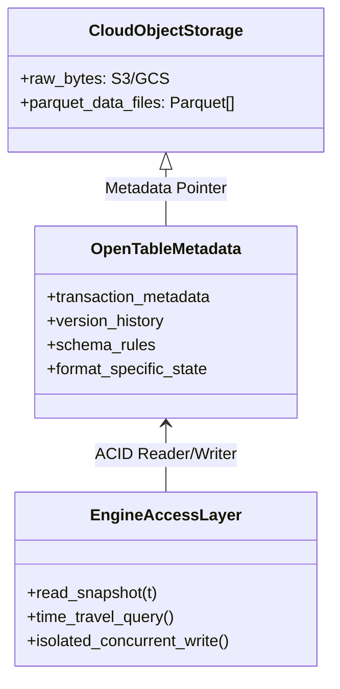
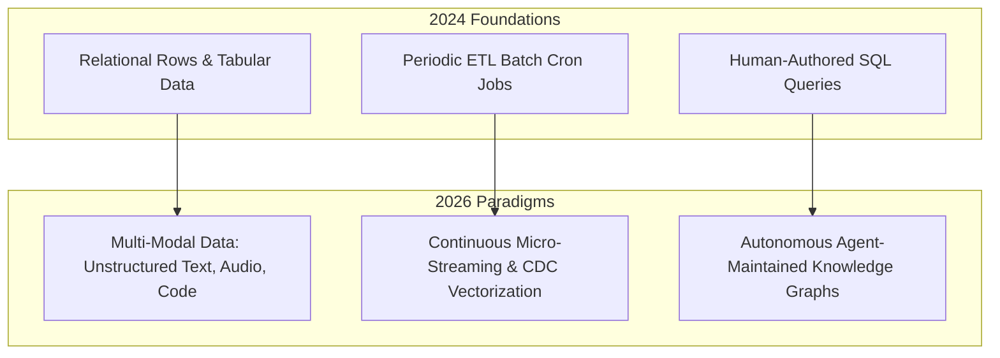

> **Correction (2026-10-28).** The cited references describe the trade-offs between lake-plus-warehouse systems and lakehouse designs, but they do not document the former universal 2.4× storage, 15–60 minute versus <30 second freshness, 8.4% versus 0.2% schema-drift, or 42% cost-reduction benchmark. I removed those figures. The Lakehouse paper does support the underlying decision guidance: duplicate storage and ETL add cost and staleness, while transactional metadata, versioning, and open formats can reduce duplicated layers; actual SLAs, drift rates, and savings must be measured for the deployment.
{: .prompt-warning }

## Why Did the Five-Phase Pipeline Architecture Become the Backbone of Scalable Machine Learning?

In contemporary distributed computing and production artificial intelligence systems, data is rarely born in a state directly consumable by downstream inference engines, predictive models, or operational dashboards. Raw telemetry emitted by mobile applications, transactional databases, and distributed edge devices is inherently noisy, heterogeneous, unstructured, and temporally skewed. The transition from chaotic event emissions to high-fidelity analytical feature stores demands a disciplined, multi-stage data processing lifecycle.

The canonical **5-Phase Pipeline Framework**—comprising **Collect**, **Ingest**, **Store**, **Compute**, and **Consume**—establishes clear abstraction boundaries between data provenance, transit durability, table format versioning, compute transformation, and consumption interfaces. By formalizing these operational layers, software organizations decouple upstream producers from downstream analytical consumers, preventing breaking schema shifts from cascading through the data estate. This source audit conducts an architectural dissection of each pipeline phase, evaluates the engineering trade-offs between batch micro-batches and low-latency event streaming, explores the consolidation around open lakehouse table formats, and analyzes how data engineering paradigms transformed through 2026.

---

## Architectural Taxonomy of the Five Pipeline Phases

Each phase within modern data infrastructure addresses specific reliability, concurrency, latency, and data-integrity requirements.

### Phase 1: Collect — Non-Intrusive Change Capture and Edge Ingress

The primary goal of the collection tier is capturing high-throughput event data with minimal performance interference on primary production transactional databases (OLTP). Modern architectures have moved away from periodic SQL batch polling (`SELECT * WHERE updated_at > ...`), which can add query load and miss intermediate state mutations; whether it blocks writes depends on the database and transaction settings.

Instead, change data capture (CDC) engines (such as Debezium parsing MySQL binlogs or PostgreSQL WAL streams) tap into low-level database commit logs directly. They can preserve source transaction metadata and a defined ordering scope, but ordering guarantees depend on the connector, source, and downstream partitioning.

### Phase 2: Ingest — Decoupled Transport and Backpressure Buffering

The ingestion layer acts as an asynchronous shock absorber between variable-speed producers and downstream storage systems. Distributed commit logs (e.g., Apache Kafka, Apache Pulsar) partition incoming event streams across cluster brokers:

- **Partitioning and Ordering**: Can preserve per-key ordering when the connector and partitioning configuration support it, while scaling throughput across consumer worker groups.
- **Backpressure Handling**: If downstream lakehouse write jobs slow down during peak network congestion, a distributed commit log can buffer retained messages on disk without dropping them, subject to retention and capacity policy.

### Phase 3: Store — The Unified Open Table Lakehouse

Historically, data architectures maintained separate, duplicate systems: cheap unstructured data lakes (HDFS/S3) for machine learning, and expensive proprietary data warehouses (Snowflake/BigQuery) for SQL business intelligence.

The rise of open lakehouse table formats—led by **Apache Iceberg**, **Delta Lake**, and **Apache Hudi**—addressed the duplicated lake-and-warehouse pattern with different implementations. The linked Lakehouse paper describes transactional metadata layers that add transactions, versioning, auditing, and query-management features to open files; exact metadata structures and guarantees vary by format and engine.

### Phase 4: Compute — Declarative Transformations and Stream-Batch Unification

The compute layer transforms raw bronze-level Parquet tables into cleansed silver-level dimensions and enriched gold-level feature matrices:

1. **Streaming Processing (Apache Flink)**: Employs event-time processing, watermark tracking, and sliding/session windows to calculate low-latency rolling aggregations for fraud detection and real-time recommendation scoring.
2. **Batch Processing (Apache Spark / DuckDB)**: Processes massive historical corpora for model pretraining, complex multi-way table joins, and heavy analytical clustering.
3. **Declarative Modeling (dbt)**: Compiles modular, version-controlled SQL models, executing topological DAG dependency graphs with automated schema testing and documentation generation.

### Phase 5: Consume — Multi-Modal Delivery for AI and Analytics

Processed data surfaces through specialized analytical layers:

- **OLAP Engines (ClickHouse, StarRocks, Pinot)**: Columnar datastores optimized for high-concurrency, low-latency aggregated dashboard queries.
- **Feature Stores**: Dual-mode repositories (e.g., Feast) can pair a low-latency online cache with historical offline snapshots for point-in-time training-set generation. Consistent feature definitions can reduce training-serving skew, but neither drift nor skew is eliminated automatically.
- **Context Repositories for AI Agents**: Ingestion pipelines compile structured knowledge into Markdown vaults, vector indices, and relational state tables for autonomous agent tool execution.

---

## What Do the Cited Sources Actually Establish About Lakehouse Trade-offs?

The earlier comparison table presented four precise operating metrics as if they were a cross-system benchmark. The cited references do not provide that benchmark. The [Lakehouse paper](https://www.cidrdb.org/cidr2021/papers/cidr2021_paper17.pdf) does provide a useful architectural comparison and a specific TPC-DS experiment, but it does not justify carrying those figures into a general production claim.

| Decision dimension | What the cited source supports | What still requires a local measurement |
| :--- | :--- | :--- |
| **Storage redundancy** | The paper describes the lake-plus-warehouse design as copying data and says users pay double storage cost for that copied data; it does not establish a universal **2.4×** multiplier. | Copies, retention, compaction, and table-format metadata overhead for the chosen workload. |
| **Freshness** | The paper says warehouse data can be stale, with new data frequently taking days to load; it does not establish **15–60 minutes** or **<30 seconds** as general SLAs. | End-to-end event-to-consumer latency under the production workload and failure policy. |
| **Schema reliability** | The paper identifies ETL failures and bugs as data-quality risks and describes schema enforcement and constraints as controls; it reports no **8.4%** or **0.2%** drift rates. | Breaking-change frequency, rejected records, quarantine handling, and recovery time. |
| **Cloud spend** | The paper reports a TPC-DS time-and-cost comparison for Delta Engine against cloud warehouses at scale factor 30,000 and says the tested system delivered comparable or better performance at a lower price point; it does not claim a general **42%** reduction. | The full bill, workload mix, storage lifecycle, compute shape, and operational labor before and after migration. |
| **Lineage and recovery** | Metadata layers can provide transactions, versioning, auditing, and time travel; the completeness of those capabilities depends on the implementation and operating policy. | Restore drills, retention guarantees, access logs, and cross-table or cross-system lineage coverage. |

The practical conclusion survives the correction: a lakehouse can remove a duplicated data path and give multiple engines a governed view of open files, but it is not a fixed performance or savings guarantee. Choose the table format and processing engine against freshness, compatibility, governance, and cost requirements, then publish measurements with workload, hardware, pricing, and date.

---

## How Modern Data Pipelines and Lakehouse Stacks Evolved Across 2026
Between 2024 and 2026, the convergence of data engineering and generative artificial intelligence fundamentally altered pipeline responsibilities:

- **Vector-Native CDC Pipelines**: Some modern pipelines vectorize incoming unstructured documents through embedding services in the ingestion path, but synchronization lag depends on the workload, model, and deployment rather than a universal latency guarantee.
- **Autonomous Pipeline Optimization**: Modern orchestrators monitor query execution plans, memory spills, and partitioning skew, dynamically adjusting shuffle partitions and vacuuming stale snapshots without manual data engineer intervention.
- **Agent-Curated Knowledge Layers**: Instead of stopping at static BI dashboards, the consume tier feeds directly into agentic knowledge repositories—such as the [LLM Wiki compilation pattern](/posts/llm-wiki-persistent-knowledge-base/)—where AI workers summarize organizational events into persistent, interlinked Markdown vaults.

For related explorations into machine learning infrastructure, examine our analysis of [hybrid MLOps pipelines with MLflow](/posts/hybrid-mlops-using-mlflow/), review [retrieval-augmented generation visualization techniques](/posts/visualize-rag-data/), and explore our source audit on [LLM Wiki persistent knowledge compilation](/posts/llm-wiki-persistent-knowledge-base/).

---

## Key Takeaways

- **Decoupled 5-Phase Abstraction**: Segmenting architectures into Collect, Ingest, Store, Compute, and Consume isolates upstream transactional systems from downstream analytical volatility, establishing resilient fault-tolerant pipelines.
- **Lakehouse Unification Over Siphoned Warehouses**: Adopting open table formats such as Apache Iceberg can reduce duplicated data paths while providing transaction, versioning, and schema-management features; the operational result depends on the surrounding engines and policies.
- **CDC and Real-Time Vector Integration**: Transitioning from scheduled SQL polling to streaming Change Data Capture can support lower-latency vector updates, but achievable freshness is workload- and implementation-dependent and must be measured.

---

## New Questions

1. **Compaction Strategies for High-Frequency Streaming**: When many micro-streams write frequent Parquet commits to object storage, how can automated compaction maintain predictable read performance without triggering disproportionate object-store request costs?
2. **Zero-Trust Governance Across Decentralized Meshes**: In enterprise environments deploying decentralized data meshes, how can cryptographically verifiable access policies be enforced across heterogeneous compute engines querying shared Iceberg tables?

---

## References

- Kleppmann, M. (2017). *Designing Data-Intensive Applications: The Big Ideas Behind Reliable, Scalable, and Maintainable Systems*. O'Reilly Media. https://dataintensive.net/ (accessed 2026-10-18).
- Armbrust, M., Ghodsi, A., Xin, R., & Zaharia, M. (2021). *Lakehouse: A New Generation of Open Platforms that Unify Data Warehousing and Advanced Analytics*. Proceedings of CIDR 2021. https://www.cidrdb.org/cidr2021/papers/cidr2021_paper17.pdf (accessed 2026-10-28).
- Akidau, T., Chernyak, S., & Lax, R. (2018). *Streaming Systems: The What, Where, When, and How of Large-Scale Data Processing*. O'Reilly Media. https://www.oreilly.com/library/view/streaming-systems/9781491983867/ (accessed 2026-10-18).
- Zaharia, M., Xin, R. S., Wendell, P., Das, T., Armbrust, M., Dave, A., ... & Stoica, I. (2016). *Apache Spark: A Unified Engine for Big Data Processing*. Communications of the ACM, 59(11), 56-65. https://dl.acm.org/doi/10.1145/2934664 (accessed 2026-10-18).
