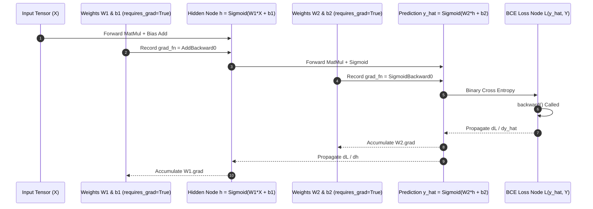

## Why Did the XOR Problem Trigger the First AI Winter?

In 1969, Marvin Minsky and Seymour Papert published their landmark mathematical treatise, *Perceptrons*. Their analysis contained a rigorous proof demonstrating that single-layer Rosenblatt perceptrons were mathematically incapable of computing the exclusive-or (XOR) boolean function. Because a single linear decision boundary $w_1 x_1 + w_2 x_2 + b = 0$ can only partition vector spaces linearly, it cannot separate coordinates $(0,0)$ and $(1,1)$ from $(0,1)$ and $(1,0)$. This mathematical limitation prompted funding agencies to withdraw research capital from connectionist neural networks, inaugurating the first "AI Winter."

The resolution to the XOR dilemma did not arrive until 1986, when Rumelhart, Hinton, and Williams formalized the backpropagation algorithm for multi-layer feedforward neural networks (MLPs). Introducing an intermediate hidden layer equipped with non-linear activation functions warps the input coordinate space: it maps non-linearly separable input points into a transformed representation space where a hyper-plane can separate the classes linearly.

Modern deep learning frameworks—most notably PyTorch—have automated this gradient calculation through tape-based dynamic Reverse-Mode Automatic Differentiation (`torch.autograd`). Understanding how PyTorch tracks computational DAGs, initialises layer weights, and navigates non-convex loss surfaces is the foundational prerequisite for mastering deep neural architectures like [Transformers and attention mechanics](/posts/study-transformer/).

```mermaid
flowchart TD
    subgraph LinearFailure["Single-Layer Perceptron (Linear Inseparability)"]
        A["Inputs: (0,0), (0,1), (1,0), (1,1)"] --> B["Linear Hyperplane: w1*x1 + w2*x2 + b"]
        B --> C["Strict Binary Classification Output"]
        C --> D["Failure: Cannot separate XOR without error"]
    end

    subgraph MultiLayerSuccess["Multi-Layer Perceptron (Non-Linear Representation)"]
        E["Inputs: x in R^2"] --> F["Hidden Layer: h = sigma(W1*x + b1)"]
        F --> G["Representation Warping (Linear Separability in R^h)"]
        G --> H["Output Layer: y = sigma(W2*h + b2)"]
        H --> I["Dynamic Autograd DAG (Backward Gradient Flow)"]
    end

    style D fill:#ffe6e6,stroke:#ff4d4d,stroke-width:2px
    style I fill:#e6ffe6,stroke:#33cc33,stroke-width:2px
```



## Mathematical Foundations of Representation Warping

To understand why multi-layer networks succeed where single perceptrons fail, consider the exact geometric transformation performed by a two-layer neural network with a hidden dimension of 2:

$$h = \sigma(W_1 x + b_1), \quad \hat{y} = \sigma(W_2 h + b_2)$$

Where $x \in \{0, 1\}^2$, $W_1 \in \mathbb{R}^{2 \times 2}$, and $W_2 \in \mathbb{R}^{1 \times 2}$.

If $\sigma$ were a linear identity function $\sigma(z) = z$, the entire network would collapse into a single linear projection:

$$\hat{y} = W_2 (W_1 x + b_1) + b_2 = (W_2 W_1)x + (W_2 b_1 + b_2) = W_{\text{eff}} x + b_{\text{eff}}$$

Because matrix multiplication is associative, any depth of purely linear layers can be simplified into a single linear layer. It is the **non-linear activation function** $\sigma$ (such as Sigmoid, ReLU, or GELU) that breaks linearity. The hidden layer maps the four input corners of the unit square into a new coordinate space where the two positive XOR points are folded together or separated from the origin, rendering them linearly separable.

### Dynamic Computational Graphs in PyTorch

PyTorch implements **Reverse-Mode Automatic Differentiation** using a tape-based dynamic graph. Unlike static graph engines (such as TensorFlow 1.x) that compile computational graphs prior to execution, PyTorch constructs the Directed Acyclic Graph (DAG) imperatively during the forward pass:

1. **Leaf Tensors**: Tensors initialized by the user with `requires_grad=True` (such as weight matrices $W_1$ and bias vectors $b_1$) act as graph leaves.
2. **Execution Nodes**: Every mathematical operation applied to a `requires_grad` tensor generates a `Node` object encapsulating the forward operator and its corresponding vector-Jacobian product (VJP) backward kernel.
3. **Backward Traversal**: Calling `loss.backward()` triggers an topological sort traversal from the scalar loss node back to the leaf tensors, accumulating partial derivatives $\frac{\partial \mathcal{L}}{\partial W_i}$ into `tensor.grad` fields via the chain rule:

$$\frac{\partial \mathcal{L}}{\partial W_1} = \frac{\partial \mathcal{L}}{\partial \hat{y}} \cdot \frac{\partial \hat{y}}{\partial h} \cdot \frac{\partial h}{\partial z_1} \cdot \frac{\partial z_1}{\partial W_1}$$



### Weight Initialization and Local Minima Dynamics

Even in toy problems like XOR, training neural networks from scratch exposes optimization hurdles:
- **Zero Initialization Pitfall**: If weights are initialized to zeros ($W_1 = 0, W_2 = 0$), all hidden neurons receive identical activation values and compute identical gradients during backpropagation. This creates **symmetry trapping**, preventing the neurons from differentiating into complementary feature detectors.
- **Xavier / Glorot Initialization**: To maintain variance of activations and backpropagated gradients throughout deep layers, weights must be sampled from distributions scaled by fan-in and fan-out:
  $$W \sim \mathcal{N}\left(0, \frac{2}{n_{\text{in}} + n_{\text{out}}}\right)$$
- **Saddle Points and Local Minima**: The loss surface of an XOR MLP contains saddle points where gradient norms vanish ($\nabla \mathcal{L} \approx 0$). Using momentum-based optimizers like Adam or SGD with Nesterov momentum accelerates escape from plateau regions, as detailed in [rigorous machine learning systems interview principles](/posts/machine-learning-interview-questions/).

## How Non-Linear Activation Functions Evolved Across 2026

Throughout the history of neural networks and leading into 2026, the choice of activation function has undergone systematic refinement to support extreme network depths:

1. **Sigmoid and Tanh (1986–2010)**: Saturated activation functions $\sigma(z) = \frac{1}{1 + e^{-z}}$ suffered from the vanishing gradient problem. When $|z| \gg 0$, the derivative $\sigma'(z) \approx 0$, which halts backpropagation when multiplied across more than three layers.
2. **ReLU and Leaky ReLU (2011–2018)**: Rectified Linear Units $\text{ReLU}(z) = \max(0, z)$ revolutionized computer vision and early NLP by providing a constant gradient of 1 for positive inputs, eliminating vanishing gradients. However, negative activations caused neurons to "die" permanently if pushed into negative regimes.
3. **GELU and Swish (2019–2023)**: Gaussian Error Linear Units ($\text{GELU}(z) = z \cdot \Phi(z)$) introduced probabilistic regularization by smoothly dampening negative values rather than hard-clipping them at zero, becoming the standard in BERT, GPT-3, and LLaMA architectures.
4. **SwiGLU and Gated Linear Units (2024–2026)**: Frontier architectures (such as LLaMA-3, DeepSeek-V3, and Gemma) universally adopted Gated Linear Units with Swish activations ($\text{SwiGLU}(x) = \text{Swish}(x W_g) \odot (x W_u)$). Gating allows the network to dynamically scale information flow across hidden dimensions, accelerating convergence on non-linear reasoning benchmarks, directly aligned with [LLM optimization methodologies](/posts/improving-the-performance-llm/) and [statistical evaluation principles](/posts/essential-statistical-concepts-must-know/).

## Practical Implementation: Solving XOR from First Principles in PyTorch

To understand PyTorch's dynamic autograd engine without hiding behind high-level abstraction wrappers, the following implementation constructs an MLP using raw `torch.Tensor` leaves, explicit gradient steps, and Xavier normal initialization:

```python
"""
xor_autograd_audit.py - Solving non-linear XOR using PyTorch dynamic autograd from scratch.
"""

import torch
import torch.nn.functional as F


def solve_xor_from_scratch(learning_rate: float = 0.5, epochs: int = 5000):
    """
    Demonstrates manual autograd mechanics, Xavier initialization, and non-linear separability.
    """
    # 1. XOR input truth table and binary classification targets
    X = torch.tensor([[0.0, 0.0], [0.0, 1.0], [1.0, 0.0], [1.0, 1.0]], dtype=torch.float32)
    Y = torch.tensor([[0.0], [1.0], [1.0], [0.0]], dtype=torch.float32)

    # 2. Initialize weights using Xavier Normal distribution to prevent symmetry trapping
    torch.manual_seed(42)
    hidden_dim = 4

    W1 = torch.empty(2, hidden_dim, requires_grad=True)
    b1 = torch.zeros(1, hidden_dim, requires_grad=True)
    torch.nn.init.xavier_normal_(W1)

    W2 = torch.empty(hidden_dim, 1, requires_grad=True)
    b2 = torch.zeros(1, 1, requires_grad=True)
    torch.nn.init.xavier_normal_(W2)

    print("Initial W1 Weights:\n", W1.data)

    # 3. Optimization training loop
    for epoch in range(1, epochs + 1):
        # Forward pass: Non-linear representation transformation
        hidden = torch.sigmoid(torch.matmul(X, W1) + b1)
        predictions = torch.sigmoid(torch.matmul(hidden, W2) + b2)

        # Binary Cross Entropy Loss
        loss = F.binary_cross_entropy(predictions, Y)

        # Backward pass: Compute exact partial derivatives via autograd graph
        loss.backward()

        # Parameter update via manual SGD (in-place operation inside no_grad context)
        with torch.no_grad():
            W1 -= learning_rate * W1.grad
            b1 -= learning_rate * b1.grad
            W2 -= learning_rate * W2.grad
            b2 -= learning_rate * b2.grad

            # Zero accumulated gradients before the next iteration
            W1.grad.zero_()
            b1.grad.zero_()
            W2.grad.zero_()
            b2.grad.zero_()

        if epoch % 1000 == 0 or epoch == epochs:
            binary_preds = (predictions >= 0.5).float()
            accuracy = (binary_preds == Y).float().mean().item()
            print(f"Epoch {epoch:4d} | Loss: {loss.item():.5f} | Accuracy: {accuracy * 100:.1f}%")

    print("\nFinal Learned Predictions vs Targets:")
    for i in range(len(X)):
        print(f"  Input: {X[i].tolist()} -> Target: {Y[i].item()} | Predicted: {predictions[i].item():.4f}")


if __name__ == "__main__":
    solve_xor_from_scratch()
```

Inspecting the gradient tape manually reveals how non-linear activations warp the geometric feature space, transforming an intractable single-layer failure into a cleanly convergent optimization problem.

## Key Takeaways

- **Linear Decision Boundaries Cannot Solve XOR**: Minsky and Papert's 1969 proof showed that single-layer perceptrons fail on non-linearly separable truth tables, demonstrating the mathematical necessity of hidden layers.
- **Hidden Non-Linearity Warps Geometry**: Multiple linear layers collapse into a single linear projection without non-linear activations. Non-linear activation functions warp input coordinates, rendering features linearly separable.
- **Dynamic Autograd Tracks DAGs Imperatively**: PyTorch builds computational directed acyclic graphs on the fly during the forward pass, using Reverse-Mode Automatic Differentiation to compute exact vector-Jacobian products.
- **Symmetry Breaking Demands Scaled Initialization**: Zero weight initialization traps neurons in identical gradients. Xavier/Glorot normal initialization breaks symmetry and stabilizes gradient magnitudes across layer boundaries.
- **Modern LLMs Standardized on Gated Activations**: The progression from Sigmoid to ReLU, GELU, and SwiGLU reflects the architectural requirement to maintain non-vanishing gradient flow across hundreds of transformer layers.

## New Questions

- How do loss surface saddles in over-parameterized deep networks differ geometrically from local minima in low-dimensional toy problems like XOR?
- What are the mathematical trade-offs between dynamic tape-based autograd (PyTorch) and static XLA graph compilation (JAX) in distributed training throughput?
- Can zero-order optimization methods (such as evolutionary strategies or forward-gradient estimation) solve non-linear separability without backpropagating gradients?
- How does weight quantization (e.g., ternary 1.58-bit BitNet weights) constrain the representational capacity of non-linear activations in multi-layer perceptrons?

## References

- Glorot, X., & Bengio, Y. (2010). *Understanding the difficulty of training deep feedforward neural networks*. Proceedings of the Thirteenth International Conference on Artificial Intelligence and Statistics (AISTATS 2010). URL: [https://proceedings.mlr.press/v9/glorot10a.html](https://proceedings.mlr.press/v9/glorot10a.html) (accessed 2026-10-18).
- Minsky, M., & Papert, S. (1969). *Perceptrons: An Introduction to Computational Geometry*. MIT Press. URL: [https://mitpress.mit.edu/9780262631111/perceptrons/](https://mitpress.mit.edu/9780262631111/perceptrons/) (accessed 2026-10-18).
- Paszke, A., Gross, S., Massa, F., Lerer, A., Bradbury, J., Chanan, G., Killeen, T., Lin, Z., Gimelshein, N., Antiga, L., Desmaison, A., Kopf, A., Yang, E., DeVito, Z., Raison, M., Tejani, A., Chilamkurthy, S., Steiner, B., Fang, L., ... Chintala, S. (2019). *PyTorch: An Imperative Style, High-Performance Deep Learning Library*. Advances in Neural Information Processing Systems (NeurIPS 2019). URL: [https://arxiv.org/abs/1912.01703](https://arxiv.org/abs/1912.01703) (accessed 2026-10-18).
- Rumelhart, D. E., Hinton, G. E., & Williams, R. J. (1986). *Learning representations by back-propagating errors*. Nature, 323(6088), 533-536. URL: [https://doi.org/10.1038/323533a0](https://doi.org/10.1038/323533a0) (accessed 2026-10-18).
