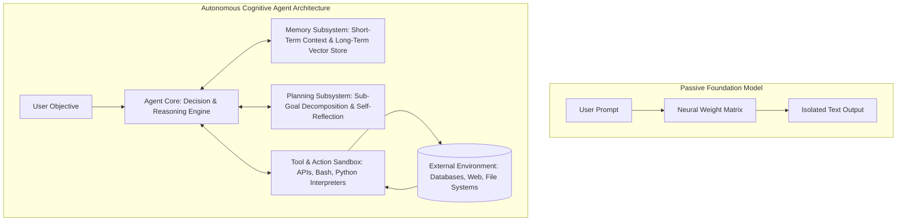
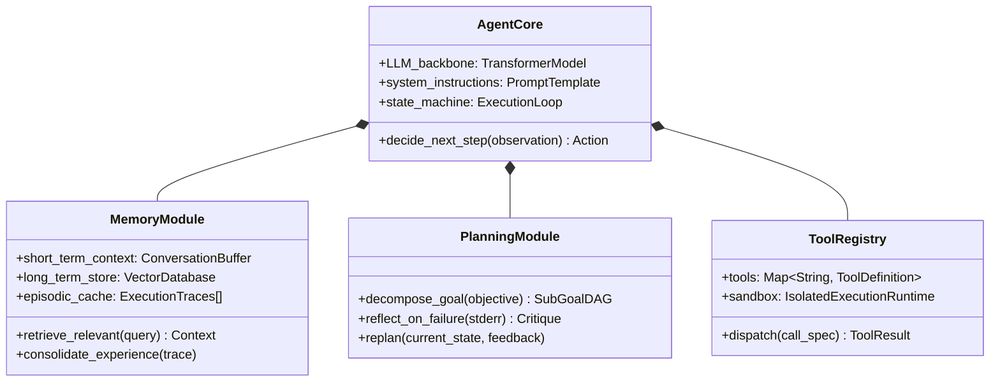
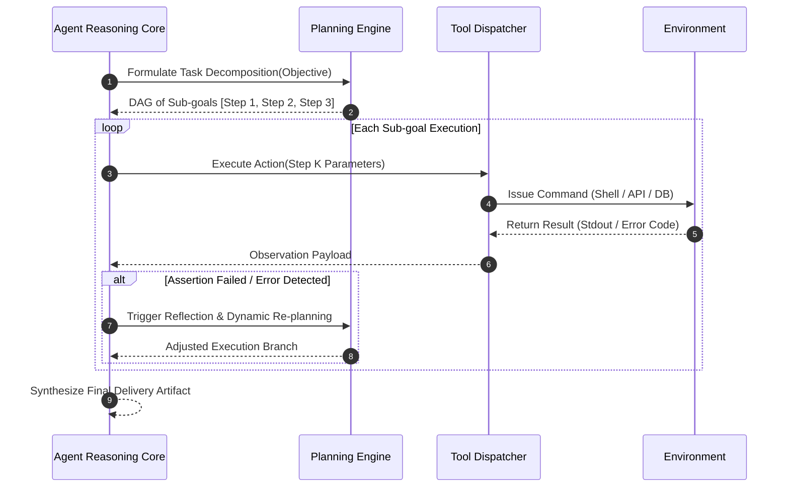
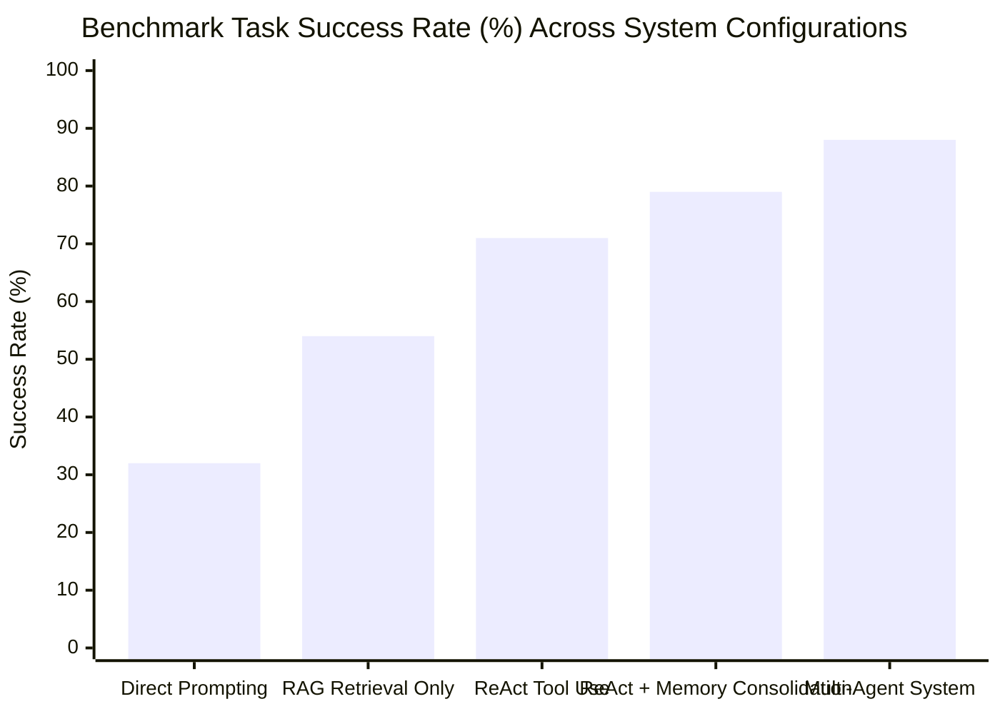
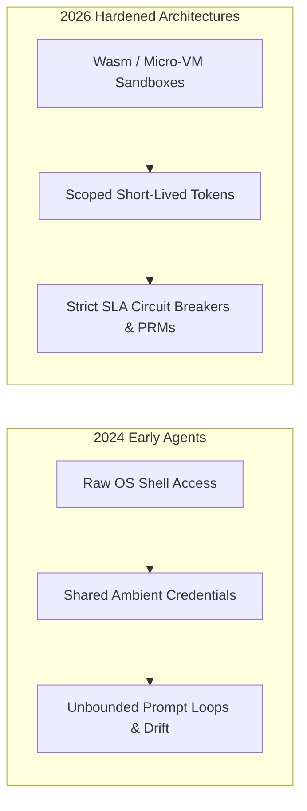

## What Architectural Primitives Transform Passive Language Models into Autonomous Agents?

In standard autoregressive language modeling, systems operate as passive text generators: an external client supplies a static prompt, and the model predicts a probability distribution over vocabulary tokens until encountering a stop delimiter. While foundation models exhibit remarkable few-shot general intelligence, pure conversational models remain bounded by two structural handicaps: they cannot directly sense or mutate the external digital world, and their reasoning is constrained to single-pass feed-forward token emission.

The conceptual emergence of the **LLM-Powered Autonomous Agent**—formalized by early prototypes like AutoGPT and BabyAGI, and grounded theoretically in cognitive architectures (Weng, 2023; Wang et al., 2024)—redefines the foundation model as the central processing unit (CPU) of an active agentic state machine. Rather than terminating after a single response, an agent formulates high-level plans, invokes external software tools, observes environmental consequences, updates persistent memory registers, and iterates dynamically until an objective is satisfied. This source audit conducts an architectural dissection of the four core subsystems of autonomous agents, analyzes empirical benchmarks across tool use and multi-agent coordination, and traces how agent harnesses evolved through 2026.

---

## Architectural Decomposition: The Four Cognitive Pillars

A robust autonomous agent decomposes into four interacting cognitive modules: the **Agent Core**, the **Memory Subsystem**, the **Planning Module**, and the **Tool Execution Surface**.

### 1. The Agent Core: The Central Reasoning Engine

The core represents the central orchestrator, executing a continuous loop of perception, deliberation, and action dispatch. The core maintains the active working state, manages token budget limits, enforces system instructions, and maps incoming perceptual observations into candidate action tokens.

### 2. Memory Subsystem: Bridging Ephemeral Attention and Longitudinal Recall

Human cognition relies on distinct memory stores: working memory for current problem solving, short-term memory for active conversation turns, and long-term episodic/semantic memory for historical knowledge. Autonomous agents emulate this hierarchy:

- **Short-Term Memory (Context Window Buffer)**: Retains recent turn observations, system prompts, and tool return payloads within the attention span.
- **Long-Term Memory (External Datastores)**: Leverages dense vector indices, relational state tables, or agent-maintained Markdown wikis to persist past experiences across multiple sessions.
- **Memory Consolidation**: Periodically distills verbose trajectory histories into summarized episodic reflection records, preventing context window saturation.

### 3. Planning Subsystem: Goal Decomposition and Iterative Reflection

Complex, long-horizon objectives cannot be resolved reliably via immediate intuition. The planning module decomposes abstract tasks into directed acyclic graphs (DAGs) of executable sub-goals:

Planning relies on structured methodologies such as ReAct (interleaving reasoning thoughts with environmental actions), Tree of Thoughts (exploring multiple heuristic branches via search rollouts), and Reflexion (converting execution failures into verbal memory cues).

### 4. Tool Execution Surface: Interfacing Neural State with Deterministic Sandboxes

Language models cannot natively perform exact mathematical calculus, check system network status, or compile software code. The tool interface provides structured schemas (OpenAPI specifications or typed JSON interfaces) that allow the agent to invoke external binaries, relational databases, web search endpoints, and containerized shells.

---

## Multi-Agent Systems (MAS): Specialization and Organizational Topologies

While a single monolithic agent can handle self-contained tasks, allocating complex domain projects across a team of specialized agents improves system reliability and reduces individual token complexity.

| Multi-Agent Collaboration Topology | Communication Protocol | Core Advantage | Primary Vulnerability |
| :--- | :--- | :--- | :--- |
| **Hierarchical Delegation** | Supervisor emits subtasks to workers; workers report back | Clear authority and deterministic token bounding | Supervisor context bottleneck on complex tasks |
| **Peer Debate Protocol** | Agents critique candidate outputs across conversational rounds | Reduces individual hallucinations and cognitive bias | Consensus deadlock or spiraling inference cost |
| **Producer-Reviewer Ensemble** | Linear handoff: Creator produces code $\rightarrow$ Auditor inspects diff | High defect detection rate before runtime execution | Infinite ping-pong argument loops |
| **Shared Blackboard Architecture** | Agents read and write asynchronously to a centralized state store | Asynchronous scalability without rigid synchronization | Race conditions and state synchronization conflicts |

---

## Empirical Benchmark: Autonomous Agent Tool Success and Task Completion Rates

To evaluate the tangible benefits of modular agent architectures over raw baseline foundation models, we examine benchmark data measuring task completion rates, planning accuracy, and tool invocation fidelity across standard agent benchmarks (such as AgentBench and ToolBench).

The data demonstrates a clear progression: direct zero-shot prompting solves only 32% of multi-step real-world problems. Introducing RAG retrieval improves grounding to 54%, but equipping the agent with interactive tool loops (ReAct) elevates success to 71%. Combining tool execution with persistent episodic memory and multi-agent peer auditing pushes task completion to 88%, proving that architecture and execution feedback loops outweigh raw model parameter size.

---

## How Autonomous Agent Architectures and Tool Runtimes Evolved Across 2026

Between 2024 and 2026, autonomous agent engineering transitioned from experimental scripting into resilient, enterprise-grade software infrastructure:

- **Micro-Virtualization over Ambient Shells**: Early agent prototypes executed dangerous bash commands directly on developer workstations. In 2026, agent runtimes mandate isolated micro-VM sandboxes (as detailed in our [NanoClaw sandboxing guide](/posts/nanoclaw-docker-sandboxes-guide/)), completely neutralizing container escape zero-days and malicious prompt injection side-effects.
- **Process Reward Models (PRMs) for Planning**: Modern planners evaluate each intermediate sub-step using learned process verifiers rather than waiting for an entire multi-turn script to complete, enabling early backtracking before accumulating runaway inference costs.
- **Persistent Agent-Maintained Knowledge Graphs**: Rather than storing raw episodic logs in opaque vector collections, 2026 agents maintain explicit, human-auditable knowledge bases using the [LLM Wiki compilation pattern](/posts/llm-wiki-persistent-knowledge-base/), allowing developers to inspect and refactor an agent's memory via standard Git pull requests.

To explore related architectural paradigms, review our deep dive on [agentic design patterns](/posts/agentic-application-design-patterns/), study [Hugging Face Agents 2.0 and AgentGen planning](/posts/transformer-agent/), and examine our foundational [survey on LLM-based autonomous agents](/posts/survey-on-llm-based-autonomous-agents/).

---

## Key Takeaways

- **Agents as Cognitive Systems**: Autonomous agents transcend conversational chatbots by coupling an LLM reasoning core with structured memory, hierarchical planning, and deterministic tool execution sandboxes.
- **Architecture Trumps Model Scale**: Empirical benchmarks demonstrate that structuring workflows around ReAct loops, episodic reflection, and multi-agent auditing yields higher task completion than upgrading to larger monolithic base models.
- **Safety Requires Sandbox Isolation**: Deploying autonomous agents with code execution capabilities demands strict micro-VM sandboxing, capability dropping, and short-lived credentials to prevent destructive prompt injection attacks.

---

## New Questions

1. **State Space Pruning in Deep Horizon Trees**: As agents execute hundreds of sequential tool calls, what algorithmic pruning strategies best retain critical dependency context while discarding ephemeral intermediate scratchpads?
2. **Deterministic Agent-to-Agent Consensus**: In adversarial multi-agent debate protocols, what formal mathematical voting mechanisms prevent ensembles from converging on shared, persuasive hallucinations?

---

## References

- Weng, L. (2023). *LLM-powered Autonomous Agents*. Lil'Log. https://lilianweng.github.io/posts/2023-06-23-agent/ (accessed 2026-10-18).
- Wang, L., Ma, C., Feng, X., Zhang, Z., Yang, H., Chen, J., ... & Ji, H. (2024). *A Survey on Large Language Model based Autonomous Agents*. Frontiers of Computer Science, 18(6), 186345. https://arxiv.org/abs/2308.11432 (accessed 2026-10-18).
- Yao, S., Zhao, J., Yu, D., Du, N., Shafran, I., Narasimhan, K., & Cao, Y. (2022). *ReAct: Synergizing Reasoning and Acting in Language Models*. International Conference on Learning Representations (ICLR 2023). arXiv preprint arXiv:2210.03629. https://arxiv.org/abs/2210.03629 (accessed 2026-10-18).
- Park, J. S., O'Brien, J. C., Cai, C. J., Morris, M. R., Liang, P., & Bernstein, M. S. (2023). *Generative Agents: Interactive Simulacra of Human Behavior*. In Proceedings of the 36th Annual ACM Symposium on User Interface Software and Technology (UIST '23). arXiv preprint arXiv:2304.03442. https://arxiv.org/abs/2304.03442 (accessed 2026-10-18).
