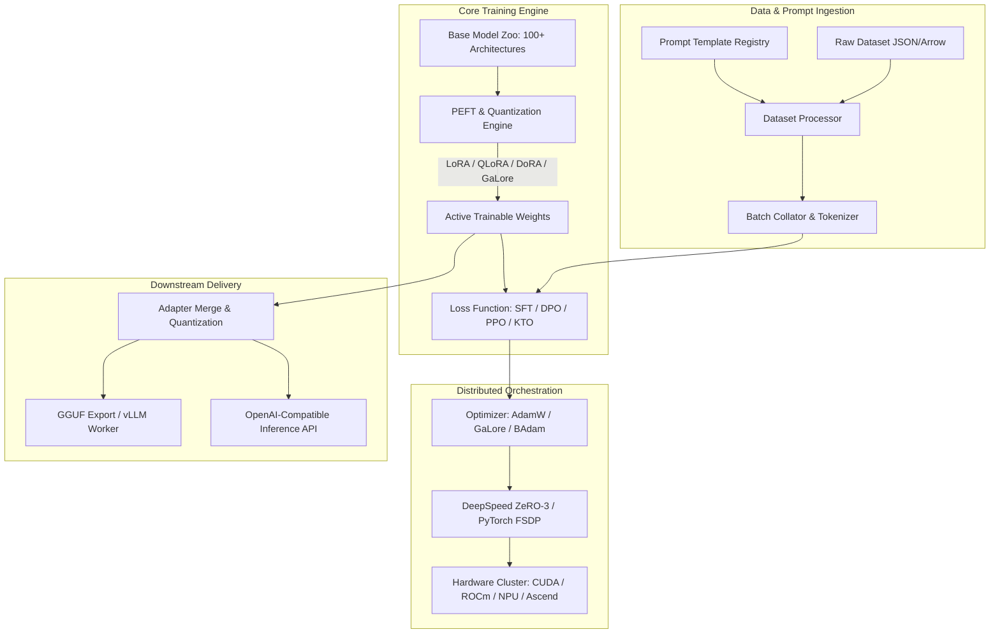

The open-source generative AI ecosystem has experienced unprecedented proliferation in model architectures. Between 2023 and 2026, researchers and enterprise engineering teams saw releases of foundational checkpoints spanning LLaMA, Mistral, Mixtral, Qwen, DeepSeek, Gemma, and Command-R. However, this architectural diversity produced severe operational friction in post-training workflows.

Each model family historically arrived with bespoke tokenization schemes, distinct rotary position embedding (RoPE) scalings, incompatible attention masks, and disparate prompt templates. Machine learning practitioners attempting to fine-tune multiple model families were forced to write and maintain brittle, fragmented training scripts across multiple disparate libraries.

LLaMA-Factory, introduced by Yaowei Zheng and collaborators in 2024, emerged as the definitive open-source post-training framework designed to eliminate this fragmentation. By constructing an extensible unified abstraction layer over Hugging Face Transformers, PEFT, DeepSpeed, and vLLM, LLaMA-Factory enables practitioners to train, align, evaluate, and serve more than 100 open language models through standardized command-line and declarative configurations.


## How Does Unified Abstraction Eliminate Framework Fragmentation in Post-Training?

The core architectural innovation of LLaMA-Factory is its **decoupled modular design**. Rather than treating model architectures, fine-tuning techniques, and hardware optimization strategies as tightly coupled scripts, the framework decouples them into distinct orthogonal layers.

Consider the matrix of decisions involved in modern LLM post-training:
1. **Target Model**: Dense decoder vs Mixture-of-Experts (MoE) vs Vision-Language Model (VLM).
2. **Training Objective**: Pre-training, Supervised Fine-Tuning (SFT), Direct Preference Optimization (DPO), Proximal Policy Optimization (PPO), or Kahneman-Tversky Optimization (KTO).
3. **Parameter Efficiency**: Full parameter tuning, Freeze tuning, LoRA, QLoRA, DoRA, or GaLore.
4. **Hardware Distribution**: Single-GPU, DeepSpeed ZeRO-2/ZeRO-3, or PyTorch Fully Sharded Data Parallel (FSDP).

```
Traditional Training Scripts (Combinatorial Explosion)
[LLaMA-3 SFT Script]   [Mistral DPO Script]   [Qwen QLoRA Script]   [DeepSeek MoE Script]
(Brittle, Redundant, Maintenance Nightmare)

LLaMA-Factory Unified Engine Architecture
┌────────────────────────────────────────────────────────────────────────┐
│ Model & Tokenizer Loader (Standardized Template & RoPE Registry)       │
├────────────────────────────────────────────────────────────────────────┤
│ Optimization Engine: SFT | Reward Modeling | PPO | DPO | ORPO | KTO    │
├────────────────────────────────────────────────────────────────────────┤
│ PEFT & Acceleration: LoRA | QLoRA | DoRA | GaLore | FlashAttention-2   │
├────────────────────────────────────────────────────────────────────────┤
│ Execution & Serving: DeepSpeed ZeRO | FSDP | LlamaBoard | vLLM Engine  │
└────────────────────────────────────────────────────────────────────────┘
```

By isolating these layers behind standard programmatic interfaces, swapping the underlying base model from `meta-llama/Meta-Llama-3-8B-Instruct` to `Qwen/Qwen2.5-7B-Instruct` or changing the alignment objective from SFT to DPO requires modifying only two lines in a YAML specification file, without altering a single line of training logic.

## The Architectural Topology of LLaMA-Factory

To trace how data and gradients flow through the framework during post-training, examine the end-to-end execution pipeline:



The system is organized into four discrete operational stages:

1. **Prompt Template Registry**: Large language models vary drastically in their special tokens (e.g., `<|im_start|>`, `<|start_header_id|>`, `[INST]`). LLaMA-Factory maintains an exhaustive registry of chat templates. When configuring a dataset, practitioners specify a template name, and the collator automatically manages system prompt insertion, role demarcation, and loss masking across conversational turns.
2. **Gradient and Memory Optimization**: For parameter-efficient training, LLaMA-Factory integrates state-of-the-art PEFT adapters. It supports 4-bit and 8-bit quantization through BitsAndBytes, dynamic weight-decomposed adaptation (DoRA), and gradient low-rank projection (GaLore).
3. **Loss Computation and Alignment**: The objective layer implements both traditional supervised cross-entropy losses and modern implicit preference objectives. In DPO or ORPO, the loss function processes paired chosen and rejected token sequences simultaneously, computing relative log probability ratios without requiring an explicit reward model.
4. **Export and Serving**: Once post-training concludes, adapters can be dynamically merged back into the base weights, converted to GGUF or AWQ formats, and served via an integrated vLLM worker exposing OpenAI-compatible endpoints.

This seamless handoff from training to serving complements the local API paradigms explored in our guide on [Unsloth Local API Guide: Run Claude/OpenAI-Style Clients on Your Own Machine](/posts/unsloth-local-api-guide/).

## Comparative Analysis: Tuning Methods and Memory Footprints

Selecting the optimal fine-tuning strategy requires balancing memory bounds against mathematical fidelity. LLaMA-Factory supports the full spectrum of adaptation methodologies:

| Tuning Methodology | Trainable Parameters | VRAM Requirement (7B Model) | Training Speed | Mathematical Formulation |
| :--- | :--- | :--- | :--- | :--- |
| **Full Parameter Tuning** | 100% | ~56 GB – 80 GB (ZeRO-3) | 1.0x Baseline | $W = W_0 + \Delta W$ (Direct update) |
| **Freeze Tuning** | ~5% – 15% | ~24 GB – 32 GB | 1.2x | Fine-tunes subset of top transformer layers |
| **LoRA (Low-Rank)** | ~0.1% – 1.0% | ~16 GB – 20 GB | 1.4x | $W = W_0 + \frac{\alpha}{r} B \cdot A$ ($A \in \mathbb{R}^{r \times d}, B \in \mathbb{R}^{d \times r}$) |
| **QLoRA (4-bit)** | ~0.1% – 1.0% | ~6 GB – 10 GB | 0.9x | NF4 quantized base + FP16 LoRA adapters |
| **DoRA (Decomposed)** | ~0.1% – 1.0% | ~16 GB – 20 GB | 1.2x | Decouples magnitude $m$ and directional matrix $V$ |
| **GaLore (Gradient Low-Rank)** | 100% | ~18 GB – 24 GB | 0.8x | Projects optimizer states into low-rank subspace |

As evidenced in empirical benchmarks, QLoRA enables fine-tuning an 8-billion parameter model on a single consumer GPU with 12GB–16GB VRAM, while GaLore allows full-parameter optimization of 7B models on 24GB GPUs by projecting Adam's first and second moment states into compact low-rank subspaces.

## Production Configuration: SFT and DPO Implementation

LLaMA-Factory provides both an interactive web GUI (**LlamaBoard**) and a declarative YAML execution runner. In production CI/CD pipelines, declarative YAML configs are preferred for reproducibility.

### 1. Supervised Fine-Tuning (SFT) Configuration

Below is an enterprise-grade configuration fine-tuning Llama-3-8B-Instruct with QLoRA on domain instruction datasets:

```yaml
# configs/llama3_qlora_sft.yaml
model_name_or_path: meta-llama/Meta-Llama-3-8B-Instruct
template: llama3
stage: sft
do_train: true
finetuning_type: lora
lora_target: all
lora_rank: 16
lora_alpha: 32
lora_dropout: 0.05
quantization_bit: 4

dataset: enterprise_code_instructions
dataset_dir: data
cutoff_len: 4096
max_samples: 50000
overwrite_cache: true

output_dir: saves/llama3-8b/qlora/sft
logging_steps: 10
save_steps: 500
plot_loss: true
learning_rate: 2.0e-4
num_train_epochs: 3.0
per_device_train_batch_size: 4
gradient_accumulation_steps: 8
lr_scheduler_type: cosine
warmup_ratio: 0.1
fp16: true

flash_attn: fa2
report_to: wandb
```

Execute training via the CLI orchestrator:

```bash
llamafactory-cli train configs/llama3_qlora_sft.yaml
```

### 2. Direct Preference Optimization (DPO) Configuration

Following initial instruction tuning, models are aligned with human preferences to reduce hallucination and enhance adherence to output schemas. Rather than training complex reinforcement learning reward models (PPO), DPO optimizes policy probabilities directly:

```yaml
# configs/llama3_dpo_alignment.yaml
model_name_or_path: saves/llama3-8b/qlora/sft
adapter_name_or_path: saves/llama3-8b/qlora/sft
template: llama3
stage: dpo
do_train: true
finetuning_type: lora
lora_target: all
pref_beta: 0.1
pref_loss: sigmoid

dataset: preference_pairs_v2
dataset_dir: data
cutoff_len: 2048
output_dir: saves/llama3-8b/dpo_aligned
learning_rate: 5.0e-6
num_train_epochs: 2.0
per_device_train_batch_size: 2
gradient_accumulation_steps: 16
fp16: true
```

The mathematical foundation of DPO derives from the Bradley-Terry preference model:

$$\mathcal{L}_{\text{DPO}}(\pi_\theta; \pi_{\text{ref}}) = -\mathbb{E}_{(x, y_w, y_l)} \left[ \log \sigma \left( \beta \log \frac{\pi_\theta(y_w|x)}{\pi_{\text{ref}}(y_w|x)} - \beta \log \frac{\pi_\theta(y_l|x)}{\pi_{\text{ref}}(y_l|x)} \right) \right]$$

LLaMA-Factory transparently manages the frozen reference model ($\pi_{\text{ref}}$) in memory by leveraging the same base weights while dynamically toggling LoRA adapter weights, completely avoiding the need to load duplicate model weights into GPU VRAM.

These alignment patterns tie directly into the broader inference and optimization techniques analyzed in [LLM Inference Patterns](/posts/llm-inference-patterns/).

## How LLaMA-Factory and Post-Training Frameworks Evolved Across 2026

Throughout 2024 to 2026, the machine learning industry transitioned from prompt engineering toward disciplined post-training and specialized domain alignment.

```
2024: Architecture Consolidation  2025: Alignment Diversification   2026: Reasoning Models & GRPO
┌───────────────────────────────┐ ┌───────────────────────────────┐ ┌───────────────────────────────┐
│ LLaMA-Factory 0.1 - 0.5       │ │ DeepSpeed & FSDP-2 Scaling    │ │ Group Relative Policy (GRPO) │
│ 100+ Base Models Supported    │─▶ Unsloth Kernel Integration    │─▶ Multimodal Vision Alignment  │
│ LoRA / QLoRA Standardization  │ │ DPO / ORPO / SimPO Emergence  │ │ Automated Agent Rollout Eval │
└───────────────────────────────┘ └───────────────────────────────┘ └───────────────────────────────┘
```

1. **Integration of Reasoning Alignment (GRPO)**: Following the breakthrough of DeepSeek-R1 in early 2025, post-training shifted from static pairwise preference tuning toward Group Relative Policy Optimization (GRPO). LLaMA-Factory incorporated native GRPO loops, enabling models to generate multiple reasoning traces and optimize verification rewards (such as mathematical correctness or unit test passes) without requiring a separate critic model.
2. **First-Class Multimodal Vision Fine-Tuning**: As multimodal foundation models became ubiquitous, LLaMA-Factory expanded its template abstraction to visual tokens. Architectures like Qwen2-VL, Llama-3.2-Vision, and InternVL can be fine-tuned using identical PEFT and DPO pipelines, aligning both image projection layers and language backbones simultaneously.
3. **Native Agent Tuning Harnesses**: Enterprise users increasingly tune foundation models for agentic tool use, as detailed in our analysis of [Agentic Engineering 9 Skills](/posts/agentic-engineering-9-skills/). LLaMA-Factory integrated synthetic multi-turn tool-call generators and environment step penalizers, ensuring that fine-tuned checkpoints reliably format tool calls and recover from runtime execution errors.

## Key Takeaways

- **Unified Architectural Surface**: LLaMA-Factory abstracts over 100+ model families, eliminating bespoke tokenization, RoPE scaling, and template scripts in favor of standardized declarative configs.
- **Resource Democratization**: By integrating QLoRA, DoRA, and GaLore alongside DeepSpeed ZeRO-3, the framework allows 8B parameter models to be fine-tuned on single consumer GPUs and 70B models on modest multi-GPU nodes.
- **Full Alignment Lifecycle**: Covers the complete post-training continuum—from domain pre-training and supervised fine-tuning (SFT) to preference alignment (DPO, KTO, GRPO) and direct vLLM deployment.
- **Production Reproducibility**: Declarative YAML workflows bridge the gap between experimental GUI prototyping (LlamaBoard) and automated enterprise MLOps pipelines.

## New Questions

- How do memory consumption and communication overhead scale in GaLore low-rank optimizer projections when scaling across multi-node clusters compared to traditional ZeRO-3?
- What are the sample-efficiency boundaries of GRPO verification loops when applied to fuzzy, non-deterministic tasks beyond formal mathematics and software unit tests?
- As foundation models increasingly integrate long-context retrieval natively, will fine-tuning on extended context windows (128k+) displace retrieval-augmented generation for specialized enterprise corpora?

## References

1. Zheng, Y., Zhang, R., Zhang, J., Ye, Y., & Luo, Z. (2024). *LlamaFactory: Unified Efficient Fine-Tuning of 100+ Language Models*. arXiv preprint arXiv:2403.13372. https://arxiv.org/abs/2403.13372 (accessed 2026-10-18).
2. Hu, E. J., Shen, Y., Wallis, P., Allen-Zhu, Z., Li, Y., Wang, S., Wang, L., & Chen, W. (2021). *LoRA: Low-Rank Adaptation of Large Language Models*. arXiv preprint arXiv:2106.09685. https://arxiv.org/abs/2106.09685 (accessed 2026-10-18).
3. Rafailov, R., Sharma, A., Mitchell, E., Ermon, S., Manning, C. D., & Finn, C. (2023). *Direct Preference Optimization: Your Language Model is Secretly a Reward Model*. Advances in Neural Information Processing Systems (NeurIPS 2023). https://arxiv.org/abs/2305.18290 (accessed 2026-10-18).
4. Zhao, J., Zhang, Z., Chen, B., Wang, Z., Anandkumar, A., & Tian, Y. (2024). *GaLore: Memory-Efficient LLM Training by Gradient Low-Rank Projection*. arXiv preprint arXiv:2403.03507. https://arxiv.org/abs/2403.03507 (accessed 2026-10-18).
