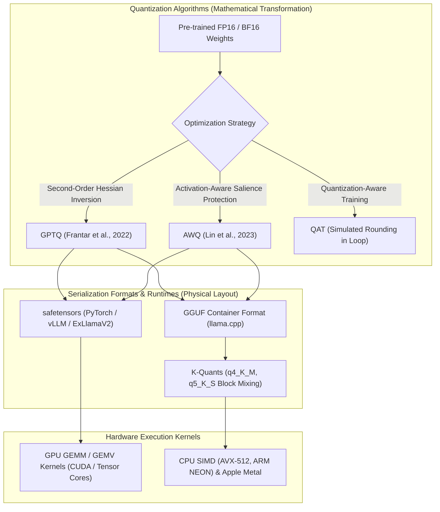
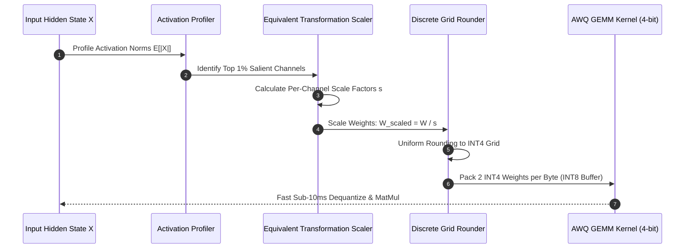

## Why Do Weight Quantization Algorithms Differ from Storage Formats?

In modern foundation model engineering, quantization is the primary mechanism for compressing model parameters from 16-bit floating-point (FP16/BF16) representations into 4-bit, 3-bit, or 2-bit integer representations. By reducing parameter memory footprints by $4\times$, quantization allows massive models to execute within the constrained high-bandwidth memory (HBM) of single workstations or edge devices.

However, a pervasive point of confusion among practitioners is conflating **quantization algorithms** with **container formats and runtimes**:
- **Quantization Algorithms** (such as GPTQ, AWQ, and SmoothQuant) define the mathematical optimization problem: how to round continuous FP16 weight matrices into low-bit integers while minimizing output reconstruction error $\arg\min_{\hat{W}} \|W X - \hat{W} X\|_2^2$.
- **File Formats and Runtimes** (such as GGML, GGUF, and K-quants) define the physical serialization and execution layout: how quantized tensors are memory-mapped (`mmap`), aligned to cache lines, and dispatched to CPU or GPU hardware execution units.

Failing to separate the mathematical compression technique from the execution container leads to mismatched calibration distributions, unexpected perplexity degradation, and sub-optimal hardware kernel utilization.



## Deconstructing Foundational Quantization Paradigms

Understanding how each algorithm operates mathematically allows engineers to select the optimal quantization strategy based on target hardware and inference concurrency.

### 1. Second-Order Optimization: GPTQ

GPTQ (Generalized Post-Training Quantization) operates by solving layer-wise parameter reconstruction using second-order Taylor expansion approximations of the loss surface:

$$\min_{\hat{W}} \|W X - \hat{W} X\|_2^2$$

Rather than rounding each weight independently (which causes accumulated error to compound across large matrices), GPTQ utilizes the inverse Hessian matrix $H = 2 X X^T$. Weights are quantized greedily column-by-column: whenever weight $w_q$ is rounded to its nearest discrete grid point $\hat{w}_q$, GPTQ applies an analytical correction vector to all remaining unquantized weights in that row:

$$W_{:, j} \leftarrow W_{:, j} - \frac{w_q - \hat{w}_q}{[H^{-1}]_{qq}} \cdot (H^{-1})_{:, q}$$

By leveraging Cholesky decomposition of the inverse Hessian matrix, GPTQ quantizes a 175-billion parameter model in approximately four GPU hours. It achieves near-lossless perplexity at 4 bits per weight, enabling single-GPU inference on architectures like [LLM serving engines](/posts/machine-learning-interview-questions/). However, because the inverse Hessian is calibrated on a fixed text dataset, performance can degrade on extreme out-of-distribution prompts.

### 2. Activation-Aware Weight Quantization: AWQ

AWQ (Lin et al., MLSys 2024 Best Paper) established a critical empirical observation: **weight magnitude does not equal weight salience**. Protecting weights with the largest absolute magnitude does not preserve model accuracy. Instead, weight salience is dictated by the magnitude of incoming input activations:

$$s_w = \text{Mean}(|X|) \cdot |W|$$

The key findings and mechanisms of AWQ include:
- **Protecting the Top 1% Salient Channels**: AWQ observes that only approximately 1% of weight channels correspond to large activation outliers. Rounding these salient weights to 4-bit integers causes severe perplexity spikes.
- **Equivalent Transformation Scaling**: Rather than keeping salient weights in FP16 (which requires irregular mixed-precision hardware kernels), AWQ applies a per-channel scaling factor $s$:
  $$Y = W X = (W \cdot \text{diag}(s)^{-1}) \cdot (\text{diag}(s) \cdot X) = \hat{W} \hat{X}$$
  By scaling up salient weight channels prior to quantization, rounding error relative to the weight magnitude is minimized, while incoming activations are scaled down proportionally.
- **Data-Free Generalization**: Because AWQ does not perform iterative regression or backpropagation on calibration text, it generalizes robustly to instruction-tuned checkpoints, multimodal models, and code generation tasks, directly complementing [frontier open model architectures](/posts/rnj-1-motif-2-12-7b-open-source-llm-analysis/).

### 3. Execution Container Formats: GGML, GGUF, and K-Quants

While GPTQ and AWQ govern mathematical rounding, the local AI ecosystem required an open, unified container format for local cross-platform deployment:
- **GGML**: The original flat tensor library written in C/C++ by Georgi Gerganov, optimized for CPU inference via AVX and ARM NEON instructions.
- **GGUF (GGML Universal Format)**: Replaced brittle binary formats (GGMF and GGJT). GGUF encapsulates all model weights, hyperparameter dictionaries, tokenizer vocabularies, and alignment parameters inside a single binary file. It natively supports memory-mapped loading (`mmap`), allowing operating systems to page weights directly from disk into RAM or VRAM with zero initialization parsing overhead.
- **K-Quants (`q4_K_M`, `q5_K_S`)**: GGUF introduced non-uniform block quantization presets. Rather than quantizing every layer uniformly to 4 bits, K-quants vary precision based on layer sensitivity: attention projection matrices ($W_q, W_k, W_v$) and down-projection feedforward layers are allocated 5 or 6 bits, while less sensitive intermediate layers are compressed to 3 or 4 bits.

| Method | Target Layer | Calibration Needed | Hardware Target | Primary Advantage |
| :--- | :--- | :--- | :--- | :--- |
| **GPTQ** | Weights only | Yes (128–512 samples) | NVIDIA GPUs (CUDA) | Second-order Hessian error compensation |
| **AWQ** | Salient weights | Yes (minimal text) | NVIDIA / AMD GPUs | Preserves 1% outlier channels without mixed kernels |
| **QAT** | Weights & activations | Yes (Full fine-tuning) | Specialized ASIC / Edge | Maximum accuracy recovery at 2–3 bit regimes |
| **GGUF (K-Quants)** | Mixed weights | No (Rule-based) | CPU, Apple Silicon, GPU | Single-file distribution, `mmap` instant loading |



## How Model Quantization Evolved Across 2026

Throughout 2026, model compression experienced a paradigm shift driven by native hardware floating-point standards and 1-bit architectural breakthroughs:

1. **Ascendance of Microscaling Formats (MXFP8 and MXFP4)**: While integer quantization (INT4/INT8) dominated earlier generations, the OCP (Open Compute Project) Microscaling formats standardized hardware support for 8-bit and 4-bit floating point formats (FP8 E4M3 and E5M2). Modern GPU accelerators execute FP8 matrix multiplications natively at full tensor-core clock speeds without the dequantization overhead inherent to INT4 packaging, as analyzed in [production LLM architectures](/posts/awesome-production-llm/).
2. **Native 1.58-Bit Ternary Architectures (BitNet)**: Rather than quantizing pre-trained models post-hoc, 2026 research popularized native ternary training (BitNet b1.58). Weights are constrained strictly to $\{-1, 0, 1\}$ during pre-training. This eliminates floating-point matrix multiplications entirely, replacing GEMM operations with simple integer additions and memory lookups, reducing server power consumption by over 70%.
3. **Activation Outlier Mitigation via Hadamard Rotations (QuaRot)**: Modern quantization frameworks apply randomized Hadamard and Walsh-Hadamard transformation matrices to activation vectors prior to linear layers. Rotating the feature space disperses activation outliers uniformly across all hidden dimensions, allowing 4-bit weight AND 4-bit activation quantization (W4A4) without accuracy collapse.
4. **Integration with Statistical Significance Testing**: As explored in [statistical foundations for AI evaluations](/posts/essential-statistical-concepts-must-know/), engineering teams no longer evaluate quantized models using single perplexity scores. Production pipelines run paired bootstrap hypothesis tests across diverse prompt sets to verify that low-bit quantization does not degrade reasoning depth.

## Implementation: Symmetric INT8 Quantization Simulator in Python

To understand the mechanics of discrete rounding, scaling, and zero-point calibration, the following Python module implements symmetric tensor quantization and computes dequantization reconstruction error:

```python
"""
quantization_sim.py - Symmetric INT8/INT4 tensor quantization simulator.
"""

from typing import Tuple, Dict, Any
import numpy as np


class SymmetricQuantizer:
    """
    Simulates symmetric uniform quantization for linear neural network weights.
    """
    def __init__(self, bits: int = 8):
        self.bits = bits
        self.qmin = -(2 ** (bits - 1))
        self.qmax = (2 ** (bits - 1)) - 1

    def quantize(self, tensor: np.ndarray) -> Tuple[np.ndarray, float]:
        """
        Maps continuous FP32 tensor into discrete integer grid.
        Returns:
            quantized_tensor: INT8/INT4 array.
            scale: Floating-point scale factor.
        """
        max_val = float(np.max(np.abs(tensor)))
        if max_val == 0.0:
            return np.zeros_like(tensor, dtype=np.int8), 1.0

        # Scale factor maps max continuous value to qmax
        scale = max_val / self.qmax
        
        # Round to nearest discrete integer and clamp
        quantized = np.clip(np.round(tensor / scale), self.qmin, self.qmax).astype(np.int8)
        return quantized, scale

    def dequantize(self, quantized_tensor: np.ndarray, scale: float) -> np.ndarray:
        """
        Reconstructs floating-point approximations from quantized integer tensor.
        """
        return (quantized_tensor * scale).astype(np.float32)

    def evaluate_error(self, original: np.ndarray) -> Dict[str, Any]:
        """
        Computes Mean Squared Error (MSE) and Signal-to-Quantization-Noise Ratio (SQNR).
        """
        quantized, scale = self.quantize(original)
        reconstructed = self.dequantize(quantized, scale)
        
        mse = float(np.mean((original - reconstructed) ** 2))
        signal_power = float(np.mean(original ** 2))
        noise_power = max(mse, 1e-12)
        sqnr_db = float(10 * np.log10(signal_power / noise_power))
        
        return {
            "bits": self.bits,
            "scale_factor": scale,
            "mean_squared_error": mse,
            "sqnr_db": sqnr_db,
            "compression_ratio": f"{32 // self.bits}x vs FP32"
        }


if __name__ == "__main__":
    np.random.seed(42)
    # Simulate a Transformer projection weight matrix (1024 x 1024)
    weight_matrix = np.random.normal(loc=0.0, scale=0.02, size=(1024, 1024)).astype(np.float32)
    
    # Evaluate INT8 vs INT4 compression metrics
    int8_sim = SymmetricQuantizer(bits=8)
    int4_sim = SymmetricQuantizer(bits=4)
    
    print("Quantization Evaluation Report:")
    print("INT8 Metrics:", int8_sim.evaluate_error(weight_matrix))
    print("INT4 Metrics:", int4_sim.evaluate_error(weight_matrix))
```

Understanding these discrete transformations allows engineers to systematically diagnose accuracy regressions and choose optimal quantization depths for production foundation models.

## Key Takeaways

- **Separate Algorithms from Container Formats**: GPTQ and AWQ are mathematical error-minimization algorithms; GGUF and safetensors are binary serialization formats.
- **Hessian Inversion Powers GPTQ**: GPTQ uses second-order Taylor expansions to apply analytical compensation to unquantized weights, achieving 4-bit compression in hours.
- **AWQ Protects the Salient 1%**: Activation salience dictates accuracy. AWQ scales outlier channels up prior to quantization, avoiding mixed-precision hardware kernels.
- **GGUF Enables Instant Memory Mapping**: Storing metadata, vocabularies, and K-quant tensors inside single GGUF binaries allows zero-copy `mmap` execution on local hardware.
- **Microscaling and 1-Bit LLMs Shape 2026**: Hardware-accelerated FP8/FP4 microscaling and native 1.58-bit ternary networks eliminate legacy post-training rounding losses.

## New Questions

- How do INT4 and FP4 tensor core implementations compare in thermal efficiency and memory bandwidth utilization during high-concurrency decoding?
- What are the mathematical stability limits of applying activation-aware scaling to multimodal vision-language cross-attention projections?
- Can Hadamard rotation matrices be dynamically computed per request without introducing latency bottlenecks into streaming token generators?
- Under what specific architectural conditions do native 1.58-bit BitNet models match the in-context few-shot adaptation of full-precision foundation models?

## References

- Dettmers, T., Lewis, M., Belkada, Y., & Zettlemoyer, L. (2022). *LLM.int8(): 8-bit Matrix Multiplication for Transformers at Scale*. Advances in Neural Information Processing Systems (NeurIPS 2022). URL: [https://arxiv.org/abs/2208.07339](https://arxiv.org/abs/2208.07339) (accessed 2026-10-18).
- Frantar, E., Saleh, S., Iofinova, A., & Alistarh, D. (2023). *GPTQ: Accurate Post-Training Quantization for Generative Pre-trained Transformers*. International Conference on Learning Representations (ICLR 2023). URL: [https://arxiv.org/abs/2210.17323](https://arxiv.org/abs/2210.17323) (accessed 2026-10-18).
- Gerganov, G., et al. (2023). *GGUF Specification and K-Quants*. GGML Documentation. URL: [https://github.com/ggerganov/ggml/blob/master/docs/gguf.md](https://github.com/ggerganov/ggml/blob/master/docs/gguf.md) (accessed 2026-10-18).
- Lin, J., Tang, J., Tang, H., Yang, S., Chen, W.-M., Wang, W.-C., Xiao, G., Dang, X., Gan, C., & Han, S. (2024). *AWQ: Activation-aware Weight Quantization for LLM Compression and Acceleration*. Proceedings of Machine Learning and Systems (MLSys 2024). URL: [https://arxiv.org/abs/2306.00978](https://arxiv.org/abs/2306.00978) (accessed 2026-10-18).
- Wang, H., Ma, S., Dong, L., Huang, S., Wang, H., Ma, L., Yang, F., Wang, R., Wu, Y., & Wei, F. (2024). *The Era of 1-bit LLMs: All Large Language Models are in 1.58 Bits*. arXiv preprint arXiv:2402.17764. URL: [https://arxiv.org/abs/2402.17764](https://arxiv.org/abs/2402.17764) (accessed 2026-10-18).
