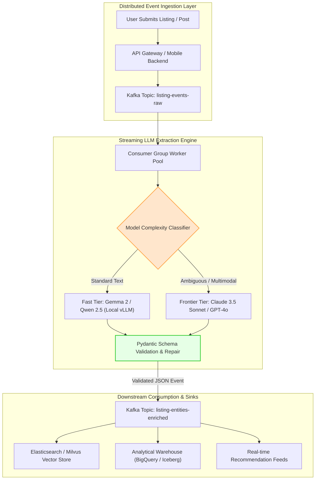
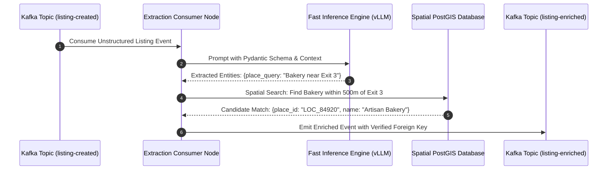

## Why Do Monolithic Batch Jobs Fail at Production Information Extraction?

In large-scale consumer marketplaces, social communities, and classifieds platforms (such as Daangn, Craigslist, or eBay), user-generated content arrives as highly unformatted, unstructured natural language text. Sellers write informal item descriptions, omit standardized category tags, mention local geographic landmarks without GPS coordinates, and paste fragmented specifications across messy paragraphs.

Historically, data engineering teams attempted to normalize this information through scheduled nightly batch ETL jobs. Monolithic pipelines ran overnight SQL regex filters, dictionary keyword matchers, and bespoke named entity recognition (NER) models. However, batch extraction architectures suffer from three critical operational deficiencies:
1. **Unacceptable Latency Windows**: Items listed at 9:00 AM remain unsearchable and un-categorized until the overnight batch completes, degrading discovery during peak listing hours.
2. **Brittle Heuristic Extractors**: Regular expressions and keyword matchers fail on typos, local colloquialisms, and slang (e.g., misidentifying "iPhone 15 Pro Max box only" as an actual phone).
3. **Cascading Pipeline Contamination**: When a batch script crashes midway due to an unexpected schema deviation, thousands of unprocessed items fail to index.

Streaming event architectures can decouple listing ingestion from LLM inference through distributed event logs such as Apache Kafka. End-to-end extraction latency depends on the workload and infrastructure; this article does not measure it.



## Deconstructing the Five Architectural Pillars of Real-Time Extraction

Transitioning from speculative prompt engineering to an enterprise-grade extraction pipeline requires rigid systems discipline across five core layers:

### 1. Declarative YAML Pipeline Configuration

In high-velocity engineering organizations, machine learning platform teams should not write custom Python consumer code for every new business vertical. Instead, the ingestion harness provides a declarative configuration interface. Platform teams register new extraction workflows simply by defining YAML contracts:

```yaml
pipeline:
  name: real-time-marketplace-extraction
  source:
    topic: market.listing.created.v1
    bootstrap_servers: kafka-broker.internal:9092
    consumer_group: llm-extraction-group
  model_routing:
    default_model: local-vllm-qwen2.5-7b
    escalation_model: claude-3-5-sonnet-20241022
    max_tokens: 300
    temperature: 0.0
  validation:
    schema: MarketplaceListingSchema
    max_retries: 2
  sinks:
    - topic: market.listing.enriched.v1
    - bigquery_table: analytics.marketplace_enriched_listings
```

Declarative routing abstracts away Kafka offset management, model rate-limiting, and distributed dead-letter queuing, allowing domain teams to deploy new extractors in minutes, directly aligning with [modern microservice architecture standards](/posts/microservices-popular-architectural-style/).

### 2. Schema Validation and Constrained Structured Outputs

Standard generative language models produce conversational, non-deterministic text. Prompting an LLM with *"Extract the product attributes in JSON"* frequently yields conversational preambles (`"Here is your JSON: ..."`), trailing comments, or malformed braces that trigger downstream parser exceptions.

Pydantic models define types and constraints that can be checked **after** a response is parsed; they do not themselves constrain the model's next token. Instructor, for example, validates responses with Pydantic and can retry failures. Separately, a provider may offer schema-constrained generation: OpenAI Structured Outputs supports a subset of JSON Schema on supported models. Handle refusals and incomplete responses separately; schema adherence does not establish that extracted facts are correct.

```python
from pydantic import BaseModel, Field
from typing import Optional, List

class MarketplaceListingSchema(BaseModel):
    category: str = Field(description="Primary category, e.g., Electronics, Furniture")
    brand: Optional[str] = Field(default=None, description="Extracted brand name")
    model_name: Optional[str] = Field(default=None, description="Specific hardware model")
    condition: str = Field(description="New, Like New, Good, For Parts")
    is_box_only: bool = Field(description="True if the listing sells only packaging")
    extracted_tags: List[str] = Field(default_factory=list, description="Search discovery tags")
```

The model above checks declared types, not whether a product description is truthful. `condition` is a string: its description is not an enforced list of allowed values. Pydantic defaults may coerce inputs and ignore extra fields; strict mode and extra-field handling must be configured explicitly. Neither schema validation nor constrained generation prevents data poisoning: a malicious or incorrect value can still fit the schema. Source provenance, access controls, independent verification, and monitoring are separate safeguards.

### 3. Hierarchical Place Entity Linking and Tag Deduction

A primary challenge in hyper-local commerce is geographic entity disambiguation. Users frequently write informal phrases like *"Meet in front of the bakery near Exit 3"* without explicitly tagging the business name or coordinate.

The real-time extractor decomposes geographic disambiguation into two phases:
1. **Named Entity Recognition (NER)**: The language model identifies the substring `"bakery near Exit 3"` and extracts the parent subway station.
2. **Spatial Candidate Verification**: The pipeline queries a local spatial database (e.g., PostGIS) within the user's registered neighborhood radius. If an exact match is confirmed, the system automatically binds the place metadata ID to the listing. If no match exists, the raw text is preserved as an unverified string, preventing hallucinated entity linkage.



### 4. Cost-Tiered Model Routing and Escalation

Running every user listing through frontier commercial APIs (e.g., GPT-4o or Claude 3.5 Sonnet) generates prohibitive cloud bills at millions of queries per day. Conversely, running only small quantized models on-premise results in extraction failures on complex, ambiguous inputs.

Production architectures deploy **hierarchical routing**:
- **Tier 1 (Fast / Edge Model)**: Route suitable listings to an internal self-hosted model (such as Qwen 2.5 or Gemma 2) hosted on [Kubernetes GPU clusters](/posts/what-is-kubernetes/). The traffic share depends on routing policy and workload; it is not measured here.
- **Tier 2 (Frontier Escalation)**: If Pydantic validation fails, if the model emits low token confidence (logprobs below a calibrated threshold), or if the listing contains multiple conflicting images, the event is automatically re-routed to a frontier API, as analyzed in [RouteLLM competitive routing benchmarks](/posts/routellm-shows-the-real-battle/).

## How Real-Time LLM Pipelines Evolved Across 2026

Throughout 2026, streaming LLM data infrastructure matured into a resilient, low-latency foundation:

1. **Speculative Decoding**: [vLLM documents speculative decoding](https://docs.vllm.ai/en/stable/features/speculative_decoding/) for reducing inter-token latency under particular workloads. Actual gains depend on the model, traffic, hardware, and configuration; no time-to-first-token benchmark is presented here.
2. **Native Multimodal Event Streaming**: Kafka event schemas expanded beyond plain text to include byte-level image embeddings and compressed image URIs. Real-time consumers inspect uploaded product photographs simultaneously with text descriptions, detecting discrepancies between the title ("Brand New iPhone") and the photo (a cracked screen) instantaneously.
3. **Arrow and Iceberg Integration**: [PyIceberg supports writing Arrow tables](https://py.iceberg.apache.org/api/#write-to-a-table) to Iceberg. That API does not establish end-to-end zero-copy behavior or a five-second freshness guarantee; measure the actual pipeline and query path.
4. **Automated Continuous Regression Auditing**: In production AI pipelines, prompt changes or model version updates can subtly alter classification accuracy. Enterprise harnesses run automated paired bootstrap significance tests on historical event logs, preventing production performance regressions as detailed in [essential statistical foundations](/posts/essential-statistical-concepts-must-know/).

## Practical Implementation: Building an Asynchronous Streaming Extraction Worker

The following Python script simulates an asynchronous worker. It generates mock JSON and validates the parsed result with Pydantic; it does not connect to Kafka or perform LLM inference or constrained decoding.

```python
"""
streaming_extraction_worker.py - Real-time asynchronous LLM information extraction worker.
"""

import asyncio
import json
from typing import Dict, Any, Optional
from pydantic import BaseModel, Field, ValidationError


class ExtractedProductSchema(BaseModel):
    category: str = Field(description="Normalized product category")
    brand: Optional[str] = Field(default=None, description="Identified brand")
    estimated_price_krw: Optional[int] = Field(default=None, description="Price mentioned in text")
    condition: str = Field(description="New, Like New, Used, Broken")
    tags: list[str] = Field(default_factory=list, description="Extracted search keywords")


class ExtractionWorker:
    """
    Simulates an asynchronous Kafka event worker with structured output validation.
    """
    def __init__(self, model_name: str = "vllm-qwen2.5-7b"):
        self.model_name = model_name

    async def mock_llm_inference(self, raw_text: str) -> str:
        """
        Simulates model inference returning structured JSON.
        """
        # Non-blocking async sleep simulating GPU inference latency (60ms)
        await asyncio.sleep(0.06)
        
        # Simulated model output based on text keywords
        if "iPhone" in raw_text:
            return json.dumps({
                "category": "Electronics",
                "brand": "Apple",
                "estimated_price_krw": 850000,
                "condition": "Like New",
                "tags": ["iphone", "apple", "smartphone", "clean"]
            })
        else:
            return json.dumps({
                "category": "General",
                "brand": None,
                "estimated_price_krw": None,
                "condition": "Used",
                "tags": ["miscellaneous"]
            })

    async def process_event(self, event: Dict[str, Any]) -> Optional[Dict[str, Any]]:
        """
        Consumes raw listing event, extracts structured attributes, and validates schema.
        """
        listing_id = event.get("listing_id")
        raw_text = event.get("content", "")

        try:
            # Step 1: Model inference
            raw_json_str = await self.mock_llm_inference(raw_text)
            parsed_dict = json.loads(raw_json_str)

            # Step 2: Pydantic validation with default settings
            validated_attributes = ExtractedProductSchema(**parsed_dict)

            # Step 3: Emit enriched output event
            enriched_event = {
                "listing_id": listing_id,
                "status": "enriched",
                "data": validated_attributes.model_dump(),
                "processed_by": self.model_name
            }
            return enriched_event

        except (ValidationError, json.JSONDecodeError) as e:
            # Route to Dead Letter Queue (DLQ) or escalate to frontier model
            print(f"Extraction failed for listing {listing_id}: {e}")
            return {
                "listing_id": listing_id,
                "status": "failed_dlq",
                "error": str(e)
            }


async def main():
    worker = ExtractionWorker()
    sample_events = [
        {
            "listing_id": "item_101",
            "content": "Selling my iPhone 14 Pro 128GB in Deep Purple. Like new condition, battery health 92%. Looking for 850,000 KRW."
        },
        {
            "listing_id": "item_102",
            "content": "Vintage wooden kitchen chair. Sturdy condition, slight scratches on the back legs."
        }
    ]

    # Process events concurrently without blocking event loop
    tasks = [worker.process_event(ev) for ev in sample_events]
    results = await asyncio.gather(*tasks)

    print("Streaming Extraction Pipeline Results:")
    for res in results:
        print(json.dumps(res, indent=2))


if __name__ == "__main__":
    asyncio.run(main())
```

Streaming workers can reduce batch-processing delay, but schema validation alone cannot guarantee that extracted metadata is factually correct or safe.

## Key Takeaways

- **Streaming Ingestion Can Reduce Batch Delay**: Kafka-based extraction can process events before a nightly batch, but latency and index freshness need measurement.
- **Pydantic Validates Parsed Outputs**: Schema checks catch violations of declared constraints; constrained decoding is a separate provider capability, and neither guarantees correct facts or prevents poisoning.
- **Hierarchical Model Routing Trades Cost Against Quality**: Routing between smaller and larger models can reduce costs in some workloads, but the traffic split and savings require measurement. The [RouteLLM paper](https://arxiv.org/abs/2406.18665) reports results for its own evaluated benchmarks, not this hypothetical pipeline.
- **Two-Phase Entity Linking Prevents Spatial Hallucinations**: Language models extract candidate strings; dedicated spatial databases (PostGIS) verify and bind exact geographic IDs.
- **Arrow Can Feed Iceberg Tables**: PyIceberg supports Arrow writes, but zero-copy behavior and analytical freshness must be verified for the deployed path.

## New Questions

- How do streaming extractors maintain consumer group rebalance stability when inference latency experiences sudden P99 GPU queuing spikes?
- What are the architectural boundaries between client-side pre-validation and server-side streaming extraction in mobile marketplace applications?
- Can small 3B models fine-tuned specifically on domain extraction datasets match frontier models while reducing inference power consumption on edge nodes?
- How should multi-language marketplaces resolve linguistic ambiguities when product descriptions mix three different languages in a single listing?

## References

- Collet, S. (2024). *PydanticAI: Production Agent Framework with Strict Type Validation*. Pydantic Documentation. URL: [https://ai.pydantic.dev/](https://ai.pydantic.dev/) (accessed 2026-10-18).
- Pydantic. *Models* and *Strict Mode*. [Model validation](https://docs.pydantic.dev/latest/concepts/models/); [strict mode](https://docs.pydantic.dev/latest/concepts/strict_mode/) (accessed 2026-10-28).
- Instructor. *Validation*. [Response validation and retries](https://python.useinstructor.com/concepts/validation/) (accessed 2026-10-28).
- OpenAI. *Structured model outputs*. [Supported schemas, refusals, and incomplete responses](https://developers.openai.com/api/docs/guides/structured-outputs) (accessed 2026-10-28).
- Daangn Engineering Team. (2024). *Utilizing Large Language Models in Production at Daangn*. Daangn Tech Blog. URL: [https://medium.com/daangn/%EB%8B%B9%EA%B7%BC%EC%97%90%EC%84%9C-llm-%ED%99%9C%EC%9A%A9%ED%95%98%EA%B8%B0-76131ecebce1](https://medium.com/daangn/%EB%8B%B9%EA%B7%BC%EC%97%90%EC%84%9C-llm-%ED%99%9C%EC%9A%A9%ED%95%98%EA%B8%B0-76131ecebce1) (accessed 2026-10-18).
- Kleppmann, M. (2017). *Designing Data-Intensive Applications: The Big Ideas Behind Reliable, Scalable, and Maintainable Systems*. O'Reilly Media. URL: [https://dataintensive.net/](https://dataintensive.net/) (accessed 2026-10-18).
- Kreps, J., Narkhede, N., & Rao, J. (2011). *Kafka: A Distributed Messaging System for Log Processing*. NetDB '11. URL: [https://www.microsoft.com/en-us/research/publication/kafka-a-distributed-messaging-system-for-log-processing/](https://www.microsoft.com/en-us/research/publication/kafka-a-distributed-messaging-system-for-log-processing/) (accessed 2026-10-18).
