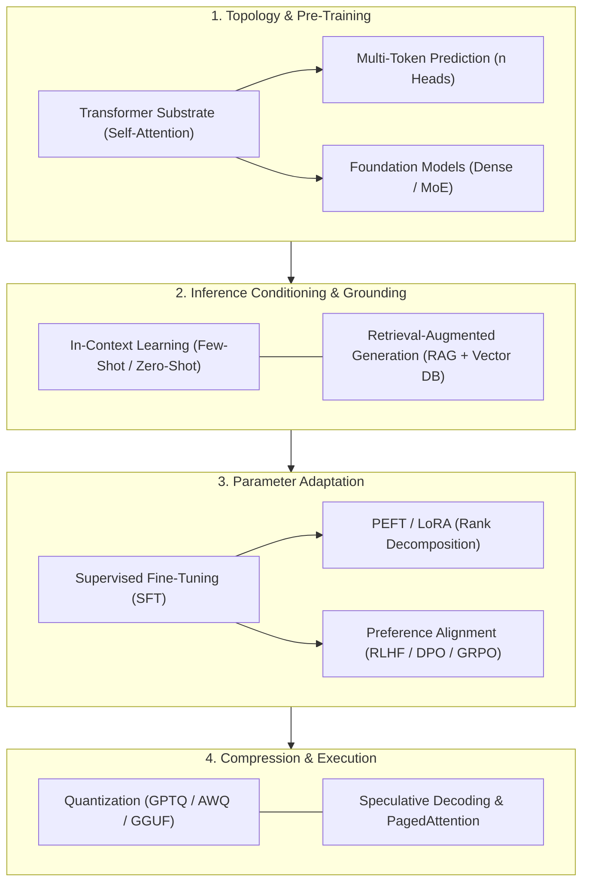
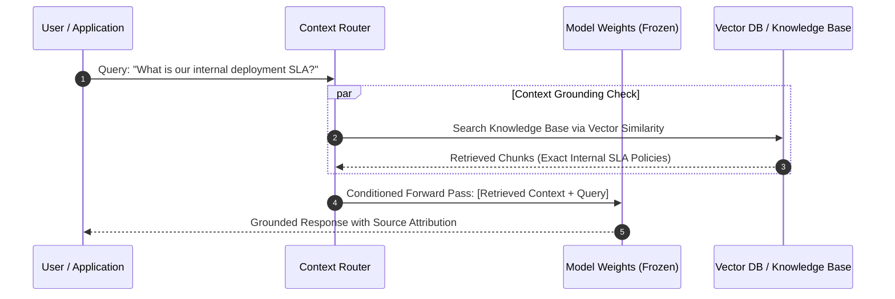

> **Correction (2026-10-28).** The MTP paragraph previously presented a 12% HumanEval gain and 3× acceleration without stating the cited experiments' scopes. The linked paper supports both claims in distinct settings: its 13B models solved 12% more HumanEval problems than comparable next-token models, and a 7B model trained with 4-token prediction used self-speculative decoding without a separate draft model, reaching 3.0× speedup on code and 2.7× on text. I also replaced generic LoRA savings percentages with the primary paper's bounded report: up to 10,000× fewer trainable parameters and 3× lower GPU memory versus GPT-3 175B full fine-tuning with Adam; LoRA still trains adapter parameters and does not eliminate all optimizer state.
{: .prompt-warning }

## What changed since the original 2024 note

The original note was a compact glossary of foundation-model terms. This version is a source audit that adds the architectural boundaries, equations, implementation example, and primary references needed to distinguish MTP, retrieval, adaptation, quantization, and serving claims. The MTP benchmark figures are now tied to the distinct 13B quality and 7B inference experiments in arXiv:2404.19737 rather than presented as universal gains.

## Why Do Superficial AI Glossaries Mislead Systems Engineering?

As generative artificial intelligence evolved from academic natural language processing into distributed systems engineering, the industry was inundated with buzzword glossaries. Social media infographics and marketing primers routinely present terms like *Foundation Model*, *RAG*, *Fine-Tuning*, and *In-Context Learning* as interchangeable features or magical capabilities.

In production engineering, however, terminology represents concrete physical, mathematical, and algorithmic trade-offs. Confusing an in-context prompting mechanism with parametric fine-tuning leads directly to architectural misallocations: teams burn GPU compute fine-tuning models on dynamic knowledge that should have lived in a retrieval index, or overload prompt context windows with tens of thousands of tokens that degrade attention precision.

Rigorous engineering requires organizing LLM terminology not alphabetically, but by the architectural boundary each concept governs: model topology, prompt conditioning, knowledge grounding, weight adaptation, and serving execution.



## Deconstructing Foundational Vocabulary Across Architectural Boundaries

Mapping foundation model systems requires understanding the exact mathematical mechanisms behind primary industry terms.

### 1. Structural Architecture and Pre-Training

- **Foundation Model**: Coined formally by Bommasani et al. (Stanford HAI, 2021), a foundation model is not merely a "large chatbot." It refers to any deep model pre-trained at scale on broad, multimodal data via self-supervision that can be adapted to a wide spectrum of downstream tasks without task-specific architectural re-engineering.
- **Transformer**: The attention-based neural network architecture formalized by Vaswani et al. (2017). By replacing sequential recurrent connections (RNNs/LSTMs) with scaled dot-product self-attention and positional encodings, Transformers enabled massive hardware parallelization during training, as explored in [Transformer deep dive studies](/posts/study-transformer/).
- **Multi-Token Prediction (MTP)**: While classical auto-regressive language models are trained strictly on next-token prediction ($\mathcal{L} = -\sum \log P(x_t \mid x_{<t})$), Multi-Token Prediction (Gloeckle et al., Meta FAIR 2024; DeepSeek-V3) equips the transformer trunk with $n$ independent projection heads to predict $n$ future tokens simultaneously:
  $$\mathcal{L}_{\text{MTP}} = -\sum_{k=1}^n \log P(x_{t+k} \mid x_{<t})$$
MTP forces the shared internal representations to anticipate long-term syntactic and algorithmic structures. The cited MTP paper reports that its 13B models solved 12% more problems on HumanEval than comparable next-token models. In a separate inference experiment, a 7B model trained with 4-token prediction used greedy self-speculative decoding without an additional draft model and reached 3.0× speedup on code and 2.7× on text across heterogeneous batch sizes ([Gloeckle et al., 2024](https://arxiv.org/abs/2404.19737)). These are setup-specific results, not a universal accuracy gain or speedup for every MTP model.

### 2. Conditioning and Retrieval Grounding

- **In-Context Learning (ICL)**: Formalized by Brown et al. (GPT-3, 2020), ICL is the emergent property wherein an autoregressive model adapts to new tasks purely through prompt conditioning during the forward pass without updating internal weight tensors ($\Delta W = 0$).
- **Few-Shot vs. Zero-Shot Learning**: Zero-shot provides only task directives. Few-shot conditioning injects input-output exemplars into the prompt, activating existing latent circuits learned during pre-training. However, few-shot prompting consumes context budget and cannot teach fundamentally new knowledge absent from pre-training weights.
- **Retrieval-Augmented Generation (RAG)**: Introduced by Lewis et al. (2020), RAG decouples parametric memory (the model's frozen weights) from non-parametric memory (external document databases). When an agent receives a query, an embedding model retrieves relevant document chunks from a vector store, injecting verified source text into the prompt context to mitigate hallucinations.



### 3. Parameter Adaptation: SFT, PEFT, and Preference Alignment

When tasks require domain-specific syntax, structured schema compliance, or specialized reasoning styles, prompt conditioning alone is insufficient.

- **Supervised Fine-Tuning (SFT)**: The process of updating model weights on curated $(x, y)$ input-output pairs using standard cross-entropy loss. SFT teaches models instruction-following formatting and domain vocabulary.
- **Parameter-Efficient Fine-Tuning (PEFT) and LoRA**: Full fine-tuning requires updating billions of parameters, demanding hundreds of gigabytes of optimizer memory. Low-Rank Adaptation (LoRA, Hu et al., 2021) freezes the pre-trained weight matrix $W_0 \in \mathbb{R}^{d \times k}$ and injects two low-rank trainable matrices $B \in \mathbb{R}^{d \times r}$ and $A \in \mathbb{R}^{r \times k}$ (where $r \ll \min(d, k)$):
  $$W = W_0 + \Delta W = W_0 + \frac{\alpha}{r}(B \cdot A)$$
  The [LoRA paper](https://arxiv.org/abs/2106.09685) reports up to 10,000× fewer trainable parameters and 3× lower GPU memory than GPT-3 175B full fine-tuning with Adam; because the low-rank matrices remain trainable, this does not eliminate optimizer state. The result is a comparison for that model and optimizer setup, not a universal percentage for every LoRA run.
- **Preference Alignment (RLHF, DPO, GRPO)**: SFT models learn to predict tokens, not align with human intentions. Reinforcement Learning from Human Feedback (RLHF) optimizes policies against reward models. Modern direct objectives like Direct Preference Optimization (DPO) and Group Relative Policy Optimization (GRPO) optimize preference boundaries without separate critic models, as deconstructed in [single-node RLHF reproduction audits](/posts/rlhf-summary-from-human-feedback-single-dgx-spark/).

### 4. Compression and Serving Runtimes

- **Quantization**: Compressing floating-point weights (FP16/BF16) into low-bit integers (INT8, INT4, FP4) to reduce memory bandwidth saturation during token generation. Weight-only post-training methods like GPTQ and AWQ optimize discrete rounding grids, while container formats like GGUF package quantized weights for instant memory-mapped (`mmap`) loading, as analyzed in [LLM quantization architectures](/posts/llm-types/).
- **PagedAttention and Continuous Batching**: Rather than pre-allocating contiguous VRAM for Key-Value (KV) caches, PagedAttention dynamically assigns virtual memory pages across non-contiguous physical blocks, eliminating memory fragmentation and multiplying concurrent serving throughput, as detailed in [machine learning system design interviews](/posts/machine-learning-interview-questions/).

## How Foundation Model Vocabulary Evolved Across 2026

Throughout 2026, the machine learning vocabulary matured, discarding vague promotional terminology in favor of precise systems engineering semantics:

1. **Test-Time Compute Scaling**: The terminology shifted from pre-training scale (FLOPs spent during pre-training) to inference-time reasoning scale (FLOPs spent during generation). Concepts like Monte Carlo Tree Search (MCTS), Process Reward Models (PRMs), and dynamic reflection tokens (`<think>`) displaced static "chain-of-thought" terminology.
2. **Rejection of Vague "AGI" in Favor of Agent Verification**: Enterprise vocabulary replaced nebulous "general intelligence" marketing claims with concrete agentic metrics: tool-call reliability, rollback recovery rates, sandbox containment boundaries, and long-context context-drift resistance.
3. **Formalization of Context Window Geometry**: Context length is no longer treated as a simple scalar number. Vocabulary now distinguishes between Effective Context Length (retrieval needle-in-a-haystack accuracy), Attention Decay Radius, and Rotary Frequency Interpolation (YaRN).
4. **Disaggregated Serving Terminology**: Serving architectures formally bifurcated into Prefill Nodes (compute-bound, high-throughput matrix multiplication engines) and Decode Nodes (memory-bandwidth bound, high-concurrency KV cache workers).

## Practical Implementation: Simulating LoRA Rank Decomposition

To ground parameter-efficient fine-tuning terminology in mathematical practice, the following PyTorch module implements a standalone Low-Rank Adaptation (LoRA) linear layer from scratch:

```python
"""
lora_primitive.py - Standalone implementation of Low-Rank Adaptation (LoRA).
"""

import math
import torch
import torch.nn as nn


class LoRALinear(nn.Module):
    """
    Applies LoRA rank decomposition: W = W0 + (alpha / rank) * (B @ A)
    """
    def __init__(self, in_features: int, out_features: int, rank: int = 4, alpha: float = 8.0):
        super().__init__()
        self.in_features = in_features
        self.out_features = out_features
        self.rank = rank
        self.scaling = alpha / rank

        # Base frozen weights
        self.weight = nn.Parameter(torch.randn(out_features, in_features), requires_grad=False)
        self.bias = nn.Parameter(torch.zeros(out_features), requires_grad=False)

        # Trainable low-rank decomposition matrices
        self.lora_A = nn.Parameter(torch.empty(rank, in_features))
        self.lora_B = nn.Parameter(torch.empty(out_features, rank))

        # Initialization: Kaiming uniform for A, zeros for B
        # Guarantees that at step 0, delta_W = (B @ A) == 0, preserving original model behavior
        nn.init.kaiming_uniform_(self.lora_A, a=math.sqrt(5))
        nn.init.zeros_(self.lora_B)

    def forward(self, x: torch.Tensor) -> torch.Tensor:
        # Base forward projection (frozen)
        base_out = nn.functional.linear(x, self.weight, self.bias)
        
        # LoRA forward projection: (x @ A.T) @ B.T * scaling
        lora_out = (x @ self.lora_A.t()) @ self.lora_B.t() * self.scaling
        
        return base_out + lora_out


if __name__ == "__main__":
    torch.manual_seed(42)
    in_dim, out_dim, r = 1024, 2048, 8

    layer = LoRALinear(in_features=in_dim, out_features=out_dim, rank=r)
    
    # Calculate parameter savings
    frozen_params = layer.weight.numel() + layer.bias.numel()
    trainable_params = layer.lora_A.numel() + layer.lora_B.numel()
    
    print("LoRA Parameter Efficiency Audit:")
    print(f"  Frozen Base Parameters:    {frozen_params:,}")
    print(f"  Trainable LoRA Parameters: {trainable_params:,}")
    print(f"  Parameter Reduction:       {((frozen_params - trainable_params) / frozen_params) * 100:.2f}%")
```

Understanding how low-rank decomposition mathematically projects gradient updates into low-dimensional subspaces transforms abstract fine-tuning jargon into an exact engineering decision.

## Key Takeaways

- **Terminology Defines System Boundaries**: Technical vocabulary in AI engineering must denote concrete hardware, memory, and mathematical trade-offs rather than interchangeable marketing concepts.
- **Multi-Token Prediction Improves Sample Efficiency**: MTP can improve downstream coding results and inference speed in the reported experiments; gains depend on model size, benchmark, prediction horizon, decoding method, and batch configuration.
- **In-Context Learning Does Not Modify Weights**: Prompting is activation-based task adaptation during inference ($\Delta W = 0$); fine-tuning updates weight parameters ($\Delta W \ne 0$).
- **LoRA Reduces, Rather Than Eliminates, Optimizer Memory**: LoRA freezes base weights and trains low-rank matrices, so optimizer state is needed for the adapter parameters; the cited paper reports up to 10,000× fewer trainable parameters and 3× lower GPU memory versus GPT-3 175B full fine-tuning with Adam.
- **2026 Focuses on Test-Time Reasoning**: The vocabulary frontier has pivoted from static pre-training scaling to dynamic inference-time compute scaling and verified agent execution loops.

## New Questions

- How do Multi-Token Prediction training objectives interact with KV cache memory consumption when serving high-concurrency requests?
- What are the mathematical stability limits of combining LoRA adapters across multiple task domains into a single merged weight checkpoint?
- Can in-context learning circuits inside transformers be permanently consolidated into model weights without catastrophic forgetting?
- How does the boundary between prefill-heavy RAG workloads and decode-heavy agent reasoning alter cluster hardware provisioning?

## References

- Bommasani, R., Hudson, D. A., Adeli, E., Altman, R., Arora, S., von Arx, S., Bernstein, M. S., Bohg, J., Bosselut, A., Brunskill, E., Brynjolfsson, E., Buch, S., Card, D., Castellon, R., Chatterji, N., Chen, A., Creel, K., Davis, J. Q., Demszky, D., ... Liang, P. (2021). *On the Opportunities and Risks of Foundation Models*. arXiv preprint arXiv:2108.07258. URL: [https://arxiv.org/abs/2108.07258](https://arxiv.org/abs/2108.07258) (accessed 2026-10-18).
- Brown, T., Mann, B., Ryder, N., Subbiah, M., Kaplan, J. D., Dhariwal, P., Neelakantan, A., Shyam, P., Sastry, G., Askell, A., Agarwal, S., Herbert-Voss, A., Krueger, G., Henighan, T., Child, R., Ramesh, A., Ziegler, D., Wu, J., Winter, C., ... Amodei, D. (2020). *Language Models are Few-Shot Learners*. Advances in Neural Information Processing Systems (NeurIPS 2020). URL: [https://arxiv.org/abs/2005.14165](https://arxiv.org/abs/2005.14165) (accessed 2026-10-18).
- Gloeckle, F., Idrissi, B. Y., Rozière, B., Lopez-Paz, D., & Synnaeve, G. (2024). *Better & Faster Large Language Models via Multi-token Prediction*. arXiv preprint arXiv:2404.19737. URL: [https://arxiv.org/abs/2404.19737](https://arxiv.org/abs/2404.19737) (accessed 2026-10-18).
- Hu, E. J., Shen, Y., Wallis, P., Allen-Zhu, Z., Li, Y., Wang, S., Wang, L., & Chen, W. (2021). *LoRA: Low-Rank Adaptation of Large Language Models*. International Conference on Learning Representations (ICLR 2022). URL: [https://arxiv.org/abs/2106.09685](https://arxiv.org/abs/2106.09685) (accessed 2026-10-18).
- Lewis, P., Perez, E., Piktus, A., Petroni, F., Karpukhin, V., Goyal, N., Küttler, H., Lewis, M., Yih, W.-t., Rocktäschel, T., Riedel, S., & Kiela, D. (2020). *Retrieval-Augmented Generation for Knowledge-Intensive NLP Tasks*. Advances in Neural Information Processing Systems (NeurIPS 2020). URL: [https://arxiv.org/abs/2005.11401](https://arxiv.org/abs/2005.11401) (accessed 2026-10-18).
- Vaswani, A., Shazeer, N., Parmar, N., Uszkoreit, J., Jones, L., Gomez, A. N., Kaiser, L., & Polosukhin, I. (2017). *Attention Is All You Need*. Advances in Neural Information Processing Systems (NeurIPS 2017). URL: [https://arxiv.org/abs/1706.03762](https://arxiv.org/abs/1706.03762) (accessed 2026-10-18).
