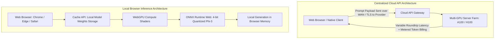
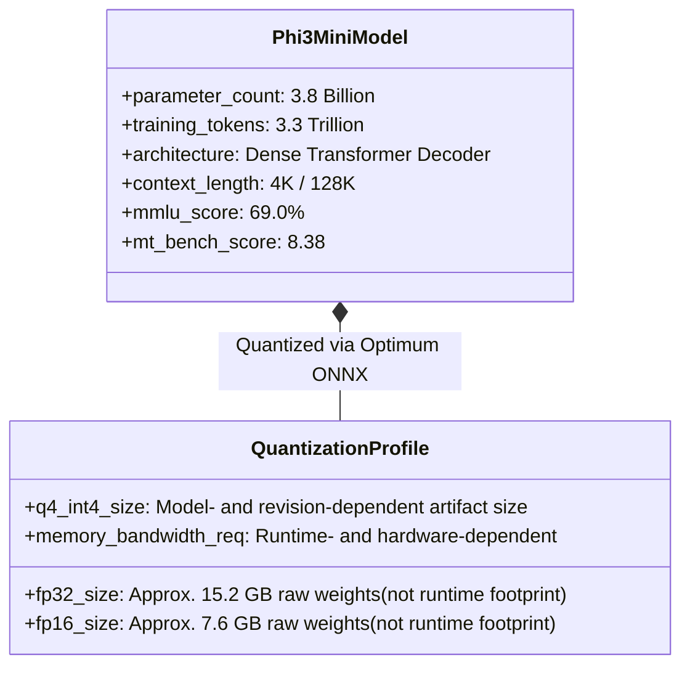
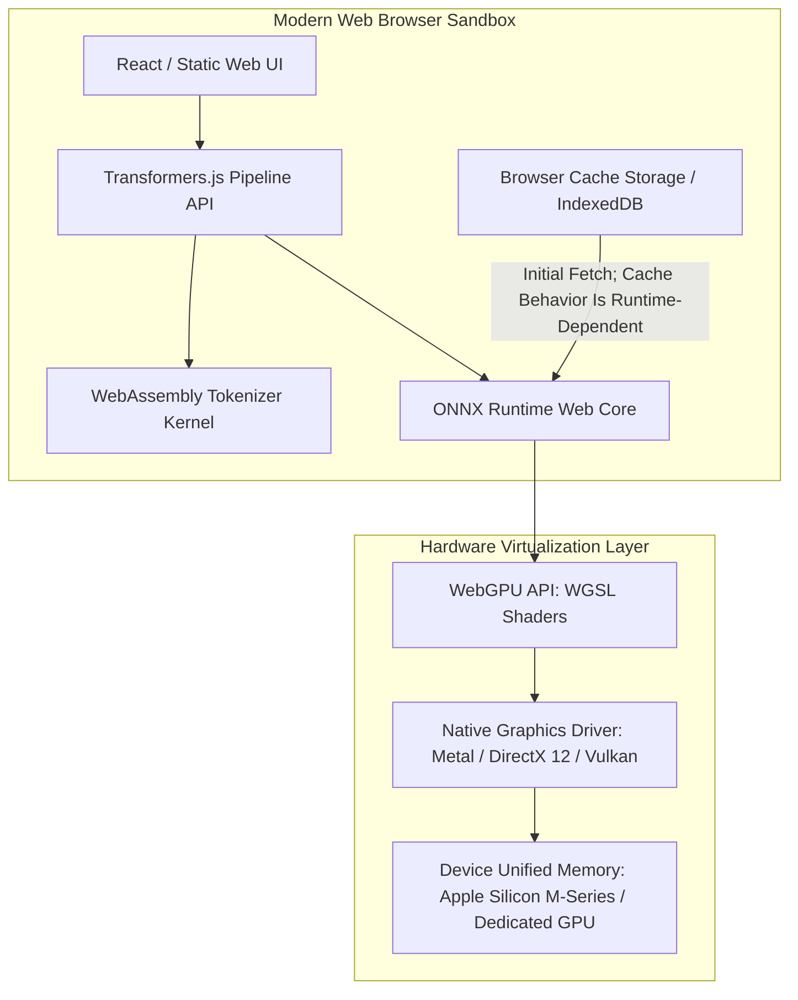
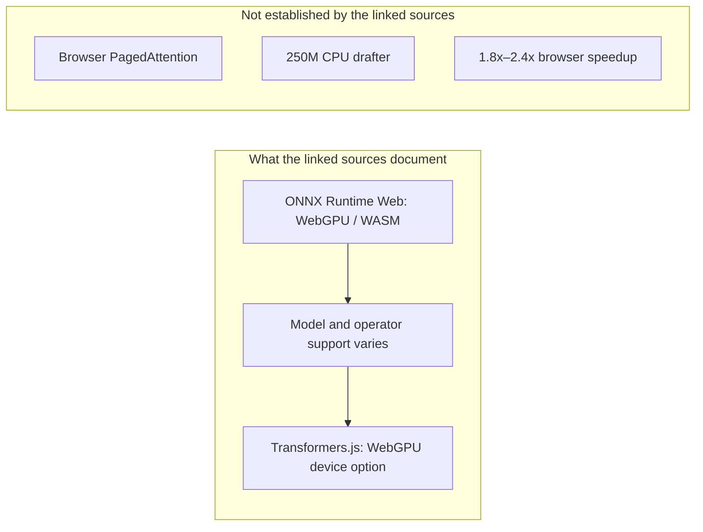

> **Correction (2026-10-28).** The linked sources do not document a 2026 browser PagedAttention implementation, a 250M CPU drafting model, a 1.8–2.4× browser speedup, or more than 96% full-precision reasoning accuracy. The linked Phi-3 and Xenova sources also do not provide a reproducible hardware matrix for the former per-device throughput table or its 20–42 tokens/sec range, a universal 2.2 GB q4 artifact size, or automatic SHA-256 verification and zero-network caching on every launch. I removed those assertions and replaced them with source-bounded notes: the PagedAttention reference is a server-side vLLM study, while ONNX Runtime Web and Transformers.js document browser execution paths and their limitations.
{: .prompt-warning }

## What changed since the original 2024 note

The original note was a brief Phi-3/WebGPU demo summary. This version is a source audit that surveys the Phi-3 technical report, the Xenova browser demo, Transformers.js, and ONNX Runtime Web; adds architecture, memory, quantization, and execution-provider context; and separates published model metrics from unverified browser throughput. The unsupported per-device table and speculative 2026 browser claims are removed instead of being presented as measured results.

## Why Does Running Phi-3-Mini Locally via WebGPU Alter Client-Side AI Economics?

For the first two years of the generative artificial intelligence expansion, production client-side applications functioned almost exclusively as thin HTTP wrappers around centralized cloud API endpoints. Every text generation turn required transmitting user prompts across public networks to remote data centers, incurring recurring token billing, variable network transmission latency, and significant privacy exposure for sensitive enterprise or personal data.



In May 2024, the experimental deployment of Microsoft’s **Phi-3-mini** in the browser—leveraging Hugging Face’s **Transformers.js** and **ONNX Runtime Web** with **WebGPU** hardware acceleration—demonstrated a browser-local execution path for a 3.8-billion-parameter model. The linked sources establish the execution architecture, but do not provide a reproducible 20–40 tokens-per-second benchmark across devices. If an application caches model weights and keeps inference local, it can reduce repeat downloads and avoid sending prompts to a remote inference service; actual cost, privacy, and offline behavior still depend on the application’s network, storage, and telemetry configuration. This source audit conducts an architectural dissection of the Phi-3 WebGPU execution stack, evaluates memory and quantization constraints, and separates documented runtime capabilities from unverified throughput claims.

---

## The Phi-3-Mini Foundation: High Capability at Compact Scale

Deploying large language models inside standard web browsers imposes severe physical constraints: browser memory ceilings and multi-gigabyte downloads can make large artifacts impractical, while exact limits vary by browser, runtime, device, and application.



Phi-3-mini (Abdin et al., 2024) is a compact model that supports browser deployment experiments when a compatible quantized ONNX artifact and runtime fit the device. The linked sources do not establish a universal 2.2 GB 4-bit binary size or memory requirement; those values vary with artifact revision, external-data files, runtime allocation, and browser limits. The technical report reports 69.0% MMLU and 8.38 MT-bench for the model-level evaluation, not browser throughput.

---

## Architectural Decomposition: The Browser WebGPU Execution Stack

Executing multi-billion-parameter transformers in client environments requires orchestrating multiple layers across the browser platform, JavaScript runtime, and graphics hardware.



### 1. Model Distribution and IndexedDB Caching

When a user opens the application for the first time, Transformers.js may fetch quantized ONNX graph fragments over HTTP. Browser cache persistence can reduce repeated downloads when the application and runtime support it, but the linked sources do not establish automatic SHA-256 verification or zero network requests on every subsequent launch. Offline behavior therefore depends on cache hits, application network policy, and any telemetry or update checks.

### 2. Transformers.js Pipeline Abstraction

Transformers.js provides a functional JavaScript API mirroring PyTorch’s `transformers` interface:

```javascript
import { pipeline } from '@huggingface/transformers';

// Initialize the WebGPU-accelerated text generation pipeline
const generator = await pipeline(
  'text-generation',
  'Xenova/Phi-3-mini-4k-instruct',
  {
    device: 'webgpu',
  }
);

// Stream tokens directly from local device compute
const output = await generator('Explain the concept of WebGPU in three bullet points:', {
  max_new_tokens: 128,
  temperature: 0.7,
});
```

### 3. ONNX Runtime Web and WGSL Compute Shaders

ONNX Runtime Web translates neural operators (matrix multiplications, LayerNorm, Rotary Positional Embeddings, Softmax) into WebGPU Shading Language (WGSL) compute pipelines. Rather than routing computations through slow CPU WebAssembly threads, WGSL compute shaders dispatch parallel execution directly to thousands of GPU shader cores via platform APIs (Metal on macOS, DirectX 12 on Windows, and Vulkan on Linux/Android).

---

## Benchmark Evidence and Limits

The linked Phi-3 technical report reports model-level academic results (69% MMLU and 8.38 MT-bench) but does not report browser throughput. The Xenova demo is an interactive browser Space; its published metadata and bundle do not provide a reproducible hardware matrix or benchmark protocol for the download times, memory measurements, and token-per-second values previously listed here. ONNX Runtime Web documents execution-provider options and trade-offs, not those per-device measurements. I removed the unreferenced table rather than presenting its figures as measured evidence. A defensible browser benchmark would need a pinned model artifact, quantization and runtime versions, browser/device details, warm-up policy, prompt set, and token-counting method.

---

## What the linked sources establish about browser inference

The linked sources establish a browser execution path, not a 2026 performance standard. [ONNX Runtime Web](https://onnxruntime.ai/docs/tutorials/web/) documents WebGPU, WebGL, WebNN, and WebAssembly execution providers, with only a subset of operators supported by GPU providers. The [Transformers.js WebGPU guide](https://huggingface.co/docs/transformers.js/main/en/guides/webgpu) documents `device: "webgpu"` integration and warns that WebGPU support remains incomplete across browsers. These sources do not document a browser PagedAttention implementation, a 32K-token guarantee, or the performance figures removed below.



Key source boundaries:

- **PagedAttention**: The [PagedAttention paper](https://arxiv.org/abs/2309.06180) describes a server-side algorithm and vLLM serving system. It reports 2–4× throughput improvements over FasterTransformer and Orca at the same latency, but it does not document a browser/WebGPU implementation or a 32K-token context guarantee. The linked ONNX Runtime Web documentation describes WebGPU/WASM execution but does not mention PagedAttention.
- **Speculative decoding**: The linked sources do not establish a 250M CPU drafting model paired with Phi-3-mini or a 1.8–2.4× browser throughput result. Those numbers have been removed rather than presented as a benchmark.
- **Privacy and offline behavior**: ONNX Runtime Web lists privacy, offline, and cost benefits for in-browser inference, but whether an application is zero-telemetry or remains offline depends on its own network, storage, and analytics configuration.

For related explorations into local neural execution and inference optimizations, review our guide on [Unsloth local inference API architecture](/posts/unsloth-local-api-guide/), study [Hugging Face Cookbook evaluation patterns](/posts/huggingface-cookbook/), and explore [code-action agent orchestration in Hugging Face Agents 2.0](/posts/transformer-agent/).

---

## Key Takeaways

- **Local Inference Changes Cost and Privacy Trade-offs**: WebGPU and compact architectures like Phi-3-mini can reduce reliance on recurring remote inference calls, but actual cost, privacy, and offline behavior depend on model downloads, application network policy, telemetry, and runtime support.
- **Hardware Determines Browser Throughput**: WebGPU can use the device GPU, but the linked sources do not establish a universal 20–42 tokens/sec production range; throughput depends on hardware, browser, model, quantization, and runtime.
- **Quantization is Essential**: 4-bit block quantization can reduce model weight memory enough for browser experiments, but the linked sources do not establish a universal quality-retention percentage; memory and quality depend on the model, quantizer, and runtime.

---

## New Questions

1. **Progressive Background Weight Streaming**: How can web applications stream model weights incrementally during active user onboarding so that interactive generation begins before a multi-gigabyte artifact finishes downloading?
2. **Cross-Tab GPU Context Contention**: In multi-tab browser environments, how can WebGPU compute schedulers balance concurrent neural inference tasks against WebGL canvas rendering without dropping display frame rates?

---

## References

- Xenova Team. (2024). *Phi-3-mini-4k-instruct ONNX model for Transformers.js*. Hugging Face model card. https://huggingface.co/Xenova/Phi-3-mini-4k-instruct (accessed 2026-10-28).
- Xenova Team. (2024). *Experimental Phi-3 WebGPU Implementation*. Hugging Face Spaces. https://huggingface.co/spaces/Xenova/experimental-phi3-webgpu (accessed 2026-10-18).
- Hugging Face Team. (2024). *Transformers.js: State-of-the-art Machine Learning for the Web*. GitHub Repository. https://github.com/huggingface/transformers.js (accessed 2026-10-18).
- Hugging Face Team. (2026). *Transformers.js: Running models on WebGPU*. Documentation. https://huggingface.co/docs/transformers.js/main/en/guides/webgpu (accessed 2026-10-28).
- Microsoft Corporation. (2024). *ONNX Runtime Web: Accelerating WebAssembly and WebGPU Machine Learning*. ONNX Runtime Documentation. https://onnxruntime.ai/docs/tutorials/web/ (accessed 2026-10-18).
- Kwon, W., Li, Z., Zhuang, S., Sheng, Y., Zheng, L., Yu, C. H., Gonzalez, J. E., Zhang, H., & Stoica, I. (2023). *Efficient Memory Management for Large Language Model Serving with PagedAttention*. arXiv preprint arXiv:2309.06180. https://arxiv.org/abs/2309.06180 (accessed 2026-10-28).
