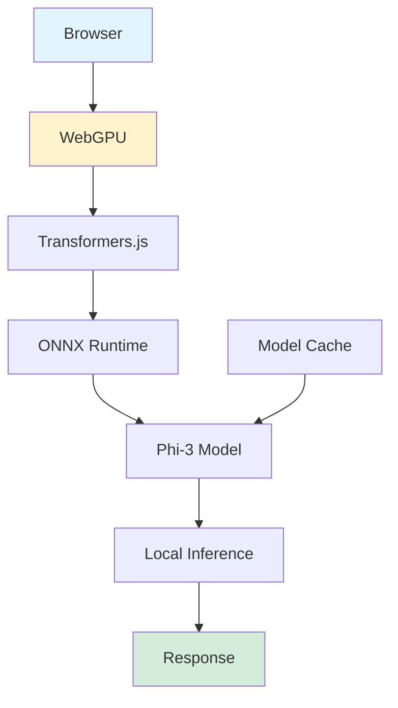

## Phi-3 WebGPU: Private AI Chatbot Running Locally in Your Browser

*Curiosity:* How can we run powerful AI models entirely in the browser? What happens when we combine WebGPU acceleration with on-device inference?

**Phi-3 WebGPU** is a private and powerful AI chatbot that runs 100% locally in your browser, powered by Transformers.js and onnxruntime-web. No data is sent to servers — everything runs on your device. The demo is Xenova's experimental build (Space running, ~300 likes as retrieved 2026-10-14):

> **Try it**: <https://huggingface.co/spaces/Xenova/experimental-phi3-webgpu>
{: .prompt-info}

Demo credit: [Xenova](https://twitter.com/xenovacom), built on the Transformers.js stack.

## Why Phi-3-mini fits the browser

Most browser demos use tiny models because the constraints are brutal: the full weights must download over the network, fit in browser memory, and execute without a server GPU. Phi-3-mini is an unusual fit because it is a genuinely capable small model, not a toy. Pinned to the primary source (Abdin et al., Phi-3 Technical Report, arXiv:2404.14219v4, revised 2024-08-30): phi-3-mini has 3.8 billion parameters trained on 3.3 trillion tokens, scoring 69% on MMLU and 8.38 on MT-bench — rivaling Mixtral 8x7B and GPT-3.5 despite being small enough to deploy on a phone. The training data is a scaled-up version of the phi-2 recipe: heavily filtered public web data plus synthetic data, with additional alignment for robustness, safety, and chat format. Larger siblings (phi-3-small 7B at 75% MMLU, phi-3-medium 14B at 78%) and the phi-3.5 series (including a 4.2B vision model) exist, but the browser demo specifically ships the mini checkpoint because download size and memory dominate the browser decision.

## How the browser stack works

*Retrieve:* the components enabling browser-based AI, and what each one actually contributes.

- **Transformers.js** (<https://github.com/huggingface/transformers.js>, 16.3k stars as retrieved, Apache-2.0) mirrors the Python `transformers` `pipeline` API in JavaScript, so the same pretrained model runs through the same call shape.
- **onnxruntime-web** executes the ONNX-converted weights inside the browser; conversion from PyTorch runs through Optimum.
- **WebGPU** is the opt-in GPU path (`device: 'webgpu'` per pipeline); the repo default is CPU via WASM, and its docs warn WebGPU remains experimental across browsers.
- **Quantization** is the download-size lever: the `dtype` option selects `fp32` (WebGPU default), `fp16`, `q8` (WASM default), or `q4`. The 4-bit setting is what makes a 3.8B model practical to fetch and hold in a tab.
- **Model cache** makes the download one-time: after the first fetch the weights persist locally and later sessions start offline-capable.

| Claim from the demo page | What it assumes |
|:-------------------------|:----------------|
| On-device inference, no data sent to servers | True after weights are cached; the first load still downloads gigabytes from the Hub |
| WebGPU-accelerated, over 20 tokens per second | Requires a WebGPU-capable browser and GPU; falls back to slower WASM CPU otherwise |
| Up to 42 tokens per second | A peak measurement on capable hardware, not a guarantee across devices |
| Works offline | True only after the one-time download completes |
| Complete privacy | Inference is local, but the demo page itself is still a hosted Space |

## Trade-offs

- Use the browser build when privacy or offline operation matters more than peak quality: no API costs, no data transmission, no server to operate.
- Prefer server-side inference with the full-precision checkpoint when output quality at the margin matters, when the target browsers lack WebGPU, or when a multi-gigabyte first download is unacceptable.
- Treat the token-per-second number as hardware-dependent. The honest comparison is quantized browser inference versus full-precision server inference on the same prompts — a measurement this rewrite did not run.

## Limitations

- This rewrite did not re-run the Xenova Space; Space status, like count, and the 42 tokens-per-second figure are reported source claims as retrieved 2026-10-14.
- Benchmark numbers (69% MMLU, 8.38 MT-bench) are the report's figures for phi-3-mini, not measurements of the quantized browser build, which may score lower.
- WebGPU availability and the `q4` quality trade-off vary by device and browser version; verify on the deployment target.

## Key Takeaways

Phi-3 WebGPU demonstrates that a capable small model plus ONNX browser execution plus optional WebGPU acceleration can deliver private, server-free chat. The decision that matters is not "browser versus server" in the abstract but which constraint dominates: download size and device GPU on one side, peak quality and cost control on the other.

**Next Steps**:
- Try the demo and note first-load size versus cached-load latency on your own hardware
- Explore Transformers.js pipeline IDs and `dtype` settings per model
- Learn the WebGPU support matrix for the target browsers before promising acceleration

## References

- Abdin et al., Phi-3 Technical Report, arXiv:2404.14219v4 — <https://arxiv.org/abs/2404.14219>
- Xenova experimental Phi-3 WebGPU Space — <https://huggingface.co/spaces/Xenova/experimental-phi3-webgpu>
- Transformers.js repository — <https://github.com/huggingface/transformers.js>
- Transformers.js documentation — <https://huggingface.co/docs/transformers.js>
