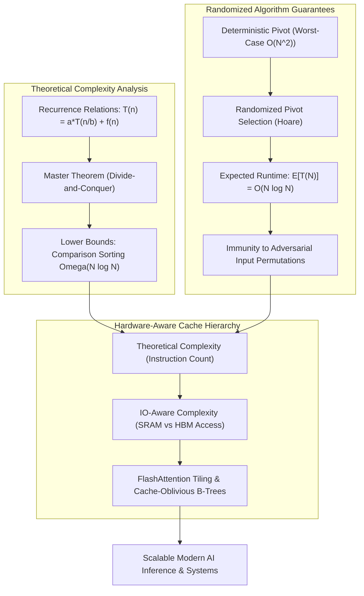
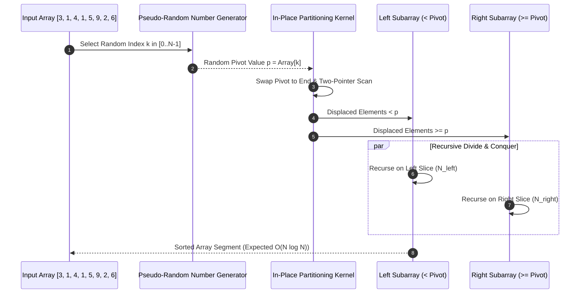

## Why Does Asymptotic Complexity Dictate Modern AI Hardware Scalability?

In contemporary software engineering and artificial intelligence research, developers frequently delegate low-level computations to high-level frameworks like PyTorch, vLLM, or distributed database engines. This abstraction layer often creates an illusion that hardware scaling (adding more GPUs, increasing high-bandwidth memory, or scaling clusters) can compensate for unoptimized algorithmic design.

In production environments, however, **asymptotic complexity** ($O(N)$, $O(N \log N)$, $O(N^2)$) represents a physical constraint that no amount of hardware parallelism can overcome. The clearest manifestation of this principle is standard dense multi-head attention: because naive self-attention computes an $N \times N$ token affinity matrix, doubling context length quadruples both compute FLOPs and KV memory footprint ($O(N^2)$ complexity). Scaling from 8K to 128K context windows without algorithmic redesign would saturate data center thermal and electrical capacities.

Mastering foundation model systems requires grounding engineering practice in classic theoretical computer science: divide-and-conquer recurrences, randomized pivot selection, and hardware-aware cache hierarchy mechanics.



## Deconstructing Foundational Algorithmic Paradigms

Understanding classical algorithmic theory transforms heuristic coding into rigorous systems design.

### 1. Divide-and-Conquer Recurrences and the Master Theorem

Many fundamental algorithms in computer science and machine learning—including Fast Fourier Transforms (FFT), Strassen's matrix multiplication, and Merge Sort—partition a problem into smaller subproblems, solve each recursively, and recombine the subproblem solutions.

The Master Theorem provides an analytical recipe for solving recurrence relations of the form:

$$T(n) = a T\left(\frac{n}{b}\right) + f(n)$$

Where $a \ge 1$ is the number of recursive subproblems, $b > 1$ is the problem size division factor, and $f(n)$ is the cost of partitioning and recombining:
1. **Leaf-Dominated Regime**: If $f(n) = O(n^{\log_b a - \epsilon})$ for $\epsilon > 0$, work at the bottom recursion level dominates: $T(n) = \Theta(n^{\log_b a})$.
2. **Balanced Regime**: If $f(n) = \Theta(n^{\log_b a} \log^k n)$ for $k \ge 0$, work is distributed evenly across all $\log_b n$ levels:
   $$T(n) = \Theta(n^{\log_b a} \log^{k+1} n)$$
3. **Root-Dominated Regime**: If $f(n) = \Omega(n^{\log_b a + \epsilon})$ and satisfies the regularity condition $a f(n/b) \le c f(n)$, the root division dominates: $T(n) = \Theta(f(n))$.

In Merge Sort ($a = 2, b = 2, f(n) = O(n)$), $\log_2 2 = 1$, yielding the classic Case 2 result: $T(n) = \Theta(n \log n)$. This asymptotic bound represents the information-theoretic lower limit for comparison-based sorting: distinguishing among $n!$ possible permutations requires at least $\log_2(n!) = \Omega(n \log n)$ binary comparisons.

### 2. Randomized Quicksort and Adversarial Defenses

Invented by C.A.R. Hoare in 1961, Quicksort partitions an array around a chosen pivot element $p$, sorting elements smaller than $p$ to the left and larger to the right, followed by recursive partitioning.

#### The Deterministic Pivot Failure Mode
If an implementation deterministically selects the first or last element as the pivot ($p = A[0]$), sorted or reverse-sorted input arrays trigger worst-case partition imbalance:
$$T(n) = T(n - 1) + O(n) = \Theta(n^2)$$
For an array of $10^6$ elements, $N^2$ operations require $10^{12}$ steps—causing severe stack overflows or latency spikes. In web services, malicious users can intentionally submit sorted arrays to trigger Algorithmic Complexity Denial of Service (ReDoS / DoS).

#### The Randomized Solution
By sampling the pivot uniformly at random from the active subarray ($\text{pivot} \sim \text{Uniform}(A[\text{low} \dots \text{high}])$), the expected balance of subproblems is guaranteed regardless of input ordering:

$$\mathbb{E}[T(n)] = 2 \sum_{k=1}^n \frac{1}{n} \mathbb{E}[T(k)] + O(n) = O(n \log n)$$

Randomization shifts the probability distribution from the input space to the algorithm's internal coin flips, ensuring that no adversarial user can craft an input that consistently forces $O(n^2)$ performance.



### 3. Cache Locality and Memory Bandwidth Limits

In theoretical algorithms, complexity is calculated strictly by operation counts. In physical modern processors (CPUs and GPUs), execution time is dominated by **data movement through the memory hierarchy**:

| Memory Level | Typical Latency | Bandwidth | Capacity |
| :--- | :--- | :--- | :--- |
| **L1 Data Cache** | ~1 ns (4 cycles) | ~2–4 TB/s | 32–64 KB |
| **L2 Unified Cache** | ~3–4 ns (14 cycles) | ~1 TB/s | 1–2 MB |
| **L3 Shared Cache** | ~10–15 ns (40 cycles) | ~500 GB/s | 32–128 MB |
| **Main RAM (DDR5)** | ~60–80 ns | ~50–100 GB/s | 32–256 GB |
| **GPU HBM3e** | ~100 ns | ~3–5 TB/s | 80–144 GB |

An algorithm with $O(N \log N)$ complexity that executes sequential, cache-friendly array scans (such as Quicksort or Timsort) routinely outperforms an algorithm with smaller theoretical constants that performs random memory hops (such as pointer-based binary search trees). Every random cache miss incurs a 60–80ns pipeline stall, wasting hundreds of processor cycles, directly mirroring the memory-bound execution bottlenecks deconstructed in [machine learning system design interviews](/posts/machine-learning-interview-questions/).

## How Algorithmic Foundations Evolved Across 2026

Throughout 2026, foundation model and systems engineering converged on IO-aware algorithmic redesign:

1. **IO-Aware Tiling Over Abstract Complexity**: Classical algorithms counted arithmetic operations (FLOPs). Modern algorithms count memory reads and writes between fast on-chip SRAM and slow off-chip HBM. FlashAttention-3 and FlashDecoding exemplify IO-aware design: by partitioning large attention tensors into small blocks that fit entirely within GPU SRAM, they eliminate intermediate memory round-trips, achieving a 3x speedup while executing the exact same mathematical formula, building on [Transformer attention mechanics](/posts/study-transformer/).
2. **Sub-Quadratic Sequence Modeling**: Linear attention architectures (Mamba, RWKV, State Space Models) demonstrated that recurrent scan formulations can achieve $O(N)$ inference latency with constant memory footprints ($O(1)$ KV state). In 2026, hybrid architectures (interleaving attention layers with state-space layers) became the standard for handling 1M+ token contexts.
3. **Cache-Oblivious Data Structures in Vector Search**: Approximate Nearest Neighbor (ANN) vector indices transitioned from traditional graph traversals to cache-oblivious memory layouts. By arranging tree nodes according to the van Emde Boas layout, vector search queries traverse memory hierarchies without needing pre-configured knowledge of specific CPU cache line sizes.
4. **Empirical Significance Verification**: In line with [essential statistical principles](/posts/essential-statistical-concepts-must-know/), modern algorithmic benchmarks reject single-run execution timers in favor of rigorous confidence intervals and variance decomposition across hundreds of randomized runs.

## Practical Implementation: Randomized Quicksort with In-Place Partitioning

To understand how randomized pivot selection eliminates worst-case quadratic degradation, the following Python module implements randomized Quicksort with Hoare's two-pointer partitioning and compares it against sorted adversarial arrays:

```python
"""
randomized_quicksort.py - Randomized Quicksort with Hoare in-place partitioning.
Demonstrates expected O(N log N) runtime against worst-case sorted inputs.
"""

import random
import time
from typing import List


def randomized_partition(arr: List[int], low: int, high: int) -> int:
    """
    Selects a random pivot, swaps it to the start, and executes Hoare partitioning.
    """
    # 1. Random pivot selection protects against sorted adversarial inputs
    rand_pivot_idx = random.randint(low, high)
    arr[low], arr[rand_pivot_idx] = arr[rand_pivot_idx], arr[low]
    
    pivot = arr[low]
    i = low - 1
    j = high + 1
    
    # 2. Hoare two-pointer partitioning
    while True:
        # Move i right while arr[i] < pivot
        i += 1
        while arr[i] < pivot:
            i += 1
            
        # Move j left while arr[j] > pivot
        j -= 1
        while arr[j] > pivot:
            j -= 1
            
        # Pointers crossed: partition complete
        if i >= j:
            return j
            
        # Swap inverted elements
        arr[i], arr[j] = arr[j], arr[i]


def quicksort_recursive(arr: List[int], low: int, high: int) -> None:
    """
    In-place recursive divide-and-conquer Quicksort.
    """
    if low < high:
        # Partition index
        pi = randomized_partition(arr, low, high)
        
        # Recurse on left and right slices
        quicksort_recursive(arr, low, pi)
        quicksort_recursive(arr, pi + 1, high)


def benchmark_sorting(size: int = 50000):
    """
    Benchmarks randomized quicksort on adversarial (pre-sorted) arrays.
    """
    adversarial_sorted_data = list(range(size))
    
    start = time.perf_counter()
    quicksort_recursive(adversarial_sorted_data, 0, len(adversarial_sorted_data) - 1)
    duration = time.perf_counter() - start
    
    is_sorted = all(adversarial_sorted_data[i] <= adversarial_sorted_data[i+1] for i in range(len(adversarial_sorted_data)-1))
    
    print(f"Randomized Quicksort Benchmark (N = {size:,}):")
    print(f"  Execution Time: {duration:.4f} seconds")
    print(f"  Correctly Sorted: {is_sorted}")


if __name__ == "__main__":
    benchmark_sorting(size=50000)
```

Adopting randomized pivot sampling guarantees that recursive execution depth remains strictly bounded to $O(\log N)$, preventing stack overflows and stabilizing system throughput.

## Key Takeaways

- **Asymptotic Limits Supersede Hardware**: Quadratic complexity ($O(N^2)$) cannot be cured by adding compute. Algorithmic efficiency dictates physical scalability in AI systems.
- **Master Theorem Governs Divide-and-Conquer**: Analyzing recurrence relations $T(n) = a T(n/b) + f(n)$ determines whether subproblem generation or tree recombination dominates execution cost.
- **Randomization Defeats Worst-Case Inputs**: Selecting pivots uniformly at random shields sorting routines from adversarial input distributions, guaranteeing expected $O(N \log N)$ runtimes.
- **Memory Hierarchy Dominates Real Wall-Clock Time**: Cache locality often trumps theoretical operation counts; algorithms with sequential memory scans outperform tree traversal algorithms that trigger frequent RAM misses.
- **IO-Aware Design Defines 2026 Engineering**: Modern breakthrough architectures (FlashAttention, State Space Models) achieve speedups by minimizing data transfers across memory levels rather than cutting arithmetic operations.

## New Questions

- How do memory-bandwidth limits in multi-GPU distributed sorting algorithms affect the crossover point between Quicksort and Radix sort?
- What are the formal cache complexity bounds of FlashAttention when scaled to multi-million token contexts across disaggregated memory pools?
- Can quantum sorting algorithms overcome the classical information-theoretic lower bound of $\Omega(N \log N)$ comparisons in unstructured databases?
- Under what workload distributions do hybrid CPU-GPU sorting pipelines outperform pure GPU radix sorting on modern unified memory architectures?

## References

- Cormen, T. H., Leiserson, C. E., Rivest, R. L., & Stein, C. (2022). *Introduction to Algorithms* (4th ed.). MIT Press. URL: [https://mitpress.mit.edu/9780262046305/introduction-to-algorithms/](https://mitpress.mit.edu/9780262046305/introduction-to-algorithms/) (accessed 2026-10-18).
- Dao, T., Fu, D. Y., Ermon, S., Rudra, A., & Ré, C. (2022). *FlashAttention: Fast and Memory-Efficient Exact Attention with IO-Awareness*. Advances in Neural Information Processing Systems (NeurIPS 2022). URL: [https://arxiv.org/abs/2205.14135](https://arxiv.org/abs/2205.14135) (accessed 2026-10-18).
- Hoare, C. A. R. (1962). *Quicksort*. The Computer Journal, 5(1), 10-15. URL: [https://doi.org/10.1093/comjnl/5.1.10](https://doi.org/10.1093/comjnl/5.1.10) (accessed 2026-10-18).
- Sedgewick, R., & Wayne, K. (2011). *Algorithms* (4th ed.). Addison-Wesley Professional. URL: [https://algs4.cs.princeton.edu/](https://algs4.cs.princeton.edu/) (accessed 2026-10-18).
