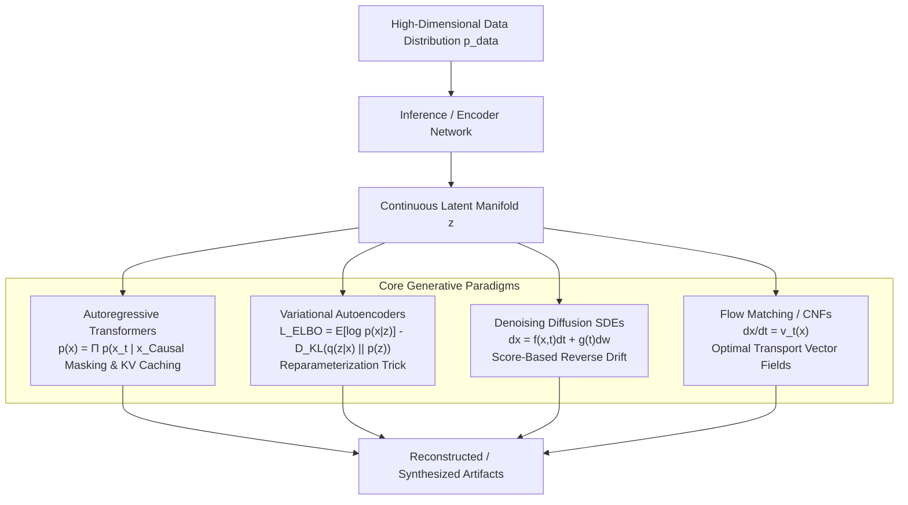
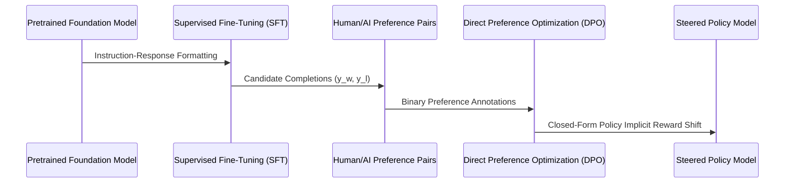

## How Do Latent Generative Paradigms Unify Modern AI Architectures?

Generative artificial intelligence has evolved from rudimentary statistical sampling to high-dimensional manifold estimation. While practitioner discourse frequently conflates product interfaces with foundational modeling capabilities, generative systems operate across distinct mathematical formulations: discrete autoregressive sequence modeling, variational autoencoding (VAE), stochastic differential equation (SDE) diffusion, and continuous flow matching. 

Understanding these foundational representations is essential before attempting pipeline optimizations such as retrieval-augmented generation (RAG) or parameter-efficient fine-tuning (PEFT). As discussed in our [taxonomy of generative artificial intelligence](/posts/generativeai-term/), the underlying loss formulations dictate sampling latency, mode coverage, and fidelity across modal boundaries.

---

## The Four Pillars of Mathematical Generative Modeling

To understand generative capabilities, practitioners must distinguish between the four fundamental families of generative models. Each formalizes density estimation and posterior sampling under distinct computational trade-offs:

### 1. Autoregressive Sequence Transformers

Autoregressive models factorize the joint probability distribution of a sequence into a product of conditional probabilities using the chain rule:

$$p_\theta(\mathbf{x}) = \prod_{i=1}^T p_\theta(x_i \mid x_{<i})$$

In transformer architectures, this is enforced through causal self-attention masks. Training is parallelized via teacher forcing, optimizing cross-entropy loss over categorical token distributions. However, inference is strictly sequential ($O(T)$ forward passes), necessitating key-value (KV) caching and speculative decoding techniques to mitigate memory bandwidth bottlenecks.

### 2. Variational Autoencoders (VAEs)

VAEs introduce a latent variable $\mathbf{z} \sim p(\mathbf{z}) = \mathcal{N}(0, \mathbf{I})$ and approximate the intractable true posterior $p(\mathbf{z} \mid \mathbf{x})$ using an inference network $q_\phi(\mathbf{z} \mid \mathbf{x})$. Training optimizes the Evidence Lower Bound (ELBO):

$$\mathcal{L}_{\text{ELBO}}(\theta, \phi; \mathbf{x}) = \mathbb{E}_{q_\phi(\mathbf{z} \mid \mathbf{x})}[\log p_\theta(\mathbf{x} \mid \mathbf{z})] - D_{\text{KL}}(q_\phi(\mathbf{z} \mid \mathbf{x}) \parallel p(\mathbf{z}))$$

The reparameterization trick ($\mathbf{z} = \mu_\phi(\mathbf{x}) + \sigma_\phi(\mathbf{x}) \odot \epsilon$, where $\epsilon \sim \mathcal{N}(0, \mathbf{I})$) permits backpropagation through stochastic nodes. While standard VAEs exhibit mode-averaging behavior that produces blurry samples in pixel space, they serve as the foundational perceptual compression engine in latent diffusion models such as Stable Diffusion and Flux.

### 3. Denoising Diffusion Probabilistic Models (DDPM) & SDEs

Diffusion models establish a forward noising process governed by an Itô stochastic differential equation:

$$\mathrm{d}\mathbf{x} = \mathbf{f}(\mathbf{x}, t)\,\mathrm{d}t + g(t)\,\mathrm{d}\mathbf{w}$$

The reverse generative process runs backwards in time from a Gaussian prior $\mathbf{x}_T \sim \mathcal{N}(0, \mathbf{I})$, guided by the score function $\nabla_{\mathbf{x}} \log p_t(\mathbf{x})$:

$$\mathrm{d}\mathbf{x} = \left[ \mathbf{f}(\mathbf{x}, t) - g(t)^2 \nabla_{\mathbf{x}} \log p_t(\mathbf{x}) \right] \mathrm{d}t + g(t)\,\mathrm{d}\bar{\mathbf{w}}$$

Neural networks are trained via score matching to estimate the injected noise $\epsilon_\theta(\mathbf{x}_t, t)$. This decouples generative fidelity from adversarial minimax instability (characteristic of GANs), but requires dozens of iterative ODE solver steps during sampling.

### 4. Continuous Normalizing Flows and Flow Matching

Flow matching eliminates the stochastic drift of diffusion by learning an ordinary differential equation (ODE) vector field $\mathbf{v}_t(\mathbf{x})$ that transports probability mass along deterministic paths from base noise $p_0$ to target data distribution $p_1$:

$$\frac{\mathrm{d}\mathbf{x}_t}{\mathrm{d}t} = \mathbf{v}_t(\mathbf{x}_t), \quad \mathbf{x}_0 \sim \mathcal{N}(0, \mathbf{I}), \quad \mathbf{x}_1 \sim p_{\text{data}}$$

Under Optimal Transport Displacement Interpolation, the conditional vector fields define straight paths in probability space:

$$\mathbf{x}_t = (1 - t)\mathbf{x}_0 + t\mathbf{x}_1, \quad \mathbf{v}_t(\mathbf{x}_t) = \mathbf{x}_1 - \mathbf{x}_0$$

By regressing straight trajectories, flow matching significantly reduces ODE integration curvature, allowing synthesis in fewer evaluation steps than conventional DDPMs.

---

## Comparing Generative Paradigm Trade-Offs

The choice of generative backbone establishes fixed boundaries on training stability, sampling speed, and representation density:

| Paradigm | Training Stability | Sampling Throughput | Latent Controllability | Primary Failure Mode |
| :--- | :--- | :--- | :--- | :--- |
| **Autoregressive (AR)** | Very High (Teacher Forcing) | Low (Sequential Token Generation) | High (Token Prompt Steering) | Exposure Bias, Hallucination |
| **Variational Autoencoder** | High (ELBO Convexity) | Instantaneous ($O(1)$ Pass) | Continuous Latent Geometry | Posterior Collapse, Blurry Reconstruction |
| **Score Diffusion (SDE)** | High (Denoising Score Matching) | Moderate to Low (Iterative Denoising) | High (Classifier-Free Guidance) | Mode Missing, High Step Count |
| **Flow Matching (CNF)** | Very High (Regression Loss) | High ($4 \text{ to } 16$ Euler Steps) | Linear Interpolation Properties | Boundary Discontinuities |

---

## Alignment, Preference Optimization, and Human-in-the-Loop Steering

Pretrained generative models learn the unconditional or raw conditional distribution of web-scale corpora, capturing noise, incoherence, and unsafe behaviors alongside reasoning patterns. Alignment bridges the gap between raw statistical density matching and task execution.

While Reinforcement Learning from Human Feedback (RLHF) historically required training an auxiliary scalar reward model $r_\psi(\mathbf{x}, \mathbf{y})$ and optimizing policy $\pi_\theta$ via Proximal Policy Optimization (PPO), contemporary architectures favor Direct Preference Optimization (DPO). DPO analytically parameterizes the reward directly through the log-ratio of the policy and reference model:

$$\mathcal{L}_{\text{DPO}}(\theta; \pi_{\text{ref}}) = -\mathbb{E}_{(\mathbf{x}, \mathbf{y}_w, \mathbf{y}_l) \sim \mathcal{D}} \left[ \log \sigma \left( \beta \log \frac{\pi_\theta(\mathbf{y}_w \mid \mathbf{x})}{\pi_{\text{ref}}(\mathbf{y}_w \mid \mathbf{x})} - \beta \log \frac{\pi_\theta(\mathbf{y}_l \mid \mathbf{x})}{\pi_{\text{ref}}(\mathbf{y}_l \mid \mathbf{x})} \right) \right]$$

This mathematical equivalence removes the multi-model instability of PPO while enforcing rigorous alignment margins against reward hacking. For detailed multi-view perspective transformations and visual conditioning, see our analysis of [GenWarp generative cross-view synthesis](/posts/genwarp-paper/) and [self-attention computational mechanics](/posts/deepdive-series-5/).

---

## 2026 Technological Evolution: Unified Multimodal Flows and Inference Scaling

From the perspective of 2026 systems engineering, the historical segregation between discrete token-based autoregression (text) and continuous diffusion/flow architectures (audio, image, video) has dissolved:

1. **Unified Flow Matching Architectures**: Modern frontier models (such as modern diffusion-transformer backbones) treat discrete tokens and continuous spatial representations as dual aspects of a shared continuous vector field. Rather than quantizing images into discrete codebooks (VQ-VAE/VQ-GAN), text embeddings modulate continuous flow ODEs directly.
2. **Inference-Time Compute Scaling**: Following the discovery that test-time search and Monte Carlo tree evaluation scale predictably, generative systems increasingly allocate computational FLOPs during token generation via chain-of-thought verification rather than pure parameter scaling.
3. **Hardware Acceleration and Distillation**: Through consistency distillation and mean-shift trajectory rectification, 50-step diffusion models have been reduced to 1-to-4 step deterministic flow samplers, enabling real-time edge synthesis at 60 FPS on consumer silicon.

---

## Key Takeaways

- **Generative Paradigms Are Complementary**: Autoregressive transformers excel at sequential discrete reasoning; Continuous Normalizing Flows and Diffusion SDEs dominate continuous spatial synthesis.
- **ELBO and Score Matching Underpin Stability**: Replacing adversarial minimax objectives with supervised regression (denoising or velocity vector matching) enabled modern generative reliability.
- **Alignment Shifts Distribution Bounds**: Techniques like DPO optimize the generative distribution toward high-utility, human-aligned sub-manifolds without fragile online reinforcement learning dynamics.
- **Flow Matching Represents the Modern Standard**: Rectified flow and optimal transport displacement interpolation offer faster sampling with lower ODE integration curvature than classical DDPM formulations.

---

## New Questions

- **Can Continuous Diffusion Replace Autoregressive Next-Token Prediction for Reasoning Tasks?**: While diffusion handles spatial distributions effortlessly, discrete logical deduction has resisted non-autoregressive parallel generation due to sequential causal dependencies.
- **How Will Test-Time Search Integrate with Latent Manifold Sampling?**: As LLMs exploit test-time compute, how will continuous generative models incorporate programmatic verifiers to prune hallucinated spatial or temporal trajectories?

---

## References

- Ho, J., Jain, A., & Abbeel, P. (2020). Denoising Diffusion Probabilistic Models. *Advances in Neural Information Processing Systems (NeurIPS 2020)*, 33, 6840-6851. [https://arxiv.org/abs/2006.11239](https://arxiv.org/abs/2006.11239) (accessed 2026-10-18)
- Lipman, Y., Chen, R. T. Q., Ben-Hamu, H., Nicklas, M., & Le, M. (2023). Flow Matching for Generative Modeling. *International Conference on Learning Representations (ICLR 2023)*. [https://arxiv.org/abs/2210.02747](https://arxiv.org/abs/2210.02747) (accessed 2026-10-18)
- Song, Y., Sohl-Dickstein, J., Kingma, D. P., Kumar, A., Ermon, S., & Poole, B. (2021). Score-Based Generative Modeling through Stochastic Differential Equations. *International Conference on Learning Representations (ICLR 2021)*. [https://arxiv.org/abs/2011.13456](https://arxiv.org/abs/2011.13456) (accessed 2026-10-18)
- Rafailov, R., Sharma, A., Mitchell, E., Ermon, S., Manning, C. D., & Finn, C. (2023). Direct Preference Optimization: Your Language Model is Secretly a Reward Model. *Advances in Neural Information Processing Systems (NeurIPS 2023)*. [https://arxiv.org/abs/2305.18290](https://arxiv.org/abs/2305.18290) (accessed 2026-10-18)
