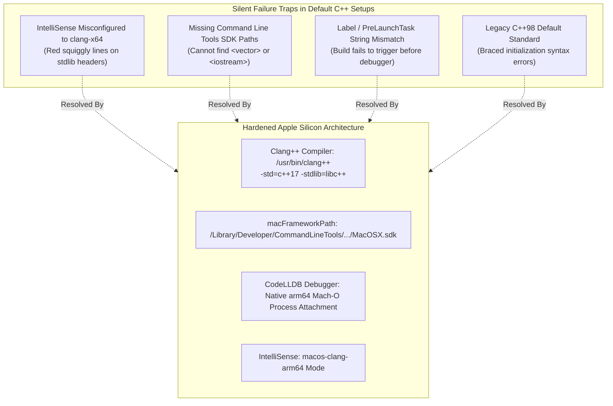
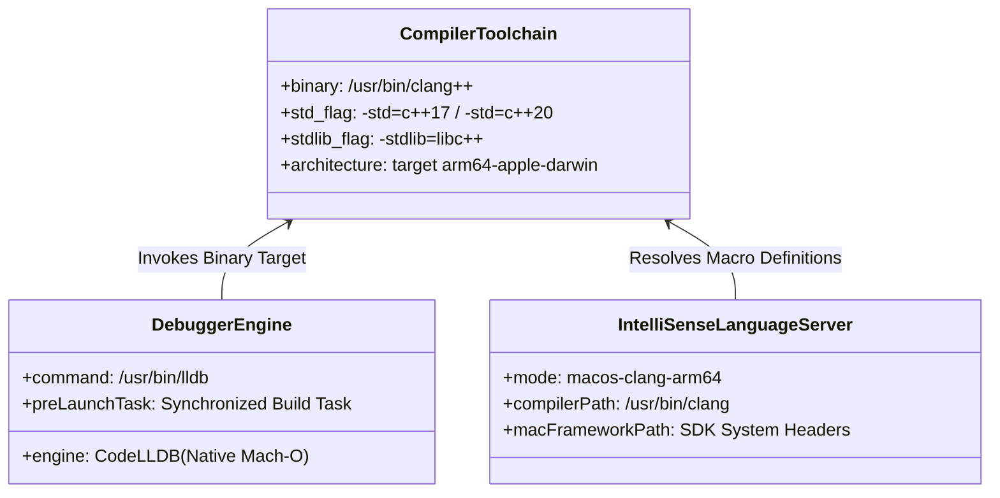
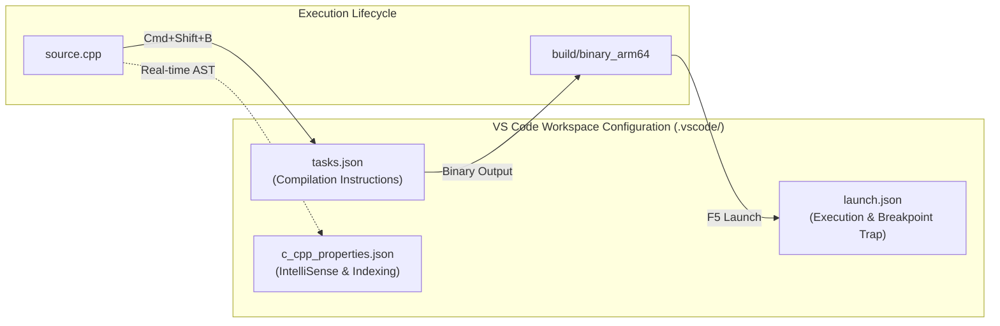
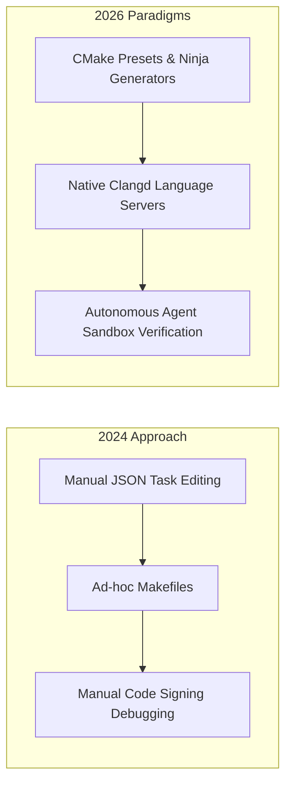

## Why Do Default C++ Configurations Fail Silently on Apple Silicon Workstations?

Setting up a modern C++ development environment in Visual Studio Code on macOS Apple Silicon (M1/M2/M3/M4 hardware architectures) is deceptively error-prone. Many developers assume that installing the official C/C++ extension and selecting default templates will immediately yield a working compilation, debugging, and IntelliSense workflow. However, macOS utilizes unique architectural conventions: the native compiler is Apple Clang rather than GNU GCC, the native debugger is LLDB rather than GDB, system header directories reside within isolated Xcode SDK paths rather than standard Unix `/usr/include` directories, and system binaries execute on 64-bit ARM (`arm64`) rather than legacy `x86_64`.



When developers copy generic Linux or x86 tutorials into VS Code, IntelliSense silently breaks—decorating standard headers with false red squiggly warnings—while the debugger either refuses to attach or halts inside Rosetta translation layers. This source audit conducts an architectural analysis of the native Apple Silicon C++ toolchain, deconstructs the three essential VS Code configuration artifacts (`tasks.json`, `launch.json`, and `c_cpp_properties.json`), details step-by-step diagnostic workflows, and explores how C++ development environments for local AI inference and systems programming evolved through 2026.

---

## Architectural Decomposition: The Core Toolchain Tiers

To build high-performance C++ applications—such as custom neural network kernels, game engines, or systems libraries—on Apple Silicon, developers must coordinate three interconnected software layers:



1. **System Compiler (`/usr/bin/clang++`)**: Distributed as part of the Apple Command Line Tools (CLT). It targets the `arm64-apple-darwin` ABI and defaults to the LLVM `libc++` standard template library.
2. **Mach-O Native Debugger (LLDB)**: Unlike Linux systems that rely on GDB, macOS mandates LLDB with code-signing entitlements to attach to local processes. In VS Code, this is managed either via the Microsoft C/C++ extension's `cppdbg` or the community-standard `CodeLLDB` extension (`vadimcn.vscode-lldb`).
3. **Language Server Engine (`c_cpp_properties.json`)**: Parses abstract syntax trees (AST) to provide semantic completion and real-time linting. It requires explicit mapping to the Apple SDK header trees.

---

## Hardened Configuration: The Three Core Artifacts

A robust C++ setup in VS Code requires configuring three specific JSON files located inside the `.vscode/` workspace directory.



### 1. Compilation Task Configuration (`.vscode/tasks.json`)

The `tasks.json` file dictates how the Clang compiler builds source files into Mach-O binaries. Notice the explicit `-std=c++17` and `-stdlib=libc++` flags:

```json
{
  "version": "2.0.0",
  "tasks": [
    {
      "type": "shell",
      "label": "clang++ build active file",
      "command": "/usr/bin/clang++",
      "args": [
        "-std=c++17",
        "-stdlib=libc++",
        "-g",
        "${file}",
        "-o",
        "${fileDirname}/${fileBasenameNoExtension}"
      ],
      "options": {
        "cwd": "${workspaceFolder}"
      },
      "problemMatcher": ["$gcc"],
      "group": {
        "kind": "build",
        "isDefault": true
      }
    }
  ]
}
```

### 2. Native Debugger Launch Configuration (`.vscode/launch.json`)

The debugger configuration links directly to the build task via the `preLaunchTask` key. If the string in `preLaunchTask` differs by even a single whitespace from the `label` in `tasks.json`, VS Code fails to recompile modified files before launching the debugger:

```json
{
  "version": "0.2.0",
  "configurations": [
    {
      "name": "clang++ - Build and debug active file",
      "type": "lldb",
      "request": "launch",
      "program": "${fileDirname}/${fileBasenameNoExtension}",
      "args": [],
      "stopAtEntry": false,
      "cwd": "${workspaceFolder}",
      "environment": [],
      "externalConsole": false,
      "MIMode": "lldb",
      "preLaunchTask": "clang++ build active file"
    }
  ]
}
```

### 3. IntelliSense Language Engine Configuration (`.vscode/c_cpp_properties.json`)

The most common trap on Apple Silicon is setting `"intelliSenseMode": "clang-x64"` or omitting the macOS SDK framework paths. On ARM64 Mac devices, `"macos-clang-arm64"` must be explicitly declared:

```json
{
  "configurations": [
    {
      "name": "Mac-AppleSilicon",
      "includePath": [
        "${workspaceFolder}/**"
      ],
      "defines": [],
      "macFrameworkPath": [
        "/Library/Developer/CommandLineTools/SDKs/MacOSX.sdk/System/Library/Frameworks"
      ],
      "compilerPath": "/usr/bin/clang",
      "cStandard": "c17",
      "cppStandard": "c++17",
      "intelliSenseMode": "macos-clang-arm64"
    }
  ],
  "version": 4
}
```

---

## The Four Apple Silicon Traps and Verification Diagnostics

When debugging environment failures, engineers should consult the following diagnostic checklist:

| Failure Symptom | Underlying Architectural Root Cause | Verification & Remediation Command |
| :--- | :--- | :--- |
| **`clang: error: unable to find SDK 'macosx'`** | Full Xcode installed via Mac App Store, but Command Line Tools path unlinked | Run `xcode-select --install` and verify `/Library/Developer/CommandLineTools` exists |
| **False Red Squigglies on `<vector>` or `<string>`** | IntelliSense defaulting to `clang-x64` or missing Apple SDK framework paths | Update `c_cpp_properties.json` to `macos-clang-arm64` and add `macFrameworkPath` |
| **Debugger Halts or Reports Architecture Mismatch** | Process executing via Rosetta x86_64 translation layer rather than native arm64 | Verify terminal architecture via `uname -m` (must output `arm64`, not `x86_64`) |
| **Braced Initializer List Compile Error** | Apple Clang defaulting to historical C++98 standards without modern flags | Add `-std=c++17` or `-std=c++20` explicitly to compilation arguments in `tasks.json` |

---

## How Modern C++ Toolchains and Local AI Coding Agents Evolved Across 2026

Between 2024 and 2026, C++ systems engineering on Apple Silicon shifted from manual JSON configuration into automated, agent-assisted developer workflows:



- **CMake Presets and Ninja Integration**: Modern C++ repositories have largely deprecated manual `tasks.json` maintenance in favor of `CMakePresets.json`. CMake automatically detects Apple Silicon hardware, queries the active `xcrun --show-sdk-path`, and generates high-speed Ninja build graphs without manual path configuration.
- **`clangd` Displacing Monolithic Extensions**: For high-concurrency systems development and local LLM inference engines (such as llama.cpp), developers increasingly favor LLVM’s native `clangd` language server over the Microsoft C/C++ extension. `clangd` parses `compile_commands.json` directly, eliminating duplicate IntelliSense configuration.
- **Autonomous Coding Agent Workspaces**: Modern coding agents operating in sandboxed container runtimes (such as [NanoClaw Docker sandboxes](/posts/nanoclaw-docker-sandboxes-guide/)) autonomously diagnose toolchain mismatches, compiling native ARM64 benchmarks and validating LLDB stack traces without human intervention.

For deeper investigations into developer toolchains and systems infrastructure, examine our guide on [deploying NanoClaw in Docker sandboxes](/posts/nanoclaw-docker-sandboxes-guide/), review [Hugging Face Cookbook engineering patterns](/posts/huggingface-cookbook/), and explore [modern data pipeline architectures](/posts/data-pipeline/).

---

## Key Takeaways

- **Explicit Architecture Targeting**: Setting `"intelliSenseMode": "macos-clang-arm64"` and linking the macOS Command Line Tools SDK path is mandatory to prevent false IntelliSense linting errors on Apple Silicon.
- **String Synchronicity Between Tasks and Launch**: The `preLaunchTask` in `launch.json` must exactly match the `label` in `tasks.json` to ensure automated recompilation prior to active debugger attachment.
- **Modern Standards Enforcement**: Apple Clang requires explicit compiler flags (`-std=c++17` and `-stdlib=libc++`) to support modern language features like structured bindings, smart pointers, and uniform initialization.

---

## New Questions

1. **Mach-O Code Signing for Distributed Debuggers**: How do security entitlements on macOS Sequoia and beyond impact headless LLDB server instances when remote AI agents attempt to debug local native processes?
2. **Clang Modules (`std.compat`) Adoption**: When adopting C++20/C++23 standard library modules on Apple Silicon, how can build orchestrators optimize precompiled module caches across multiple concurrent projects?

---

## References

- Microsoft Corporation. (2024). *Using Clang in Visual Studio Code on macOS*. Visual Studio Code Documentation. https://code.visualstudio.com/docs/cpp/config-clang-mac (accessed 2026-10-18).
- Apple Inc. (2024). *Apple Silicon Architecture and Clang Compiler Options*. Apple Developer Documentation. https://developer.apple.com/documentation/apple-silicon (accessed 2026-10-18).
- Vadim Chugunov. (2024). *CodeLLDB: Native Debugger Extension for Visual Studio Code*. GitHub Repository. https://github.com/vadimcn/codelldb (accessed 2026-10-18).
- LLVM Project. (2024). *Clang Compiler User's Manual*. LLVM Documentation. https://clang.llvm.org/docs/UsersManual.html (accessed 2026-10-18).
