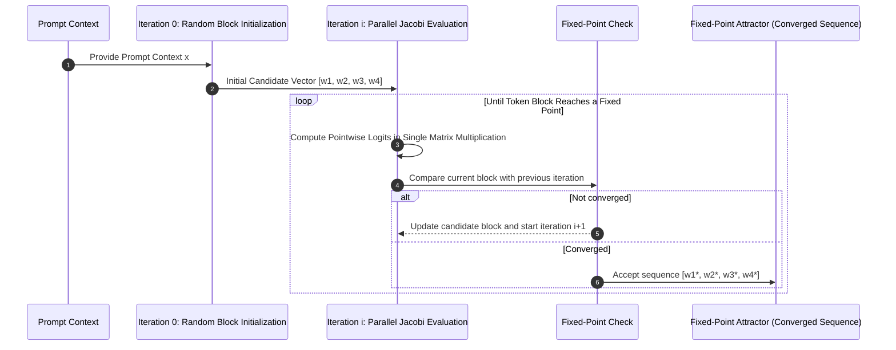
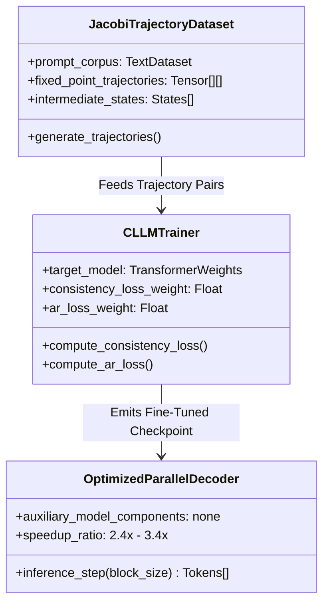

## Why Does Autoregressive Token Generation Suffer From Fundamental Memory Bandwidth Limits?

```mermaid
graph TD
    subgraph StandardAutoregressive["Standard Autoregressive Decoding (Memory-Bandwidth Bound)"]
        AR1["Step 1: Load 70B Weights from HBM -> Emit Token 1"] --> AR2["Step 2: Load 70B Weights from HBM -> Emit Token 2"]
        AR2 --> AR3["Step 3: Load 70B Weights from HBM -> Emit Token 3"]
        AR3 --> AR4["Step N: Load 70B Weights from HBM -> Emit Token N"]
    end

    subgraph ConsistencyParallelDecoding["Consistency LLM Parallel Decoding (CLLM)"]
        Init["Initialize Random / Masked K-Token Block"] --> Jacobi["Parallel Jacobi Update: One Forward Pass Per Iteration"]
        Jacobi --> Check["Check Whether the Token Block Has Reached a Fixed Point"]
        Check -->|Not converged| Jacobi
        Check -->|Converged| Emit["Emit Accepted Tokens (2.4x - 3.4x Wall-Clock Speedup)"]
    end
```

Large language models (LLMs) have traditionally been conceived and executed as strict autoregressive (AR) sequence generators. During generation, token $y_t$ is sampled conditionally based on the prefix sequence $y_{<t}$. To generate the next token $y_{t+1}$, the entire multi-billion-parameter weight tensor must be read from High Bandwidth Memory (HBM) into SRAM cache, even though the forward pass computes only a single token representation. As a consequence, autoregressive inference is severely memory-bandwidth bound: computational arithmetic logic units (ALUs) remain chronically underutilized while waiting for parameter weights to traverse bus interfaces.

In early 2024, researchers from Shanghai Jiao Tong University and UC San Diego introduced **Consistency Large Language Models (CLLMs)** (Kou et al., 2024). Inspired by consistency models in diffusion generation (Song et al., 2020), CLLMs train language models to predict multiple token positions in parallel within each Jacobi iteration, without requiring external draft models or complex auxiliary verification heads. The paper reports $2.4\times$ to $3.4\times$ speedups in task-specific evaluations without draft models or auxiliary model components; that does not establish a universal speedup or zero degradation across tasks. This source audit conducts an architectural dissection of the CLLM methodology, formalizes its dual-loss objective function, evaluates source-reported task benchmarks against the paper's own autoregressive baselines, and identifies what the cited sources do and do not establish beyond the 2024 study.
*Originally published 2024-05-12. Re-audited on 2026-10-28 against the official CLLM paper (arXiv:2403.00835v4) and the authors' repository.*

> **Correction (2026-10-28).** An earlier version included an uncited benchmark table with unsupported GSM8K and HumanEval scores, VRAM figures, a broad 3.2×/58-token-per-second result, and a zero-degradation conclusion. It also extrapolated from the 2024 paper to uncited 2026 production integrations. The official CLLM paper reports task-specific rows in Tables 1–2 and a separate 3.2× loss-design ablation in Table 6; it does not report the earlier HumanEval row, establish zero degradation across benchmarks, or establish those later integrations. I removed those unsupported values and claims, replaced the benchmark with selected source-linked rows, clarified that the paper's single-step convergence objective is a training target while reported inference still uses iterative Jacobi convergence, corrected the consistency-loss description to match Eq. 4's stop-gradient target distribution, intermediate-state input, and distance direction, corrected the AR-loss description to refer to target-model continuations rather than human ground-truth labels, and updated the sequence diagram to show repeated Jacobi iterations and a fixed-point check before output.
{: .prompt-warning }

---

## Mathematical Formulation: Jacobi Decoding as Fixed-Point Iteration

Standard autoregressive generation solves an iterative sequence generation problem:

$$y_t = \arg\max_{v \in \mathcal{V}} P(y_t = v \mid y_{<t}, x)$$

Jacobi decoding reformulates sequence generation as finding the fixed point of an operator system. Given a prompt $x$ and a target generation length $K$, Jacobi decoding initializes a candidate token sequence randomly:

$$Y^{(0)} = [y_1^{(0)}, y_2^{(0)}, \dots, y_K^{(0)}]$$

At each iteration step $i$, all $K$ tokens are updated in parallel using the model's simultaneous conditional probabilities:

$$y_k^{(i+1)} = \arg\max_{v \in \mathcal{V}} P(y_k = v \mid x, y_1^{(i)}, y_2^{(i)}, \dots, y_{k-1}^{(i)})$$

Under standard untrained transformer checkpoints, Jacobi decoding requires numerous iterations to reach a fixed point, offering little wall-clock advantage over sequential autoregressive decoding. CLLM training targets faster convergence from intermediate trajectory states, but the ideal single-step mapping is not a guarantee that every inference run reaches its fixed point in one forward pass; the reported evaluations still measure iterative Jacobi decoding.

---

## The CLLM Training Pipeline: Dual Consistency and Autoregressive Loss

To reduce the number of Jacobi iterations, CLLMs fine-tune pretrained foundation models on precomputed Jacobi trajectories using a consistency loss and an autoregressive loss. These losses are applied during training; they are not runtime decoding steps.

### 1. Generating Jacobi Trajectory Pairs

For a given training prompt, the target model executes standard Jacobi decoding, capturing the step-by-step token state transitions from random noise $Y^{(0)}$ to intermediate approximations $Y^{(i)}$ and final fixed point $Y^*$.

### 2. Dual-Objective Loss Optimization

Training minimizes a combined loss function that balances parallel multi-token prediction with autoregressive distribution fidelity:

$$\mathcal{L}_{\text{total}} = \mathcal{L}_{\text{consistency}} + \lambda \mathcal{L}_{\text{AR}}$$

- **Consistency Loss ($\mathcal{L}_{\text{consistency}}$)**: [Eq. 4](https://arxiv.org/html/2403.00835v4#S3.E4) defines a global consistency loss as an expectation over prompt/trajectory samples of distances between the stop-gradient target-model distribution conditioned on fixed-point prefixes and the trainable model distribution conditioned on intermediate prefixes:
  $$\mathcal{L}_{\text{GC}} = \mathbb{E}_{(x,\mathcal{J})\sim\mathcal{D},\,Y\sim\mathcal{J}}\left[\sum_{k=1}^{K} D\left(q_{\theta^-}(\cdot \mid Y^*_{<k},x)\,\middle\|\,q_{\theta}(\cdot \mid Y_{<k},x)\right)\right], \qquad \theta^- = \operatorname{stopgrad}(\theta).$$
  The paper allows $D$ to be forward KL, reverse KL, or Jensen–Shannon divergence, and primarily experiments with forward KL; it is not necessarily the reverse-direction KL written in the earlier version.
- **Autoregressive Regularization ($\mathcal{L}_{\text{AR}}$)**: Helps keep the CLLM from deviating from the target LLM by matching its autoregressive continuation distributions; these are target-model continuations, not human ground-truth labels.

Crucially, the paper reports that tuning on approximately 1 million tokens for LLaMA-7B reached a 3.4× speedup on Spider; it does not establish a general wall-clock training time from that token count.

---

## Linguistic Mechanism: Learning Native Collocations

A notable empirical finding of the CLLM study is how the model achieves multi-token jumps: it internalizes **linguistic collocations**—sequences of words that co-occur with high statistical frequency.

In natural human speech and code synthesis, vocabulary is not selected token-by-token from a uniform distribution. Words cluster in predictable functional collocations:

1. **Verb-Preposition Collocations**: Expressions like *"rely on"*, *"interested in"*, *"contribute to"*, and *"associated with"*.
2. **Idiomatic Verb-Noun Constructs**: Units such as *"make a decision"*, *"take into account"*, and *"catch a cold"*.
3. **Deterministic Programming Syntax**: Multi-token code constructs like `SELECT ... FROM`, `if __name__ == "__main__":`, and `try { ... } catch (...)`.

CLLMs exploit these structural regularities by updating multiple token positions in parallel within each Jacobi iteration. The resulting sequence is accepted only after the token block reaches a fixed point, so the method does not imply that an entire collocated phrase is emitted in one forward pass.

---

## Empirical Benchmark: Source-Reported CLLM Results

The table below reproduces selected rows from the official paper's [Table 1](https://arxiv.org/html/2403.00835v4#S4.T1) and [Table 2](https://arxiv.org/html/2403.00835v4#S4.T2). The paper defines speedup as wall-clock generation speed relative to that method's autoregressive baseline, with batch size 1. Its reported task metrics are not a common accuracy scale, so they must not be collapsed into a single cross-task score.

| Dataset | Model and decoding method | Speed (tokens/s) | Speedup | Paper metric |
| :--- | :--- | ---: | ---: | ---: |
| GSM8K | Fine-tuned LLaMA2-7B + AR | 43.5 | 1.0× | 59.1 |
| GSM8K | CLLM-LLaMA2-7B + Jacobi | 132.4 | 3.0× | 56.4 |
| ShareGPT (MT-Bench) | Fine-tuned LLaMA2-7B + AR | 37.6 | 1.0× | 6.5 |
| ShareGPT (MT-Bench) | CLLM-LLaMA2-7B + Jacobi | 88.4 | 2.4× | 6.4 |
| Spider | Fine-tuned Deepseek-7B + AR | 38.0 | 1.0× | 70.0 |
| Spider | CLLM-Deepseek-7B + Jacobi | 127.4 | 3.4× | 69.3 |
| CodeSearchNet Python | Fine-tuned Deepseek-7B + AR | 40.1 | 1.0× | 60.4 |
| CodeSearchNet Python | CLLM-Deepseek-7B + Jacobi | 102.1 | 2.5× | 59.2 |

The paper does contain a 3.2× figure, but it is narrower than the removed claim: [Table 6](https://arxiv.org/html/2403.00835v4#S4.T6) reports 3.2× for one CTG+AR loss-design ablation on GSM8K, with a paper metric of 51.3. That result is not the earlier 58-token-per-second benchmark row. The official tables also show that CLLM metrics differ from their listed baselines (for example, 56.4 versus 59.1 on GSM8K and 69.3 versus 70.0 on Spider), so the source does not support a universal zero-degradation claim.

---

## What the CLLM Evidence Still Does Not Establish

The official CLLM paper and the authors' repository evaluate the method on named datasets and decoding setups. They do not establish the later production claims previously attached to this article—entropy-aware speculation depth in vLLM or SGLang, browser/mobile throughput doubling, or native consistency-loss support in Unsloth. Those claims are outside the cited evidence and are removed rather than inferred.

For adjacent but separate source audits, see [WebGPU local inference](/posts/phi3-webgpu/) and [LLM inference patterns](/posts/llm-inference-patterns/); neither is evidence for the CLLM claims above.

---

## Key Takeaways

- **Overcoming the Memory-Bandwidth Bottleneck**: Parallel decoding circumvents sequential HBM access penalties by evaluating multiple token positions concurrently in a single forward pass.
- **No auxiliary decoder model**: In the paper's setup, CLLMs use the fine-tuned backbone with Jacobi decoding rather than a separate draft model or auxiliary heads; the reported memory benefit is architectural, not a universal zero-VRAM claim.
- **Collocation Exploitation**: By learning natural-language and programming collocations, CLLMs accelerate predictable token sequences, but the paper reports task-specific metrics that vary by dataset and configuration rather than proving zero degradation.

---

## New Questions

1. **Long-Context Jacobi Stability**: How do attention key-value cache dynamics behave under Jacobi iteration when sequence lengths exceed 64K tokens, and does speculative parallel decoding induce attention drift over long contexts?
2. **Multi-Modal Parallel Decoding**: Can consistency decoding principles be generalized to vision-language models, allowing parallel generation of bounding box coordinate tokens and textual object descriptions simultaneously?

---

## References

- Kou, S., Hu, L., He, Z., Deng, Z., & Zhang, H. (2024). *CLLMs: Consistency Large Language Models*. ICML 2024 / arXiv:2403.00835v4. https://arxiv.org/abs/2403.00835v4 (accessed 2026-10-28).
- [CLLM official repository](https://github.com/hao-ai-lab/Consistency_LLM) (evaluation scripts and released checkpoints; accessed 2026-10-28).
- Leviathan, Y., Kalman, M., & Matias, Y. (2023). *Fast Inference from Transformers via Speculative Decoding*. International Conference on Machine Learning (ICML 2023). arXiv preprint arXiv:2211.17192. https://arxiv.org/abs/2211.17192 (accessed 2026-10-18).
- Song, Y., Sohl-Dickstein, J., Kingma, D. P., Kumar, A., Ermon, S., & Poole, B. (2020). *Score-Based Generative Modeling through Stochastic Differential Equations*. International Conference on Learning Representations (ICLR 2021). arXiv preprint arXiv:2011.13456. https://arxiv.org/abs/2011.13456 (accessed 2026-10-18).
- Cai, T., Li, Y., Geng, Z., Peng, H., Lee, J. D., Chen, D., & Dao, T. (2024). *Medusa: Simple LLM Inference Acceleration Framework with Multiple Decoding Heads*. arXiv preprint arXiv:2401.10774. https://arxiv.org/abs/2401.10774 (accessed 2026-10-18).
