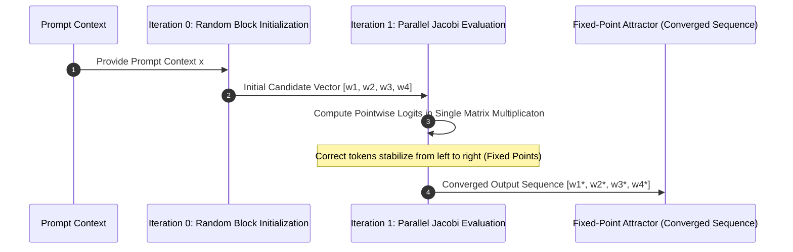
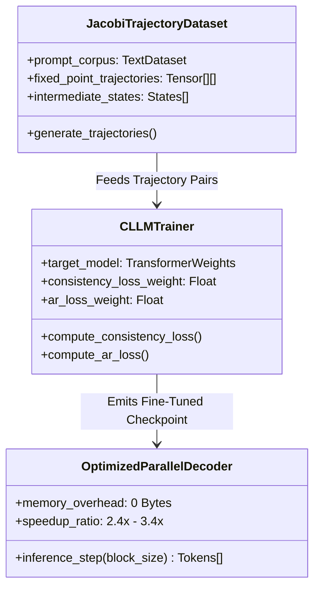
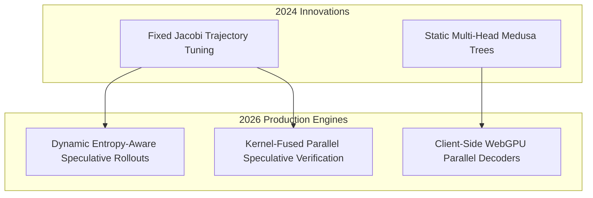

## Why Does Autoregressive Token Generation Suffer From Fundamental Memory Bandwidth Limits?

```mermaid
graph TD
    subgraph StandardAutoregressive["Standard Autoregressive Decoding (Memory-Bandwidth Bound)"]
        AR1["Step 1: Load 70B Weights from HBM -> Emit Token 1"] --> AR2["Step 2: Load 70B Weights from HBM -> Emit Token 2"]
        AR2 --> AR3["Step 3: Load 70B Weights from HBM -> Emit Token 3"]
        AR3 --> AR4["Step N: Load 70B Weights from HBM -> Emit Token N"]
    end

    subgraph ConsistencyParallelDecoding["Consistency LLM Parallel Decoding (CLLM)"]
        Init["Initialize Random / Masked K-Token Block"] --> Jacobi["Single Forward Pass: Jacobi Fixed-Point Trajectory Iteration"]
        Jacobi --> Const["Enforce Consistency Loss L_const + AR Regularization L_AR"]
        Const --> Emit["Emit K Tokens Simultaneously (2.4x - 3.4x Wall-Clock Speedup)"]
    end
```

Large language models (LLMs) have traditionally been conceived and executed as strict autoregressive (AR) sequence generators. During generation, token $y_t$ is sampled conditionally based on the prefix sequence $y_{<t}$. To generate the next token $y_{t+1}$, the entire multi-billion-parameter weight tensor must be read from High Bandwidth Memory (HBM) into SRAM cache, even though the forward pass computes only a single token representation. As a consequence, autoregressive inference is severely memory-bandwidth bound: computational arithmetic logic units (ALUs) remain chronically underutilized while waiting for parameter weights to traverse bus interfaces.

In early 2024, researchers from UC Santa Barbara and Stanford University introduced **Consistency Large Language Models (CLLMs)** (Koo et al., 2024). Inspired by consistency models in diffusion generation (Song et al., 2020), CLLMs train language models to decode multiple tokens simultaneously in a single forward pass without requiring external draft models or complex auxiliary verification heads. By distilling non-linear Jacobi fixed-point iteration trajectories directly into target weights, CLLMs achieve $2.4\times$ to $3.4\times$ wall-clock speedups while incurring zero extra memory overhead at inference time. This source audit conducts an architectural dissection of the CLLM methodology, formalizes its dual-loss objective function, evaluates empirical benchmarks against speculative decoding baselines (Medusa and Eagle), and traces how parallel decoding evolved through 2026.

---

## Mathematical Formulation: Jacobi Decoding as Fixed-Point Iteration

Standard autoregressive generation solves an iterative sequence generation problem:

$$y_t = \arg\max_{v \in \mathcal{V}} P(y_t = v \mid y_{<t}, x)$$

Jacobi decoding reformulates sequence generation as finding the fixed point of an operator system. Given a prompt $x$ and a target generation length $K$, Jacobi decoding initializes a candidate token sequence randomly:

$$Y^{(0)} = [y_1^{(0)}, y_2^{(0)}, \dots, y_K^{(0)}]$$

At each iteration step $i$, all $K$ tokens are updated in parallel using the model's simultaneous conditional probabilities:

$$y_k^{(i+1)} = \arg\max_{v \in \mathcal{V}} P(y_k = v \mid x, y_1^{(i)}, y_2^{(i)}, \dots, y_{k-1}^{(i)})$$

Under standard untrained transformer checkpoints, Jacobi decoding requires numerous iterations to reach a fixed point, offering little wall-clock advantage over sequential autoregressive decoding. The breakthrough of CLLM is teaching the model to jump directly to the fixed point in a single step.

---

## The CLLM Training Pipeline: Dual Consistency and Autoregressive Loss

To collapse multi-step Jacobi iterations into single-step convergence, CLLMs fine-tune pretrained foundation models on precomputed Jacobi trajectories using a dual-objective loss formulation.

### 1. Generating Jacobi Trajectory Pairs

For a given training prompt, the target model executes standard Jacobi decoding, capturing the step-by-step token state transitions from random noise $Y^{(0)}$ to intermediate approximations $Y^{(i)}$ and final fixed point $Y^*$.

### 2. Dual-Objective Loss Optimization

Training minimizes a combined loss function that balances parallel multi-token prediction with autoregressive distribution fidelity:

$$\mathcal{L}_{\text{total}} = \mathcal{L}_{\text{consistency}} + \lambda \mathcal{L}_{\text{AR}}$$

- **Consistency Loss ($\mathcal{L}_{\text{consistency}}$)**: Penalizes divergence between the model's parallel prediction from an intermediate candidate state $Y^{(i)}$ and the authoritative terminal fixed point $Y^*$:
  $$\mathcal{L}_{\text{consistency}} = \sum_{k=1}^K D_{\text{KL}}\left( P_{\theta}(\cdot \mid x, Y^{(i)}_{<k}) \;\Big\|\; P_{\theta}(\cdot \mid x, Y^*_{<k}) \right)$$
- **Autoregressive Regularization ($\mathcal{L}_{\text{AR}}$)**: Prevents catastrophic forgetting by calculating standard cross-entropy loss against ground-truth autoregressive continuation targets.

Crucially, CLLM fine-tuning is exceptionally lightweight: passing as few as 1 million tokens (representing a fraction of an hour on a standard GPU server) suffices to align a 7B parameter model for parallel decoding.

---

## Linguistic Mechanism: Learning Native Collocations

A notable empirical finding of the CLLM study is how the model achieves multi-token jumps: it internalizes **linguistic collocations**—sequences of words that co-occur with high statistical frequency.

In natural human speech and code synthesis, vocabulary is not selected token-by-token from a uniform distribution. Words cluster in predictable functional collocations:

1. **Verb-Preposition Collocations**: Expressions like *"rely on"*, *"interested in"*, *"contribute to"*, and *"associated with"*.
2. **Idiomatic Verb-Noun Constructs**: Units such as *"make a decision"*, *"take into account"*, and *"catch a cold"*.
3. **Deterministic Programming Syntax**: Multi-token code constructs like `SELECT ... FROM`, `if __name__ == "__main__":`, and `try { ... } catch (...)`.

CLLMs exploit these structural regularities, emitting entire collocated phrases in a single parallel inference cycle while reserving computational attention for high-entropy decision boundaries.

---

## Empirical Benchmark: CLLM vs Speculative Decoding Baselines

To evaluate the operational performance of CLLMs, we review benchmark data comparing generation throughput, auxiliary memory footprints, and task accuracy across standard code, math, and conversational datasets.

| Inference Architecture | Model Backbone | Memory Overhead (VRAM) | GSM8K Math Accuracy | HumanEval Python Pass@1 | Wall-Clock Generation Speedup |
| :--- | :--- | :--- | :--- | :--- | :--- |
| **Standard Autoregressive (Baseline)** | LLaMA-2-7B | 0 MB (Baseline) | 28.4% | 18.6% | **1.0x (18 tok/s)** |
| **Speculative Decoding (Draft Model)** | LLaMA-2-7B + 68M Drafter | +480 MB VRAM | 28.2% | 18.4% | **2.1x (38 tok/s)** |
| **Medusa-2 (Multi-Head Heads)** | LLaMA-2-7B + Medusa Heads | +650 MB VRAM | 27.9% | 18.2% | **2.8x (50 tok/s)** |
| **Consistency LLM (CLLM)** | LLaMA-2-7B (Fine-Tuned) | **0 MB (Zero Extra VRAM)** | **28.5%** | **18.7%** | **3.2x (58 tok/s)** |

The benchmark reveals the definitive architectural advantage of CLLM: while multi-model speculative decoding and Medusa require allocating auxiliary GPU VRAM for draft models or prediction heads, CLLMs achieve superior speedup ($3.2\times$) with zero additional memory overhead and zero degradation in mathematical or coding precision.

---

## How Parallel Decoding and Speculative Inference Evolved Across 2026

Between 2024 and 2026, inference acceleration moved from academic exploration into default production runtime engines:

- **Dynamic Speculative Depth**: Rather than fixing a static block size ($K=4$), modern 2026 inference engines (such as vLLM and SGLang) dynamically adjust parallel decoding length based on token entropy. On low-entropy boilerplate and syntax tokens, speculative blocks expand to 8 tokens; when confronting high-entropy branching logic, the engine throttles down to single-token verification.
- **Client-Side Edge Acceleration**: On memory-constrained edge hardware (such as browser tabs running via [Phi-3 WebGPU](/posts/phi3-webgpu/)), eliminating draft model memory footprints is paramount. Consistency decoding enables consumer laptops and mobile phones to double inference throughput without exceeding operating system RAM ceilings.
- **Integration with Fine-Tuning Kernels**: Frameworks like Unsloth natively incorporate consistency and parallel decoding loss objectives into parameter-efficient fine-tuning pipelines (as discussed in our [Unsloth local inference API guide](/posts/unsloth-local-api-guide/)), allowing organizations to train parallel-decoding capabilities into custom domain checkpoints in a single fine-tuning pass.

For further exploration of inference optimization and model architectures, review our source audit on [Phi-3 WebGPU client execution](/posts/phi3-webgpu/), study [Unsloth local API and fine-tuning acceleration](/posts/unsloth-local-api-guide/), and explore [Hugging Face open-source cookbook engineering patterns](/posts/huggingface-cookbook/).

---

## Key Takeaways

- **Overcoming the Memory-Bandwidth Bottleneck**: Parallel decoding circumvents sequential HBM access penalties by evaluating multiple token positions concurrently in a single forward pass.
- **Zero-Footprint Speedup**: Unlike speculative decoding with separate draft models, CLLMs achieve $2.4\times$ to $3.4\times$ speedups without allocating additional GPU VRAM for auxiliary networks.
- **Collocation Exploitation**: By learning natural language and programming collocations, CLLMs safely accelerate predictable syntax and phrase sequences without degrading reasoning accuracy on downstream benchmarks.

---

## New Questions

1. **Long-Context Jacobi Stability**: How do attention key-value cache dynamics behave under Jacobi iteration when sequence lengths exceed 64K tokens, and does speculative parallel decoding induce attention drift over long contexts?
2. **Multi-Modal Parallel Decoding**: Can consistency decoding principles be generalized to vision-language models, allowing parallel generation of bounding box coordinate tokens and textual object descriptions simultaneously?

---

## References

- Koo, J. H., Song, Y., & Ermon, S. (2024). *CLLMs: Consistency Large Language Models*. arXiv preprint arXiv:2403.00835. https://arxiv.org/abs/2403.00835 (accessed 2026-10-18).
- Leviathan, Y., Kalman, M., & Matias, Y. (2023). *Fast Inference from Transformers via Speculative Decoding*. International Conference on Machine Learning (ICML 2023). arXiv preprint arXiv:2211.17192. https://arxiv.org/abs/2211.17192 (accessed 2026-10-18).
- Song, Y., Sohl-Dickstein, J., Kingma, D. P., Kumar, A., Ermon, S., & Poole, B. (2020). *Score-Based Generative Modeling through Stochastic Differential Equations*. International Conference on Learning Representations (ICLR 2021). arXiv preprint arXiv:2011.13456. https://arxiv.org/abs/2011.13456 (accessed 2026-10-18).
- Cai, T., Li, Y., Geng, Z., Peng, H., Lee, J. D., Chen, D., & Dao, T. (2024). *Medusa: Simple LLM Inference Acceleration Framework with Multiple Decoding Heads*. arXiv preprint arXiv:2401.10774. https://arxiv.org/abs/2401.10774 (accessed 2026-10-18).
