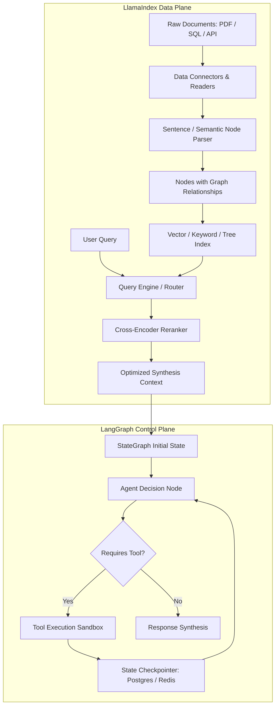

When the generative AI revolution accelerated following the public release of modern large language models, application developers immediately confronted the context window and knowledge boundary limitations of foundational checkpoints. Foundation models, trained on broad web-scale corpora, lacked access to private enterprise documents, proprietary source code repositories, and real-time operational databases.

Two foundational open-source frameworks emerged to bridge this gap: Harrison Chase's **LangChain** and Jerry Liu's **LlamaIndex** (initially known as GPT Index). While both ecosystems initially appeared to address the same problem space—connecting LLMs to external data—their foundational software design principles diverged sharply.

LangChain originated as an **action orchestration engine**, focusing on prompt chains, tool execution, and dynamic agent decision loops. LlamaIndex was conceived as a **data ingestion and indexing framework**, concentrating on data parsing, chunking strategies, hierarchical metadata graphs, and high-precision semantic retrieval. This source audit deconstructs the architectural primitives of both frameworks, maps their evolution into cyclical agent runtimes (LangGraph and LlamaIndex Workflows), and establishes an empirical evaluation rubric for production system design.


## How Did Ingestion Engines and Agent Orchestrators Diverge Architecturally?

The core philosophical divergence between LangChain and LlamaIndex reflects classical compiler and operating system design distinctions: **Compute versus Data**.

In traditional data engineering pipelines, query execution engines (like Apache Spark or SQL runtimes) separate table storage definitions and indexing structures from execution plans. Similarly, enterprise LLM architectures must balance two distinct responsibilities:
1. **The Data Plane (Storage & Retrieval)**: Ingesting raw unstructured documents (PDFs, Markdown, relational rows), transforming them into parsed chunks with attached metadata, generating vector embeddings, and executing hybrid vector/keyword searches with cross-encoder re-ranking.
2. **The Control Plane (Agent Orchestration)**: Managing conversational state, evaluating stop criteria, routing execution across tools, executing cyclical control flows, and handling human-in-the-loop interrupts.

```
LlamaIndex (Data-First Architectural Focus)
[Raw Documents / Data Connectors] ──▶ [Node Parsers & Metadata Extractors] ──▶ [Composable Indices] ──▶ [Query Engine]

LangChain & LangGraph (Control-First Architectural Focus)
[User Prompt] ──▶ [LCEL Runnable / StateGraph Node] ──▶ [Tool Selection & Cyclical Routing] ──▶ [Environment Execution]
```

LlamaIndex treats the document chunk as a first-class citizen called a **Node**. A Node contains not merely the raw text snippet, but structural parent-child relationships, preceding and following chunk pointers, and arbitrary typed metadata dictionaries. This rich data model allows LlamaIndex to implement advanced retrieval patterns—such as small-to-big sentence window retrieval, recursive document summaries, and hierarchical index trees—out of the box.

Conversely, LangChain historically treated documents as primitive dictionaries containing `page_content: str` and `metadata: dict`. LangChain’s core intellectual investment went into the **LangChain Expression Language (LCEL)** and later **LangGraph**, providing a declarative, composable runtime for streaming, parallel branching, fallback execution, and state persistence.

## Comparing Architectural Topologies: RAG Ingestion vs StateGraph Orchestration

To understand where each framework excels, consider how a user request traverses their respective processing graphs:



In a pure retrieval-augmented generation (RAG) workload, LlamaIndex provides superior index composability. It natively implements query routing over heterogeneous data collections—for example, automatically dispatching high-level thematic queries to a summary index while routing specific numerical questions to a SQL database or vector table.

However, once an application requires multi-step autonomous planning, dynamic retries, state machine validation, or tool error recovery—as described in our analysis of [Agentic Engineering 9 Skills](/posts/agentic-engineering-9-skills/)—LangChain's LangGraph provides a more robust execution model based on mathematical State Graphs.

## Code-Level Implementation Comparison

Examining idiomatic code implementations demonstrates the operational differences between the frameworks.

### 1. Advanced Production RAG in LlamaIndex

LlamaIndex encapsulates document chunking, metadata extraction, vector indexing, and query synthesis within a cohesive object-oriented hierarchy:

```python
from llama_index.core import SimpleDirectoryReader, VectorStoreIndex, StorageContext
from llama_index.core.node_parser import SentenceWindowNodeParser
from llama_index.core.indices.postprocessor import MetadataReplacementPostProcessor
from llama_index.core.postprocessor import SentenceTransformerRerank

# 1. Parse documents with small-to-big window metadata
node_parser = SentenceWindowNodeParser.from_defaults(
    window_size=3,
    window_metadata_key="window",
    original_text_metadata_key="original_text",
)

documents = SimpleDirectoryReader("./enterprise_knowledge_base").load_data()
nodes = node_parser.get_nodes_from_documents(documents)

# 2. Build indexed vector storage
index = VectorStoreIndex(nodes)

# 3. Configure query engine with dynamic context expansion and re-ranking
query_engine = index.as_query_engine(
    similarity_top_k=5,
    node_postprocessors=[
        # Replaces isolated matching sentence with surrounding paragraph window
        MetadataReplacementPostProcessor(target_metadata_key="window"),
        # High-precision cross-encoder re-ranking
        SentenceTransformerRerank(
            top_n=3, model="BAAI/bge-reranker-large"
        ),
    ],
)

response = query_engine.query("What are the contractual SLA penalty bounds for datacenter downtime?")
print(str(response))
```

In under thirty lines of code, LlamaIndex configures a state-of-the-art sentence window retrieval pipeline that resolves the classic chunking dilemma: indexing small sentences for optimal embedding similarity while expanding the surrounding context window during generation to preserve narrative coherence.

### 2. Cyclical Agentic Workflow in LangChain / LangGraph

When building an autonomous coding or diagnostic agent, linear chains fail because real-world problem solving requires cyclic loops: execute a tool, inspect stdout/stderr, handle exceptions, and loop back until tests pass:

```python
from typing import TypedDict, Annotated, Sequence
import operator
from langchain_core.messages import BaseMessage, HumanMessage
from langgraph.graph import StateGraph, END
from langchain_openai import ChatOpenAI
from langgraph.prebuilt import ToolNode

class AgentState(TypedDict):
    messages: Annotated[Sequence[BaseMessage], operator.add]
    iteration_count: int

def call_model(state: AgentState):
    model = ChatOpenAI(model="gpt-4o", temperature=0.0).bind_tools(tools)
    response = model.invoke(state["messages"])
    return {
        "messages": [response],
        "iteration_count": state["iteration_count"] + 1
    }

def should_continue(state: AgentState):
    last_message = state["messages"][-1]
    if not last_message.tool_calls or state["iteration_count"] > 10:
        return END
    return "tools"

# Construct explicit cyclical StateGraph
workflow = StateGraph(AgentState)
workflow.add_node("agent", call_model)
workflow.add_node("tools", ToolNode(tools))

workflow.set_entry_point("agent")
workflow.add_conditional_edges("agent", should_continue, {"tools": "tools", END: END})
workflow.add_edge("tools", "agent")

app = workflow.compile()
```

LangGraph’s graph-theoretic model provides first-class support for checkpointer persistence (saving conversation graphs to PostgreSQL), time-travel debugging (rewinding state to a previous node and replaying with alternative parameters), and human-in-the-loop approval barriers before destructive tool executions.

## Framework Capability Matrix

| System Dimension | LangChain / LangGraph | LlamaIndex (Workflows) | Production Assessment |
| :--- | :--- | :--- | :--- |
| **Primary Domain** | Multi-agent orchestration, cyclical state machines | Hierarchical document parsing, indexing, RAG | Complementary strengths |
| **Document Data Model** | Flat `Document(page_content, metadata)` | Structured `Node` with relational hierarchy | LlamaIndex excels at complex document ingestion |
| **Workflow Paradigm** | Graph-theoretic `StateGraph` with explicit edges | Event-driven `@step` Workflows (v0.11+) | LangGraph offers superior determinism |
| **State Persistence** | Native durable checkpointers (Postgres/Redis) | Event queue serialization | LangGraph leads in enterprise session replay |
| **Observability Integration** | LangSmith (Native tracing, evals, datasets) | LlamaTrace (Arize Phoenix integration) | LangSmith provides deeper prompt versioning |
| **Streaming Support** | Native token and event-level multiplexing (LCEL) | Asynchronous generator streaming | Both support token-level streaming |
| **Model Agnosticism** | Extensive vendor ecosystem (100+ providers) | Extensive provider integrations | Both support custom endpoints and local models |

As detailed in our post-training analysis in [LLaMA-Factory Architecture: Unified Post-Training Across 100+ LLMs](/posts/llama-factory/), model fine-tuning and inference serving are increasingly commoditized; application value concentrates in retrieval precision and workflow orchestration.

## How LangChain and LlamaIndex Evolved Across 2026

Between 2024 and 2026, the landscape of AI frameworks underwent significant architectural maturation. What began as simple wrapper libraries around OpenAI completion endpoints transformed into industrial-grade systems engineering software.

```
2023: Linear Prompt Chains        2024: Graph Runtimes & LCEL      2026: Event-Driven & Multi-Agent Swarms
┌───────────────────────────┐     ┌───────────────────────────┐    ┌───────────────────────────────────┐
│ LangChain Chains & Agents │────▶│ LangGraph StateGraphs     │───▶│ Durable Agent Checkpointing       │
│ LlamaIndex VectorStore    │     │ Composable Query Engines  │    │ LlamaIndex Event-Driven Workflows │
│ Simple Embeddings         │     │ Small-to-Big Retrieval    │    │ Hybrid GraphRAG & Vector Fusion   │
└───────────────────────────┘     └───────────────────────────┘    └───────────────────────────────────┘
```

1. **The Death of Monolithic Chains in Favor of Graphs**: In early 2024, LangChain deprecated legacy sequential chains (`LLMChain`, `SequentialChain`) in favor of LCEL and LangGraph. In 2026, production systems rarely deploy black-box ReAct loops; engineering teams require explicit state machines where valid transitions, maximum loop guards, and fallback branches are statically declared and validated.
2. **Event-Driven Workflows in LlamaIndex**: In late 2024, LlamaIndex introduced **LlamaIndex Workflows**, shifting its orchestration model from nested query engines to an event-driven architecture using Python decorators (`@step`). Each step listens for specific event types and emits downstream events into an asynchronous queue, allowing developers to construct complex RAG loops without deep LangChain dependencies.
3. **GraphRAG Convergence**: Pure vector similarity search reached its mathematical limit in answering multi-hop exploratory questions (e.g., "Identify all corporate subsidiaries that violated regulatory compliance across fiscal Q3"). Both ecosystems embraced hybrid GraphRAG—combining vector similarity with knowledge graph entity extraction (using Neo4j and Memgraph) to deliver deterministic multi-hop reasoning.
4. **Integration with Local Serving Runtimes**: Modern enterprise architectures increasingly run local models for privacy-sensitive RAG workloads, deploying authenticated local API proxies as documented in [Unsloth Local API Guide: Run Claude/OpenAI-Style Clients on Your Own Machine](/posts/unsloth-local-api-guide/) and optimizing latency via patterns explored in [LLM Inference Patterns](/posts/llm-inference-patterns/).

## Key Takeaways

- **Complementary Architectural Niches**: LangChain/LangGraph excels as an autonomous control plane and cyclical state orchestrator; LlamaIndex reigns as a high-precision data plane for indexing, parsing, and context synthesis.
- **Node-Level Richness**: LlamaIndex’s hierarchical Node data model enables advanced retrieval strategies (sentence windows, auto-merging, hierarchical indexing) that require complex custom plumbing in LangChain.
- **State Machine Determinism**: LangGraph replaces unpredictable black-box agent loops with mathematically sound State Graphs featuring persistent checkpoints, time travel, and human-in-the-loop validation.
- **The Modern Enterprise Standard**: Production architectures in 2026 rarely choose exclusively between the two; top teams frequently employ LlamaIndex for document ingestion and context retrieval, wrapping the resulting query engines as tools inside LangGraph agent swarms.

## New Questions

- As native database engines (such as PostgreSQL with pgvector, ClickHouse, and SingleStore) build native hybrid vector and full-text ranking algorithms directly into database kernels, will external framework indexing layers become redundant?
- What are the formal computational complexity boundaries when scaling LangGraph multi-agent systems to hundreds of concurrent subagents sharing persistent state checkpointers?
- Will the emergence of long-context foundation models (1M+ to 10M+ tokens) reduce enterprise dependence on complex chunking heuristics, or will attention dilution sustain the necessity of precision RAG?

## References

1. Chase, H. (2022–2026). *LangChain: Building Applications with LLMs through Composability*. LangChain Documentation. https://python.langchain.com/ (accessed 2026-10-18).
2. Liu, J., et al. (2022–2026). *LlamaIndex: Data Framework for LLM Applications*. LlamaIndex Documentation. https://docs.llamaindex.ai/ (accessed 2026-10-18).
3. LangChain Engineering. (2024–2026). *LangGraph: Building Language Agents as Graphs*. LangChain Project Documentation. https://langchain-ai.github.io/langgraph/ (accessed 2026-10-18).
4. Edge, D., Trinh, H., Cheng, N., Bradley, J., Chao, A., Mody, A., Truitt, S., & Larson, J. (2024). *From Local to Global: A Graph RAG Approach to Query-Focused Summarization*. arXiv preprint arXiv:2404.16130. https://arxiv.org/abs/2404.16130 (accessed 2026-10-18).
