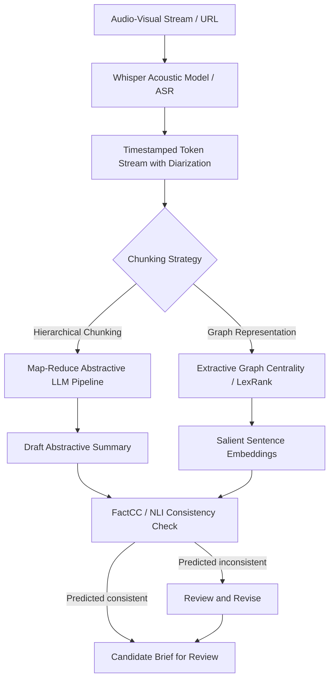
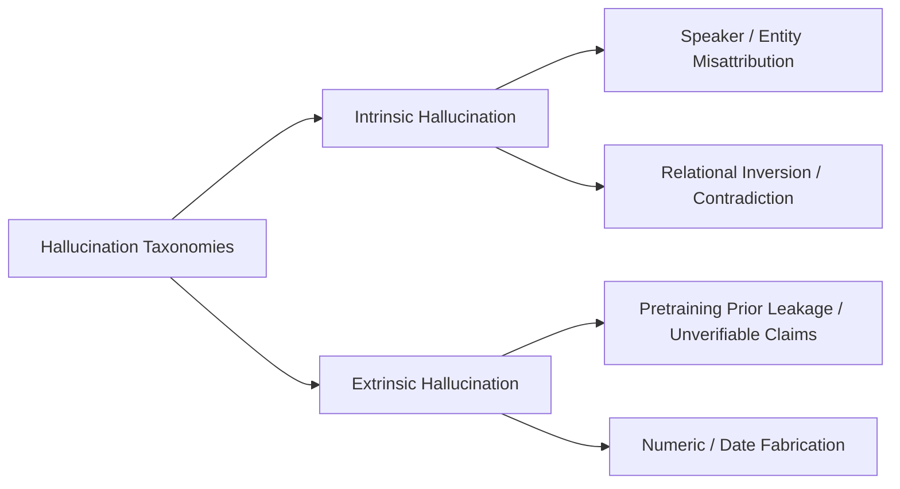
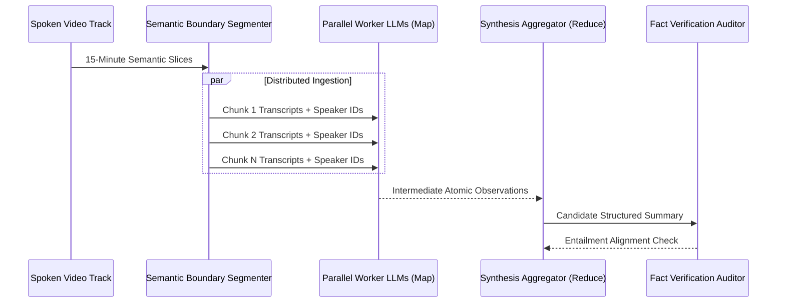

## Why Does Neural Video Summarization Require Hybrid Extractive-Abstractive Pipelines?

Automated video summarization tools—which convert long-form audio-visual streams into structured markdown briefs—frequently encounter a fundamental tension between factual fidelity and synthesis coherence. While user-facing applications like Lilys AI present a streamlined single-click interface, the underlying technical pipeline spans multiple brittle layers: acoustic speech recognition (ASR), speaker diarization, hierarchical context chunking, and neural text generation.

A primary failure mode in end-to-end abstractive summarization of hours-long transcripts is neural hallucination. Language models hallucinate factual details or attribute statements to the incorrect speaker when context lengths exceed optimal attention bounds. Addressing this challenge requires analyzing the mathematical divergence between extractive graph formulations and abstractive neural sequence models, alongside model-based factual consistency checks.

---

## Extractive versus Abstractive Summarization: Mathematical Foundations

Modern document compression operates across two distinct mathematical regimes:

### 1. Extractive Summarization via Graph Centrality

Extractive summarization constructs summaries strictly by selecting an optimal subset $S^* \subset D$ of existing sentences from the document $D = \{s_1, s_2, \dots, s_n\}$ without modifying token sequences. In unsupervised graph formulations (such as TextRank and LexRank), sentences are modeled as vertices $V$ in a fully connected weighted graph $G = (V, E)$. Edge weights $W_{ij}$ reflect semantic affinity:

$$W_{ij} = \frac{\mathbf{e}_i \cdot \mathbf{e}_j}{\|\mathbf{e}_i\| \|\mathbf{e}_j\|}$$

where $\mathbf{e}_i$ denotes the dense embedding of sentence $s_i$. Vertex importance scores $R(s_i)$ are solved via power iteration of the PageRank transition probability matrix:

$$R(s_i) = (1 - d) + d \sum_{j \in \text{In}(s_i)} \frac{W_{ji}}{\sum_{k \in \text{Out}(s_j)} W_{jk}} R(s_j)$$

where $d \in (0, 1)$ is the damping factor (conventionally $0.85$). Extracting sentences preserves their wording, not a guarantee of factual faithfulness: source statements may themselves be wrong, and omitted context or unresolved references can make a verbatim selection misleading. Human review against the full source and, where needed, independent evidence remains necessary.

### 2. Abstractive Summarization via Conditional Autoregression

Abstractive summarization frames compression as a sequence-to-sequence translation problem from source document tokens $\mathbf{X} = (x_1, \dots, x_N)$ to summary tokens $\mathbf{Y} = (y_1, \dots, y_M)$ where $M \ll N$. The model maximizes conditional log-likelihood under parameter weights $\theta$:

$$\mathcal{L}_{\text{seq2seq}}(\theta) = -\sum_{t=1}^M \log p_\theta(y_t \mid y_{<t}, \mathbf{X})$$

By generating novel phrasing and synthesizing across non-contiguous sections, abstractive systems produce fluid, human-grade syntheses. However, because generation relies on statistical token co-occurrences rather than deterministic fact databases, models are vulnerable to exposure bias and catastrophic hallucinations.

| Dimension | Extractive Formulation | Abstractive Formulation |
| :--- | :--- | :--- |
| **Source Material** | Verbatim sentence extraction | Novel paraphrase generation |
| **Factuality** | Verbatim wording, but context or source claims can still mislead | Generated claims require checking against the source and, where needed, independent evidence |
| **Compression Ratio** | Low (bounded by source sentence length) | High (dense thematic abstraction) |
| **Discourse Fluency** | Choppy, pronoun-unresolved | Cohesive, structured discourse |
| **Computational Overhead** | $O(N^2)$ graph distance or linear scoring | $O(N \cdot M)$ autoregressive attention passes |

---

## Hallucination Taxonomies in Multi-Hour Speech Transcripts

When processing transcripts from multi-hour video streams, models encounter noisy inputs: missing punctuation, phoneme confusion from speech-to-text engines, and disordered speaker interleaving. Hallucinations in these environments fall into two primary categories:

1. **Intrinsic Hallucinations**: Generated summaries directly contradict facts stated in the transcript. For example, if the speaker discusses corporate layoffs occurring at an external competitor, an intrinsic hallucination might summarize: *"The speaker announced layoffs within their own engineering team."*
2. **Extrinsic Hallucinations**: The summary introduces claims that cannot be grounded in or verified by the source transcript. While the factual assertion might be objectively true in the broader real world (leakage from pretraining weights), it constitutes an ungrounded hallucination relative to the source video.

Natural language inference (NLI) classifiers can estimate whether a source supports a summary, but their entailment labels are model predictions, not proofs. [Falke et al.](https://aclanthology.org/P19-1213/) found that out-of-the-box NLI models did not achieve the desired performance on their summary-ranking task. [FactCC](https://aclanthology.org/2020.emnlp-main.750/) predicts sentence-level consistency and extracts supporting or conflicting spans to assist review; it does not establish external truth. A source-consistent claim can still be false if the source is wrong, so reviewers must inspect context and independently check consequential claims.

For a different approach to reducing hallucinations during generation rather than checking summaries afterward, see the discussion of [DoLa decoding](/posts/new-decoding-to-reduce-hallucinations/).

---

## Architectural Scaling: Hierarchical Map-Reduce vs. Infinite Context Windows

Long recordings can produce transcripts that challenge a model's context handling. In [Lost in the Middle](https://arxiv.org/html/2307.03172), Liu et al. found that some tested models performed worse when relevant information appeared in the middle of a long input on multi-document question answering and key-value retrieval tasks. The result concerns task performance, not a demonstrated universal attention-weight mechanism or a fixed problematic interval.

Hierarchical chunking is one approach to processing long transcripts, but it can lose context during intermediate summarization and does not guarantee reliable retrieval or factuality:

1. **Map Phase**: Transcripts are segmented at natural pauses or topic shifts into 10-to-15 minute slices. Independent LLM workers extract atomic propositions, key decisions, and speaker positions from each slice.
2. **Reduce Phase**: Intermediate structured observations are aggregated sequentially. The master model synthesizes an overarching narrative, resolving duplicate topics and organizing timelines.
3. **Grounding Phase**: Each high-level bullet point is explicitly cross-referenced against exact source timestamps, enabling interactive user verification in downstream UI components. Similar retrieval mechanics underpin production [retrieval-augmented generation pipelines](/posts/llm-update-rag-paper/).

---

## 2026 Technological Evolution: Native Multimodal Video LLMs

In contemporary 2026 production environments, separate two-stage pipelines—ASR transcription followed by text-only LLM summarization—are increasingly superseded by native audio-visual language models:

- **End-to-End Multimodal Ingestion**: Native multimodal transformers ingest raw audio spectrograms and sampled video frames directly into shared token space. This retains tonal inflection, sarcasm, visual slide presentations, and ambient pauses that pure text transcripts discard.
- **Constrained Decoding with Attribution Masks**: Production summarizers enforce token-level attribution masks during autoregressive decoding. The model is penalized if generated entity spans do not possess direct attention alignment back to input video timestamps.
- **Sub-Second Speculative Summarization**: By coupling small drafting models with large verifier transformers, real-time conference call transcription and live hierarchical summarization achieve under-500ms latency on edge server clusters.

---

## Key Takeaways

- **Extractive Models Preserve Wording, Not Truth**: Verbatim selections can still omit necessary context or reproduce errors in the source.
- **Long Context Needs Evaluation**: Hierarchical Map-Reduce can divide a long transcript into smaller inputs, but it does not guarantee that important context survives or that positional failures disappear.
- **NLI Is a Fallible Check**: Entailment predictions can help flag potential inconsistencies, but cannot replace source review or independent fact-checking.
- **Timestamps Provide Verification Utility**: Pairing generated narrative points with verifiable audio-visual timestamps transforms opaque AI generation into an auditable research tool.

---

## New Questions

- **Can Direct Audio-Visual Embeddings Eliminate ASR Transcription Errors Entirely?**: As native video-audio models scale, will acoustic transcription become obsolete in favor of direct latent cross-modal summarization?
- **How Can Dynamic Attribution Penalties Be Implemented Efficiently in Real-Time Decoding?**: Can logit-level factual constraint checks run within strict streaming latency budgets without degrading conversational naturalness?

---

## References

- Lewis, M., Liu, Y., Goyal, N., Ghazvininejad, M., Mohamed, A., Levy, O., Stoyanov, V., & Zettlemoyer, L. (2020). BART: Denoising Sequence-to-Sequence Pre-training for Natural Language Generation, Translation, and Comprehension. *Association for Computational Linguistics (ACL 2020)*. [https://arxiv.org/abs/1910.13461](https://arxiv.org/abs/1910.13461) (accessed 2026-10-18)
- Radford, A., Kim, J. W., Xu, T., Brockman, G., McLeavey, C., & Sutskever, I. (2023). Robust Speech Recognition via Large-Scale Weak Supervision. *International Conference on Machine Learning (ICML 2023)*. [https://arxiv.org/abs/2212.04356](https://arxiv.org/abs/2212.04356) (accessed 2026-10-18)
- Kryscinski, W., McCann, B., Xiong, C., & Socher, R. (2020). Evaluating the Factual Consistency of Abstractive Text Summarization. *Empirical Methods in Natural Language Processing (EMNLP 2020)*. [https://arxiv.org/abs/1910.12840](https://arxiv.org/abs/1910.12840) (accessed 2026-10-18)
- Falke, T., Ribeiro, L. F. R., Utama, P. A., Dagan, I., & Gurevych, I. (2019). Ranking Generated Summaries by Correctness: An Interesting but Challenging Application for Natural Language Inference. *ACL 2019*. [https://aclanthology.org/P19-1213/](https://aclanthology.org/P19-1213/) (accessed 2026-10-28)
- Liu, N. F., Lin, K., Hewitt, J., Paranjape, A., Bevilacqua, M., Petroni, F., & Liang, P. (2024). Lost in the Middle: How Language Models Use Long Contexts. *Transactions of the Association for Computational Linguistics (TACL)*, 12, 157-173. [https://arxiv.org/abs/2307.03172](https://arxiv.org/abs/2307.03172) (accessed 2026-10-18)
