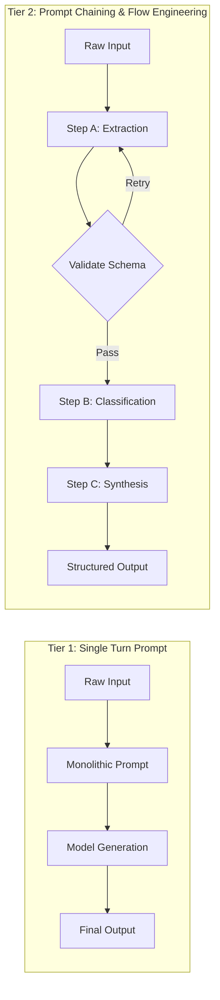
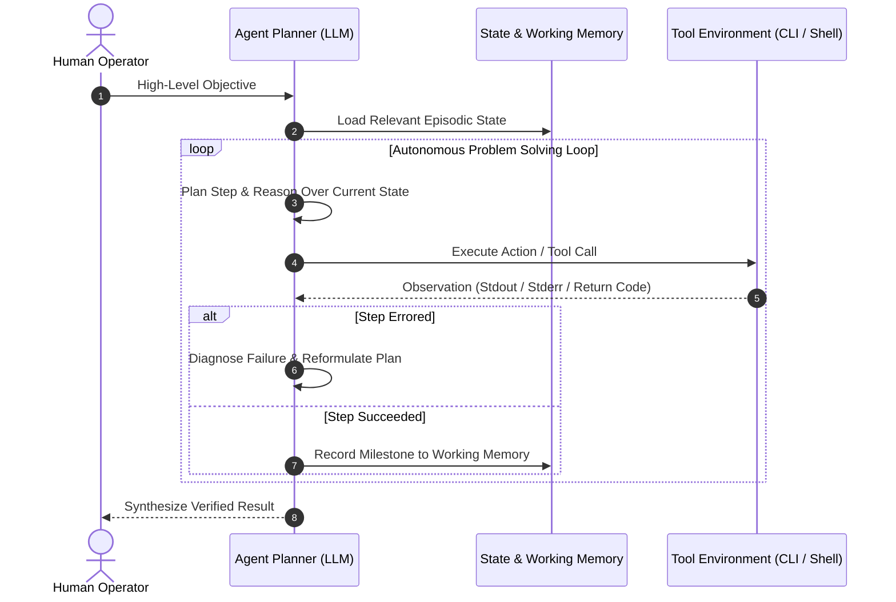

When enterprise software engineers first transition into applied generative AI, they frequently suffer from abstraction confusion. A team might attempt to solve a simple document querying problem by launching an expensive parameter-efficient fine-tuning (PEFT) cluster, or conversely, attempt to build an autonomous coding system using a single, brittle 5,000-token prompt string.

Building robust generative systems requires recognizing that large language models are not monolithic applications; they are non-deterministic reasoning engines that must be wrapped in progressively sophisticated software architectures.

This source audit formalizes the **Seven-Layer LLM Systems Hierarchy**—a structured systems taxonomy spanning raw prompt execution, deterministic prompt chaining, retrieval-augmented generation (RAG), conversational memory state, external tool integration, autonomous agent loops, and parameter-efficient post-training.


## How Does Complexity Scale Across the Seven Layers of LLM Architecture?

Engineering teams often treat generative AI development as a binary choice between "prompting" and "training." In production software engineering, this view is dangerously reductive. The capability, operational cost, and debugging complexity of an AI system scale across seven distinct architectural tiers:

```
Tier 7: Post-Training & Alignment (SFT, DPO, QLoRA, GRPO)
  ▲
Tier 6: Autonomous Agent Loops (Cyclical State Machines & Self-Correction)
  ▲
Tier 5: External Tool Integration (Function Calling & API Invocation)
  ▲
Tier 4: Conversational & Working Memory (Summary, Entity, & Episodic Graphs)
  ▲
Tier 3: Retrieval-Augmented Generation (Vector Search, Reranking, GraphRAG)
  ▲
Tier 2: Prompt Chaining & Flow Engineering (Sequential & Branching Pipelines)
  ▲
Tier 1: Foundation Inference & Prompting (Zero-shot, Few-shot, In-Context)
```

Each ascending tier introduces additional runtime state, external dependency dependencies, and non-deterministic error modes:
- **Tiers 1 and 2** operate entirely within the static weights of the base model, relying on prompt structuring and sequential decomposition.
- **Tiers 3, 4, and 5** introduce external data stores and computational sandboxes, granting the model external knowledge and real-world side effects.
- **Tiers 6 and 7** complete the feedback loop: Tier 6 provides dynamic autonomy via runtime self-correction, while Tier 7 bakes domain behaviors directly into model weights.

## Tier 1 & 2: From Zero-Shot Prompting to Deterministic Flow Engineering

The foundation of any language model system is the prompt interface. At Tier 1, an application relies on **In-Context Learning (ICL)**: formatting instructions, input data, and optional few-shot demonstrations within a single completion turn.

However, complex enterprise tasks (such as parsing legal contracts or conducting multi-factor security reviews) degrade rapidly under single-turn generation. Models suffer from attention diffusion across extensive prompts and fail to maintain reasoning discipline.



Tier 2 introduces **Flow Engineering** (prompt chaining). Instead of requesting an entire solution in one pass, the engineering workflow decomposes the problem into discrete, deterministic stages. As demonstrated by early prompt-engineering research (including Chain-of-Thought by Wei et al. and Chain-of-Density by Adams et al.), intermediate outputs are validated against strict JSON schemas before serving as input to subsequent steps.


In Tier 2, control flow remains hard-coded and deterministic. If a step fails schema validation, the system executes an automated retry or falls back to an alternative model branch.

## Tier 3: Grounding Outputs with Retrieval-Augmented Generation (RAG)

While prompt chaining structures logic, it cannot supply knowledge absent from the model’s pre-training dataset or context window. Tier 3 incorporates **Retrieval-Augmented Generation (RAG)**, grounding generation in validated external knowledge bases.


The canonical RAG architecture operates through three tightly coupled subsystems:
1. **The Ingestion Pipeline**: Ingesting unstructured text (PDFs, Markdown, database records), splitting text into semantically cohesive chunks, and computing vector embeddings using dense bi-encoders.
2. **The Retrieval Engine**: Querying vector databases (using Hierarchical Navigable Small World graphs or flat cosine similarity) and performing sparse BM25 keyword matching to produce hybrid candidate lists.
3. **The Re-ranking and Synthesis Layer**: Passing retrieved candidates through cross-encoder models to discard irrelevant noise before inserting the top chunks into the LLM's system prompt.

As analyzed in our framework deep-dive on [LangChain vs LlamaIndex: Architectural Patterns for RAG and Autonomous Agents](/posts/langchain-llama/), managing document chunk boundaries and hierarchical metadata structures represents the primary determinant of retrieval accuracy.

## Tier 4 & 5: State Persistence and Tool Calling Sandboxes

Once an AI application interacts with human users across multi-day sessions or requires access to live systems, static prompting and stateless retrieval become insufficient.

### Tier 4: Memory Hierarchies

Conversational memory is not merely appending chat histories until the context window overflows. Naive history dumping bloats token costs and introduces catastrophic forgetting. Production architectures implement tiered memory:
- **Buffer Window Memory**: Retaining the most recent $k$ interaction turns verbatim.
- **Summary Memory**: Periodically compressing historical interactions into dense narrative abstracts using smaller helper models.
- **Entity and Episodic Memory**: Extracting key facts, user preferences, and temporal relationships into an external key-value or graph store, retrieved dynamically when relevant entity keys are referenced.

### Tier 5: External Tool Integration (Function Calling)

Tier 5 bridges the model from passive textual reasoning to active environment manipulation. Through structured function calling schemas (standardized by OpenAI and Anthropic), the model outputs typed JSON arguments matching pre-declared API endpoints:

```json
{
  "name": "execute_database_migration",
  "arguments": {
    "target_table": "customer_ledger",
    "migration_id": "20261018_add_billing_hash",
    "dry_run": true
  }
}
```

The host application parses the function call, enforces authorization and security policies, executes the code inside a sandboxed runtime (such as Docker or WebAssembly), and feeds the execution output back into the model's message context. This architecture forms the core foundation of modern developer tooling, as examined in [CLI-Anything Agent-Native Interfaces](/posts/cli-anything-agent-native-interfaces/).

## Tier 6 & 7: Autonomous Agent Loops and Post-Training

At the apex of the hierarchy sit autonomous agents and model-level parameter adaptation.

### Tier 6: Autonomous Agent Loops

Tier 6 transitions from static developer-defined control flow to dynamic **model-directed planning**. The agent observes environmental feedback, formulates a multi-step task decomposition, invokes tools, analyzes execution errors, and adjusts its subsequent plan autonomously:



Building resilient agent loops requires strict SLA boundaries—including loop limits (`MAX_LOOPS`), timeout guards, and human-in-the-loop approval gates—as documented in our comprehensive analysis of [Agentic Engineering 9 Skills](/posts/agentic-engineering-9-skills/).

### Tier 7: Parameter-Efficient Fine-Tuning and Alignment

When behavioral requirements cannot be enforced through in-context prompting or when latency constraints demand smaller, specialized models, engineering teams graduate to Tier 7: **Post-Training and Alignment**.

Utilizing frameworks like LLaMA-Factory and Unsloth, teams apply Supervised Fine-Tuning (SFT), Direct Preference Optimization (DPO), or Group Relative Policy Optimization (GRPO) to teach models specialized syntaxes, internalize domain vocabularies, and eliminate reasoning latency. Review our detailed technical audit on [LLaMA-Factory Architecture: Unified Post-Training Across 100+ LLMs](/posts/llama-factory/) for exact mathematical and configuration specs.

## Architectural Trade-off Matrix

| Hierarchy Tier | Development Effort | Runtime Latency | Compute / Token Cost | Failure Modes | Primary Remedy |
| :--- | :--- | :--- | :--- | :--- | :--- |
| **Tier 1: Single Prompt** | Hours | Lowest (~300ms) | Low | Hallucination, instruction drift | Few-shot examples, prompt clarity |
| **Tier 2: Prompt Chains** | Days | Medium (~1s–3s) | Moderate | Schema parsing errors, cascading failures | Pydantic validation, retries |
| **Tier 3: RAG** | 1–2 Weeks | Medium (~800ms–2s) | Moderate | Chunking fragmentation, retrieval misses | Cross-encoder rerankers, GraphRAG |
| **Tier 4: Memory** | 1–2 Weeks | Low–Medium | Low–Medium | Context bloat, outdated factual state | Periodic summarization, vector memory |
| **Tier 5: Tool Calling** | 2–3 Weeks | Medium (~1s–5s) | Moderate | Malformed tool arguments, timeout faults | Sandboxed execution, strict schemas |
| **Tier 6: Agent Loops** | 3–6 Weeks | High (~5s–60s) | High | Infinite loops, goal drift, tool thrashing | Circuit breakers, StateGraph guards |
| **Tier 7: Fine-Tuning** | Months | Low (inference only) | High (GPU training) | Catastrophic forgetting, dataset bias | LoRA/QLoRA, rigorous eval harnesses |

## How the LLM Systems Stack Evolved Across 2026

Between 2024 and 2026, the boundaries separating these seven layers shifted significantly due to algorithmic and systems advancements:

```
2023-2024: Fragmented Stacks           2025: Graph Runtimes & MCP      2026: Reasoning Models & Automated Compilers
┌────────────────────────────┐         ┌──────────────────────────┐    ┌──────────────────────────────────────────┐
│ Manual Prompt Engineering  │────────▶│ Model Context Protocol   │───▶│ DSPy Automated Prompt Optimization       │
│ Brittle Sequential Chains  │         │ LangGraph StateGraphs    │    │ Native Long-Context Needle Retrieval     │
│ Isolated Vector Stores     │         │ OpenTelemetry Tracing    │    │ Test-Time Compute & GRPO RL Alignment   │
└────────────────────────────┘         └──────────────────────────┘    └──────────────────────────────────────────┘
```

1. **Automated Prompt Optimization (DSPy)**: Manual prompt engineering (Tier 1 & 2) was largely replaced in 2026 by programmatic prompt compilers like Stanford's DSPy. Developers define input-output assertions and metrics, and optimizers (such as MIPROv2) automatically synthesize, evaluate, and tune few-shot exemplars and system instructions against validation sets.
2. **Context Extension vs. Precision RAG**: As production models extended stable context windows to 1 million and 2 million tokens, naive RAG implementations were re-evaluated. However, because feeding full document dumps into long-context prompts increases inference latency and cost linearly, hybrid architectures emerged: using lightweight vector indexes for initial candidate selection and massive in-context caches for multi-document reasoning.
3. **Protocol Standardization (MCP and CLI-Anything)**: Tool integration (Tier 5) consolidated around standardized protocols such as Anthropic’s Model Context Protocol (MCP) and deterministic CLI wrappers. Rather than writing custom REST adapters for each enterprise tool, agents discover, authenticate, and invoke capabilities through unified client-server architectures.
4. **Test-Time Compute and Reasoning Models**: The emergence of reasoning-native models (such as DeepSeek-R1 and OpenAI o-series) shifted cognitive load from complex external agent orchestrators (Tier 6) into native token generation loops, enabling models to perform internal backtracking and verification before emitting final answers.

## Key Takeaways

- **Architectural Discipline**: Match the tier of the LLM hierarchy to the actual problem bounds; do not deploy expensive fine-tuning or open-ended agent loops where deterministic prompt chains or RAG suffice.
- **Schema-Gated Boundaries**: Every transition between tiers—whether passing prompt chain outputs, validating RAG chunks, or executing tool parameters—must be strictly enforced using typed validation contracts.
- **Stateful Persistence Matters**: Moving from stateless prompt wrappers to industrial software requires durable memory and cyclical state machines equipped with session checkpointers.
- **The Modern 2026 Standard**: Competitive enterprise systems combine DSPy-optimized prompts, hybrid vector/graph retrieval, standardized tool protocols, and targeted post-training adapters into a unified engineering pipeline.

## New Questions

- At what point does the cost of test-time compute in native reasoning models exceed the latency and infrastructure cost of external multi-step agent orchestrators?
- How will the deprecation of proprietary tool interfaces in favor of the Model Context Protocol (MCP) impact enterprise security audits and data exfiltration guardrails?
- Can automated prompt compilers (like DSPy) achieve parity with specialized QLoRA fine-tuning for domain-specific syntax generation tasks?

## References

1. Wei, J., Wang, X., Schuurmans, D., Bosma, M., Chi, E., Le, Q., & Zhou, D. (2022). *Chain-of-Thought Prompting Elicits Reasoning in Large Language Models*. Advances in Neural Information Processing Systems (NeurIPS 2022). https://arxiv.org/abs/2201.11903 (accessed 2026-10-18).
2. Adams, G., Fabbri, A., Ladhak, F., Lehman, E., & Elhadad, N. (2023). *From Sparse to Dense: GPT-4 Summarization with Chain of Density Prompting*. arXiv preprint arXiv:2309.04269. https://arxiv.org/abs/2309.04269 (accessed 2026-10-18).
3. Khattab, O., Singhvi, A., Maheshwari, P., Zhang, Z., Santhanam, K., Vardham, S., Zou, J., & Potts, C. (2023–2026). *DSPy: Compiling Declarative Language Model Calls into Self-Improving Pipelines*. Stanford University & arXiv preprint arXiv:2310.03714. https://arxiv.org/abs/2310.03714 (accessed 2026-10-18).
4. Anthropic. (2024–2026). *Model Context Protocol: An Open Standard for Connecting AI Assistants to Data and Tools*. Anthropic Standards Documentation. https://modelcontextprotocol.io/ (accessed 2026-10-18).
