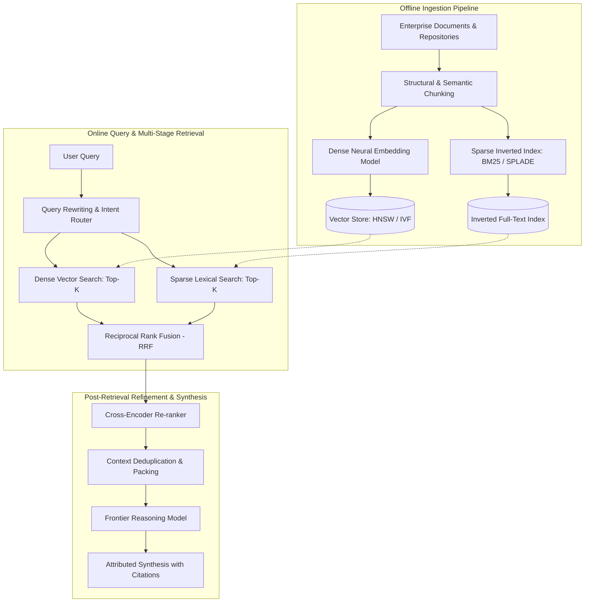

{: .light .w-75 .shadow .rounded-10 }

## How Did Retrieval-Augmented Generation Shift from Heuristic Augmentation to Systems Engineering?

When large language models entered mainstream enterprise adoption, their primary operational limitation became immediately apparent: parametric memory is static, costly to update, prone to hallucinations, and opaque regarding provenance. Fine-tuning a multi-billion parameter model to ingest dynamic internal knowledge bases or temporal records is economically prohibitive and operationally unmaintainable. 

Retrieval-Augmented Generation (RAG) emerged as the primary architectural paradigm to bridge static parametric weights with dynamic, non-parametric knowledge repositories. However, early implementations frequently reduced RAG to an oversimplified heuristic: split documents into arbitrary character chunks, compute dense embeddings, perform cosine similarity retrieval against a vector database, and paste top-$k$ passages into the prompt context window. 

In production systems, this naive chunk-and-embed approach degrades quickly under enterprise query loads. Semantic drift, chunk boundary fragmentation, embedding decay across specialized vocabularies, and the "lost-in-the-middle" attention phenomenon frequently lead to incomplete retrieval or hallucinated syntheses. 

Moving beyond naive prototypes requires treating RAG as a multi-stage distributed information retrieval problem. This source audit traces the architectural foundations of RAG from the seminal formulation by Lewis et al. (Facebook AI Research) to modern 2026 production systems incorporating hybrid sparse-dense indices, cross-encoder re-ranking, late-interaction scoring, and graph-augmented traversal.



---

## The Foundational Formulation: Lewis et al. and Non-Parametric Memory

The formal foundation of RAG was introduced by Patrick Lewis and colleagues at Facebook AI Research (NeurIPS 2020) in *Retrieval-Augmented Generation for Knowledge-Intensive NLP Tasks*. Lewis et al. formalized language modeling by decoupling knowledge into two distinct memory systems:
1. **Parametric Memory:** Pre-trained seq2seq transformer weights (e.g., BART or T5) parameterized by $\theta$.
2. **Non-Parametric Memory:** An external dense vector index of Wikipedia text passages accessed via a Dense Passage Retriever (DPR) parameterized by $\eta$.

### Mathematical Foundations: RAG-Sequence vs. RAG-Token
Lewis et al. proposed two primary probabilistic formulations for combining retrieved documents $z$ with input query $x$ to generate target tokens $y$:

#### 1. RAG-Sequence Model
In the RAG-Sequence formulation, the model assumes that a single retrieved passage generates the entire output sequence. The probability of generating sequence $y$ is computed by marginalizing over the top-$k$ retrieved documents:

$$
P_{\text{RAG-Seq}}(y|x) = \sum_{z \in \text{top-}k(p(\cdot|x))} p_\eta(z|x) \prod_{i=1}^N p_\theta(y_i|x, z, y_{1:i-1})
$$

Where the retrieval probability $p_\eta(z|x)$ is modeled as a bi-encoder inner product:

$$
p_\eta(z|x) \propto \exp\left( \mathbf{d}(z)^\top \mathbf{q}(x) \right)
$$

$\mathbf{q}(x) = \text{BERT}_Q(x)$ represents the dense query embedding, and $\mathbf{d}(z) = \text{BERT}_D(z)$ represents the dense document passage embedding.

#### 2. RAG-Token Model
In the RAG-Token formulation, the model can dynamically shift across different retrieved passages for each generated token. This allows the generator to synthesize facts from multiple distinct documents:

$$
P_{\text{RAG-Tok}}(y|x) = \prod_{i=1}^N \sum_{z \in \text{top-}k(p(\cdot|x))} p_\eta(z|x) p_\theta(y_i|x, z, y_{1:i-1})
$$

While RAG-Token offers greater theoretical flexibility, in production systems RAG-Sequence patterns (augmented by multi-document context packing) dominate due to the high computational overhead of marginalizing across document sets at every autoregressive decoding step.

---

## The Multi-Stage Retrieval Pipeline: Ingestion, Retrieval, and Reranking

Production architectures decompose RAG into three distinct operational phases: offline document preparation, multi-index candidate retrieval, and post-retrieval context refinement.

### 1. Document Preparation and Indexing
Effective retrieval depends heavily on document preprocessing:
- **Structural Chunking:** Naive fixed-length windowing (e.g., slicing every 500 characters) tears syntax and semantic coherence apart. Production pipelines employ Abstract Syntax Tree (AST) parsing for code, markdown header splitting for documentation, and table serialization for structured figures.
- **Hierarchical Parent-Document Indexing:** Storing small chunks (100–200 tokens) for precise vector matching while maintaining references to their enclosing parent section (1,000–2,000 tokens) allows models to match specific keywords without losing contextual surrounding text during generation.

### 2. Hybrid Retrieval: Combining Dense and Sparse Representations
Dense bi-encoder embeddings excel at capturing high-level semantic intent, but frequently fail on exact token lookups (part numbers, UUIDs, function signatures, error codes). Production systems pair dense embeddings with sparse lexical indexing (BM25 or SPLADE) and merge candidate sets using **Reciprocal Rank Fusion (RRF)**:

$$
\text{RRF\_Score}(d \in D) = \sum_{m \in M} \frac{1}{k + r_m(d)}
$$

Where $M$ represents the set of retrieval systems (e.g., dense vector search and BM25), $r_m(d)$ is the rank of document $d$ within retriever $m$, and $k$ is a smoothing constant (typically $k=60$). RRF provides a scale-invariant scoring mechanism that merges disparate relevance distributions without fragile score normalization.

### 3. Cross-Encoder Re-Ranking
Bi-encoders map query and document independently into vector space ($\mathbf{e}_q, \mathbf{e}_d$), sacrificing token-level interaction for sub-millisecond approximate nearest neighbor (ANN) lookups. To recover lost precision, production systems route the top-50 hybrid candidates through a **Cross-Encoder Re-ranker** (such as BGE-Reranker-Large or Cohere Rerank):

```
Bi-Encoder (Retrieval):   Score = dot( BERT(query), BERT(document) )
Cross-Encoder (Re-rank):  Score = BERT( [CLS] query [SEP] document [EOS] )
```

Cross-encoders evaluate full cross-attention between every query token and document token, discarding irrelevant matches and compressing the context window down to the 3 to 5 highest-density passages.

---

## Why Naive Chunk-and-Embed Approaches Fail in Production

Deploying RAG pipelines without structural guardrails results in well-documented production failure modes:

| Failure Mode | Root Cause | Engineering Solution |
|:---|:---|:---|
| **Lost in the Middle** | Attention heads in frontier LLMs prioritize tokens at the beginning and end of long prompts, ignoring middle contexts. | Sort re-ranked passages so highest-relevance documents sit at the extreme ends of the context window; prune redundant chunks. |
| **Out-of-Domain Decay** | Dense embedding models trained on general web corpora lose discriminative power on proprietary domain jargon. | Implement hybrid lexical/dense search or fine-tune embedding layers using Matryoshka Representation Learning (MRL). |
| **Chunk Boundary Fragmentation** | Slicing across sentence or paragraph boundaries isolates pronouns from their referents, rendering chunks unretrievable. | Employ sentence-window retrieval with contextual metadata pre-pending (enriching chunks with parent document title and summary). |
| **Hallucinated Grounding** | LLMs cite retrieved context even when the context does not contain the answer, hallucinating a false synthesis. | Implement deterministic evidence contracts, requiring explicit fact handles before synthesis commits to state. |

---

## How RAG Architectures Evolved Across 2026: Hybrid Search, Graph RAG, and Agentic Routing

Throughout 2026, information retrieval for AI systems moved beyond static document retrieval into dynamic, structured knowledge engines:

1. **Graph-Augmented Retrieval (Graph RAG):** Pure vector proximity fails when answering global relationship questions (e.g., *"How do modules in subsystem X interact with policy Y across the repository?"*). Systems like [EdgeQuake: High-Performance Graph RAG in Rust](/posts/edgequake-graph-rag-rust/) integrate knowledge graph extraction (entities and causal relations) with vector search over PostgreSQL (Apache AGE + pgvector), allowing dual-mode local and global thematic traversal.
2. **Evidence-Gated Recursive Synthesis:** In complex multi-hop question answering, autonomous agents decompose queries into sub-questions. However, unconstrained recursive querying often amplifies hallucinations. As analyzed in [RLM-FORGE: Architecting Evidence-Gated Recursion in Multi-Agent Loops](/posts/rlm-forge-evidence-gated-recursion/), modern runtimes enforce deterministic evidence policies (TraceGuard) that inspect candidate passages and reject claims lacking explicit fact tokens.
3. **Verifier-First Reasoning Loops:** Rather than generating an answer immediately upon retrieval, modern harnesses adopt reasoning loops—as explored in [Stop Generating, Start Thinking: The Architecture of Reasoning AI](/posts/stop-generating-start-thinking/)—where models generate multi-query hypotheses, verify source agreements, and formulate targeted secondary queries before finalizing answers.

---

## Key Takeaways

- **Decouple Parametric from Non-Parametric Memory:** Lewis et al. established RAG as a formal probabilistic framework combining pre-trained seq2seq generators with non-parametric dense retrieval indices.
- **Naive Chunking Is Insufficient:** Simple text windowing and cosine similarity search lead to semantic fragmentation and high hallucination rates on specialized enterprise corpora.
- **Hybrid Search via RRF Is Mandatory:** Combining sparse lexical matching (BM25) with dense vector representations via Reciprocal Rank Fusion ensures high recall for both exact identifier lookups and broad semantic queries.
- **Cross-Encoder Re-Ranking Restores Precision:** Routing top candidates through a cross-encoder model recovers token-to-token cross-attention interactions that bi-encoders discard during fast ANN search.
- **Graph and Evidence Integration:** Modern 2026 architectures combine vector similarity with knowledge graphs (Graph RAG) and deterministic evidence gating to resolve complex multi-hop queries reliably.

---

## New Questions

1. **Context Window vs. Retrieval Latency:** As frontier LLM context windows expand to 1M+ tokens, what is the exact economic and latency break-even point between direct long-context prompting and multi-stage RAG pipelines?
2. **Contextual Document Embedding Overhead:** How cost-effective are real-time LLM-generated contextual chunk summaries (generating prompt-aware prefix metadata for each chunk) during large-scale continuous document ingestion?
3. **Dynamic Graph Pruning:** How can Graph RAG engines dynamically prune low-centrality entity nodes during vector-graph traversal to prevent context pollution in high-density corporate intranets?

---

## References

- [Lewis et al.: Retrieval-Augmented Generation for Knowledge-Intensive NLP Tasks (NeurIPS 2020 / arXiv:2005.11401)](https://arxiv.org/abs/2005.11401) (accessed 2026-10-18)
- [Karpukhin et al.: Dense Passage Retrieval for Open-Domain Question Answering (EMNLP 2020 / arXiv:2004.04906)](https://arxiv.org/abs/2004.04906) (accessed 2026-10-18)
- [Khattab & Zaharia: ColBERT - Efficient and Effective Passage Search via Contextualized Late Interaction (SIGIR 2020 / arXiv:2004.12832)](https://arxiv.org/abs/2004.12832) (accessed 2026-10-18)
- [Cormack, Clarke & Buettcher: Reciprocal Rank Fusion Outperforms Condorcet and Individual Rank Learning Methods (SIGIR 2009)](https://dl.acm.org/doi/10.1145/1571941.1572114) (accessed 2026-10-18)
- [Liu et al.: Lost in the Middle - How Language Models Use Long Contexts (TACL 2024 / arXiv:2307.03172)](https://arxiv.org/abs/2307.03172) (accessed 2026-10-18)
