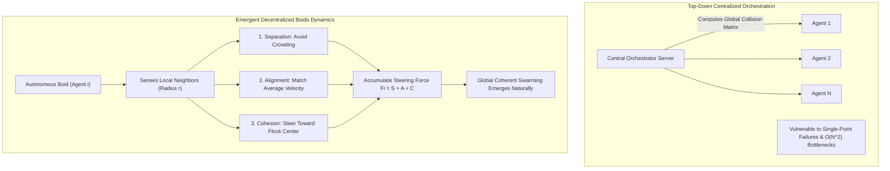
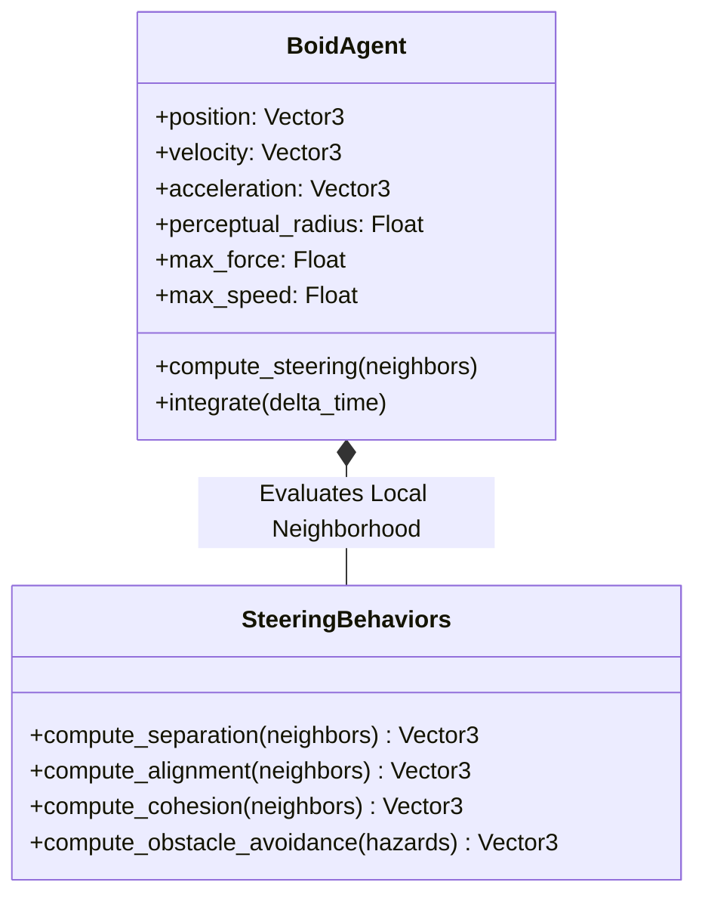
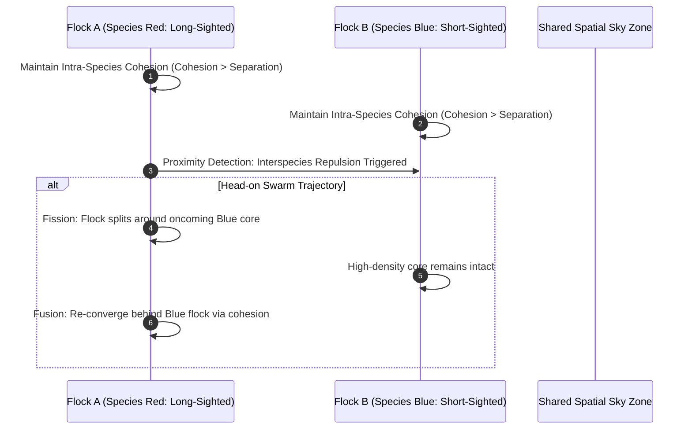
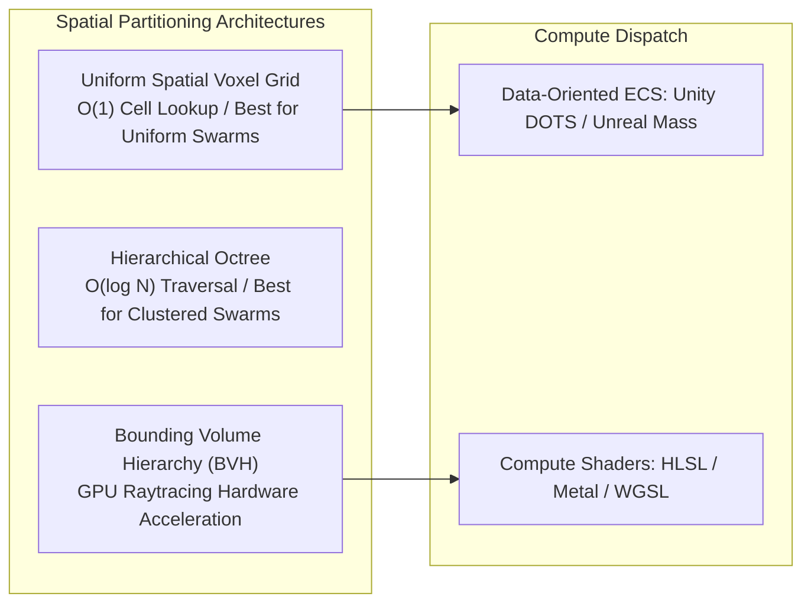
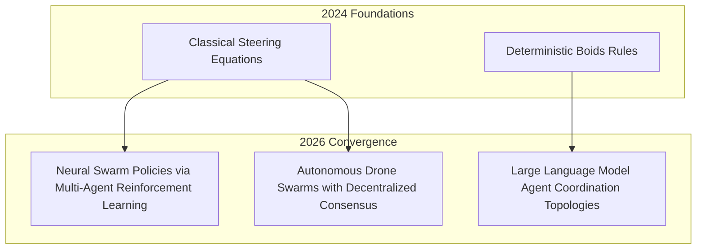

## How Do Three Simple Local Rules Synthesize Complex Global Swarm Dynamics?

In distributed systems, robotics, and computational graphics, generating coherent collective motion across thousands of independent entities represents a classic modeling challenge. If an engineer attempts to choreograph a flock of birds, a school of fish, or an autonomous drone swarm via centralized, top-down pathfinding (e.g., computing a single global trajectory plan and broadcasting waypoints to every individual), computational complexity scales quadratically $\mathcal{O}(N^2)$ and collapses under dynamic obstacles or communication dropouts.

In 1987, computer graphics pioneer Craig Reynolds introduced **Boids** (Reynolds, 1987), demonstrating that global flocking behavior does not require a central leader. Instead, breathtaking collective patterns emerge strictly from decentralized agents evaluating three elementary steering behaviors over local neighborhood spheres: **Separation**, **Alignment**, and **Cohesion**. In May 2024, Christopher Wolfram extended this classical framework to multi-species ecosystems, investigating fission-fusion segregation, visual range asymmetry, and multi-flock collision dynamics. This source audit conducts an architectural dissection of the Boids mathematical foundations, analyzes multi-species interaction dynamics, evaluates spatial acceleration structures, and traces how swarm intelligence evolved across 2026.

---

## Mathematical Formulation: The Three Foundational Steering Forces

At each discrete simulation time step $\Delta t$, each individual agent $i$ possesses a position vector $\mathbf{x}_i \in \mathbb{R}^d$ and a velocity vector $\mathbf{v}_i \in \mathbb{R}^d$. The agent senses only those neighbors $j$ situated within a localized perceptual spherical radius $r$ and field of view angle $\theta$:

$$\mathcal{N}_i = \{ j \mid j \neq i, \; \|\mathbf{x}_j - \mathbf{x}_i\| \le r \}$$

### 1. Separation ($\mathbf{F}_{\text{sep}}$): Collision Avoidance

Separation prevents crowding and physical collisions. Each boid applies a repulsive force inversely proportional to its Euclidean distance from neighboring flockmates:

$$\mathbf{F}_{\text{sep}} = \sum_{j \in \mathcal{N}_i} \frac{\mathbf{x}_i - \mathbf{x}_j}{\|\mathbf{x}_i - \mathbf{x}_j\|^2}$$

### 2. Alignment ($\mathbf{F}_{\text{ali}}$): Velocity Matching

Alignment steers the boid toward the average heading and velocity vector of its local flockmates, establishing synchronized laminar flow:

$$\mathbf{F}_{\text{ali}} = \left( \frac{1}{|\mathcal{N}_i|} \sum_{j \in \mathcal{N}_i} \mathbf{v}_j \right) - \mathbf{v}_i$$

### 3. Cohesion ($\mathbf{F}_{\text{coh}}$): Flock Center Attractor

Cohesion steers the boid toward the center of mass (centroid) of local flockmates, preventing the group from dispersing into isolated particles:

$$\mathbf{c}_i = \frac{1}{|\mathcal{N}_i|} \sum_{j \in \mathcal{N}_i} \mathbf{x}_j, \quad \mathbf{F}_{\text{coh}} = \text{steer\_toward}(\mathbf{c}_i)$$

The net steering force combines these weighted behaviors, clamped by a maximum acceleration ceiling $\mathbf{F}_{\text{max}}$:

$$\mathbf{F}_{\text{total}} = w_{\text{sep}} \mathbf{F}_{\text{sep}} + w_{\text{ali}} \mathbf{F}_{\text{ali}} + w_{\text{coh}} \mathbf{F}_{\text{coh}}$$

$$\mathbf{v}_i(t + \Delta t) = \text{truncate}\left(\mathbf{v}_i(t) + \frac{\mathbf{F}_{\text{total}}}{m} \Delta t, \; v_{\text{max}}\right), \quad \mathbf{x}_i(t + \Delta t) = \mathbf{x}_i(t) + \mathbf{v}_i(t + \Delta t) \Delta t$$

---

## Christopher Wolfram's Multi-Species Dynamics: Segregation and Fission-Fusion

While standard Reynolds Boids model a single homogeneous species, Christopher Wolfram (2024) investigated heterogeneous multi-flock ecosystems where distinct groups inhabit shared airspace.

### 1. Interspecies Segregation and Repulsion

In multi-species configurations, boids distinguish between conspecifics (same species) and heterospecifics (different species). Conspecific interactions maintain standard alignment and cohesion. In contrast, encounters with heterospecific boids trigger asymmetric repulsive forces:

$$\mathbf{F}_{\text{inter}} = \sum_{k \notin \text{Species}(i)} w_{\text{avoid}} \frac{\mathbf{x}_i - \mathbf{x}_k}{\|\mathbf{x}_i - \mathbf{x}_k\|^2}$$

This simple extension generates natural **fission-fusion** behavior: when two swarms meet in the sky, they do not entangle into a chaotic mixture. Instead, they dynamically split, stream around one another, and seamlessly fuse back into discrete, segregated flocks.

### 2. Sensory Radius Asymmetry: Core vs Periphery Stratification

Wolfram demonstrated that varying perceptual sight radius ($r_{\text{short}}$ vs $r_{\text{long}}$) across species induces spontaneous spatial stratification:

- **Short-Sighted Agents**: Senses only immediate neighbors, reacting rapidly to localized density spikes. Consequently, short-sighted boids naturally cluster inside the dense **core** of the swarm.
- **Long-Sighted Agents**: Senses distant cluster boundaries and distant obstacles, acting as early-warning scouts that naturally populate the **periphery** of the flock.

---

## Algorithmic Complexity: Accelerating Neighbor Queries via Spatial Partitioning

A naive implementation of Boids checks every agent against every other agent, leading to an intractable $\mathcal{O}(N^2)$ execution cost. For massive simulations ($N \ge 100,000$ boids in real-time game engines), spatial acceleration datastores reduce neighbor lookups to $\mathcal{O}(N \log N)$ or amortized $\mathcal{O}(N)$.

| Partitioning Strategy | Time Complexity per Step | Memory Footprint | Ideal Simulation Scenario |
| :--- | :--- | :--- | :--- |
| **Naive All-Pairs Comparison** | $\mathcal{O}(N^2)$ | $\mathcal{O}(1)$ | Small prototypes ($N < 500$) |
| **Uniform Spatial Grid / Hashing** | $\mathcal{O}(N \cdot k)$ (Amortized $\mathcal{O}(N)$) | $\mathcal{O}(\text{Cells} + N)$ | Bounded airspace with uniform boid distributions |
| **Dynamic Octree / KD-Tree** | $\mathcal{O}(N \log N)$ | $\mathcal{O}(N \log N)$ | Sparse, unbounded 3D space with dense localized clusters |
| **GPU Compute Shader Bitonic Sort** | $\mathcal{O}(N \log^2 N)$ parallel | High VRAM Bandwidth | Real-time swarms ($N > 500,000$ agents at 60 FPS) |

---

## How Swarm Simulation and Multi-Agent Spatial AI Evolved Across 2026

Between 2024 and 2026, the principles of emergent swarm dynamics expanded far beyond classical computer graphics:

- **Neural Boids via Multi-Agent RL**: Classical fixed-weight steering equations have been augmented with compact neural policies. Modern simulation frameworks train individual agents using decentralized Actor-Critic reinforcement learning, allowing swarms to discover emergent aerodynamic drafting formations (e.g., V-formations that conserve 30% battery power in physical drone flights).
- **Physical Drone Mesh Navigation**: Commercial and defense drone fleets in 2026 navigate GPS-denied environments using Boids-inspired decentralized peer-to-peer RF ranging and optical flow, maintaining spatial separation without relying on centralized ground control telemetry.
- **Cognitive Swarm Systems**: The philosophical core of Boids—that simple local interactions generate sophisticated global behavior—directly underpins modern multi-agent software engineering (as detailed in our [survey on LLM agents](/posts/llm-agents/) and [agentic design patterns](/posts/agentic-application-design-patterns/)), where specialized LLM workers collaborate without centralized bottlenecks.

For related explorations into multi-agent systems and graphics runtimes, examine our source audit on [LLM agent foundations and architectures](/posts/llm-agents/), study [foundational agentic design patterns](/posts/agentic-application-design-patterns/), and review [WebAssembly and WebGL/WebGPU graphics pipelines](/posts/web-gl/).

---

## Key Takeaways

- **Emergence Over Centralized Control**: Global flocking, schooling, and swarming behaviors can be generated entirely through three simple decentralized rules: Separation, Alignment, and Cohesion.
- **Multi-Species Segregation**: Introducing interspecies repulsion replicates complex biological fission-fusion dynamics, allowing multiple distinct flocks to cross paths without entangling or losing coherence.
- **Sensory Asymmetry Explains Stratification**: Varying perceptual sight radii naturally segregates short-sighted boids into the dense flock interior while long-sighted agents patrol the periphery.

---

## New Questions

1. **Topological vs Metric Neighborhoods**: In biological starling murmurations, empirical studies suggest boids interact with a fixed number of nearest neighbors (topological metric, $k \approx 7$) rather than a fixed spatial radius (metric distance). How does topological neighbor tracking alter multi-species fission dynamics?
2. **Energy Optimization Formations**: What minimal aerodynamic drag models can be integrated into real-time Boids simulations to organically induce energy-saving V-shaped migratory flight patterns without hardcoded formation templates?

---

## References

- Reynolds, C. W. (1987). *Flocks, Herds and Schools: A Distributed Behavioral Model*. In Proceedings of the 14th Annual Conference on Computer Graphics and Interactive Techniques (SIGGRAPH '87), 21(4), 25-34. https://dl.acm.org/doi/10.1145/37401.37406 (accessed 2026-10-18).
- Wolfram, C. (2024). *Simulating Multi-Flock Boids Dynamics and Fission-Fusion Swarms*. Wolfram Community Research Notes. https://community.wolfram.com/groups/-/m/t/3166791 (accessed 2026-10-18).
- Vicsek, T., Czirók, A., Ben-Jacob, E., Cohen, I., & Shochet, O. (1995). *Novel Type of Phase Transition in a System of Self-Driven Particles*. Physical Review Letters, 75(6), 1226-1229. https://journals.aps.org/prl/abstract/10.1103/PhysRevLett.75.1226 (accessed 2026-10-18).
- Olfati-Saber, R. (2006). *Flocking for Multi-Agent Dynamic Systems: Algorithms and Theory*. IEEE Transactions on Automatic Control, 51(3), 401-420. https://ieeexplore.ieee.org/document/1605401 (accessed 2026-10-18).
