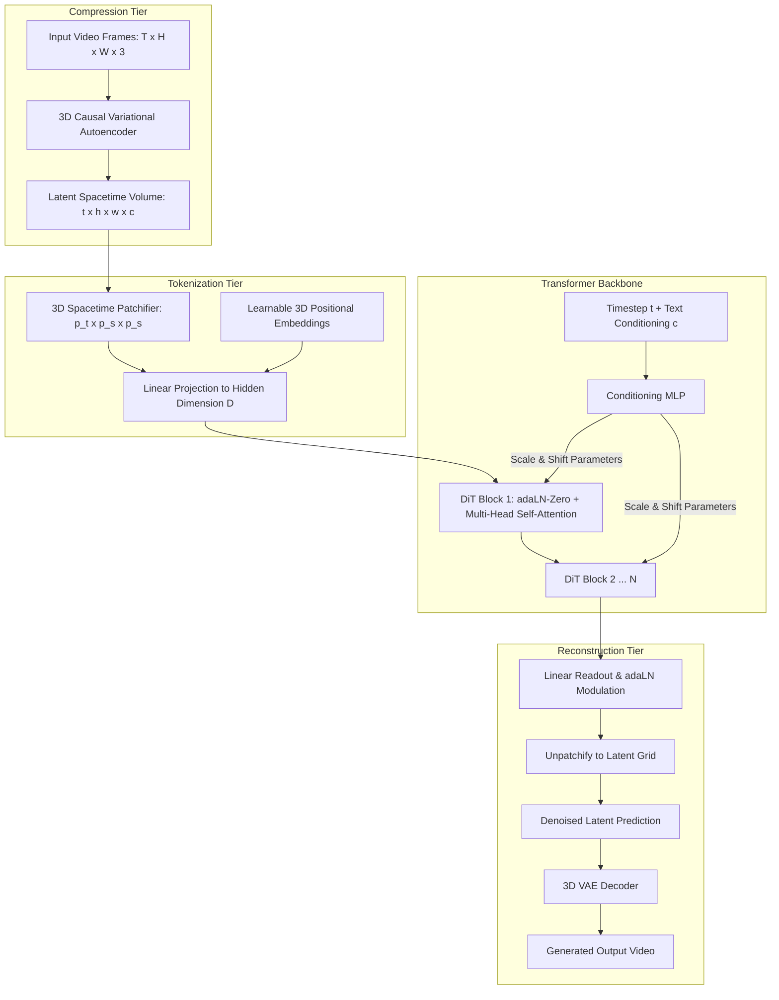

When OpenAI revealed its text-to-video foundation model Sora in early 2024, the computer vision research community observed a decisive departure from the dominant visual generative paradigm. For nearly a decade—from Denoising Diffusion Probabilistic Models (DDPM) to Latent Diffusion Models (LDM / Stable Diffusion)—the foundational inductive bias of visual generation resided in the **Convolutional U-Net**.

U-Nets, characterized by hierarchical downsampling, bottleneck convolutions, spatial cross-attention layers, and residual skip connections, were long assumed to be indispensable for spatial locality and perceptual coherence.

Sora demonstrated that scaling video generation across diverse resolutions, aspect ratios, and durations did not require hand-crafted convolutional hierarchies. Instead, it relied directly on the **Diffusion Transformer (DiT)** architecture introduced by William Peebles and Saining Xie at ICCV 2023. By decomposing visual signals into sequences of spacetime latent patches and replacing convolutional feature pyramids with standard isotropic transformer blocks, DiT unlocked transformer scaling laws for visual and temporal generation.


## Why Did Diffusion Transformers Replace Convolutional U-Nets in Video Generation?

To understand why the vision community pivoted toward Diffusion Transformers, one must analyze the inductive bias constraints of convolutional U-Nets.

A convolutional filter operates over fixed local kernel windows (e.g., $3 \times 3$ or $5 \times 5$). While local inductive biases assist small models trained on constrained image datasets, they impose severe architectural friction when scaling to video:
1. **Fixed Spatial and Aspect Ratios**: Convolutions require rigid dimensional tiling. Ingesting arbitrary widescreen (16:9), portrait (9:16), or square (1:1) video frames required awkward letterboxing, cropping, or bespoke multi-scale positional conditioning.
2. **Spatiotemporal Disconnect**: Extending 2D U-Nets to video historically required interleaving 2D spatial convolutions with pseudo-3D temporal 1D convolutions or temporal self-attention. This decoupled factorization struggled to model complex non-linear physics, fluid dynamics, and long-range camera trajectories.
3. **Sub-optimal Compute Scaling**: As demonstrated by Kaplan et al. and Chinchilla scaling laws in natural language processing, transformers exhibit monotonic, predictable loss reductions when scaled with compute (FLOPs). Convolutional backends plateau earlier, yielding diminishing generative quality per added parameter.

```
Traditional Latent Diffusion (Convolutional U-Net Backbone)
[Latent Tensor] ──▶ [Conv Downblocks] ──▶ [Conv Bottleneck] ──▶ [Conv Upblocks + Skips] ──▶ [Noise Prediction]
(Rigid Resolution, Heavy Inductive Bias, Complex Temporal Glue)

Diffusion Transformer (DiT Backbone)
[Video Frames] ──▶ [3D Causal VAE] ──▶ [Spacetime Patches] ──▶ [Linear Projection + adaLN-Zero] ──▶ [Isotropic DiT Blocks]
(Arbitrary Resolution/Duration, Native Temporal Attention, Predictable Scaling)
```

DiT discards convolutional downsampling entirely. Instead, it treats latent video tensors identically to tokens in large language models: flattening spatio-temporal patches into continuous token vectors processed by homogeneous transformer layers.

## The Architectural Topology of Diffusion Transformers

The DiT pipeline decomposes generation into four mathematical operations: latent compression, spacetime patchification, conditioned transformer processing, and latent unflattening.



### 1. Spacetime Latent Patchification

Let a raw video input be represented as $V \in \mathbb{R}^{T \times H \times W \times 3}$. A pre-trained spatial-temporal Variational Autoencoder (VAE) compresses this volume into a continuous latent space $Z \in \mathbb{R}^{t \times h \times w \times c}$, where $t = T / f_t$ and $(h, w) = (H / f_s, W / f_s)$. The temporal compression factor $f_t$ and spatial factor $f_s$ typically compress raw pixel dimensions by factors of 4 to 8.

Next, DiT decomposes the latent volume into non-overlapping spacetime patches of size $(p_t \times p_s \times p_s)$. For an image model, $p_t = 1$, whereas for video, $p_t \in \{1, 2\}$. Each patch is flattened into a continuous vector:

$$x_i \in \mathbb{R}^{(p_t \cdot p_s^2 \cdot c)}$$

A linear projection maps each patch vector into the transformer hidden dimension $D$. The total sequence length fed into the transformer is:

$$L = \left(\frac{t}{p_t}\right) \times \left(\frac{h}{p_s}\right) \times \left(\frac{w}{p_s}\right)$$

Standard learnable 1D or decomposed 3D rotary positional embeddings (RoPE) are added to each token, enabling the transformer to attend arbitrarily across spatial and temporal dimensions.

### 2. Conditioning via Adaptive Layer Normalization (adaLN-Zero)

In standard diffusion models, the network must be conditioned on the continuous diffusion timestep $t \in [0, T]$ and optional guidance vectors $c$ (such as CLIP or T5 text embeddings).

Peebles and Xie evaluated four distinct conditioning strategies for DiT: in-context conditioning tokens, cross-attention layers, standard adaptive layer normalization (adaLN), and **adaLN-Zero**.

```
adaLN-Zero Block Formulation:
Token Input x ──▶ LayerNorm ──(Scale γ, Shift β)──▶ Multi-Head Self-Attention ──(Gate α)──▶ (+)
                     ▲                                                             ▲
                     │                                                             │
Condition Vector (t, c) ──▶ [Linear Projection / MLP: yields γ_1, β_1, α_1, γ_2, β_2, α_2]
```

Under adaLN-Zero, a single multi-layer perceptron (MLP) regresses six modulation parameters per transformer block from the sum of the timestep and text embeddings:

$$\text{adaLN}(h, \gamma, \beta) = \gamma \odot \left( \frac{h - \mu}{\sigma} \right) + \beta$$

Crucially, the gating parameters $\alpha_1, \alpha_2$ applied to the attention and MLP residual streams are initialized to **zero**. At initialization, each DiT block functions as an exact identity mapping:

$$\mathbf{x}_{l} = \mathbf{x}_{l-1} + \alpha \cdot \text{SubLayer}(\text{adaLN}(\mathbf{x}_{l-1})) \quad \text{where } \alpha = 0 \implies \mathbf{x}_l = \mathbf{x}_{l-1}$$

This architectural trick drastically stabilizes gradient flow across deep networks (e.g., 28 to 40 layers), accelerating convergence speed and preventing early training divergence.

## Model Configuration and Compute Benchmarking

The computational complexity of DiT is governed primarily by patch size $p$ and hidden dimension $D$. Below is the standard architectural family defined by Peebles and Xie:

| Model Variant | Layers | Hidden Dim $D$ | Heads | Parameters | GigaFLOPs (Patch $p=2$, $256 \times 256$) |
| :--- | :--- | :--- | :--- | :--- | :--- |
| **DiT-S (Small)** | 12 | 384 | 6 | 33M | 24.1 |
| **DiT-B (Base)** | 12 | 768 | 12 | 130M | 96.4 |
| **DiT-L (Large)** | 24 | 1024 | 16 | 458M | 344.2 |
| **DiT-XL (Extra-Large)** | 28 | 1152 | 16 | 675M | 524.3 |

When patch size is halved from $p=4$ to $p=2$, the sequence length $L$ quadruples, increasing self-attention FLOPs by a factor of 16. Empirically, Peebles and Xie discovered that **decreasing patch size improves generative Fréchet Inception Distance (FID) faster than adding depth or width**. Smaller patches provide finer spatial granularity, enabling sharper geometric boundaries and eliminating fuzzy halo artifacts typical of high-compression autoencoders.

## Training Objective: From DDPM to Rectified Flow Matching

Original DiT implementations were trained using standard epsilon-prediction under the Denoising Diffusion Probabilistic Model (DDPM) objective:

$$\mathcal{L}_{\text{DDPM}}(\theta) = \mathbb{E}_{t, x_0, \epsilon} \left[ \| \epsilon - \epsilon_\theta(x_t, t, c) \|^2 \right]$$

However, sampling from curved DDPM trajectories requires dozens or hundreds of discrete denoising integration steps, creating massive latency hurdles for video generation.

By 2024–2026, state-of-the-art video architectures (including Flux, Stable Diffusion 3, and modern video engines) transitioned to **Rectified Flow Matching (RFM)**. Rather than tracing complex stochastic Brownian motion paths, Flow Matching defines a straight probability trajectory between pure Gaussian noise $x_1 \sim \mathcal{N}(0, I)$ and true data $x_0$:

$$x_t = (1 - t) x_0 + t x_1 \quad \text{for } t \in [0, 1]$$

The target velocity field is simply $v_t = x_1 - x_0$. The DiT network is trained to predict the vector field directly:

$$\mathcal{L}_{\text{Flow}}(\theta) = \mathbb{E}_{t, x_0, x_1} \left[ \| v_\theta(x_t, t, c) - (x_1 - x_0) \|^2 \right]$$

Because the trajectory between noise and data is linear, numerical ODE solvers (such as Euler or midpoint methods) can generate high-fidelity video samples in as few as 20 to 30 steps without quality degradation.

Understanding these foundational training equations directly informs post-training techniques, such as adapter fine-tuning examined in [LLaMA-Factory Architecture: Unified Post-Training Across 100+ LLMs](/posts/llama-factory/) and high-throughput inference patterns detailed in [LLM Inference Patterns](/posts/llm-inference-patterns/).

## How Diffusion Transformers and Video Generation Evolved Across 2026

The period between 2024 and 2026 witnessed the complete institutionalization of Diffusion Transformers across the visual synthesis industry.

```
2023: Academic Inception          2024: Sora & World Simulators     2026: Open Weights & Multi-Modal DiT
┌───────────────────────────┐     ┌────────────────────────────┐    ┌───────────────────────────────────┐
│ DiT (Peebles & Xie, ICCV) │────▶│ OpenAI Sora Technical Brief│───▶│ Wan2.1 / Kling / MovieGen / Luma  │
│ ImageNet 256x256 Baseline │     │ Spacetime Latent Patches   │    │ MMDiT Dual-Stream Joint Attention │
│ DDPM Epsilon Objective    │     │ Temporal World Simulation  │    │ Real-time Flow Matching Inference │
└───────────────────────────┘     └────────────────────────────┘    └───────────────────────────────────┘
```

1. **Multimodal Dual-Stream Transformers (MMDiT)**: In original DiT, text conditions were pooled into a single vector or passed via cross-attention. In 2024–2026, architectures like Stable Diffusion 3 and modern video generators adopted Multimodal DiT (MMDiT). Text tokens and video patch tokens are concatenated into a unified sequence with distinct linear weights, enabling deep cross-modal bidirectional attention where visual patches influence text representations and vice versa.
2. **Open-Weight Video Foundation Models**: While Sora remained behind closed API barriers throughout 2024, open-source research rapidly reproduced and improved upon its core mechanics. Open-weight video generation models (such as Wan2.1, CogVideoX, and HunyuanVideo) demonstrated that consumer GPUs could fine-tune and execute 1080p DiT video pipelines using 3D causal VAEs and low-rank adapters.
3. **From Video Synthesis to Physical World Simulators**: In 2026, the primary application of video DiT models expanded beyond media generation into robotics and autonomous driving simulation. Because DiTs scale monotonically with compute, training on massive datasets of ego-centric driving and manipulation video enables models to internalize three-dimensional spatial persistence, optical occlusion, and rigid body dynamics.
4. **Hardware Acceleration and Low-Precision Serving**: Executing billions of parameters across expansive 3D attention sequences required substantial systems optimization. Modern deployment stacks utilize 4-bit and 8-bit quantized weights, FlashAttention-3 kernels, and ring-attention spatial parallelization to stream video tokens across multiple GPU nodes. This parallels the infrastructure patterns documented in [The LLM Systems Hierarchy: From Prompt Engineering to Autonomous Agents](/posts/llm-course-trying/).

## Key Takeaways

- **Elimination of U-Net Inductive Bias**: DiT replaces convolutional downsampling and skip connections with standard isotropic transformer blocks, unlocking predictable compute scaling laws for computer vision.
- **Unified Spacetime Tokenization**: By slicing 3D latent tensors into continuous spacetime patches, DiT processes variable resolutions, widescreen/portrait aspect ratios, and dynamic video durations within a single model architecture.
- **adaLN-Zero Identity Initialization**: Conditioning via adaptive layer normalization initialized to zero parameters enables stable optimization of deep transformer stacks without gradient vanishing.
- **Rectified Flow Matching**: Modern visual diffusion has converged on straight-line flow matching objectives, reducing required denoising integration steps from hundreds down to 20–30 Euler steps.

## New Questions

- As sequence lengths in high-definition video DiTs reach hundreds of thousands of tokens, will quadratic attention force a transition toward linear state-space models (such as Mamba or RWKV) for temporal generation?
- How can 3D causal VAEs prevent temporal blur and drifting artifacts over extended minute-long video generation windows without incurring catastrophic memory penalties?
- To what extent can video diffusion models learn real-world physics causality purely from 2D pixel projections without explicit 3D spatial priors?

## References

1. Peebles, W., & Xie, S. (2023). *Scalable Diffusion Models with Transformers*. Proceedings of the IEEE/CVF International Conference on Computer Vision (ICCV 2023). https://arxiv.org/abs/2212.09748 (accessed 2026-10-18).
2. OpenAI. (2024). *Video generation models as world simulators*. OpenAI Research Technical Report. https://openai.com/research/video-generation-models-as-world-simulators (accessed 2026-10-18).
3. Lipman, Y., Chen, R. T. Q., Ben-Hamu, H., Nicklas, M., & Le, M. (2023). *Flow Matching for Generative Modeling*. International Conference on Learning Representations (ICLR 2023). https://arxiv.org/abs/2210.02747 (accessed 2026-10-18).
4. Esser, P., Chiu, S., Atighehchian, P., Granskog, J., & Germanidis, A. (2024). *Scaling Rectified Flow Transformers for High-Resolution Image Synthesis*. arXiv preprint arXiv:2403.03206. https://arxiv.org/abs/2403.03206 (accessed 2026-10-18).
