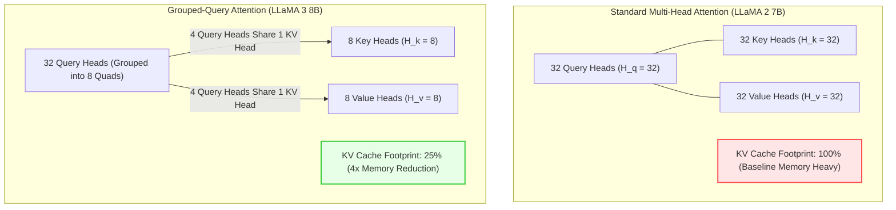
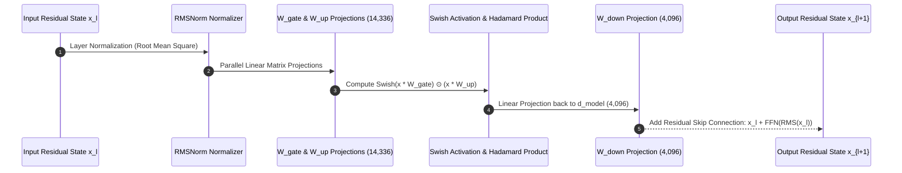

## Why Did LLaMA 3 Universalize Grouped-Query Attention Across All Model Scales?

When Meta AI released LLaMA 1 and LLaMA 2, the architectural design diverged based on parameter scale. In LLaMA 2, standard Multi-Head Attention (MHA)—where every single query head possesses its own dedicated key and value heads ($H_q = H_{kv} = 32$)—was retained for the compact 7B and 13B models. Grouped-Query Attention (GQA) was reserved exclusively for the massive 70B variant. Consequently, deploying LLaMA-2-7B or 13B at long context windows (4k–8k tokens) under concurrent serving conditions triggered severe GPU memory fragmentation, as individual request Key-Value (KV) caches rapidly consumed high-bandwidth memory (HBM).

With LLaMA 3, Meta unified the attention topology across all model configurations (8B, 70B, and 405B) by standardizing on **Grouped-Query Attention with exactly 8 Key-Value heads**:
- In the 8B model: 32 query heads are mapped to 8 KV head groups (a $4:1$ query-to-KV ratio).
- In the 70B model: 64 query heads are mapped to 8 KV head groups (an $8:1$ query-to-KV ratio).
- In the 405B model: 128 query heads are mapped to 8 KV head groups (a $16:1$ query-to-KV ratio).

Standardizing on 8 KV heads reduced serving KV cache memory consumption by $4\times$ to $8\times$. Combined with expanding the Byte-Pair Encoding (BPE) vocabulary from 32,000 to 128,256 tokens and adjusting the Rotary Position Embedding (RoPE) base frequency $\theta$ from 10,000 to 500,000, LLaMA 3 established the standard architecture for modern open foundation models.



## Mathematical Deconstruction of the LLaMA 3 Transformer Block

Tracing the forward pass of a single token vector through an 8-billion parameter LLaMA 3 block reveals how dimensional projections, rotary transformations, and gated activations interact.

### 1. Architectural Hyperparameters (LLaMA 3 8B)

| Parameter | Symbol | Exact Value |
| :--- | :--- | :--- |
| **Model Hidden Dimension** | $d_{\text{model}}$ | 4,096 |
| **Transformer Block Depth** | $n_{\text{layers}}$ | 32 |
| **Query Attention Heads** | $H_q$ | 32 |
| **Key/Value Attention Heads** | $H_{kv}$ | 8 |
| **Head Dimension** | $d_{\text{head}}$ | 128 ($4096 / 32$) |
| **Feedforward Hidden Dimension** | $d_{\text{ffn}}$ | 14,336 ($\approx \frac{8}{3} d_{\text{model}}$) |
| **Vocabulary Size** | $V$ | 128,256 |
| **Rotary Base Frequency** | $\theta$ | 500,000 |
| **Native Context Length** | $L$ | 8,192 tokens |

### 2. Grouped-Query Attention (GQA) Tensor Mechanics

For an input activation matrix $X \in \mathbb{R}^{B \times L \times d_{\text{model}}}$, the attention projections compute queries, keys, and values:

$$Q = X W_Q, \quad K = X W_K, \quad V = X W_V$$

Where projection weight dimensions are:
- $W_Q \in \mathbb{R}^{d_{\text{model}} \times (H_q \cdot d_{\text{head}})} = \mathbb{R}^{4096 \times 4096}$
- $W_K \in \mathbb{R}^{d_{\text{model}} \times (H_{kv} \cdot d_{\text{head}})} = \mathbb{R}^{4096 \times 1024}$
- $W_V \in \mathbb{R}^{d_{\text{model}} \times (H_{kv} \cdot d_{\text{head}})} = \mathbb{R}^{4096 \times 1024}$
- $W_O \in \mathbb{R}^{(H_q \cdot d_{\text{head}}) \times d_{\text{model}}} = \mathbb{R}^{4096 \times 4096}$

Notice that $W_K$ and $W_V$ output tensors of width 1,024 rather than 4,096. During self-attention computation, each Key and Value head is broadcast-repeated across 4 corresponding Query heads:

$$\text{Attention}(Q_i, K_j, V_j) = \text{softmax}\left(\frac{Q_i K_j^T}{\sqrt{d_{\text{head}}}} + M\right) V_j \quad \text{for } j = \lfloor i / 4 \rfloor$$

This $4\times$ reduction in Key-Value tensor size directly slashes KV cache memory overhead during autoregressive generation, allowing concurrent serving batches to multiply without out-of-memory crashes on [Kubernetes GPU clusters](/posts/what-is-kubernetes/).

### 3. SwiGLU Gated Feedforward Networks

In standard Transformers, feedforward layers consist of two linear transformations separated by a non-linear activation (e.g., $\text{GELU}(X W_1) W_2$).

LLaMA 3 utilizes **SwiGLU** (Swish-Gated Linear Units, Shazeer 2020), which introduces an element-wise gating mechanism:

$$\text{SwiGLU}(X) = \left( \text{Swish}(X W_{\text{gate}}) \odot (X W_{\text{up}}) \right) W_{\text{down}}$$

Where:
- $W_{\text{gate}} \in \mathbb{R}^{d_{\text{model}} \times d_{\text{ffn}}} = \mathbb{R}^{4096 \times 14336}$
- $W_{\text{up}} \in \mathbb{R}^{d_{\text{model}} \times d_{\text{ffn}}} = \mathbb{R}^{4096 \times 14336}$
- $W_{\text{down}} \in \mathbb{R}^{d_{\text{ffn}} \times d_{\text{model}}} = \mathbb{R}^{14336 \times 4096}$
- $\text{Swish}(z) = z \cdot \sigma(z) = \frac{z}{1 + e^{-z}}$

The intermediate dimension $d_{\text{ffn}} = 14{,}336$ is chosen by computing $\frac{8}{3} d_{\text{model}} \approx 10{,}922$ and rounding up to the nearest multiple of 256 for optimal hardware alignment on NVIDIA Tensor Cores. Gated multiplicative units allow the network to dynamically filter out irrelevant feature activations, yielding faster convergence than legacy ReLU or GELU networks, as demonstrated in [Transformer architectural studies](/posts/study-transformer/).



### 4. Rotary Position Embedding (RoPE) Base Frequency Scaling

To expand the native context length from LLaMA 2's 4,096 tokens to LLaMA 3's 8,192 tokens without causing attention degradation, Meta scaled the base rotary frequency $\theta$:

$$\theta_{\text{LLaMA 2}} = 10{,}000 \longrightarrow \theta_{\text{LLaMA 3}} = 500{,}000$$

RoPE computes rotational frequencies as $\omega_k = \theta^{-2k / d}$. Increasing $\theta$ to 500,000 lowers the rotation velocity across all embedding dimensions. This stretches the wavelength of the slowest-rotating dimensions:

$$\lambda_{\max} = 2\pi \cdot \theta^{(d - 2)/d} = 2\pi \cdot (500{,}000)^{126/128} \approx 2{,}470{,}000 \text{ tokens}$$

Because the slowest dimensions complete only a fraction of a cycle over 8k tokens, the model maintains high-precision relative distance discrimination across distant tokens without catastrophic perplexity blowups, a technique later refined in [YaRN context scaling architectures](/posts/rnj-1-motif-2-12-7b-open-source-llm-analysis/).

## How LLaMA-Derived Architectures Evolved Across 2026

Throughout 2026, the architectural principles popularized by LLaMA 3 became the foundation for virtually all open-weight frontier models:

1. **Extreme Vocabulary Expansion**: The shift from 32K to 128K tokens demonstrated that larger vocabularies dramatically improve compression efficiency for code and non-English scripts (reducing token sequence length by ~15%). Subsequent 2026 foundation models (Qwen 2.5, DeepSeek-V3) expanded vocabularies further to 150K–200K tokens.
2. **Chinchilla Overtraining as Standard Practice**: Chinchilla scaling laws originally suggested training an 8B parameter model on ~160 billion tokens. LLaMA 3 trained on over **15 trillion tokens**—nearly $100\times$ beyond the compute-optimal point. In 2026, overtraining compact models on massive synthetic data mixtures became the standard enterprise strategy, because pre-training compute is spent once, while inference efficiency is realized over billions of downstream user queries.
3. **Hybrid MoE Transformations**: While LLaMA 3 remained dense, 2026 open architectures transformed LLaMA 3 blocks into Mixture-of-Experts (MoE) topologies (such as DeepSeek-V3 and LLaMA-3-MoE derivatives), replacing the dense SwiGLU FFN with 64–256 fine-grained routed experts and shared routing channels.
4. **Hardware-Native Quantization Alignment**: Because LLaMA 3 standardizes dimension multiples of 256 and 8 KV heads, downstream quantized serving frameworks (vLLM, SGLang, and GGUF) execute INT4/FP8 GEMM operations at peak memory bandwidth, as detailed in [LLM quantization architectures](/posts/llm-types/).

## Implementation: PyTorch LLaMA 3 Attention Block from First Principles

To inspect the tensor dimensions of Grouped-Query Attention in code, the following PyTorch module implements a standalone LLaMA 3 GQA layer with rotary position embeddings:

```python
"""
llama3_gqa.py - PyTorch implementation of LLaMA 3 Grouped-Query Attention (GQA).
"""

import math
from typing import Tuple
import torch
import torch.nn as nn
import torch.nn.functional as F


def precompute_rope_freqs_cis(dim: int, end: int, theta: float = 500000.0) -> torch.Tensor:
    """Precomputes complex rotary position frequencies for LLaMA 3."""
    freqs = 1.0 / (theta ** (torch.arange(0, dim, 2)[: (dim // 2)].float() / dim))
    t = torch.arange(end, device=freqs.device)
    freqs = torch.outer(t, freqs)
    # Polar to complex: cos(theta) + i * sin(theta)
    freqs_cis = torch.polar(torch.ones_like(freqs), freqs)
    return freqs_cis


def apply_rotary_emb(xq: torch.Tensor, xk: torch.Tensor, freqs_cis: torch.Tensor) -> Tuple[torch.Tensor, torch.Tensor]:
    """Applies complex rotary embeddings to Query and Key tensors."""
    # Convert real tensors to complex views
    xq_complex = torch.view_as_complex(xq.float().reshape(*xq.shape[:-1], -1, 2))
    xk_complex = torch.view_as_complex(xk.float().reshape(*xk.shape[:-1], -1, 2))
    
    # Complex multiplication rotates vectors
    xq_out = torch.view_as_real(xq_complex * freqs_cis).flatten(3)
    xk_out = torch.view_as_real(xk_complex * freqs_cis).flatten(3)
    return xq_out.type_as(xq), xk_out.type_as(xk)


class LLaMA3Attention(nn.Module):
    """
    LLaMA 3 Grouped-Query Attention block with 8 KV heads.
    """
    def __init__(self, d_model: int = 4096, n_heads: int = 32, n_kv_heads: int = 8, max_seq_len: int = 8192):
        super().__init__()
        self.d_model = d_model
        self.n_heads = n_heads
        self.n_kv_heads = n_kv_heads
        self.head_dim = d_model // n_heads  # 128
        self.num_rep = n_heads // n_kv_heads  # 4 query heads per KV head

        # Projections
        self.wq = nn.Linear(d_model, n_heads * self.head_dim, bias=False)
        self.wk = nn.Linear(d_model, n_kv_heads * self.head_dim, bias=False)
        self.wv = nn.Linear(d_model, n_kv_heads * self.head_dim, bias=False)
        self.wo = nn.Linear(n_heads * self.head_dim, d_model, bias=False)

        # Precompute RoPE with LLaMA 3 base theta = 500,000
        self.freqs_cis = precompute_rope_freqs_cis(self.head_dim, max_seq_len, theta=500000.0)

    def forward(self, x: torch.Tensor) -> torch.Tensor:
        B, L, _ = x.shape
        
        # Linear projections
        xq = self.wq(x).view(B, L, self.n_heads, self.head_dim)
        xk = self.wk(x).view(B, L, self.n_kv_heads, self.head_dim)
        xv = self.wv(x).view(B, L, self.n_kv_heads, self.head_dim)

        # Apply RoPE
        freqs_cis = self.freqs_cis[:L].to(x.device)
        xq, xk = apply_rotary_emb(xq, xk, freqs_cis)

        # Repeat KV heads to match query head count (4x expansion)
        xk = xk.repeat_interleave(self.num_rep, dim=2)
        xv = xv.repeat_interleave(self.num_rep, dim=2)

        # Transpose for scaled dot-product attention: (B, H, L, D)
        xq, xk, xv = xq.transpose(1, 2), xk.transpose(1, 2), xv.transpose(1, 2)

        # Scaled dot-product attention with causal mask
        output = F.scaled_dot_product_attention(xq, xk, xv, is_causal=True)

        # Concatenate heads and project output
        output = output.transpose(1, 2).contiguous().view(B, L, -1)
        return self.wo(output)


if __name__ == "__main__":
    torch.manual_seed(42)
    layer = LLaMA3Attention(d_model=4096, n_heads=32, n_kv_heads=8)
    
    dummy_input = torch.randn(2, 64, 4096)  # Batch 2, SeqLen 64, Dim 4096
    out = layer(dummy_input)
    
    print("LLaMA 3 GQA Execution Test:")
    print(f"  Input Shape:  {dummy_input.shape}")
    print(f"  Output Shape: {out.shape}")
    print(f"  KV Heads: {layer.n_kv_heads} | Query Heads: {layer.n_heads} (GQA Ratio: {layer.num_rep}:1)")
```

Inspecting the tensor shapes demonstrates how repeating Key and Value heads inside scaled dot-product kernels preserves query expressiveness while reducing memory bandwidth consumption by 75%.

## Key Takeaways

- **GQA Slashes KV Cache Footprint by 75%**: Standardizing on 8 Key-Value heads across all LLaMA 3 variants allows multiple query heads to share cache blocks, enabling higher concurrent serving capacity.
- **SwiGLU Outperforms Standard FFNs**: Combining Swish gating with linear up-projections provides smooth non-linear representation filtering, accelerated by hardware-aligned dimension multiples of 256.
- **RoPE $\theta = 500{,}000$ Extends Native Context**: Scaling base rotary frequency stretches long-distance rotation wavelengths, preserving fine-grained relative position awareness across 8k+ context windows.
- **128K Tokenizer Reduces Fertility**: Transitioning from a 32K sentencepiece vocabulary to a 128,256 BPE tokenizer slashes token count by 15%, reducing inference latency and context starvation.
- **Chinchilla Overtraining Maximizes Inference Economy**: Training an 8B model on 15 trillion tokens amortizes pre-training compute across millions of downstream inference requests.

## New Questions

- How do floating-point rounding errors in RoPE base frequency scaling ($\theta = 500{,}000$) compound when using FP8 KV caches at 128k context lengths?
- What is the mathematical boundary where GQA with 8 KV heads begins to lose multi-query attention fidelity compared to full Multi-Head Attention?
- How does the 128K vocabulary size affect GPU memory consumption during vocab-parallel cross-entropy loss computation in distributed training?
- Can SwiGLU gating be dynamically pruned or skipped during autoregressive decoding to save compute on low-entropy tokens?

## References

- Ainslie, J., Ontanon, D., Alberti, C., Cvicek, V., Fisher, Z., Pham, P., Ravula, A., Sumbaly, S., & Sung, M. (2023). *GQA: Training Generalized Multi-Query Transformer Models from Multi-Head Checkpoints*. Proceedings of the 2023 Conference on Empirical Methods in Natural Language Processing (EMNLP 2023). URL: [https://arxiv.org/abs/2305.13245](https://arxiv.org/abs/2305.13245) (accessed 2026-10-18).
- Meta AI. (2024). *The Llama 3 Herd of Models*. arXiv preprint arXiv:2407.21783. URL: [https://arxiv.org/abs/2407.21783](https://arxiv.org/abs/2407.21783) (accessed 2026-10-18).
- Shazeer, N. (2019). *Fast Transformer Decoding: One Write-Head is All You Need*. arXiv preprint arXiv:1911.02150. URL: [https://arxiv.org/abs/1911.02150](https://arxiv.org/abs/1911.02150) (accessed 2026-10-18).
- Shazeer, N. (2020). *GLU Variants Improve Transformer*. arXiv preprint arXiv:2002.05202. URL: [https://arxiv.org/abs/2002.05202](https://arxiv.org/abs/2002.05202) (accessed 2026-10-18).
- Su, J., Ahmed, M., Lu, Y., Pan, S., Bo, W., & Liu, Y. (2024). *RoFormer: Enhanced Transformer with Rotary Position Embedding*. Neurocomputing, 568, 127063. URL: [https://doi.org/10.1016/j.neucom.2023.127063](https://doi.org/10.1016/j.neucom.2023.127063) (accessed 2026-10-18).
