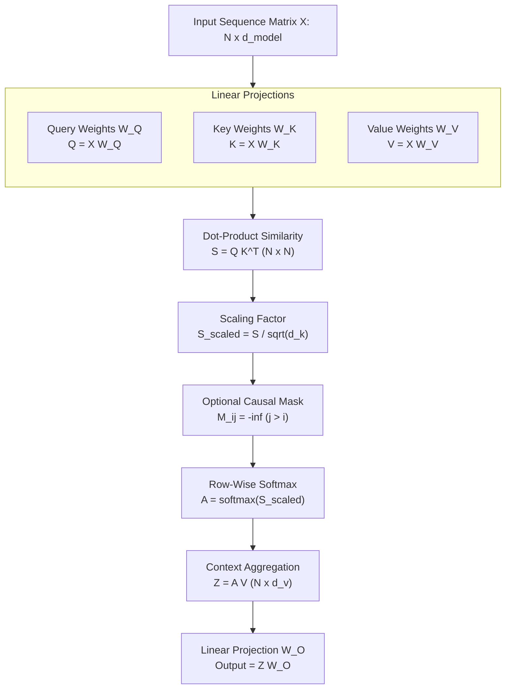

## Why Is the $\sqrt{d_k}$ Scaling Factor Mathematically Indispensable in Self-Attention?

The transformer architecture introduced by Vaswani et al. in *Attention Is All You Need* displaced recurrent and convolutional networks by enabling parallelized sequence modeling. At the core of this transformation is the Scaled Dot-Product Attention operator. While high-level conceptual diagrams often illustrate attention as a qualitative lookup table, the operational stability of large neural networks depends directly on its underlying matrix algebra and variance preservation properties.

Without the scaling denominator $\sqrt{d_k}$, standard dot products between high-dimensional embedding vectors grow proportionally with dimensionality. This inflation pushes the softmax activation function into extreme saturation zones where gradients approach zero, paralyzing backpropagation. Understanding this mechanic requires working through the linear algebra step-by-step with explicit numerical tensors.

---

## Step-by-Step Hand Calculation of Scaled Dot-Product Attention

To demystify how token representations interact, consider an explicit toy sequence of two tokens ($N=2$) with embedding dimension $d_{\text{model}} = 4$, projecting into attention head subspaces of dimension $d_k = d_v = 2$.

### Step 1: Input Sequence Matrix $\mathbf{X}$

Let the input sequence matrix $\mathbf{X} \in \mathbb{R}^{2 \times 4}$ represent two tokens:

$$\mathbf{X} = \begin{bmatrix} 1.0 & 0.0 & 1.0 & 0.0 \\ 0.0 & 2.0 & 0.0 & 2.0 \end{bmatrix}$$

### Step 2: Weight Projections $\mathbf{W}_Q, \mathbf{W}_K, \mathbf{W}_V$

Let the projection weight matrices $\mathbf{W}_Q, \mathbf{W}_K, \mathbf{W}_V \in \mathbb{R}^{4 \times 2}$ be defined as:

$$\mathbf{W}_Q = \begin{bmatrix} 1 & 0 \\ 0 & 1 \\ 0 & 1 \\ 1 & 0 \end{bmatrix}, \quad \mathbf{W}_K = \begin{bmatrix} 1 & 1 \\ 0 & 0 \\ 1 & 0 \\ 0 & 1 \end{bmatrix}, \quad \mathbf{W}_V = \begin{bmatrix} 0 & 2 \\ 1 & 0 \\ 1 & 1 \\ 0 & 1 \end{bmatrix}$$

Computing the projections via matrix multiplication:

$$\mathbf{Q} = \mathbf{X} \mathbf{W}_Q = \begin{bmatrix} 1.0 & 0.0 & 1.0 & 0.0 \\ 0.0 & 2.0 & 0.0 & 2.0 \end{bmatrix} \begin{bmatrix} 1 & 0 \\ 0 & 1 \\ 0 & 1 \\ 1 & 0 \end{bmatrix} = \begin{bmatrix} 1.0 & 1.0 \\ 2.0 & 2.0 \end{bmatrix}$$

$$\mathbf{K} = \mathbf{X} \mathbf{W}_K = \begin{bmatrix} 1.0 & 0.0 & 1.0 & 0.0 \\ 0.0 & 2.0 & 0.0 & 2.0 \end{bmatrix} \begin{bmatrix} 1 & 1 \\ 0 & 0 \\ 1 & 0 \\ 0 & 1 \end{bmatrix} = \begin{bmatrix} 2.0 & 1.0 \\ 0.0 & 2.0 \end{bmatrix}$$

$$\mathbf{V} = \mathbf{X} \mathbf{W}_V = \begin{bmatrix} 1.0 & 0.0 & 1.0 & 0.0 \\ 0.0 & 2.0 & 0.0 & 2.0 \end{bmatrix} \begin{bmatrix} 0 & 2 \\ 1 & 0 \\ 1 & 1 \\ 0 & 1 \end{bmatrix} = \begin{bmatrix} 1.0 & 3.0 \\ 2.0 & 2.0 \end{bmatrix}$$

### Step 3: Raw Attention Scores $\mathbf{S} = \mathbf{Q} \mathbf{K}^T$

We compute the dot product between all queries and keys to form the compatibility matrix $\mathbf{S} \in \mathbb{R}^{2 \times 2}$:

$$\mathbf{K}^T = \begin{bmatrix} 2.0 & 0.0 \\ 1.0 & 2.0 \end{bmatrix}$$

$$\mathbf{S} = \mathbf{Q} \mathbf{K}^T = \begin{bmatrix} 1.0 & 1.0 \\ 2.0 & 2.0 \end{bmatrix} \begin{bmatrix} 2.0 & 0.0 \\ 1.0 & 2.0 \end{bmatrix} = \begin{bmatrix} (1 \cdot 2 + 1 \cdot 1) & (1 \cdot 0 + 1 \cdot 2) \\ (2 \cdot 2 + 2 \cdot 1) & (2 \cdot 0 + 2 \cdot 2) \end{bmatrix} = \begin{bmatrix} 3.0 & 2.0 \\ 6.0 & 4.0 \end{bmatrix}$$

### Step 4: Variance Scaling $\mathbf{S}_{\text{scaled}} = \frac{\mathbf{S}}{\sqrt{d_k}}$

Here $d_k = 2$, so $\sqrt{d_k} = \sqrt{2} \approx 1.4142$:

$$\mathbf{S}_{\text{scaled}} = \begin{bmatrix} \frac{3.0}{1.4142} & \frac{2.0}{1.4142} \\ \frac{6.0}{1.4142} & \frac{4.0}{1.4142} \end{bmatrix} \approx \begin{bmatrix} 2.121 & 1.414 \\ 4.243 & 2.828 \end{bmatrix}$$

### Step 5: Row-Wise Softmax Normalization

The attention weight matrix $\mathbf{A}$ normalizes each row independently into a valid categorical probability distribution:

$$\mathbf{A}_{i, j} = \frac{\exp(\mathbf{S}_{\text{scaled}, i, j})}{\sum_{k=1}^N \exp(\mathbf{S}_{\text{scaled}, i, k})}$$

For Row 1:
- $\exp(2.121) \approx 8.339$
- $\exp(1.414) \approx 4.112$
- $\text{Sum}_1 = 8.339 + 4.112 = 12.451$
- $\mathbf{A}_{1, 1} = \frac{8.339}{12.451} \approx 0.670$
- $\mathbf{A}_{1, 2} = \frac{4.112}{12.451} \approx 0.330$

For Row 2:
- $\exp(4.243) \approx 69.617$
- $\exp(2.828) \approx 16.912$
- $\text{Sum}_2 = 69.617 + 16.912 = 86.529$
- $\mathbf{A}_{2, 1} = \frac{69.617}{86.529} \approx 0.805$
- $\mathbf{A}_{2, 2} = \frac{16.912}{86.529} \approx 0.195$

$$\mathbf{A} \approx \begin{bmatrix} 0.670 & 0.330 \\ 0.805 & 0.195 \end{bmatrix}$$

### Step 6: Output Computation $\mathbf{Z} = \mathbf{A} \mathbf{V}$

We multiply the attention weights by the value matrix $\mathbf{V}$:

$$\mathbf{Z} = \begin{bmatrix} 0.670 & 0.330 \\ 0.805 & 0.195 \end{bmatrix} \begin{bmatrix} 1.0 & 3.0 \\ 2.0 & 2.0 \end{bmatrix} = \begin{bmatrix} (0.670 \cdot 1.0 + 0.330 \cdot 2.0) & (0.670 \cdot 3.0 + 0.330 \cdot 2.0) \\ (0.805 \cdot 1.0 + 0.195 \cdot 2.0) & (0.805 \cdot 3.0 + 0.195 \cdot 2.0) \end{bmatrix}$$

$$\mathbf{Z} \approx \begin{bmatrix} 1.330 & 2.670 \\ 1.195 & 2.805 \end{bmatrix}$$

Each output row represents a contextually aggregated vector combining information across the entire sequence according to learned semantic relevance.

---

## Formal Proof of Variance Scaling Preservation

Why does dividing by $\sqrt{d_k}$ prevent gradient vanishing? Let components of query vector $\mathbf{q} \in \mathbb{R}^{d_k}$ and key vector $\mathbf{k} \in \mathbb{R}^{d_k}$ be independent and identically distributed (i.i.d.) random variables with mean $\mathbb{E}[q_i] = \mathbb{E}[k_i] = 0$ and unit variance $\mathrm{Var}(q_i) = \mathrm{Var}(k_i) = \sigma^2 = 1$.

Consider the dot product scalar $S = \mathbf{q} \cdot \mathbf{k} = \sum_{i=1}^{d_k} q_i k_i$:

1. **Expectation**:
   $$\mathbb{E}[S] = \sum_{i=1}^{d_k} \mathbb{E}[q_i k_i] = \sum_{i=1}^{d_k} \mathbb{E}[q_i] \mathbb{E}[k_i] = 0$$

2. **Variance**:
   Because $q_i$ and $k_i$ are independent:
   $$\mathrm{Var}(q_i k_i) = \mathbb{E}[(q_i k_i)^2] - (\mathbb{E}[q_i k_i])^2 = \mathbb{E}[q_i^2]\mathbb{E}[k_i^2] - 0 = \sigma^2 \cdot \sigma^2 = 1$$

   Summing across all $d_k$ dimensions:
   $$\mathrm{Var}(S) = \sum_{i=1}^{d_k} \mathrm{Var}(q_i k_i) = d_k \cdot 1 = d_k$$

   The standard deviation of the raw dot product is:
   $$\text{StdDev}(S) = \sqrt{\mathrm{Var}(S)} = \sqrt{d_k}$$

In contemporary models such as Llama 3.1 ($d_k = 128$), the variance of raw dot products reaches $128$, yielding standard deviations of $\approx 11.31$. When logits differ by margins of this magnitude, the softmax function acts as an argmax indicator: the largest element receives probability $\approx 1.0$, while all other elements receive $0.0$. Because the derivative of softmax is:

$$\frac{\partial \text{softmax}(z)_i}{\partial z_j} = \text{softmax}(z)_i (\delta_{ij} - \text{softmax}(z)_j)$$

when $\text{softmax}(z)_i \approx 0$ or $1$, the derivative evaluates to near zero, causing severe gradient vanishing. Dividing by $\sqrt{d_k}$ rescales the variance back to unity:

$$\mathrm{Var}\left( \frac{S}{\sqrt{d_k}} \right) = \frac{1}{d_k} \mathrm{Var}(S) = \frac{d_k}{d_k} = 1$$

preserving healthy gradient flow during stochastic gradient descent. For further exploration of attention mechanics, consult our analyses of [generative AI taxonomy](/posts/generativeai-term/) and [Meta Llama 3.1 architecture](/posts/the-gpt-4-killer-llama-3-1/).

---

## 2026 Technological Evolution: IO-Aware FlashAttention-3 and Grouped-Query Attention

While the mathematical formulation of self-attention remains invariant, physical execution on accelerator hardware has undergone revolutionary optimization:

```mermaid
graph TD
    subgraph Classical["Standard Attention (Quadratic HBM Wall)"]
        HBM1[HBM: Read Q, K] --> Compute1[SRAM: Compute S = Q K^T]
        Compute1 --> HBM2[HBM: Write N x N Matrix S]
        HBM2 --> Compute2[SRAM: Compute Softmax]
        Compute2 --> HBM3[HBM: Write N x N Matrix A]
        HBM3 --> Compute3[SRAM: Compute Z = A V]
        Compute3 --> HBM4[HBM: Write Output Z]
    end
    
    subgraph Flash["FlashAttention-3 (Tiled Kernel Fusion)"]
        HBM_Fast[HBM: Stream Q, K, V Blocks] --> SRAM_Fast[SRAM: Online Softmax + Matrix Accumulation]
        SRAM_Fast --> HBM_Out[HBM: Write Final Output Z Directly]
    end
```

1. **IO-Aware Tiling (FlashAttention)**: Standard PyTorch materializes the intermediate $N \times N$ attention matrix $\mathbf{S}$ into High Bandwidth Memory (HBM). FlashAttention tiles inputs into small blocks that fit entirely within SRAM, computing softmax normalization on-the-fly using the online softmax algorithm and eliminating $O(N^2)$ memory reads/writes.
2. **FlashAttention-3 Hardware Exploitation**: On NVIDIA Hopper and Blackwell architectures, FlashAttention-3 leverages asynchronous Tensor Memory Accelerators (TMA), FP8 tensor cores, and warp-specialization to decouple tensor loading from matrix math, reaching up to $80\%$ of theoretical peak hardware FLOPS.
3. **Grouped-Query Attention (GQA)**: In models like Meta Llama 3.1 and Mistral, multiple query heads share a single key-value head ($G$ query heads per KV head). This reduces the memory footprint of KV caches during autoregressive decoding by a factor of $G$ without degrading empirical benchmark performance. Detailed parameterizations are explored in [self-attention series part 5](/posts/deepdive-series-5/).

---

## Key Takeaways

- **Scaled Dot-Product Formula**: Scaled attention computes $\text{Attention}(Q, K, V) = \text{Softmax}\left(\frac{Q K^T}{\sqrt{d_k}}\right) V$, contextually weighting value vectors by query-key similarity.
- **Variance Invariance Is Essential**: Dot products of dimension $d_k$ have variance $d_k$; scaling by $\sqrt{d_k}$ normalizes variance to $1$, preventing softmax saturation and vanishing gradients.
- **Quadratic Complexity**: Traditional attention requires $O(N^2 d)$ compute and memory bandwidth, which becomes a bottleneck for long sequences.
- **Hardware Fusion Overcomes Memory Bottlenecks**: Modern implementations (FlashAttention-3, GQA) bypass HBM latency walls through SRAM tiling and reduced KV cache footprints.

---

## New Questions

- **Can Linear Attention Mechanisms Fully Replicate Softmax Expressivity?**: While kernel-based linear attention models operate in $O(N)$ time, do they sacrifice associative recall capacity in multi-needle synthetic benchmarks?
- **How Will Asynchronous TMA Pipelines Evolve Beyond Blackwell?**: As GPU architectures adopt optical interconnects and ultra-wide SRAM caches, will the optimal block tile size expand to encompass thousands of tokens simultaneously?

---

## References

- Vaswani, A., Shazeer, N., Parmar, N., Uszkoreit, J., Jones, L., Gomez, A. N., Kaiser, Ł., & Polosukhin, I. (2017). Attention Is All You Need. *Advances in Neural Information Processing Systems (NeurIPS 2017)*, 30, 5998-6008. [https://arxiv.org/abs/1706.03762](https://arxiv.org/abs/1706.03762) (accessed 2026-10-18)
- Dao, T., Fu, D. Y., Ermon, S., Rudra, A., & Ré, C. (2022). FlashAttention: Fast and Memory-Efficient Exact Attention with IO-Awareness. *Advances in Neural Information Processing Systems (NeurIPS 2022)*, 35, 16344-16359. [https://arxiv.org/abs/2205.14135](https://arxiv.org/abs/2205.14135) (accessed 2026-10-18)
- Shah, J., Ganesh, A., Wang, S., Gu, A., & Dao, T. (2024). FlashAttention-3: Fast and Accurate Attention with Asynchrony and Low-Precision. *arXiv preprint*. [https://arxiv.org/abs/2407.08608](https://arxiv.org/abs/2407.08608) (accessed 2026-10-18)
- Ainslie, J., Ontanon, S., Alberti, C., Cvicek, V., Fisher, Z., Pham, P., Ravula, A., Sumbaly, S., & Yang, Z. (2023). GQA: Training Generalized Multi-Query Transformer Models from Multi-Head Checkpoints. *Empirical Methods in Natural Language Processing (EMNLP 2023)*. [https://arxiv.org/abs/2305.13245](https://arxiv.org/abs/2305.13245) (accessed 2026-10-18)
