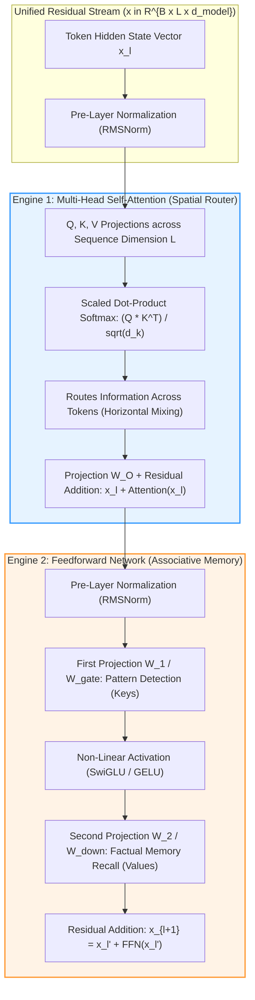
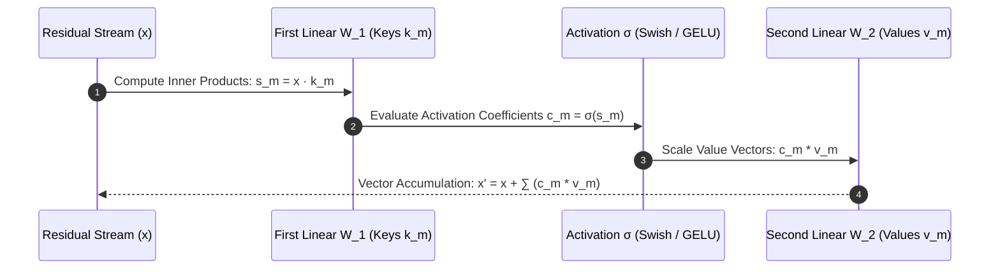

## Why Is a Transformer Block Divided into Two Distinct Computational Engines?

Since Vaswani et al. introduced the Transformer architecture in 2017, the canonical building block has remained remarkably invariant across generations of foundation models: each decoder block is strictly partitioned into two alternating sub-layers:
1. **Multi-Head Self-Attention (MHSA)**
2. **Position-wise Feedforward Network (FFN)**

While introductory deep learning tutorials often describe the Transformer as a single monolithic "attention network," mechanistic interpretability research reveals that these two sub-layers execute fundamentally complementary mathematical tasks:
- **Attention is a Spatial Router**: It computes soft routing weights across the sequence length dimension ($L$). It operates horizontally across time, allowing tokens to share representations, retrieve antecedents, and construct relational circuits (such as induction heads). Critically, attention mixes information across tokens without modifying the semantic dictionary of facts.
- **The Feedforward Network is an Associative Memory Bank**: It operates vertically along the feature dimension ($d_{\text{model}}$), independently for every token position ($L=1$). As established by Geva et al. (2021), the two linear layers in an FFN act as a neural Key-Value store: the first projection computes activations over semantic concepts (keys), while the second projection writes factual associations and world knowledge back into the residual stream (values).

Failing to appreciate this functional division leads to misguided architectural experiments—such as attempting to store factual world knowledge purely inside attention weights or cutting feedforward parameter budgets without degrading reasoning capacity.



## Deconstructing the Mathematical Mechanics of the Two Engines

A rigorous mathematical analysis of the forward and backward passes clarifies why the residual stream acts as a central communication bus connecting the routing engine to the memory bank.

### 1. Engine 1: Self-Attention as a Contextual Routing Matrix

Let $X \in \mathbb{R}^{L \times d_{\text{model}}}$ denote the hidden states of $L$ tokens at layer $l$. Multi-Head Self-Attention computes:

$$\text{Attention}(Q, K, V) = \text{softmax}\left(\frac{Q K^T}{\sqrt{d_k}} + M\right) V$$

Where:
- $Q = X W_Q$, $K = X W_K$, $V = X W_V$ with projection matrices $W \in \mathbb{R}^{d_{\text{model}} \times d_k}$.
- $M \in \mathbb{R}^{L \times L}$ is the autoregressive causal mask ($M_{ij} = -\infty$ for $j > i$).
- $\sqrt{d_k}$ is the scaling factor preventing softmax saturation for large head dimensions.

#### Mechanistic Circuit Specialization: Induction Heads
Anthropic's Transformer Circuits research (Olsson et al., 2022) revealed that multi-layer attention networks develop specialized sub-circuits called **induction heads**. An induction head in layer $l+1$ coordinates with a positional head in layer $l$ to execute pattern completion:
$$\text{[A][B]} \dots \text{[A]} \longrightarrow \text{predict [B]}$$
This two-step routing circuit is the fundamental mathematical engine driving in-context few-shot learning. It does not compute new facts; it moves existing tokens across the sequence coordinate space, directly complementing [Transformer architectural studies](/posts/study-transformer/).

### 2. Engine 2: Feedforward Networks as Neural Key-Value Memories

After self-attention contextualizes the sequence, the hidden representation passes through the position-wise Feedforward Network (FFN). Standard FFNs compute:

$$\text{FFN}(x) = \sigma(x W_1 + b_1) W_2 + b_2$$

Where $W_1 \in \mathbb{R}^{d_{\text{model}} \times d_{\text{ffn}}}$ and $W_2 \in \mathbb{R}^{d_{\text{ffn}} \times d_{\text{model}}}$. Usually, $d_{\text{ffn}} = 4 \times d_{\text{model}}$ (or $\approx \frac{8}{3} d_{\text{model}}$ in SwiGLU architectures).

Geva et al. (2021) demonstrated that this computation is isomorphic to soft associative memory retrieval:

$$\text{FFN}(x) = \sum_{m=1}^{d_{\text{ffn}}} \sigma(x \cdot k_m) v_m$$

Where:
- $k_m = W_{1, :, m}$ (the $m$-th column of $W_1$) acts as a **Memory Key Vector**, measuring semantic pattern similarity with the incoming token state.
- $v_m = W_{2, m, :}$ (the $m$-th row of $W_2$) acts as a **Memory Value Vector**, which is added into the residual stream when key $k_m$ fires.

For example, when an input contains the token "Paris," hidden activations trigger memory keys corresponding to French geography, causing the corresponding memory value vectors (encoding attributes like "capital of France" or "Eiffel Tower") to be added directly into the residual stream. This explains why over 65% of foundation model parameters reside within feedforward layers: FFNs are the storage media for world knowledge.



### 3. The Residual Stream as a Shared Communication Highway

In modern Deep Transformers (32 to 128 layers deep), signal attenuation and vanishing gradients are prevented by identity residual connections:

$$x_{l+1} = x_l + f_{\text{attn}}(\text{LN}(x_l)) + f_{\text{ffn}}(\text{LN}(x_l'))$$

Because the derivative of $x + f(x)$ contains an explicit identity term:

$$\frac{\partial x_{l+1}}{\partial x_l} = I + \frac{\partial f}{\partial x_l}$$

Gradients can backpropagate directly from layer 128 down to layer 1 through the identity highway ($I$) without passing through intermediate matrix multiplications. The residual stream functions as a persistent state blackboard: attention heads read from and write to the board horizontally, while FFN layers read from and write to the board vertically.

## How Transformer Block Mechanics Evolved Across 2026

Throughout 2026, foundation model architecture moved past standard dense Transformer blocks to optimize serving economics and memory bandwidth:

1. **Decoupled Architecture with Mixture-of-Experts (MoE)**: While the attention engine remains dense (or utilizes Grouped-Query Attention with 8 KV heads), modern models (such as DeepSeek-V3 and Mixtral derivatives) shard the feedforward engine into dozens of fine-grained experts. Because FFNs function as associative memories, only 2 to 8 relevant experts fire per token, slashing inference compute while preserving massive memory capacity.
2. **Transition from Pre-LN to RMSNorm**: Classical LayerNorm computed both mean centering and variance normalization ($y = \frac{x - \mu}{\sqrt{\sigma^2 + \epsilon}} \gamma + \beta$). Modern architectures universally adopt Root Mean Square Normalization (RMSNorm), which discards mean centering:
   $$\text{RMSNorm}(x) = \frac{x}{\sqrt{\frac{1}{d} \sum_{i=1}^d x_i^2 + \epsilon}} \odot \gamma$$
   RMSNorm achieves identical numerical stability while eliminating 50% of normalization FLOPs and reducing memory access overhead.
3. **SwiGLU Gating Universalization**: As analyzed in [LLaMA 3 architectural deconstructions](/posts/deepdive-series-3/), standard two-matrix FFNs were replaced by three-matrix SwiGLU gating ($\text{Swish}(X W_{\text{gate}}) \odot (X W_{\text{up}}) W_{\text{down}}$), offering superior gradient propagation through multiplicative gates.
4. **Quantization Resilience of Attention vs FFN**: Empirical research demonstrated that FFN weights are significantly more resilient to aggressive 4-bit and 3-bit quantization (via AWQ or GPTQ) than attention projection matrices, informing block-wise mixed-precision K-quants in modern GGUF runtimes, as detailed in [LLM quantization architectures](/posts/llm-types/).

## Implementation: PyTorch Transformer Block with Gated FFN from Scratch

To demonstrate the exact interaction between the spatial attention router and the associative feedforward memory engine, the following Python module implements a full Pre-RMSNorm Transformer block from first principles:

```python
"""
transformer_block.py - Self-contained Pre-RMSNorm Transformer block with SwiGLU FFN.
Demonstrates the dual-engine mechanics of self-attention routing and FFN memory.
"""

import math
import torch
import torch.nn as nn
import torch.nn.functional as F


class RMSNorm(nn.Module):
    """Root Mean Square Layer Normalization."""
    def __init__(self, dim: int, eps: float = 1e-6):
        super().__init__()
        self.eps = eps
        self.weight = nn.Parameter(torch.ones(dim))

    def forward(self, x: torch.Tensor) -> torch.Tensor:
        variance = x.pow(2).mean(-1, keepdim=True)
        return x * torch.rsqrt(variance + self.eps) * self.weight


class SwiGLUFeedForward(nn.Module):
    """
    Associative Memory Engine: SwiGLU Gated Feedforward Network.
    """
    def __init__(self, d_model: int, d_ffn: int):
        super().__init__()
        # Key Pattern Detectors (Gate & Up projections)
        self.w_gate = nn.Linear(d_model, d_ffn, bias=False)
        self.w_up = nn.Linear(d_model, d_ffn, bias=False)
        # Value Association Writers (Down projection)
        self.w_down = nn.Linear(d_ffn, d_model, bias=False)

    def forward(self, x: torch.Tensor) -> torch.Tensor:
        # Gated activation: Swish(x * W_gate) ⊙ (x * W_up)
        gate = F.silu(self.w_gate(x))
        up = self.w_up(x)
        # Project associative memory back into residual stream
        return self.w_down(gate * up)


class DualEngineTransformerBlock(nn.Module):
    """
    Complete Transformer block coupling the Attention Router and the FFN Memory Bank.
    """
    def __init__(self, d_model: int = 1024, n_heads: int = 8, d_ffn: int = 2816):
        super().__init__()
        self.d_model = d_model
        self.n_heads = n_heads
        self.head_dim = d_model // n_heads

        # Engine 1: Self-Attention (Spatial Router)
        self.norm1 = RMSNorm(d_model)
        self.wq = nn.Linear(d_model, d_model, bias=False)
        self.wk = nn.Linear(d_model, d_model, bias=False)
        self.wv = nn.Linear(d_model, d_model, bias=False)
        self.wo = nn.Linear(d_model, d_model, bias=False)

        # Engine 2: FFN (Associative Memory)
        self.norm2 = RMSNorm(d_model)
        self.ffn = SwiGLUFeedForward(d_model, d_ffn)

    def forward(self, x: torch.Tensor) -> torch.Tensor:
        B, L, D = x.shape

        # --- ENGINE 1: Spatial Attention Routing ---
        normed_x = self.norm1(x)
        q = self.wq(normed_x).view(B, L, self.n_heads, self.head_dim).transpose(1, 2)
        k = self.wk(normed_x).view(B, L, self.n_heads, self.head_dim).transpose(1, 2)
        v = self.wv(normed_x).view(B, L, self.n_heads, self.head_dim).transpose(1, 2)

        # Causal attention routing across sequence dimension L
        attn_out = F.scaled_dot_product_attention(q, k, v, is_causal=True)
        attn_out = attn_out.transpose(1, 2).contiguous().view(B, L, D)
        
        # Residual update from Engine 1
        x = x + self.wo(attn_out)

        # --- ENGINE 2: Associative FFN Memory Recall ---
        normed_x2 = self.norm2(x)
        ffn_out = self.ffn(normed_x2)
        
        # Residual update from Engine 2
        x = x + ffn_out
        return x


if __name__ == "__main__":
    torch.manual_seed(42)
    block = DualEngineTransformerBlock(d_model=512, n_heads=8, d_ffn=1408)
    
    # Input batch: 2 sequences, 16 tokens each, 512 embedding dim
    dummy_input = torch.randn(2, 16, 512)
    output = block(dummy_input)

    print("Dual-Engine Transformer Block Execution Report:")
    print(f"  Input Tensor Shape:  {dummy_input.shape}")
    print(f"  Output Tensor Shape: {output.shape}")
    print(f"  Residual Consistency Maintained: {output.shape == dummy_input.shape}")
```

Running this decoupled implementation clarifies how information is routed horizontally across tokens by the attention matrix before factual representations are retrieved vertically by the feedforward memory bank.

## Key Takeaways

- **Complementary Dual Engines**: Attention is a spatial router that shifts information across time ($L$); the feedforward network is an associative memory bank that stores facts along features ($d_{\text{model}}$).
- **FFNs Operate as Key-Value Memories**: The first linear projection identifies input pattern keys; the second linear projection retrieves factual value vectors into the residual stream.
- **Induction Heads Drive In-Context Learning**: Multi-layer attention circuits develop specialized induction mechanisms that complete repeated patterns without modifying model weights.
- **Residual Highways Prevent Gradient Extinction**: Identity connections bypass intermediate matrix multiplications, allowing stable backpropagation through hundreds of layer blocks.
- **2026 Architectures Decouple via MoE**: To optimize serving compute, modern models keep attention dense while sharding feedforward associative memories across dozens of sparse experts.

## New Questions

- How do memory key-value activations inside FFNs reorganize when a model undergoes catastrophic forgetting during continuous pre-training?
- What are the formal bounds on how many independent factual associations an FFN layer of dimension $d_{\text{ffn}}$ can store without destructive interference?
- Can attention routing circuits be trained independently from feedforward memory banks to enable modular fact updating in deployed models?
- Under what specific sequence lengths does the computational latency of the spatial attention engine exceed the compute latency of the FFN engine?

## References

- Geva, M., Schuster, R., Berant, J., & Gkatzia, D. (2021). *Transformer Feed-Forward Layers Are Key-Value Memories*. Proceedings of the 2021 Conference on Empirical Methods in Natural Language Processing (EMNLP 2021). URL: [https://arxiv.org/abs/2012.14913](https://arxiv.org/abs/2012.14913) (accessed 2026-10-18).
- Olsson, C., Elhage, N., Neelakantan, A., Olah, C., & Henighan, T. (2022). *In-context Learning and Induction Heads*. Transformer Circuits Thread, Anthropic. URL: [https://transformer-circuits.pub/2022/in-context-learning-and-induction-heads/index.html](https://transformer-circuits.pub/2022/in-context-learning-and-induction-heads/index.html) (accessed 2026-10-18).
- Vaswani, A., Shazeer, N., Parmar, N., Uszkoreit, J., Jones, L., Gomez, A. N., Kaiser, L., & Polosukhin, I. (2017). *Attention Is All You Need*. Advances in Neural Information Processing Systems (NeurIPS 2017). URL: [https://arxiv.org/abs/1706.03762](https://arxiv.org/abs/1706.03762) (accessed 2026-10-18).
- Xiong, R., Yang, Y., He, D., Zheng, K., Zheng, S., Xing, C., Zhang, H., Lan, Y., Wang, L., & Liu, T. (2020). *On Layer Normalization in the Transformer Architecture*. Proceedings of the 37th International Conference on Machine Learning (ICML 2020). URL: [https://proceedings.mlr.press/v119/xiong20b.html](https://proceedings.mlr.press/v119/xiong20b.html) (accessed 2026-10-18).
