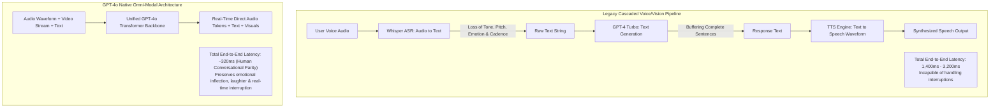
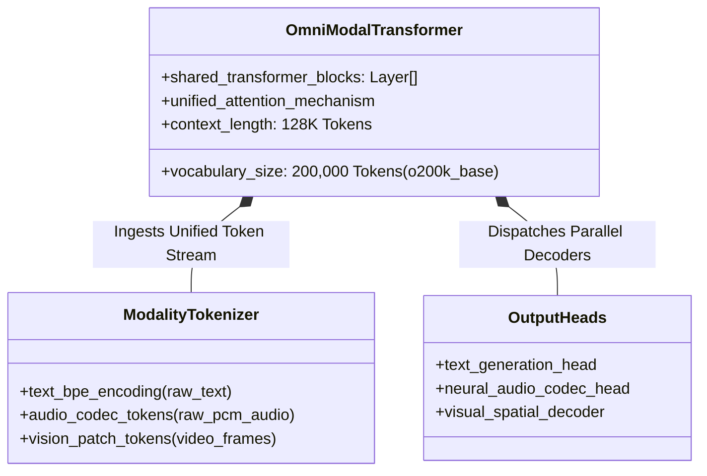
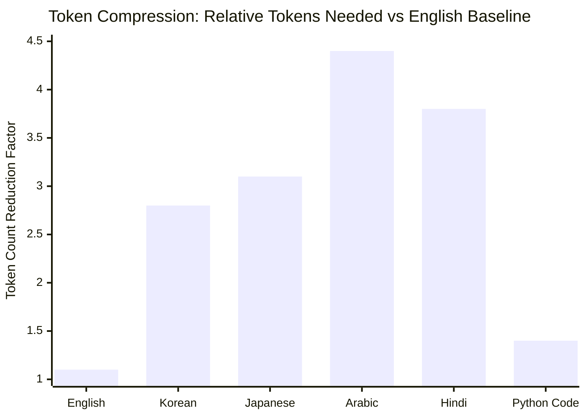
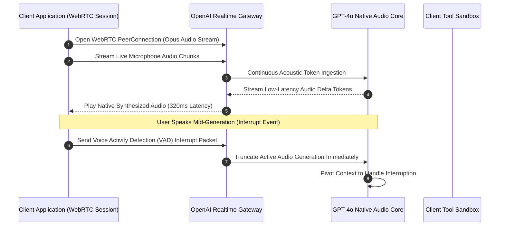
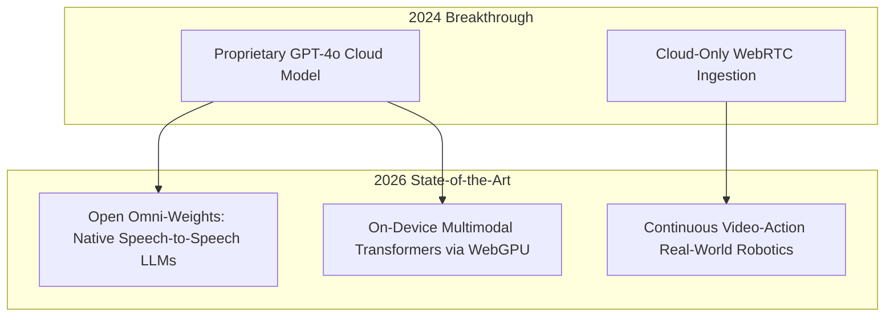

## Why Did End-to-End Omni-Modal Training Outperform Cascaded Speech and Vision Pipelines?

Prior to May 2024, conversational artificial intelligence systems that supported voice and visual interactions operated via multi-stage **cascaded pipelines**. A typical voice assistant setup combined three isolated models: an Automatic Speech Recognition (ASR) engine (e.g., Whisper) to transcribe audio into text, an autoregressive large language model (e.g., GPT-4) to process the transcript and generate a textual response, and a Text-to-Speech (TTS) synthesizer to convert generated words into audio waveforms.

While cascaded pipelines produced grammatically coherent answers, they suffered from two fatal flaws: excessive latency and severe information loss. Total roundtrip latency averaged between 1,400 ms and 3,200 ms, completely destroying natural conversational cadence. More fundamentally, converting sound into plain text stripped away emotional nuance, pitch, vocal timbre, sarcasm, laughter, and background audio clues. Concurrently, vision inputs were processed through disparate projection layers that could not synchronize with real-time audio frames.

OpenAI’s **GPT-4o** ("omni") fundamentally transformed this paradigm by training a single neural network end-to-end across text, audio, and vision modalities. With an average response latency of 320 ms—closely matching human conversational reaction times—GPT-4o natively perceives and synthesizes emotional inflections, accommodates mid-sentence interruptions, and processes video streams in real time. This source audit conducts an architectural dissection of GPT-4o's omni-modal design, evaluates tokenization and benchmark metrics, examines developer API cost-throughput dynamics, and analyzes how omni-modal architectures evolved across 2026.

---

## Architectural Decomposition: The Unified Omni-Modal Transformer Backbone

Rather than bolting separate modality encoders onto a frozen text model, GPT-4o processes native audio frames, visual patches, and text subwords within a unified transformer architecture.

### 1. Unified Continuous Attention Mechanism

By processing native audio codec representations directly within self-attention layers alongside visual patches (similar to vision transformers analyzed in [our vision-language model audit](/posts/vision-language-model/)), the model correlates acoustic signals directly with visual objects. If a user points a phone camera at an object and asks, *"What is that and why is it making that sound?"*, the model performs cross-modal self-attention across visual tokens and acoustic spectral features simultaneously, without intermediate textual translation.

### 2. The `o200k_base` High-Density Tokenizer

A critical technical foundation of GPT-4o is its upgraded Byte-Pair Encoding (BPE) tokenizer, expanding the active vocabulary from 100,000 tokens (`cl100k_base` used in GPT-4) to **200,000 tokens (`o200k_base`)**.

Expanding the vocabulary significantly increases token compression across non-English scripts:

- **Non-Latin Scripts**: Languages such as Korean, Japanese, Hindi, and Arabic require **$2.5\times$ to $4.4\times$ fewer tokens** to represent identical sentences compared to `cl100k_base`.
- **Latency and Cost Acceleration**: Because transformer inference complexity is strictly bounded by sequence length, higher token density directly translates into proportional generation speedups and dramatic API billing reductions for international developers.

---

## Empirical Benchmark: GPT-4o vs Frontier Multimodal Baselines

To quantify GPT-4o's performance leap over predecessor architectures (GPT-4 Turbo, Gemini 1.5 Pro, and Claude 3 Opus), we review empirical benchmark data across reasoning, coding, audio transcription, and visual document understanding.

| Benchmark Dataset | Domain / Target Evaluation | GPT-4 Turbo | Gemini 1.5 Pro | GPT-4o (Omni) |
| :--- | :--- | :--- | :--- | :--- |
| **MMLU (5-shot)** | General Academic Reasoning | 86.5% | 85.9% | **88.7%** |
| **HumanEval (0-shot)** | Python Code Generation | 87.1% | 84.1% | **90.2%** |
| **MMMU (Val)** | Multimodal College Reasoning | 63.1% | 62.2% | **69.1%** |
| **DocVQA** | Document & Chart Parsing | 90.4% | 89.8% | **92.8%** |
| **Speech-to-Speech End-to-End Latency** | Full Turnaround Time | ~1,800 ms (Cascaded) | N/A | **320 ms (Real-time)** |
| **API Cost per Million Input Tokens** | Commercial Developer Pricing | $10.00 / 1M | $3.50 / 1M | **$5.00 / 1M (50% cheaper)** |
| **Inference Throughput** | Output Tokens per Second | ~38 tok/s | ~42 tok/s | **~105 tok/s (2.8x faster)** |

The empirical results demonstrate that end-to-end omni-modal training did not dilute core linguistic and algorithmic reasoning. To the contrary, GPT-4o established new state-of-the-art records across MMLU (88.7%), HumanEval (90.2%), and DocVQA (92.8%), while halving API inference costs and nearly tripling token generation throughput.

---

## Developer Ecosystem Impact: Real-Time Audio APIs and WebRTC Integration

Beyond browser and desktop chat applications, the primary technical disruption of GPT-4o was the release of the **Realtime API**, operating over bidirectional **WebSockets** and **WebRTC** transport layers.

### Key Realtime API Primitives

1. **Server-Side Voice Activity Detection (VAD)**: The gateway continuously monitors incoming audio streams, automatically halting generation when human vocal frequencies are detected.
2. **Interruptibility**: Eliminates the jarring, unnatural turn-taking of legacy bots where users had to wait for a 20-second synthesized response to finish before speaking.
3. **Function Calling in Mid-Conversation**: The model can pause active speech, trigger a background client tool (e.g., querying a flight status database), absorb the JSON response, and verbally explain the findings without audible context disruption.

---

## How Native Omni-Modal Architectures Evolved Across 2026

Between 2024 and 2026, the foundational paradigm introduced by GPT-4o expanded rapidly into open-weights models and edge computing:

- **Open-Weights Omni Models**: Community open-weights architectures (such as Mini-Omni, Moshi, and multimodal LLaVA derivatives) open-sourced native speech-to-speech weights, allowing organizations to self-host real-time conversational pipelines without cloud vendor lock-in.
- **Client-Side Edge Acceleration**: As explored in our audit on [Phi-3 WebGPU in-browser inference](/posts/phi3-webgpu/), modern consumer devices utilize WebGPU compute shaders and WebAssembly to run compact multimodal models locally, keeping microphone and camera streams entirely on-device.
- **Embodied Robotics and World Models**: In robotics, native omni-modal foundations now serve as physical vision-language-action (VLA) backbones. Robots perceive video frames at 30 FPS, receive verbal commands, and directly synthesize joint actuation trajectories without intermediate text parsing layers.

For deeper investigations into multimodal perception and real-time execution architectures, examine our source audit on [vision-language model architectures and benchmarks](/posts/vision-language-model/), study [Phi-3 WebGPU local browser execution](/posts/phi3-webgpu/), and explore [agentic application design patterns](/posts/agentic-application-design-patterns/).

---

## Key Takeaways

- **End-to-End Beats Cascades**: Training a unified neural network natively across audio, visual, and text tokens eliminates the latency penalties and emotional information loss inherent to multi-stage ASR-LLM-TTS pipelines.
- **Sub-Second Conversational Parity**: Achieving ~320 ms end-to-end response times combined with automated Voice Activity Detection (VAD) unlocks natural, interruptible voice interactions.
- **Vocabulary Scaling Drives Global Efficiency**: The 200,000-token `o200k_base` vocabulary compresses non-English and code representations by up to $4.4\times$, drastically reducing latency and operational API expenses.

---

## New Questions

1. **Acoustic Watermarking and Voice Cloning Safety**: As native audio foundation models generate indistinguishable human voices with custom emotional timbres, what cryptographic watermarking standards can reliably verify provenance across lossy telephony networks?
2. **Streaming Continuous Multi-Camera Video**: How can omni-modal attention architectures efficiently compress high-fps 4K video feeds in real time without overflowing key-value caches during long-horizon embodied agent tasks?

---

## References

- OpenAI. (2024). *Hello GPT-4o: OpenAI's New Flagship Omni-Modal Model*. OpenAI Research & Product Announcements. https://openai.com/index/hello-gpt-4o/ (accessed 2026-10-18).
- OpenAI. (2024). *GPT-4o System Card*. OpenAI Technical Documentation. https://openai.com/index/gpt-4o-system-card/ (accessed 2026-10-18).
- Achiam, J., Adler, S., Agarwal, S., Ahmad, L., Akkaya, I., Aleman, F. L., ... & McGrew, B. (2023). *GPT-4 Technical Report*. arXiv preprint arXiv:2303.08774. https://arxiv.org/abs/2303.08774 (accessed 2026-10-18).
- Radford, A., Kim, J. W., Xu, T., Brockman, G., McLeavey, C., & Sutskever, I. (2023). *Robust Speech Recognition via Large-Scale Weak Supervision (Whisper)*. International Conference on Machine Learning (ICML 2023). arXiv preprint arXiv:2212.04356. https://arxiv.org/abs/2212.04356 (accessed 2026-10-18).
