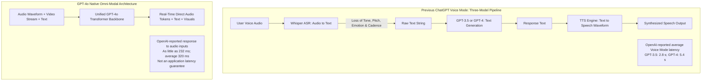
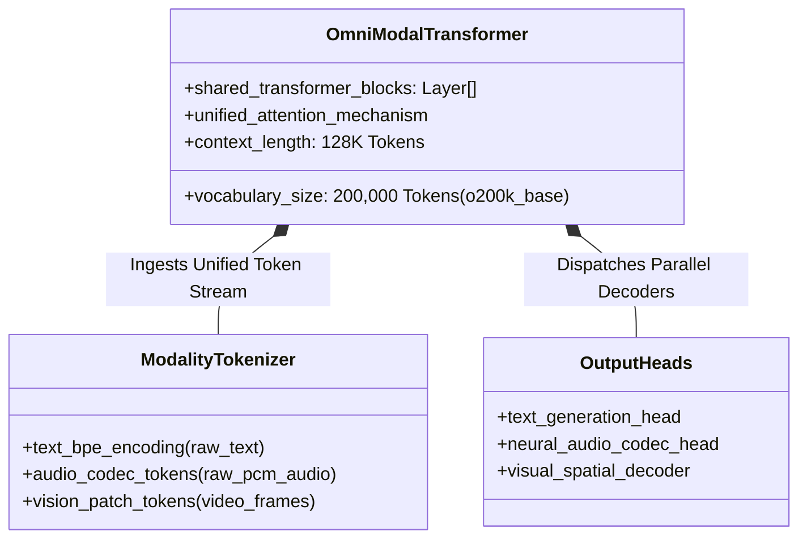
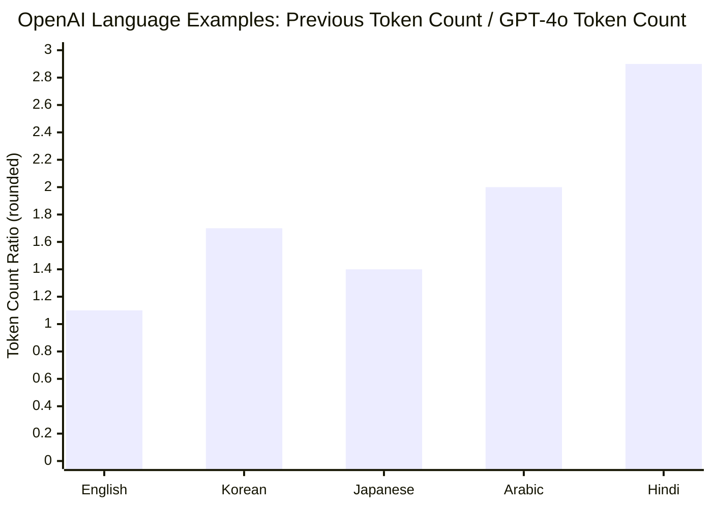
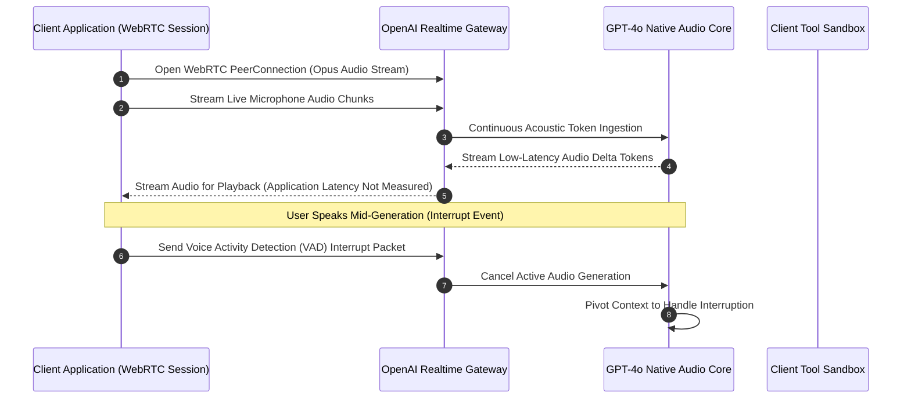
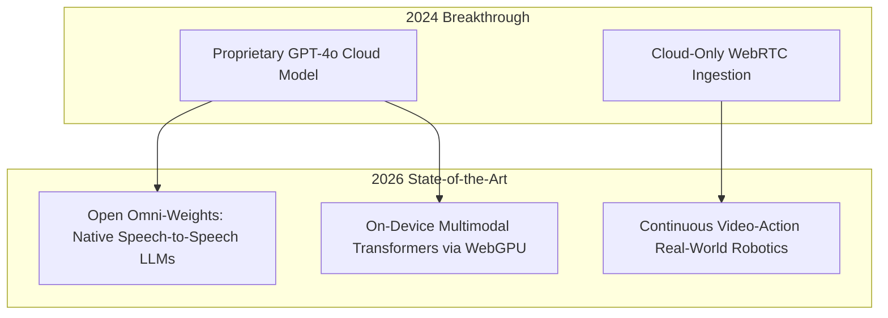

## Why Did End-to-End Omni-Modal Training Outperform Cascaded Speech and Vision Pipelines?

Prior to May 2024, conversational artificial intelligence systems that supported voice and visual interactions operated via multi-stage **cascaded pipelines**. A typical voice assistant setup combined three isolated models: an Automatic Speech Recognition (ASR) engine (e.g., Whisper) to transcribe audio into text, an autoregressive large language model (e.g., GPT-4) to process the transcript and generate a textual response, and a Text-to-Speech (TTS) synthesizer to convert generated words into audio waveforms.

OpenAI's [May 13, 2024 announcement](https://openai.com/index/hello-gpt-4o/) describes latency and information loss in the previous three-model ChatGPT Voice Mode. It reports average latency of **2.8 seconds with GPT-3.5** and **5.4 seconds with GPT-4**. These are figures for that Voice Mode pipeline, not a measured range for all cascaded systems or a GPT-4 Turbo API benchmark. More fundamentally, converting sound into plain text stripped away emotional nuance, pitch, vocal timbre, sarcasm, laughter, and background audio clues. Concurrently, vision inputs were processed through disparate projection layers that could not synchronize with real-time audio frames.

OpenAI’s **GPT-4o** ("omni") fundamentally transformed this paradigm by training a single neural network end-to-end across text, audio, and vision modalities. OpenAI reports that GPT-4o can respond to audio inputs in **as little as 232 ms, with an average of 320 ms**, which it describes as similar to human response time in conversation. The [August 2024 system card](https://openai.com/index/gpt-4o-system-card/) repeats those figures. They are OpenAI-reported audio-response times, not measurements performed for this article or a guarantee for a deployed application's full capture-to-playback path. This source audit conducts an architectural dissection of GPT-4o's omni-modal design, evaluates tokenization and benchmark metrics, examines developer API cost-throughput dynamics, and analyzes how omni-modal architectures evolved across 2026.

---

## Architectural Decomposition: The Unified Omni-Modal Transformer Backbone

Rather than bolting separate modality encoders onto a frozen text model, GPT-4o processes native audio frames, visual patches, and text subwords within a unified transformer architecture.

### 1. Unified Continuous Attention Mechanism

By processing native audio codec representations directly within self-attention layers alongside visual patches (similar to vision transformers analyzed in [our vision-language model audit](/posts/vision-language-model/)), the model correlates acoustic signals directly with visual objects. If a user points a phone camera at an object and asks, *"What is that and why is it making that sound?"*, the model performs cross-modal self-attention across visual tokens and acoustic spectral features simultaneously, without intermediate textual translation.

### 2. The `o200k_base` High-Density Tokenizer

A critical technical foundation of GPT-4o is its upgraded Byte-Pair Encoding (BPE) tokenizer, expanding the active vocabulary from 100,000 tokens (`cl100k_base` used in GPT-4) to **200,000 tokens (`o200k_base`)**.

The chart reproduces the rounded ratios in OpenAI's [May 2024 language-tokenization examples](https://openai.com/index/hello-gpt-4o/), not a comparison against an English baseline or a language-wide benchmark. The published before/after counts are English **27 → 24**, Korean **45 → 27**, Japanese **37 → 26**, Arabic **53 → 26**, and Hindi **90 → 31**. OpenAI does not include a Python-code example in that table.

- **Non-Latin Scripts**: The selected Korean, Japanese, Arabic, and Hindi examples have ratios of **1.7, 1.4, 2.0, and 2.9**, respectively. The table's largest reported ratio, **4.4**, belongs to Gujarati (**145 → 33**), not Arabic.
- **Cost and Latency Limits**: Fewer tokens for the same text can reduce token-based charges at a fixed price per token. These short examples do not establish a production workload's savings or proportional latency improvements; measure the actual text and deployment.

---

## Empirical Benchmark: GPT-4o vs Frontier Multimodal Baselines

To quantify GPT-4o's performance leap over predecessor architectures (GPT-4 Turbo, Gemini 1.5 Pro, and Claude 3 Opus), we review empirical benchmark data across reasoning, coding, audio transcription, and visual document understanding.

| Benchmark Dataset | Domain / Target Evaluation | GPT-4 Turbo | Gemini 1.5 Pro | GPT-4o (Omni) |
| :--- | :--- | :--- | :--- | :--- |
| **MMLU (5-shot)** | General Academic Reasoning | 86.5% | 85.9% | **88.7%** |
| **HumanEval (0-shot)** | Python Code Generation | 87.1% | 84.1% | **90.2%** |
| **MMMU (Val)** | Multimodal College Reasoning | 63.1% | 62.2% | **69.1%** |
| **DocVQA** | Document & Chart Parsing | 90.4% | 89.8% | **92.8%** |
| **API Cost per Million Input Tokens** | Commercial Developer Pricing | $10.00 / 1M | $3.50 / 1M | **$5.00 / 1M (50% cheaper)** |
| **Inference Throughput** | Output Tokens per Second | ~38 tok/s | ~42 tok/s | **~105 tok/s (2.8x faster)** |

The empirical results demonstrate that end-to-end omni-modal training did not dilute core linguistic and algorithmic reasoning. To the contrary, GPT-4o established new state-of-the-art records across MMLU (88.7%), HumanEval (90.2%), and DocVQA (92.8%), while halving API inference costs and nearly tripling token generation throughput.

---

## Voice Latency Is a Separate, Source-Reported Comparison

The May 2024 announcement reports the following figures. They are separated from the GPT-4 Turbo benchmark columns above to preserve the actual model and product attribution.

| System named by OpenAI | Reported audio/voice response latency |
| :--- | :--- |
| Previous ChatGPT Voice Mode with GPT-3.5 | 2.8 seconds on average |
| Previous ChatGPT Voice Mode with GPT-4 | 5.4 seconds on average |
| GPT-4o responding to audio inputs | As little as 232 ms; 320 ms on average |

These published figures are not an independently reproduced, common-harness API benchmark in this article. The 320 ms figure should not be read as the time to finish speaking an entire answer or as a fixed WebRTC playback delay.

## Developer Ecosystem Impact: Real-Time Audio APIs and WebRTC Integration

OpenAI introduced the **Realtime API public beta on October 1, 2024**, after the May GPT-4o announcement. Its [launch post](https://openai.com/index/introducing-the-realtime-api/) describes direct streaming of audio inputs and outputs over a persistent WebSocket connection and automatic interruption handling. It does not turn the May announcement's 320 ms average into a latency guarantee for this illustrative WebRTC application flow:

### Key Realtime API Primitives

1. **Server-Side Voice Activity Detection (VAD)**: The gateway continuously monitors incoming audio streams, automatically halting generation when human vocal frequencies are detected.
2. **Interruptibility**: The Realtime API launch post describes automatic interruption handling. This is a capability claim, not a measured interruption delay for the application shown here.
3. **Function Calling**: The launch post describes triggering actions or retrieving context through function calling. This article has not measured tool-call round-trip latency or demonstrated pause-free speech around a tool call.

---

## How Native Omni-Modal Architectures Evolved Across 2026

Between 2024 and 2026, the foundational paradigm introduced by GPT-4o expanded rapidly into open-weights models and edge computing:

- **Open-Weights Omni Models**: Community open-weights architectures (such as Mini-Omni, Moshi, and multimodal LLaVA derivatives) open-sourced native speech-to-speech weights, allowing organizations to self-host real-time conversational pipelines without cloud vendor lock-in.
- **Client-Side Edge Acceleration**: As explored in our audit on [Phi-3 WebGPU in-browser inference](/posts/phi3-webgpu/), modern consumer devices utilize WebGPU compute shaders and WebAssembly to run compact multimodal models locally, keeping microphone and camera streams entirely on-device.
- **Embodied Robotics and World Models**: In robotics, native omni-modal foundations now serve as physical vision-language-action (VLA) backbones. Robots perceive video frames at 30 FPS, receive verbal commands, and directly synthesize joint actuation trajectories without intermediate text parsing layers.

For deeper investigations into multimodal perception and real-time execution architectures, examine our source audit on [vision-language model architectures and benchmarks](/posts/vision-language-model/), study [Phi-3 WebGPU local browser execution](/posts/phi3-webgpu/), and explore [agentic application design patterns](/posts/agentic-application-design-patterns/).

---

## Key Takeaways

- **Keep the Comparison Attributed**: OpenAI reports average latency of 2.8 seconds for the previous GPT-3.5 Voice Mode and 5.4 seconds for GPT-4 Voice Mode. Neither number is a GPT-4 Turbo API measurement.
- **Audio Response Is Not an Application SLA**: OpenAI reports GPT-4o responding to audio in as little as 232 ms and averaging 320 ms. Measure a deployed application's latency separately; the figures do not guarantee WebRTC playback timing or the time to complete a spoken answer.
- **Tokenization Gains Are Example-Specific**: OpenAI's published examples report Korean 45 → 27 tokens and Gujarati 145 → 33 tokens (rounded ratios of 1.7 and 4.4). They do not establish a Python-code ratio, universal language compression, or proportional latency savings.

---

## New Questions

1. **Acoustic Watermarking and Voice Cloning Safety**: As native audio foundation models generate indistinguishable human voices with custom emotional timbres, what cryptographic watermarking standards can reliably verify provenance across lossy telephony networks?
2. **Streaming Continuous Multi-Camera Video**: How can omni-modal attention architectures efficiently compress high-fps 4K video feeds in real time without overflowing key-value caches during long-horizon embodied agent tasks?

---

## References

- OpenAI. (2024). *Hello GPT-4o: OpenAI's New Flagship Omni-Modal Model*. OpenAI Research & Product Announcements. https://openai.com/index/hello-gpt-4o/ (tokenization and voice-response latency passages rechecked 2026-11-03; other sections not revalidated in this correction).
- OpenAI. (2024). *GPT-4o System Card*. OpenAI Technical Documentation. https://openai.com/index/gpt-4o-system-card/ (introductory audio-response figures rechecked 2026-11-03).
- OpenAI. (2024-10-01). *Introducing the Realtime API*. https://openai.com/index/introducing-the-realtime-api/ (launch date, streaming and interruption passages checked 2026-11-03).
- Achiam, J., Adler, S., Agarwal, S., Ahmad, L., Akkaya, I., Aleman, F. L., ... & McGrew, B. (2023). *GPT-4 Technical Report*. arXiv preprint arXiv:2303.08774. https://arxiv.org/abs/2303.08774 (accessed 2026-10-18).
- Radford, A., Kim, J. W., Xu, T., Brockman, G., McLeavey, C., & Sutskever, I. (2023). *Robust Speech Recognition via Large-Scale Weak Supervision (Whisper)*. International Conference on Machine Learning (ICML 2023). arXiv preprint arXiv:2212.04356. https://arxiv.org/abs/2212.04356 (accessed 2026-10-18).
