{: .light .shadow .rounded-10 w='1212' h='668' }

## Why Does Offline Preference Optimization Suffer from Severe Distribution Shift?

Direct Preference Optimization (DPO) revolutionized the post-training alignment of large language models by eliminating the unstable dual-network (critic and reward model) loops of Proximal Policy Optimization (PPO). By establishing a direct mathematical substitution between human preference probability and policy token likelihood, DPO enabled practitioners to optimize alignment via an exact binary cross-entropy loss over pre-collected pairs of winning and losing completions $(x, y_w, y_l)$.

However, as production teams deployed offline DPO at scale, a critical flaw emerged: **off-policy distribution shift**. In standard offline DPO, preference pairs are generated by an older baseline policy (or a different teacher model such as GPT-4). As the student policy $\pi_\theta$ undergoes gradient updates, its output distribution drifts away from the static training data. When prompted during deployment, the model generates sequences that reside outside the support of the offline dataset, leading to verbosity inflation, repetitive loops, and uncalibrated hallucinations.

Introduced by Salesforce AI Research (Dong et al., 2024), **Online Iterative DPO** resolves this distribution collapse. By continuously re-sampling candidate completions from the active policy checkpoint and labeling them on-the-fly using high-capacity proxy reward models, online iterative alignment bridges the gap between the simplicity of DPO and the on-policy exploration advantages of PPO.

```mermaid
flowchart TD
    subgraph OfflineStatic["Legacy Offline DPO (Distribution Shift)"]
        OldData["Static Offline Dataset (x, y_w, y_l)<br/>Generated by foreign teacher model"]
        DPOUpdate["One-Shot DPO Optimization"]
        DriftPolicy["Drifted Policy<br/>Unseen token distributions & verbosity bias"]
    end

    subgraph OnlineLoop["Online Iterative DPO Loop (Salesforce SFR)"]
        SFT["Supervised Fine-Tuned (SFT) Base Model: Llama-3-8B"]
        SampleRollout["Active Policy Generation (t)<br/>Sample pairs y_1, y_2 ~ π_t(· | x)"]
        ProxyRM["Proxy Reward Model (R_φ)<br/>Ensemble scoring over open preference data"]
        RankFilter["Dynamic Preference Labeling<br/>Identify winning/losing pair (y_w, y_l)"]
        IterDPO["Iterative DPO Gradient Step<br/>Reference anchor updated to π_t"]
        NextPolicy["Next-Generation Checkpoint π_{t+1}"]
    end

    OldData --> DPOUpdate
    DPOUpdate --> DriftPolicy

    SFT --> SampleRollout
    SampleRollout --> ProxyRM
    ProxyRM --> RankFilter
    RankFilter --> IterDPO
    IterDPO --> NextPolicy
    NextPolicy -.->|Loop t = 1..T| SampleRollout
```



---

## 1. The Mathematical Failure of Offline DPO

To understand why offline optimization deteriorates, recall the standard DPO objective parameterized by reference policy $\pi_{\text{ref}}$ and temperature $\beta$:

$$\mathcal{L}_{\text{DPO}}(\pi_\theta; \pi_{\text{ref}}) = -\mathbb{E}_{(x, y_w, y_l) \sim \mathcal{D}} \left[ \log \sigma \left( \beta \log \frac{\pi_\theta(y_w \mid x)}{\pi_{\text{ref}}(y_w \mid x)} - \beta \log \frac{\pi_\theta(y_l \mid x)}{\pi_{\text{ref}}(y_l \mid x)} \right) \right]$$

In offline training, the dataset distribution $\mathcal{D}$ is static. The implicit reward estimated by DPO is:

$$\hat{r}_\theta(x, y) = \beta \log \frac{\pi_\theta(y \mid x)}{\pi_{\text{ref}}(y \mid x)}$$

As training progresses through multiple epochs, the policy $\pi_\theta$ learns to maximize $\hat{r}_\theta(x, y_w)$ for samples present in $\mathcal{D}$. However, for any novel completion $y' \sim \pi_\theta(\cdot \mid x)$ generated during inference that was *not* present in the offline training distribution, the ratio $\pi_\theta(y' \mid x) / \pi_{\text{ref}}(y' \mid x)$ is completely unconstrained. 

The policy quickly discovers adversarial shortcut tokens—phrases, formatting markers, or excessive polite padding—that artificially elevate the log-ratio without providing helpful or accurate content. This breakdown was highlighted in our theoretical survey of [reinforcement learning foundations](/posts/reinforcement-learning-top-40-libraries/).

---

## 2. The Online Iterative DPO Formulation

Salesforce’s framework converts static alignment into a multi-round game between the evolving policy and a proxy reward model.

Let $t \in \{1, 2, \dots, T\}$ denote the alignment iteration:
1. **On-Policy Sampling**: At iteration $t$, the current policy $\pi_t$ generates $N$ candidate completions for each prompt $x$ drawn from a diverse prompt distribution $\mathcal{D}_{\text{prompts}}$:
   $$y_1, y_2 \sim \pi_t(\cdot \mid x), \quad y_1 \neq y_2$$
2. **Proxy Preference Scoring**: A high-precision frozen Reward Model $R_\phi(x, y)$ evaluates the completions:
   $$\Delta R = R_\phi(x, y_1) - R_\phi(x, y_2)$$
   If $|\Delta R| > \delta$ (where $\delta$ is a confidence margin preventing labeling noise), the pair is designated as winning completion $y_w$ and losing completion $y_l$.
3. **Iterative Policy Update**: The policy is updated using the freshly sampled dataset $\mathcal{D}_t$:
   $$\pi_{t+1} = \arg\min_\theta \mathcal{L}_{\text{DPO}}\left(\pi_\theta; \pi_t, \mathcal{D}_t\right)$$

```
Prompt (x) ──► Policy Checkpoint pi_t ──► Candidate y_1 ──┐
                                      ──► Candidate y_2 ──┼──► Proxy RM R_phi ──► Ranked Pair (y_w, y_l)
                                                          │                               │
                                                          └───────────────────────────────┼──► DPO Update Step
                                                                                          ▼
                                                                             Next Policy Checkpoint pi_{t+1}
```

By setting the reference policy for iteration $t+1$ to the immediate predecessor policy $\pi_t$ (rather than the distant unaligned SFT model $\pi_0$), the KL divergence penalty enforces strict trust-region stability:

$$\mathbb{D}_{\text{KL}}(\pi_{t+1} \,\|\, \pi_t) \le \epsilon$$

This bounded update prevents the model from experiencing catastrophic forgetting or exploiting reward hacking shortcuts.

---

## 3. Proxy Reward Modeling without Human Annotators

A historical hurdle to online iterative RLHF in open-source research was the assumption that online learning required human annotators in the loop to label fresh completions at every iteration—a process requiring millions of dollars and weeks of latency.

Salesforce demonstrated that high-performing **proxy preference models** can substitute entirely for human annotators:
- **Curated Multi-Source Datasets**: Combining open-source preference benchmarks (UltraFeedback, HelpSteer, LMSYS Chatbot Arena) to train an ensemble reward model.
- **Length-De-Biasing**: Applying length-normalization penalties during reward computation:
  $$R_{\text{norm}}(x, y) = R_\phi(x, y) - \alpha \cdot \text{Length}(y)$$
  This neutralizes the tendency of reward models to assign higher scores to verbose, repetitive responses.
- **Rejection Sampling Filtering**: When two sampled responses receive near-identical reward scores ($|\Delta R| \le \delta$), the pair is discarded, ensuring that the student policy learns only from decisive, high-contrast preference signals.

---

## Quantitative Empirical Benchmark Results

The resulting model, **SFR-Iterative-DPO-LLaMA-3-8B-R**, set a new standard for open-weight 8B alignment, outperforming both Meta’s official instruction-tuned baseline and frontier models:

| Model | Alignment Paradigm | AlpacaEval-2 (LC Win Rate %) | Arena-Hard Score | MT-Bench (Score / 10) | HumanEval (Pass@1 %) |
| :--- | :--- | :--- | :--- | :--- | :--- |
| **Llama-3-8B-Base + SFT** | Supervised Fine-Tuning Only | 14.2% | 18.5 | 7.12 | 58.5% |
| **Llama-3-8B-Instruct (Official)** | Proprietary RLHF / DPO | 22.9% | 20.6 | 8.05 | 62.2% |
| **Llama-3-8B + Offline DPO** | Single-Pass Static DPO | 20.4% | 19.8 | 7.84 | 60.1% |
| **SFR-Iterative-DPO-8B-R** | **Online Iterative DPO (3 Rounds)**| **30.2%** | **25.4** | **8.28** | **66.4%** |
| **GPT-3.5-Turbo (0125)** | Proprietary RLHF | 22.7% | 21.2 | 8.10 | 68.2% |
| **Mixtral-8x7B-Instruct** | Coarse MoE SFT + DPO | 23.7% | 23.4 | 8.30 | 60.4% |

The data proves that **Online Iterative DPO adds over 7 percentage points to length-controlled win rates** compared to official Llama-3-8B-Instruct, while maintaining strong mathematical and coding reasoning (66.4% on HumanEval). By continually refreshing preference pairs against the active policy distribution, iterative DPO avoids the performance ceiling of static alignment corpora, a dynamic observed in our enterprise case study on [single-node RLHF training](/posts/rlhf-summary-from-human-feedback-single-dgx-spark/).

---

## How Preference Alignment Evolved Across 2026

Entering 2026, the post-training alignment landscape progressed beyond proxy human preferences into autonomous verifiable reinforcement learning:

1. **Reinforcement Learning with Verifiable Rewards (RLVR)**: In formal domains (code synthesis, mathematical problem solving, formal logic), proxy reward models have been completely supplanted by deterministic execution sandboxes. Compilers, unit test runners, and theorem provers provide binary ground-truth rewards, eliminating reward hacking entirely, as explored in our audit of [frontier LLM research trends](/posts/llm-research-trend/).
2. **Self-Play Preference Optimization (SPPO)**: Rather than relying on external reward models, models play iterative minimax games against themselves. A generator proposes solutions while a critic head within the same model identifies subtle logical contradictions, driving continuous self-improvement without human or teacher model labels.
3. **Multi-Turn Conversational DPO**: Alignment has shifted from single-turn prompt-response pairs to evaluating complete multi-turn conversational trajectories, penalizing models that lose context coherence or fail to recover from tool execution errors.

---

## Key Takeaways

- **Offline DPO Suffers from Distribution Shift**: Static preference datasets cannot prevent policy drift; models quickly exploit out-of-distribution shortcut tokens.
- **Iterative Resampling Restores Exploration**: Re-generating candidate pairs from the active policy checkpoint brings the alignment benefits of on-policy PPO to the architectural simplicity of DPO.
- **Proxy Reward Models Eliminate Human Bottlenecks**: Open-source reward ensembles can accurately rank candidate completions, allowing researchers to execute end-to-end online RLHF on consumer hardware.

---

## New Questions

- At what iteration count does online iterative DPO encounter diminishing returns or collapse into mode-dropped narrow response distributions?
- Can proxy reward models reliably evaluate complex multi-turn agentic planning without penalizing innovative, unconventional problem-solving strategies?

---

## References

- Dong, H., Xiong, W., Goyal, D., Pan, R., Diao, S., Zhang, J., Shum, K., & Zhang, T. (2024). *RLHF Workflow: From Reward Modeling to Online RLHF*. arXiv preprint arXiv:2405.07863. [https://arxiv.org/abs/2405.07863](https://arxiv.org/abs/2405.07863) (accessed 2026-10-18).
- Rafailov, R., Sharma, A., Mitchell, E., Ermon, S., Manning, C. D., & Finn, C. (2023). *Direct Preference Optimization: Your Language Model is Secretly a Reward Model*. Advances in Neural Information Processing Systems, 36. [https://arxiv.org/abs/2305.18290](https://arxiv.org/abs/2305.18290) (accessed 2026-10-18).
- Dubey, A., Jauhri, A., Pandey, A., Kadian, A., Al-Dahle, A., Letman, A., ... & Ganapathy, A. (2024). *The Llama 3 Herd of Models*. arXiv preprint arXiv:2407.21783. [https://arxiv.org/abs/2407.21783](https://arxiv.org/abs/2407.21783) (accessed 2026-10-18).
- Cui, G., Yuan, L., Ding, N., Yao, B., Zhu, B., Ni, Y., ... & Sun, M. (2023). *UltraFeedback: Boosting Language Models with High-quality Feedback*. arXiv preprint arXiv:2310.01377. [https://arxiv.org/abs/2310.01377](https://arxiv.org/abs/2310.01377) (accessed 2026-10-18).
- Li, Z., Xu, T., Zhang, Y., Lin, Z., Yu, P. S., & McAuley, J. (2024). *Arena-Hard: An Open Benchmark for Evaluating LLMs on Diverse, Challenging Queries*. LMSYS Organization Technical Report. [https://lmsys.org/blog/2024-04-19-arena-hard/](https://lmsys.org/blog/2024-04-19-arena-hard/) (accessed 2026-10-18).
