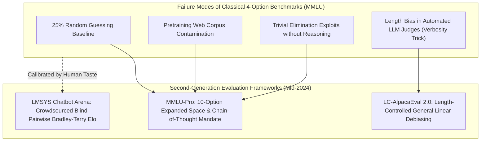
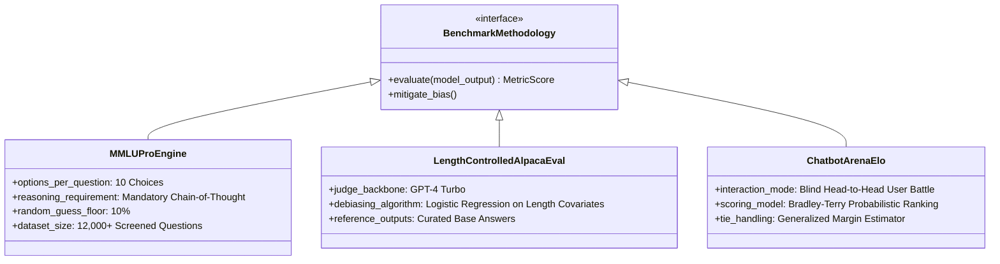
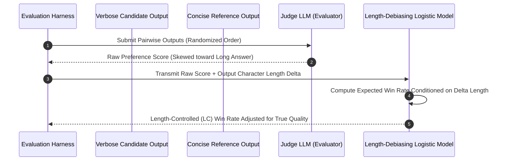
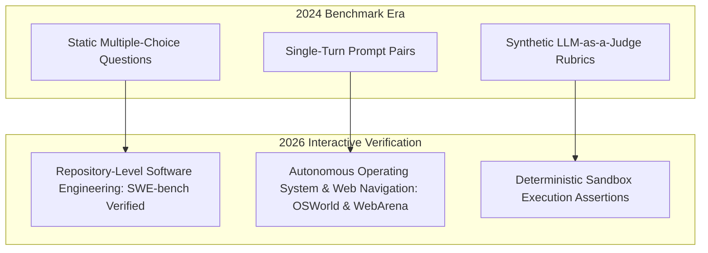

## Why Did First-Generation Static Benchmarks Fail to Reflect Real-World LLM Capability?

During the early surge of foundation model research (2020–2023), academic benchmark evaluations were dominated by static multiple-choice question-answering datasets, most notably **MMLU** (Massive Multitask Language Understanding; Hendrycks et al., 2021). Spanning 57 subjects across humanities, social sciences, and STEM fields, MMLU served as the de facto universal grading rubric for AI intelligence. However, by early 2024, the artificial intelligence community confronted a critical evaluation crisis: **benchmark saturation and test-set contamination**.

As frontier models pushed scores on standard 4-option MMLU beyond 88%, the metric lost discriminative power. Because models possessed a 25% random guessing floor, superficial heuristic elimination allowed models with weak multi-step reasoning to register inflated scores. Furthermore, widespread web scraping inadvertently absorbed benchmark questions and answer keys into pretraining datasets. Concurrently, automated evaluators (such as early AlpacaEval and MT-Bench) suffered from severe **verbosity bias**: models that emitted unnecessarily lengthy, flowery prose consistently received inflated preference scores from judge models, regardless of factual conciseness.

In mid-2024, the evaluation ecosystem underwent a structural overhaul, spearheaded by platforms like Upstage’s **Evalverse**, the release of **MMLU-Pro** (Wang et al., 2024), **Length-Controlled AlpacaEval 2.0** (Dubois et al., 2024), and the empirical dominance of **LMSYS Chatbot Arena Elo** (Chiang et al., 2024). This source audit conducts an architectural evaluation of these next-generation benchmarking frameworks, inspects their mathematical debiasing formulations, reviews empirical performance across frontier model families, and examines how benchmark evaluation evolved through 2026.

---

## Architectural Taxonomy of Modern Evaluation Paradigms

Rigorous model assessment requires triangulating performance across three complementary evaluation methodologies: hard multi-choice reasoning, automated length-debiased preference modeling, and crowdsourced blind pairwise human battlegrounds.

### 1. MMLU-Pro: Eliminating the Guessing Floor via Expanded Search Spaces

MMLU-Pro (Wang et al., 2024) fundamentally rebuilt academic multiple-choice testing:

- **10 Options per Question**: Expanding candidate choices from 4 to 10 choices drops the random guessing baseline from 25% down to **10%**, drastically reducing the likelihood of false-positive successes through superficial elimination.
- **Expert Human Filtering**: Filtered out low-quality trivia and ambiguous questions from the original MMLU, replacing them with rigorous university- and professional-level STEM problems.
- **Mandatory Chain-of-Thought (CoT)**: Models are required to emit step-by-step reasoning tokens before committing to an answer tag (`Final Answer: [X]`), testing genuine logical deduction rather than shallow token probability biases.

On MMLU-Pro, frontier models experienced an immediate 15% to 25% score contraction compared to classical MMLU, reopening substantial headroom for future capability differentiation.

---

### 2. Length-Controlled AlpacaEval 2.0: Correcting Verbosity Exploits

In instruction-following evaluation, using an LLM as a judge (as discussed in our [Hugging Face Cookbook audit](/posts/huggingface-cookbook/)) introduced a vulnerability: models trained to generate verbose, bullet-point-heavy answers scored disproportionately higher than concise, direct responses.

Length-Controlled AlpacaEval 2.0 (Dubois et al., 2024) isolates true answer quality from answer length by modeling the judge's preference as a generalized linear model conditioned on output length differences:

$$P(\text{Judge Prefers } A) = \sigma\left( \alpha \cdot (\text{Length}(A) - \text{Length}(B)) + \beta \cdot \text{Quality}(A, B) \right)$$

By mathematically subtracting the length covariate $\alpha \cdot \Delta\text{Length}$, LC-AlpacaEval achieves a **0.98 Pearson correlation** with human preference rankings, preventing teams from gaming leaderboards through superficial output padding.

---

### 3. LMSYS Chatbot Arena: Crowdsourced Blind Pairwise Elo

The gold standard for real-world utility remains **LMSYS Chatbot Arena** (Chiang et al., 2024). Users submit arbitrary, unconstrained prompts to two anonymous models side-by-side (`Model A` vs `Model B`). Upon inspecting both responses, the user votes on which model performed better, after which identities are revealed.

Rankings are updated using the **Bradley-Terry probability model**:

$$P(i \text{ beats } j) = \frac{1}{1 + 10^{(R_j - R_i) / 400}}$$

Where $R_i$ and $R_j$ represent the current Elo rating points of the competing models. Because the prompts originate from hundreds of thousands of organic real-world users tackling coding, translation, creative writing, and roleplay, Chatbot Arena cannot be contaminated via static web scraping.

---

## Empirical Benchmark: Frontier Model Performance Across Evaluation Dimensions

To observe how different evaluation lenses alter relative model standing, we analyze empirical score telemetry across six representative frontier models from the May 2024 Evalverse update.

| Model Checkpoint | Provider | MMLU (Classical 4-Choice) | MMLU-Pro (10-Choice CoT) | LC-AlpacaEval 2.0 (Win Rate) | LMSYS Arena Elo Rating |
| :--- | :--- | :--- | :--- | :--- | :--- |
| **GPT-4o-0513** | OpenAI | 88.7% | **72.6%** | **51.1%** | **1286 (Rank #1)** |
| **GPT-4 Turbo (0409)** | OpenAI | 86.5% | 63.7% | 46.2% | 1258 (Rank #2)** |
| **Yi-Large** | 01.AI | 85.5% | 58.2% | 41.8% | 1234 (Rank #4) |
| **Qwen-Max-0428** | Alibaba | 85.1% | 56.4% | 38.4% | 1215 (Rank #7) |
| **Snowflake-Arctic** | Snowflake | 68.2% | 34.1% | 22.4% | 1110 (Rank #24) |
| **OpenELM-3B** | Apple | 42.1% | 18.4% | 8.2% | 985 (Edge Baseline) |

The comparative data reveals crucial insights: while classical MMLU scores between GPT-4o and top open-weights models differed by only ~3 percentage points, the gap widened to **14.4 percentage points on MMLU-Pro** (72.6% vs 58.2%). MMLU-Pro decisively separates models capable of multi-step logical derivation from those relying on memorized statistical associations.

---

## How Foundation Model Benchmarks and Agent Evals Evolved Across 2026

Between 2024 and 2026, the artificial intelligence evaluation paradigm shifted from evaluating isolated text completions to assessing multi-turn agentic task completion in live digital environments:

- **From Multiple Choice to Repository-Level Verification**: By 2026, benchmarks like SWE-bench Verified, OSWorld, and WebArena replaced text-based trivia. Instead of selecting letter choices, agents clone actual GitHub repositories, execute shell commands, compile binaries, and must pass continuous integration test suites inside isolated sandboxes (such as [NanoClaw Docker sandboxes](/posts/nanoclaw-docker-sandboxes-guide/)).
- **Dynamic Procedural Generation to Prevent Contamination**: To permanently neutralize web scraping contamination, modern benchmarks dynamically generate problem variants procedurally at runtime, mutating variable names, arithmetic constraints, and API schemas so models cannot rely on memorized pretraining weights.
- **Multi-Agent Coordination Benchmarks**: Modern harnesses evaluate how well models communicate, debate, and decompose work across multi-agent ensembles (as explored in our [survey on LLM-based autonomous agents](/posts/survey-on-llm-based-autonomous-agents/)), measuring coordination efficiency, error recovery, and token overhead.

For deeper investigations into model capability assessment and agent architectures, examine our source audit on [GPT-4o omni-modal architecture](/posts/gpt4o-release/), study [Hugging Face evaluation cookbook recipes](/posts/huggingface-cookbook/), and review our comprehensive [survey on LLM-based autonomous agents](/posts/survey-on-llm-based-autonomous-agents/).

---

## Key Takeaways

- **Overcoming Benchmark Saturation**: MMLU-Pro eliminates the 25% guessing floor and demands step-by-step reasoning across 10 choices, restoring meaningful separation between frontier models.
- **Debiasing Automated Judges**: Length-Controlled AlpacaEval 2.0 mathematically strips out verbosity bias, aligning automated model-based evaluation with true human preference quality.
- **The Value of Centralized Aggregation**: Platforms like Evalverse consolidate disparate metrics—from blind Arena Elo to task-specific benchmarks—providing a multi-dimensional perspective essential for production model selection.

---

## New Questions

1. **Adversarial Robustness in Crowd-Voted Arenas**: As commercial providers face immense economic incentives to climb Chatbot Arena leaderboards, what statistical anomaly detection algorithms best identify coordinated sybil voting or automated astroturfing campaigns?
2. **Evaluation of Non-Deterministic Tool Calling**: In long-horizon agent workflows involving live web browsing and database mutations, how can evaluation harnesses ensure reproducible grading when the external environment is stochastic and constantly changing?

---

## References

- Wang, Y., Ma, X., Zhang, G., Ni, Y., Chandra, A., Guo, S., ... & Chen, W. (2024). *MMLU-Pro: A More Robust and Challenging Multi-Task Language Understanding Benchmark*. arXiv preprint arXiv:2406.01574. https://arxiv.org/abs/2406.01574 (accessed 2026-10-18).
- Dubois, Y., Li, X., Taori, R., Hashimoto, T., & Liang, P. (2024). *Length-Controlled AlpacaEval: A Simple Way to De-bias Automatic Evaluators*. arXiv preprint arXiv:2404.04475. https://arxiv.org/abs/2404.04475 (accessed 2026-10-18).
- Chiang, W. L., Zheng, L., Sheng, Y., Angelopoulos, A. N., Li, T., Tian, H., ... & Stoica, I. (2024). *Chatbot Arena: An Open Platform for Evaluating LLMs by Human Preference*. arXiv preprint arXiv:2403.04132. https://arxiv.org/abs/2403.04132 (accessed 2026-10-18).
- Hendrycks, D., Burns, C., Basart, S., Zou, A., Mazeika, M., Song, D., & Steinhardt, J. (2021). *Measuring Massive Multitask Language Understanding (MMLU)*. International Conference on Learning Representations (ICLR 2021). arXiv preprint arXiv:2009.03300. https://arxiv.org/abs/2009.03300 (accessed 2026-10-18).
