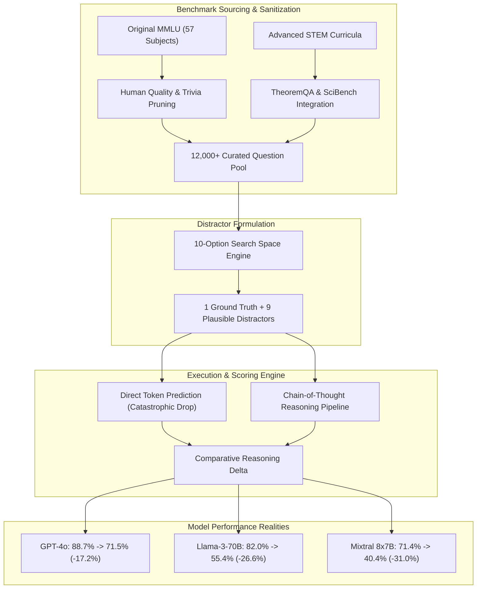
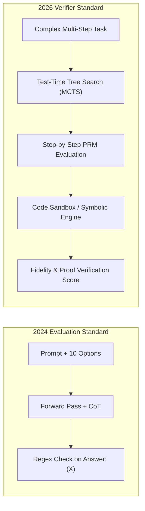

## Why Did MMLU-Pro Expose Reasoning Fragilities That Classical Benchmarks Concealed?

Standard standardized benchmarks for autoregressive foundation models encounter a predictable ceiling: saturation. When Hendrycks et al. introduced Massive Multitask Language Understanding (MMLU) in 2020, its 57 subjects spanning elementary humanities through advanced graduate-level medicine and law served as an insurmountable barrier for transformer architectures. By late 2023 and early 2024, leading frontier models began scoring above 86% to 89%, matching and exceeding human domain expert baselines. However, engineering practitioners routinely noticed a perplexing divergence: models recording stellar MMLU scores frequently collapsed when presented with subtle multi-step logical formulations, domain-specific algebraic transformations, or complex counterfactual reasoning.

In May 2024, TIGER-Lab (led by Yubo Wang, Xueguang Ma, and collaborators) released **MMLU-Pro**, a rigorously filtered and expanded evaluation harness designed explicitly to destabilize surface-level heuristic memorization. Rather than treating evaluation as an arbitrary trivia retrieval exercise, MMLU-Pro reconstructed the diagnostic pipeline across three foundational vectors:

1. **Expanding the Decision Space from 4 to 10 Choices**: Classical MMLU relies on standard four-choice multiple-choice questions (A, B, C, D). A purely random or biased predictor holds a 25% floor. By injecting six additional expert-level distractors, MMLU-Pro compresses the random guess floor to 10%, penalizing models that exploit spurious lexical correlations between prompt phrasing and target answer keys.
2. **Integrating Advanced STEM Reasoning Datasets**: Classical humanities questions often test factual memorization. MMLU-Pro dramatically scaled the proportion of rigorous STEM queries, sourcing difficult problem formulations from TheoremQA, SciBench, and verified university STEM curricula. Over 34% of questions stem directly from rigorous technical subjects requiring symbolic intermediate computations.
3. **Mandating Chain-of-Thought (CoT) Workflows**: In standard 5-shot direct generation, models emit an immediate answer token (`(A)`). In MMLU-Pro, evaluation demonstrates that direct answer prediction degrades catastrophically across nearly all open and proprietary architectures, proving that intermediate reasoning tokens are strictly necessary for correct candidate discrimination.



As demonstrated in early comparative audits, the score collapse was immediate and uniform. GPT-4o dropped by over 17 percentage points (from 88.7% to 71.49%), Meta's Llama-3-70B fell by 26.6 percentage points (from 82.0% to 55.41%), and Mixtral 8x7B suffered a 31 percentage point collapse down to 40.4%. These empirical findings confirmed what evaluation researchers suspected: classical benchmark saturation was an artifact of narrow distractor spaces and token memorization rather than robust domain reasoning.

---

## Benchmark Decontamination and Distractor Generation Architecture

Evaluating large language models demands meticulous dataset sanitization to guarantee that benchmark scores reflect genuine generalization rather than verbatim pretraining memorization. In our related study on [LLM Evaluation Frameworks](/posts/llm-evaluation/), we explored how automated judges and synthetic testbeds drift without strict ground truth guarantees. MMLU-Pro addressed contamination through a rigorous two-tier human-in-the-loop audit.

### Eliminating Trivial and Ambiguous Questions

The authors observed that approximately 15% of original MMLU questions contained ambiguous phrasing, outdated factual premises, or formatting errors where multiple choices were mathematically identical. Expert reviewers scrubbed questions reliant solely on rote memorization while preserving questions demanding multi-step deductions.

```
Question Complexity Distribution:
--------------------------------------------------------------------------------
Original MMLU:    [ Rote Memorization: 62% ]  [ Multi-Step Deductions: 38% ]
MMLU-Pro:         [ Rote Memorization: 16% ]  [ Multi-Step Deductions: 84% ]
--------------------------------------------------------------------------------
```

### The 10-Option Hard Negative Sampling Strategy

Constructing nine plausible distractors for university-level quantum physics, abstract algebra, or constitutional law presents severe generation challenges. If distractors are syntactically dissimilar or semantically absurd, the model can trivially eliminate them via perplexity heuristics. TIGER-Lab combined LLM generation with expert verification:

1. Candidate models were prompted to generate candidate solutions containing plausible calculation mistakes, sign errors, or historical misconceptions.
2. Domain experts reviewed distractors to verify that none constituted valid secondary interpretations or alternate truths.
3. The distractor order was randomized per sample to prevent positional bias, a known vulnerability discussed in our analysis of [GPT-4o Release Dynamics](/posts/gpt4o-release/).

```python
# Simplified Representation of MMLU-Pro 10-Option Prompt Construction
from typing import List, Dict

def construct_mmlu_pro_prompt(
    subject: str,
    question: str,
    options: List[str],
    few_shot_exemplars: List[Dict]
) -> str:
    """
    Constructs a standardized 5-shot Chain-of-Thought prompt with 10 options.
    """
    prompt_lines = [
        f"The following are multiple choice questions (with answers) about {subject}.",
        "Think step by step before providing your final answer in the format: 'Answer: [OPTION]'.\n"
    ]
    
    # Inject few-shot reasoning exemplars
    for ex in few_shot_exemplars:
        prompt_lines.append(f"Question: {ex['question']}")
        for idx, opt in enumerate(ex['options']):
            char_label = chr(ord('A') + idx)
            prompt_lines.append(f"({char_label}) {opt}")
        prompt_lines.append(f"Thought:\n{ex['rationale']}")
        prompt_lines.append(f"Answer: ({ex['answer']})\n")
        
    # Append target evaluation query
    prompt_lines.append(f"Question: {question}")
    for idx, opt in enumerate(options):
        char_label = chr(ord('A') + idx)
        prompt_lines.append(f"({char_label}) {opt}")
    prompt_lines.append("Thought:")
    
    return "\n".join(prompt_lines)
```

By enforcing that every prompt terminates with an explicit reasoning request, MMLU-Pro systematically separated lexical recall from multi-step deduction.

---

## Chain-of-Thought Sensitivity and Reasoning Degradation

Why does the transition from 4 to 10 options disproportionately damage medium-scale models? In research detailed in [Top Papers in Modern AI](/posts/top-papers-ai/), scaling laws dictate that parametric capacity limits intermediate state tracking. When a model operates in a 4-choice setting, the logit probability distribution across target tokens `A, B, C, D` is relatively steep. Minor probability mass leakage across irrelevant options rarely alters the argmax selection.

In a 10-choice setting (`A` through `J`), the probability distribution becomes significantly flatter. Without chain-of-thought, an autoregressive decoder must predict the final option token in a single forward pass through its transformer layers. If the required solution involves three intermediate algebraic substitutions, computing those non-linear interactions entirely within residual stream representations before emitting the first token incurs immense representational strain.

| Model Architecture | MMLU Direct (4-Choice) | MMLU CoT (4-Choice) | MMLU-Pro Direct (10-Choice) | MMLU-Pro CoT (10-Choice) | CoT Gain ($\Delta$) |
| :--- | :--- | :--- | :--- | :--- | :--- |
| **GPT-4o (Omni)** | 88.7% | 88.9% | 54.3% | 71.5% | **+17.2%** |
| **Claude 3.5 Sonnet** | 88.5% | 89.2% | 56.1% | 73.2% | **+17.1%** |
| **Llama-3-70B-Instruct** | 82.0% | 82.4% | 38.6% | 55.4% | **+16.8%** |
| **Mixtral 8x7B Instruct** | 71.4% | 71.8% | 24.1% | 40.4% | **+16.3%** |
| **Qwen1.5-32B-Chat** | 73.1% | 73.5% | 26.5% | 42.1% | **+15.6%** |

The data proves that while Chain-of-Thought provided marginal improvements on saturated 4-choice MMLU (often less than 1%), on MMLU-Pro it provided an absolute performance uplift of 15% to 17% across all model classes. This empirical divergence confirmed that MMLU-Pro successfully transformed the benchmark from a memory test into an active inference and search challenge.

---

## How Multi-Step Reasoning Benchmarks and Verifiers Evolved Across 2026

Between 2024 and 2026, the paradigm of static multiple-choice evaluation underwent fundamental obsolescence. While MMLU-Pro established the necessity of 10-option distractor spaces, modern 2026 frontier systems (including OpenAI o3, DeepSeek-R1, and Anthropic Claude 3.7 Sonnet) routinely demonstrate test-time computation and deep tree search. Consequently, the evaluation ecosystem adapted across four major dimensions:

### 1. Shift from Multiple-Choice to Free-Form Verification
Multiple-choice questions, regardless of distractor depth, remain susceptible to elimination heuristics. In 2026, standard evaluation harnesses utilize deterministic sandboxes, symbolic CAS (Computer Algebra Systems), and unit test compilers (e.g., SWE-bench Verified, FrontierMath, and LiveCodeBench). Models must output complete executable code, formal mathematical proofs, or interactive API calls rather than option tokens.

### 2. Process Reward Modeling (PRM) and Step-Level Verifiers
Rather than scoring models solely on final outcome accuracy (Outcome Reward Models, or ORMs), evaluation frameworks in 2026 inspect step-by-step reasoning traces. Automated process verifiers evaluate each logical transition, penalizing hallucinated premises or mathematical fallacies even if the model accidentally stumbles upon the correct final option.



### 3. Dynamic and Live Contamination Mitigation
Static benchmark repositories published on public model hubs inevitably leak into training splits during continuous web crawling. Modern 2026 evaluation platforms utilize programmatic dynamic generators that synthesize novel mathematical structures and logic puzzles on-the-fly, ensuring that no model has encountered the exact parameterization during pretraining.

---

## Key Takeaways

- **MMLU-Pro exposed the illusion of benchmark saturation**: Expanding options from 4 to 10 and curating difficult STEM problems revealed double-digit percentage drops across all frontier models.
- **Random guessing floors were successfully mitigated**: Compressing the baseline guessing probability from 25% down to 10% penalized heuristic shortcut learning.
- **Chain-of-Thought is indispensable for large search spaces**: Direct answer prediction on MMLU-Pro collapsed across every tested architecture, while CoT delivered a 15% to 17% accuracy boost.
- **Dataset curation demands expert verification**: Automated distractor synthesis paired with domain expert validation provides reliable, non-trivial negative exemplars.
- **Evaluation evolved beyond static option selection in 2026**: Modern frontier validation prioritizes sandboxed execution, process reward verification, and dynamic procedural problem generation.

---

## New Questions

1. To what extent do test-time compute models (e.g., o1 and o3 series) circumvent distractor traps by evaluating option validity in parallel during internal tree search?
2. How can evaluation harnesses accurately distinguish between genuine causal reasoning and highly sophisticated statistical emulation in multi-modal scientific domains?
3. What are the economic cost trade-offs of running comprehensive 10-option CoT benchmarks versus dynamic code-execution test suites across billions of inference tokens?

---

## References

- Wang, Y., Ma, X., Zhang, G., Ni, Y., Chandra, G., Guo, S., Ren, W., Arulraj, A., He, X., Jiang, Z., Tian, T. Y., Liu, T., & Wang, W. Y. (2024). *MMLU-Pro: A More Robust and Challenging Multi-Task Language Understanding Benchmark*. arXiv preprint arXiv:2406.01574. Available at: <https://arxiv.org/abs/2406.01574> (accessed 2026-10-18).
- Hendrycks, D., Burns, C., Basart, S., Zou, A., Ong, M., Song, D., & Steinhardt, J. (2021). *Measuring Massive Multitask Language Understanding*. In International Conference on Learning Representations (ICLR). Available at: <https://arxiv.org/abs/2009.03300> (accessed 2026-10-18).
- Wei, J., Wang, X., Schuurmans, D., Bosma, M., Xia, F., Chi, E., Le, Q. V., & Zhou, D. (2022). *Chain-of-Thought Prompting Elicits Reasoning in Large Language Models*. Advances in Neural Information Processing Systems (NeurIPS), 35, 24824-24837. Available at: <https://arxiv.org/abs/2201.11903> (accessed 2026-10-18).
- Chen, W., Yin, X., Mao, X., & Shen, B. (2023). *TheoremQA: A Theorem-driven Question Answering Dataset for Large Language Models*. In Empirical Methods in Natural Language Processing (EMNLP). Available at: <https://arxiv.org/abs/2305.12524> (accessed 2026-10-18).
