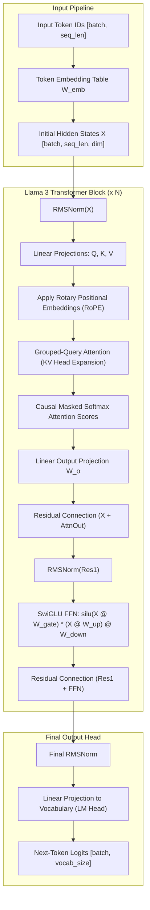
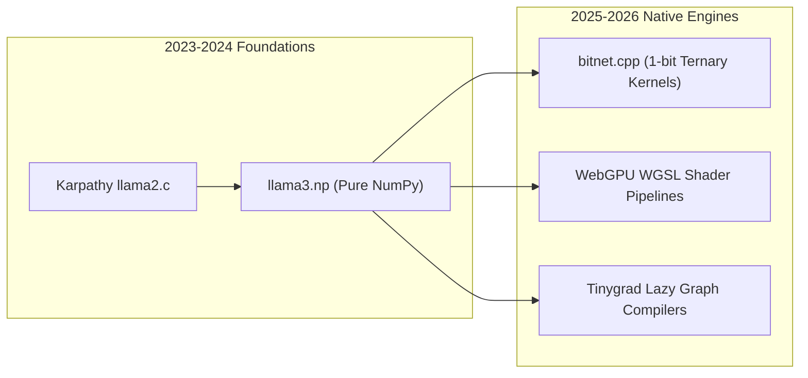

## Why Does Implementing Autoregressive Transformers in Pure NumPy Clarify Architectural Mechanics?

Modern deep learning frameworks such as PyTorch, JAX, and Hugging Face `transformers` wrap autoregressive execution inside complex abstractions: asynchronous CUDA streams, fused kernel compilers (TorchDynamo, Triton), automated graph capture, and opaque memory managers. While these runtimes are essential for petascale pretraining across tens of thousands of GPUs, they often obscure the underlying linear algebra and tensor permutations that govern token generation.

When developers inspect Llama 3's open weights, understanding the exact mathematical pipeline—from raw discrete token IDs to next-token logit distributions—requires stripping away runtime abstractions. Implementing Llama 3 using **pure NumPy** provides a transparent, zero-dependency environment where every matrix multiplication, positional rotation, and normalization layer is exposed in clean, deterministic Python arrays.

Inspired by Andrej Karpathy's minimalist `llama2.c` and educational NumPy ports like `llama3.np`, this source audit dissects the fundamental computational kernels of Llama 3:
1. **Root Mean Square Normalization (RMSNorm)** without mean centering.
2. **Rotary Position Embedding (RoPE)** complex phasor multiplications.
3. **Grouped-Query Attention (GQA)** key/value head broadcasting.
4. **SwiGLU Feed-Forward Networks** with gated linear units.



By tracing tensor shapes throughout this forward pass, we isolate the exact arithmetic that transforms high-dimensional latent vectors into coherent autoregressive predictions.

---

## Dissecting the Core Tensor Kernels in NumPy

### 1. Root Mean Square Normalization (RMSNorm)

Classical LayerNorm centers activations by subtracting the mean and dividing by the standard deviation:
$$\text{LN}(x) = \frac{x - \mu}{\sqrt{\sigma^2 + \epsilon}} \odot \gamma + \beta$$
Zhang and Sennrich (2019) demonstrated that the shift-invariance property ($\mu$) contributes minimally to training stability, whereas the scaling property dominates representation calibration. Llama 3 dispenses with mean computation and bias offsets ($\beta$), computing pure RMS:
$$\text{RMSNorm}(x) = \frac{x}{\sqrt{\frac{1}{d}\sum_{i=1}^d x_i^2 + \epsilon}} \odot \gamma$$

In pure NumPy, this translates to an efficient, vectorized tensor operation:

```python
import numpy as np

def rms_norm(x: np.ndarray, weight: np.ndarray, eps: float = 1e-5) -> np.ndarray:
    """
    Computes RMSNorm over the last dimension.
    x: [batch, seq_len, dim]
    weight: [dim]
    """
    variance = np.mean(x ** 2, axis=-1, keepdims=True)
    normed_x = x * (1.0 / np.sqrt(variance + eps))
    return normed_x * weight
```

### 2. Rotary Position Embeddings (RoPE) via Complex Multiplication

Unlike absolute learned positional embeddings or relative bias matrices (such as ALiBi), RoPE (Su et al., 2021) encodes positional information by rotating query and key vectors in 2D coordinate subspaces:
$$R_{\Theta, m}^d = \text{diag}\left(R_{\theta_1, m}, R_{\theta_2, m}, \dots, R_{\theta_{d/2}, m}\right)$$
where each $R_{\theta_i, m}$ represents a 2D rotation matrix with frequency $\theta_i = 10000^{-2(i-1)/d}$ (or adjusted frequency bases like $500,000$ in Llama 3).

In NumPy, pairs of adjacent coordinates can be cast directly into complex numbers, multiplying by unit phasors $e^{i m \theta}$:

```python
def precompute_rope_freqs_cis(dim: int, end: int, theta: float = 500000.0) -> np.ndarray:
    """
    Precomputes complex exponential rotation factors for RoPE.
    """
    freqs = 1.0 / (theta ** (np.arange(0, dim, 2)[: (dim // 2)] / dim))
    t = np.arange(end)
    freqs_outer = np.outer(t, freqs)  # [end, dim // 2]
    freqs_cis = np.exp(1j * freqs_outer)  # Complex phasors
    return freqs_cis

def apply_rotary_emb(x: np.ndarray, freqs_cis: np.ndarray) -> np.ndarray:
    """
    Applies RoPE to query or key tensors.
    x: [batch, seq_len, num_heads, head_dim]
    freqs_cis: [seq_len, head_dim // 2]
    """
    # View real tensor as complex numbers along pairs of head dimensions
    x_complex = x.reshape(*x.shape[:-1], -1, 2)
    x_complex = x_complex[..., 0] + 1j * x_complex[..., 1]
    
    # Broadcast across batch and heads
    freqs_cis = freqs_cis[None, :, None, :]  # [1, seq_len, 1, head_dim // 2]
    x_rotated = x_complex * freqs_cis
    
    # Unpack real and imaginary parts back to real tensor
    x_out = np.stack([x_rotated.real, x_rotated.imag], axis=-1)
    return x_out.reshape(*x.shape)
```

### 3. Grouped-Query Attention (GQA) Broadcasting

Standard Multi-Head Attention (MHA) allocates equal numbers of Query, Key, and Value heads ($n_{kv} = n_q$). At long context windows, caching Key and Value projections consumes significant VRAM. Llama 3 adopts Grouped-Query Attention (Ainslie et al., 2023), sharing key/value heads across groups of query heads ($n_q = 32, n_{kv} = 8$, grouping factor $g = 4$).

In a pure NumPy engine, expanding KV heads does not require memory copies; NumPy's `np.repeat` or strided broadcasting expands $n_{kv}$ to match $n_q$:

```python
def repeat_kv(x: np.ndarray, n_rep: int) -> np.ndarray:
    """
    Expands KV heads along the head dimension for GQA.
    x: [batch, seq_len, n_kv_heads, head_dim]
    n_rep: n_q_heads // n_kv_heads
    """
    if n_rep == 1:
        return x
    return np.repeat(x, repeats=n_rep, axis=2)
```

### 4. SwiGLU Gated Feed-Forward Networks

Llama 3 replaces standard ReLU or GELU activations with SwiGLU (Shazeer, 2020), which splits linear projection into gating and value branches:
$$\text{SwiGLU}(x) = \left(\text{Swish}(x W_{\text{gate}}) \odot (x W_{\text{up}})\right) W_{\text{down}}$$
where $\text{Swish}(z) = z \cdot \sigma(z)$.

```python
def silu(x: np.ndarray) -> np.ndarray:
    """Computes the SiLU (Swish-1) activation function."""
    return x / (1.0 + np.exp(-x))

def feed_forward(x: np.ndarray, w_gate: np.ndarray, w_up: np.ndarray, w_down: np.ndarray) -> np.ndarray:
    """
    Computes SwiGLU feed-forward layer.
    x: [batch, seq_len, dim]
    """
    gate = silu(x @ w_gate)
    up = x @ w_up
    return (gate * up) @ w_down
```

---

## Comparing Bare-Metal NumPy Execution with High-Level Frameworks

Building inference from bare arrays contrasts sharply with optimized frameworks explored in our guides on [Fine-Tuning with LLaMA-Factory](/posts/llama-factory/) and [Unsloth Local Fine-Tuning Optimization](/posts/unsloth-local-api-guide/). While frameworks leverage CUDA graphs and kernel fusion to achieve thousands of tokens per second, pure NumPy illustrates algorithmic truth:

| Optimization Layer | Pure NumPy (CPU) | PyTorch Native (Eager) | vLLM / SGLang (Production) |
| :--- | :--- | :--- | :--- |
| **Execution Backend** | Single-threaded / OpenBLAS | Multi-threaded LibTorch / CUDA | Custom PagedAttention CUDA / Triton |
| **KV Cache Strategy** | Dynamic array resizing | Paged pre-allocated GPU buffer | Paged block allocation with zero-copy |
| **RoPE Computation** | NumPy complex broadcasting | Fused RoPE CUDA kernel | FlashAttention integrated rotary kernel |
| **Memory Footprint** | Full float32/float16 in RAM | Quantized INT4/INT8 on VRAM | Dynamic Paged KV Cache pool |
| **Primary Utility** | Architectural transparency & education | Research model prototyping | High-throughput multi-user serving |

---

## How First-Principles Minimalist Engines Evolved Across 2026

Between 2024 and 2026, the movement toward zero-dependency, first-principles model engines expanded from educational experiments into critical systems infrastructure:

### 1. The Proliferation of Edge C Runtimes (`llama.cpp` and `bitnet.cpp`)
Georgi Gerganov's minimalist C/C++ architecture demonstrated that eliminating multi-gigabyte Python dependencies allowed models to execute on edge microcontrollers, mobile silicon, and embedded devices. In 2026, 1-bit native engines (such as Microsoft's BitNet b1.58 runtimes) execute ternary matrix multiplication using pure integer bitwise additions, discarding floating-point matrix multipliers entirely.

### 2. Browser-Native WebGPU Acceleration
As explored in our analysis of [Phi-3 WebGPU Client-Side Execution](/posts/phi3-webgpu/), first-principles tensor loops shifted from CPU NumPy arrays directly into browser WGSL (WebGPU Shading Language) compute pipelines. Modern client-side engines execute the exact same RMSNorm, RoPE, and GQA operations directly on local hardware shaders without server round-trips.



### 3. Deterministic Sandboxed Verification
In autonomous agent architectures, verifying that a model's weights have not experienced post-training corruption requires running lightweight, verifiable forward passes in isolated sandboxes. Pure NumPy implementations serve as ground-truth reference specifications against which hardware-accelerated kernels are formally verified.

---

## Key Takeaways

- **NumPy reveals underlying linear algebra**: Removing framework wrappers exposes the exact tensor rotations, gating mechanisms, and normalization steps powering modern foundation models.
- **RMSNorm simplifies LayerNorm**: Eliminating mean-centering reduces computational overhead while maintaining activation stability across deep residual stacks.
- **RoPE operates cleanly via complex phasors**: Casting coordinate pairs into complex numbers enables concise, vectorized 2D rotations for relative positional encoding.
- **GQA resolves KV cache bottlenecks**: Grouped-Query Attention broadcasts smaller key/value projections across multiple query heads, slashing runtime memory bandwidth.
- **First-principles engines shape 2026 edge inference**: The architectural clarity gained from minimalist implementations directly informs 1-bit integer runtimes, WebGPU client-side execution, and embedded LLM engines.

---

## New Questions

1. How do 1-bit ternary architectures (e.g., BitNet b1.58) mathematically modify the SwiGLU gating interaction compared to traditional float16 foundation models?
2. What are the cache-locality limits of pure CPU tensor operations when context lengths scale beyond 32,000 tokens without custom hardware tiling?
3. Can browser-based WGSL compute kernels maintain numerical parity with IEEE 754 float32 reference implementations during recursive autoregressive sampling?

---

## References

- Meta AI. (2024). *The Llama 3 Herd of Models*. arXiv preprint arXiv:2407.21783. Available at: <https://arxiv.org/abs/2407.21783> (accessed 2026-10-18).
- Touvron, H., Martin, L., Stone, K., Albert, P., Almahairi, A., Babaei, Y., Bashlykov, N., Batra, S., Bhargava, P., Bhosale, S., et al. (2023). *Llama 2: Open Foundation and Fine-Tuned Chat Models*. arXiv preprint arXiv:2307.09288. Available at: <https://arxiv.org/abs/2307.09288> (accessed 2026-10-18).
- Su, J., Ahmed, M., Lu, Y., Pan, S., Bo, W., & Liu, Y. (2024). *RoFormer: Enhanced Transformer with Rotary Position Embedding*. Neurocomputing, 568, 127063. arXiv preprint arXiv:2104.09864. Available at: <https://arxiv.org/abs/2104.09864> (accessed 2026-10-18).
- Shazeer, N. (2020). *GLU Variants Improve Transformer*. arXiv preprint arXiv:2002.05202. Available at: <https://arxiv.org/abs/2002.05202> (accessed 2026-10-18).
- Ainslie, J., Lee-Thorp, J., de Jong, M., Zemlyanskiy, Y., Lebrón, F., & Sanghai, S. (2023). *GQA: Training Generalized Multi-Query Transformer Models from Multi-Head Checkpoints*. In Empirical Methods in Natural Language Processing (EMNLP). Available at: <https://arxiv.org/abs/2305.13245> (accessed 2026-10-18).
- Karpathy, A. (2023). *llama2.c: Inference Llama 2 in one file of pure C*. GitHub Repository. Available at: <https://github.com/karpathy/llama2.c> (accessed 2026-10-18).
