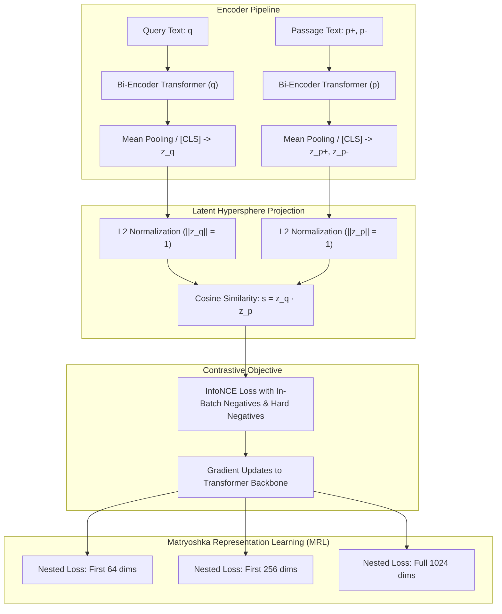
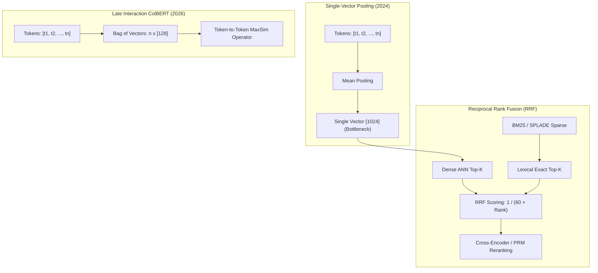

## Why Do Dense Vector Embeddings Serve as the Indispensable Foundation of Semantic Search?

Every neural information retrieval pipeline, semantic deduplication system, and Retrieval-Augmented Generation (RAG) architecture rests upon a foundational mathematical abstraction: dense vector embeddings. Raw text, images, and audio represent unstructured, discrete tokens situated in combinatorial spaces that lack continuous geometric metrics. By projecting variable-length discrete inputs into fixed-dimensional continuous manifolds ($\mathbb{R}^d$), embedding encoders map semantic affinities into spatial proximity.

While early representation learning relied on static lexical lookup tables (Word2Vec, GloVe) or bag-of-words heuristics (TF-IDF, BM25), modern transformer-based encoders compute context-aware representations where polysemy, syntactic nuance, and cross-lingual alignments are preserved. However, treating embedding models as black-box API endpoints obscures critical structural mechanics:
1. **The contrastive loss formulations** that pull semantically equivalent passages together while repelling hard negatives across high-dimensional unit hyperspheres.
2. **The evaluation taxonomies (MTEB)** that distinguish generic sentence similarity from specialized zero-shot asymmetric passage retrieval.
3. **The compression dynamics of Matryoshka Representation Learning (MRL)**, which allow dynamic truncation of embedding dimensions without catastrophic loss of retrieval fidelity.



By engineering embedding spaces to reflect geometric distance rather than lexical overlap, retrieval engines achieve semantic generalization across diverse domains.

---

## Contrastive Optimization and the InfoNCE Objective

How do deep encoders learn to position semantically aligned texts adjacent to one another in $\mathbb{R}^d$? In modern bi-encoder architectures, encoders are trained using variants of the **InfoNCE** (Information Noise-Contrastive Estimation) loss.

Given a query representation $q \in \mathbb{R}^d$, a relevant positive document $p^+ \in \mathbb{R}^d$, and a set of $K$ negative documents $\{p_j^-\}_{j=1}^K$, the objective maximizes the mutual information between the query and the positive target while minimizing correlation with negatives:

$$\mathcal{L}_{\text{InfoNCE}} = -\log \frac{\exp\left(\frac{\text{sim}(q, p^+)}{\tau}\right)}{\exp\left(\frac{\text{sim}(q, p^+)}{\tau}\right) + \sum_{j=1}^K \exp\left(\frac{\text{sim}(q, p_j^-)}{\tau}\right)}$$

where $\text{sim}(u, v) = \frac{u \cdot v}{\|u\| \|v\|}$ denotes cosine similarity, and $\tau > 0$ represents a learnable temperature parameter that sharpens or softens the probability distribution over candidate pairs.

```python
import torch
import torch.nn as nn
import torch.nn.functional as F

class ContrastiveEmbeddingLoss(nn.Module):
    """
    Computes InfoNCE loss with in-batch negatives.
    """
    def __init__(self, temperature: float = 0.05):
        super().__init__()
        self.temperature = temperature

    def forward(self, query_embs: torch.Tensor, doc_embs: torch.Tensor) -> torch.Tensor:
        """
        query_embs: [batch_size, dim]
        doc_embs:   [batch_size, dim]
        Assumes doc_embs[i] is the positive target for query_embs[i].
        All other doc_embs[j] (j != i) serve as in-batch negatives.
        """
        # Normalize embeddings to unit hypersphere
        q_norm = F.normalize(query_embs, p=2, dim=-1)
        d_norm = F.normalize(doc_embs, p=2, dim=-1)
        
        # Compute cosine similarity matrix: [batch_size, batch_size]
        similarity_matrix = torch.matmul(q_norm, d_norm.T) / self.temperature
        
        # Ground-truth labels are on the diagonal (index 0, 1, ..., N-1)
        labels = torch.arange(query_embs.size(0), device=query_embs.device)
        
        return F.cross_entropy(similarity_matrix, labels)
```

In production pipelines, mining **hard negatives** (passages that share high lexical overlap or top BM25 scores but do not contain the answer) is strictly necessary to prevent the encoder from collapsing into trivial keyword-matching heuristics.

---

## Evaluating Embedding Fidelity: The MTEB Taxonomy

Prior to 2022, embedding evaluation suffered from severe methodological fragmentation: models were benchmarked on disparate STS (Semantic Textual Similarity) tasks that favored short sentence pairs over long documents. Muennighoff et al. (2022) introduced the **Massive Text Embedding Benchmark (MTEB)**, establishing a unified leaderboard spanning 8 distinct task categories:

1. **Information Retrieval (IR)**: Sourced from BEIR, assessing zero-shot passage ranking via NDCG@10.
2. **Classification**: Evaluating linear probe separability on labeled topical corpora.
3. **Clustering**: Measuring V-measure and silhouette scores across unstructured groupings.
4. **Pair Classification**: Predicting duplicate questions (e.g., Quora QP).
5. **Reranking**: Assessing precision among pre-filtered candidate sets.
6. **Semantic Textual Similarity (STS)**: Computing Spearman correlation against human ratings.
7. **Summarization**: Ranking generated summaries against source references.
8. **Bitext Mining**: Identifying translation equivalents across multilingual parallel texts.

As explored in our technical guides on [Optimal RAG Configuration Strategies](/posts/the-most-optimal-rag-configuration/) and [Visualizing RAG Vector Data](/posts/visualize-rag-data/), high STS scores do not guarantee robust retrieval. Asymmetric tasks (where a 10-word question retrieves a 500-word technical passage) require specialized instruction prefixes (e.g., `"Represent this sentence for searching relevant passages: "`) or dual-encoder projection heads.

---

## Matryoshka Representation Learning (MRL): Elastic Dimension Truncation

A primary operational challenge in vector database infrastructure is memory consumption. Storing 100 million passages as 1536-dimensional `float32` vectors consumes:
$$\text{Storage} = 10^8 \times 1536 \times 4\text{ bytes} \approx 614.4\text{ GB of high-speed RAM}$$

In 2022, Kusupati et al. introduced **Matryoshka Representation Learning (MRL)**. Inspired by Russian nesting dolls, MRL enforces that leading slices of the representation vector $[z_1, z_2, \dots, z_k]$ ($k \in \{64, 128, 256, 512, 1024\}$) independently form valid metric spaces. During training, the InfoNCE loss is computed simultaneously across multiple sub-dimensional truncations:

$$\mathcal{L}_{\text{MRL}} = \sum_{m \in \mathcal{M}} w_m \mathcal{L}_{\text{InfoNCE}}\left(z_{1:m}^{(q)}, z_{1:m}^{(p)}\right)$$

```
Matryoshka Truncation Efficiency:
--------------------------------------------------------------------------------
Full 1536 Dims:  [==================================================] 100% NDCG@10 (614 GB RAM)
Truncated 512:   [================================================  ]  98.7% NDCG@10 (205 GB RAM)
Truncated 256:   [==============================================    ]  96.4% NDCG@10 (102 GB RAM)
Truncated 64:    [========================================          ]  89.1% NDCG@10 ( 26 GB RAM)
--------------------------------------------------------------------------------
```

With MRL-trained encoders (such as OpenAI's `text-embedding-3-large` or open Nomic/BGE architectures), systems can store 256-dimensional vectors in RAM for ultra-fast ANN candidate generation (HNSW/IVFFlat), retrieving the full vector from disk only for final top-k reranking.

---

## How Dense Embeddings Evolved Across 2026: Multi-Vector ColBERT, Late-Interaction, and Sparse Hybrid RAG

Between 2024 and 2026, the reliance on single-vector dense pooling encountered structural limits. In our architectural study on [Implementing RAG with LangChain](/posts/try-implementing-rag-using-langchain/), compressing a 512-token document into a single vector inevitably created an information bottleneck. The retrieval ecosystem evolved across three major paradigms:

### 1. Late-Interaction Multi-Vector Search (ColBERTv3 / PLAID)
Rather than pooling tokens into a single vector, late-interaction models preserve token-level representations. At retrieval time, the similarity between query $Q$ and passage $D$ is computed via MaxSim:
$$\text{Score}(Q, D) = \sum_{i \in Q} \max_{j \in D} \left(E_{q, i} \cdot E_{d, j}^\top\right)$$
Using vectorized inverted lists (PLAID), late-interaction achieves cross-encoder accuracy with millisecond bi-encoder latency.



### 2. Learned Sparse Representations (SPLADE and BGE-M3)
While dense embeddings excel at fuzzy semantic synonyms, they frequently fail on exact serial numbers, product IDs, or rare medical acronyms. Modern 2026 search pipelines deploy hybrid engines pairing dense embeddings with neural sparse representations (SPLADE), projecting tokens into vocabulary-sized sparse vectors where exact matching is mathematically guaranteed.

### 3. Binary and 1-Bit Vector Quantization
Advanced vector engines in 2026 deploy 1-bit binary quantization. By taking $\text{sign}(v_i) \in \{-1, +1\}$, floating-point inner products are replaced with single-cycle CPU hardware popcount and XOR instructions, accelerating similarity search by $30\times$.

---

## Key Takeaways

- **Embeddings map discrete language into continuous geometry**: High-dimensional vectors capture semantic similarity via spatial proximity on unit hyperspheres.
- **InfoNCE drives representation alignment**: Contrastive loss functions paired with hard negative mining prevent encoders from defaulting to lexical shortcuts.
- **MTEB standardizes comprehensive retrieval evaluation**: Isolated STS benchmarks fail to measure real-world asymmetric passage retrieval performance.
- **Matryoshka embeddings enable flexible compression**: MRL allows downstream systems to truncate vector dimensions by up to $75\%$ with negligible retrieval degradation.
- **2026 architectures combine dense, sparse, and late-interaction**: Modern high-fidelity retrieval synthesizes single-vector dense search, SPLADE sparse matching, and ColBERT token-level MaxSim operations.

---

## New Questions

1. How do multimodal embedding models (e.g., CLIP and SigLIP) handle asymmetric semantic density when projecting high-resolution images and concise text prompts into a shared latent space?
2. What are the theoretical limits of Matryoshka dimension truncation when applied to highly specialized mathematical or chemical structure representations?
3. To what extent does binary quantization (1-bit vectors) degrade recall on low-resource languages compared to traditional scalar quantization (INT8)?

---

## References

- Muennighoff, N., Tazi, N., Magne, L., & Reimers, N. (2022). *MTEB: Massive Text Embedding Benchmark*. arXiv preprint arXiv:2210.07316. Available at: <https://arxiv.org/abs/2210.07316> (accessed 2026-10-18).
- Kusupati, A., Bhatt, G., Chen, A., Wallingford, M., Sinha, P., Ramanujan, V., Somani, S., Hall, R., Shen, S., Kakade, S., et al. (2022). *Matryoshka Representation Learning*. Advances in Neural Information Processing Systems (NeurIPS), 35, 30233-30249. Available at: <https://arxiv.org/abs/2205.13147> (accessed 2026-10-18).
- Khattab, O., & Zaharia, M. (2020). *ColBERT: Efficient and Effective Passage Search via Contextualized Late Interaction over BERT*. In Proceedings of the 43rd International ACM SIGIR Conference on Research and Development in Information Retrieval, 39-48. Available at: <https://arxiv.org/abs/2004.12832> (accessed 2026-10-18).
- Reimers, N., & Gurevych, I. (2019). *Sentence-BERT: Sentence Embeddings using Siamese BERT-Networks*. In Empirical Methods in Natural Language Processing (EMNLP). Available at: <https://arxiv.org/abs/1908.10084> (accessed 2026-10-18).
- Thakur, N., Reimers, N., Rücklé, A., Srivastava, A., & Gurevych, I. (2021). *BEIR: A Heterogeneous Benchmark for Zero-shot Evaluation of Information Retrieval Models*. In Datasets and Benchmarks Track, NeurIPS 2021. Available at: <https://arxiv.org/abs/2104.08663> (accessed 2026-10-18).
