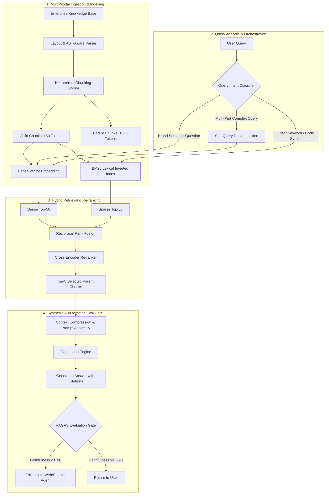

{: .light .w-75 .shadow .rounded-10 }

## Why Do Naive Retrieval-Augmented Generation Pipelines Collapse in Production?

When engineers first assemble a prototype of Retrieval-Augmented Generation (RAG), the pipeline feels deceptively straightforward. A document is chunked into 500-token fragments, converted into vectors using an off-the-shelf embedding model, stored in an approximate nearest neighbor (ANN) vector database, and retrieved via cosine similarity when a user submits a query. In sandbox demonstrations with pristine documentation and simple factual inquiries, this setup performs satisfactorily.

In production environments, however, naive RAG pipelines experience catastrophic performance collapse. Real-world enterprise datasets contain semi-structured tables, contradictory temporal documents, dense domain-specific nomenclature, and multi-faceted queries. When subjected to enterprise workloads, basic vector search yields irrelevant passages, splits related context across arbitrary chunk boundaries, and feeds fragmented evidence into the language model. The result is silent failure: subtle hallucinations, confidently stated inaccuracies, and high latency.

The realization that "RAG is not dead, but naive RAG is dead" marks the transition from quick proof-of-concept scripts to disciplined systems engineering. Building a reliable production RAG system requires a systematic workflow that treats retrieval, augmentation, and generation as an instrumented, closed-loop pipeline equipped with dynamic query routing, adaptive chunking, hybrid index fusion, and automated regression evaluation.



---

## The Anatomy of an Enterprise Systematic RAG Architecture

A systematic RAG architecture operates through four decoupled yet tightly coordinated subsystems:

### 1. Multi-Modal Document Parsing and Hierarchical Indexing
Rather than treating documents as flat character streams, enterprise ingestion parses document geometry. Tables are converted into markdown or JSON structures, headers establish hierarchical topic trees, and code snippets are parsed via language-specific Abstract Syntax Trees (ASTs).

To reconcile the trade-off between retrieval precision and synthesis context:
- **Child Chunks (100–200 tokens):** Encapsulate atomic concepts to maximize dense embedding similarity accuracy.
- **Parent Chunks (800–1,500 tokens):** Attached via metadata pointers. When a child chunk achieves high similarity, its entire parent section is loaded into the LLM context, ensuring the generative model perceives full surrounding context without clipping critical qualifiers.

### 2. Query Transformation and Intent-Based Routing
Raw user prompts are rarely optimized for vector retrieval. A systematic workflow introduces a query transformation layer before querying indices:
- **Hypothetical Document Embeddings (HyDE):** The LLM generates a speculative ideal answer, and the vector embedding of that synthetic answer is used to search the index, bridging the semantic gap between questions and assertions.
- **Sub-Query Decomposition:** Complex multi-step queries (e.g., *"Compare our Q3 latency metrics against our SLA commitments and list the mitigation steps implemented in October"*) are decomposed into three independent search tasks executed in parallel.
- **Intent Routing:** Queries containing UUIDs, error codes, or function signatures bypass dense vector search entirely and route to exact-match inverted indices.

### 3. Hybrid Index Fusion and Cross-Encoder Re-Ranking
No single retrieval modality is sufficient:
- **Dense Vector Search:** Captures semantic synonyms and abstract intent via Approximate Nearest Neighbor (ANN) search across HNSW graphs.
- **Sparse Lexical Search:** Ensures deterministic retrieval of exact terminology, acronyms, and alphanumeric identifiers via BM25 or learned sparse representations (SPLADE).
- **Reciprocal Rank Fusion (RRF):** Interleaves sparse and dense candidate sets into a unified candidate list.
- **Cross-Encoder Scoring:** The top candidates undergo pairwise cross-attention evaluation against the user prompt, weeding out superficially similar but factually irrelevant text fragments.

### 4. Generation Packaging and Automated Quality Gates
The generation stage does not simply dump retrieved text into the system prompt. It deduplicates passages, orders context to mitigate "lost-in-the-middle" attention degradation (placing the most salient facts at the outermost edges of the context window), and routes the final synthesis through an automated quality gate before client delivery.

---

## Chunking Dynamics: Moving Beyond Static Token Windows

The choice of chunking strategy represents the single highest-leverage decision in the indexing pipeline. The following comparison illustrates how chunking strategies impact retrieval fidelity:

| Chunking Strategy | Granularity | Primary Advantage | Production Trade-off |
|:---|:---|:---|:---|
| **Fixed-Size Windowing** | 200–500 tokens with 10% overlap | Trivial to implement; uniform vector tensor sizes. | High risk of fracturing semantic sentences and tearing tabular data. |
| **Sentence-Window Splitting** | Single sentences with surrounding buffer | High embedding precision for specific facts. | Increases vector store entry count by $5\times$ to $10\times$; higher index cost. |
| **Hierarchical Parent-Child** | 150-token children linked to 1000-token parents | Optimal balance: atomic retrieval with complete context delivery. | Requires relational metadata tracking in the vector storage layer. |
| **Semantic Similarity Chunking** | Variable length based on embedding cosine shifts | Preserves thematic coherence within natural narrative boundaries. | High ingestion computation latency due to continuous embedding calculations. |
| **AST / Syntax-Aware Parsing** | Language-defined code blocks and Markdown trees | Code structures, functions, and markdown sections remain fully intact. | Requires dedicated parsers for each supported file format. |

In mission-critical enterprise deployments, the combination of **Hierarchical Parent-Child Chunking** and **Syntax-Aware Parsing** consistently outperforms flat windowing approaches, eliminating context fragmentation at retrieval time.

---

## Closed-Loop Verification: Evaluation Harnesses and Metric Disciplines

A systematic RAG workflow cannot improve without objective, automated measurement. Relying on sporadic manual prompt spot-checks guarantees silent regression during model or prompt updates.

Production RAG engineering relies on the **RAG Triad** of evaluation metrics, popularized by frameworks such as RAGAS and TruLens:

```
          ┌──────────────────────────────────────────────┐
          │                  User Query                  │
          └──────────────┬───────────────────────────────┘
                         │
        Context Relevance│               Answer Relevance
                         ▼                               ▲
          ┌──────────────────────────┐                   │
          │    Retrieved Context     ├───────────────────┘
          └──────────────┬───────────┘
                         │
             Faithfulness│
             (Groundedness)
                         ▼
          ┌──────────────────────────┐
          │     Generated Answer     │
          └──────────────────────────┘
```

1. **Context Relevance (Retrieval Precision):** Measures whether the retrieved passages are strictly pertinent to the query, penalizing noisy context that inflates prompt token costs and distracts the generator.
2. **Faithfulness / Groundedness (Hallucination Rate):** Measures whether every claim asserted in the generated answer can be mathematically derived from the provided context passages. Answers containing ungrounded claims are rejected.
3. **Answer Relevance (Completeness):** Measures whether the generated answer directly satisfies the user's intent without evading the question or generating extraneous digressions.

By integrating these metrics into a Continuous Integration (CI) regression harness, engineering teams establish hard quality thresholds: any change to chunk size, embedding model, or prompt templates that drops faithfulness below 0.90 is blocked from production release.

---

## How Production RAG Engineering Evolved Across 2026

Throughout 2026, the software engineering community fundamentally restructured its approach to retrieval and language model integration:

1. **From Heuristics to Formal Information Retrieval:** As explored in our source audit of [Retrieval-Augmented Generation: Architectural Foundations and Production Evolution](/posts/rag-guid/), RAG transitioned from naive LangChain scripts into formal dual-memory systems combining bi-encoders, BM25 indices, and cross-encoder re-rankers.
2. **From Flat Vector Databases to Knowledge Graphs:** Pure vector proximity proved inadequate for multi-hop relationship reasoning. High-performance implementations like [EdgeQuake: High-Performance Graph RAG in Rust](/posts/edgequake-graph-rag-rust/) combined graph extraction with vector databases, establishing Graph RAG as a default for enterprise knowledge intranets.
3. **Deterministic Evidence Contracts:** Rather than allowing language models to hallucinate plausible-sounding citations, modern agent harnesses—such as the runtime contracts examined in [RLM-FORGE: Architecting Evidence-Gated Recursion in Multi-Agent Loops](/posts/rlm-forge-evidence-gated-recursion/)—enforce strict evidence-gating gates (e.g., TraceGuard) that abort parent state commits unless claims map to verifiable fact tokens.
4. **Harness-Native Traceability:** As detailed in our review of [Harness Engineering: Building Autonomous Systems with Codex and PLANS.md](/posts/harness-engineering/), production workflows now capture immutable execution traces, enabling deterministic replay of retrieval failures and continuous automated dataset curation.

---

## Key Takeaways

- **Naive RAG Fails at Scale:** Fixed-size chunking and single-vector cosine similarity collapse when faced with complex enterprise queries, multi-modal documents, and specialized terminology.
- **Hierarchical Indexing Resolves the Context Dilemma:** Pairing small child chunks for vector matching with larger parent chunks for LLM context synthesis provides both precision and complete contextual awareness.
- **Hybrid Fusion Is Non-Negotiable:** Combining dense vector representations with sparse lexical search (BM25/SPLADE) via Reciprocal Rank Fusion guarantees recall across both semantic intent and exact alphanumeric lookups.
- **Cross-Encoders Recover Lost Precision:** Routing candidates through a cross-encoder model applies token-to-token cross-attention, filtering out irrelevant false positives before prompt construction.
- **Automated Metric Gates Prevent Silent Regression:** Establishing CI regression suites tracking Context Relevance, Faithfulness, and Answer Relevance (the RAG Triad) is essential to safely evolve production pipelines.

---

## New Questions

1. **Dynamic Re-Ranking Compute Budget:** What is the optimal latency and financial trade-off between executing cross-encoder re-ranking locally on CPU clusters versus outsourcing to hosted cloud re-ranking APIs?
2. **Real-Time Index Freshness vs. Cache Invalidation:** How can high-throughput document updating pipelines maintain real-time vector and graph index freshness without triggering prohibitive index rebuilding costs?
3. **Agentic Multi-Step Query Termination:** What deterministic heuristic best signals an autonomous research agent that sufficient context has been retrieved to terminate iterative sub-querying and begin synthesis?

---

## References

- [Es et al.: RAGAS - Automated Evaluation of Retrieval Augmented Generation (EACL 2024 / arXiv:2309.15217)](https://arxiv.org/abs/2309.15217) (accessed 2026-10-18)
- [Gao et al.: Retrieval-Augmented Generation for Large Language Models - A Survey (arXiv:2312.10997)](https://arxiv.org/abs/2312.10997) (accessed 2026-10-18)
- [Yu et al.: Evaluation of Retrieval-Augmented Generation - A Comprehensive Survey (arXiv:2405.07437)](https://arxiv.org/abs/2405.07437) (accessed 2026-10-18)
- [Lewis et al.: Retrieval-Augmented Generation for Knowledge-Intensive NLP Tasks (NeurIPS 2020 / arXiv:2005.11401)](https://arxiv.org/abs/2005.11401) (accessed 2026-10-18)
- [Cormack, Clarke & Buettcher: Reciprocal Rank Fusion Outperforms Condorcet and Individual Rank Learning Methods (SIGIR 2009)](https://dl.acm.org/doi/10.1145/1571941.1572114) (accessed 2026-10-18)
