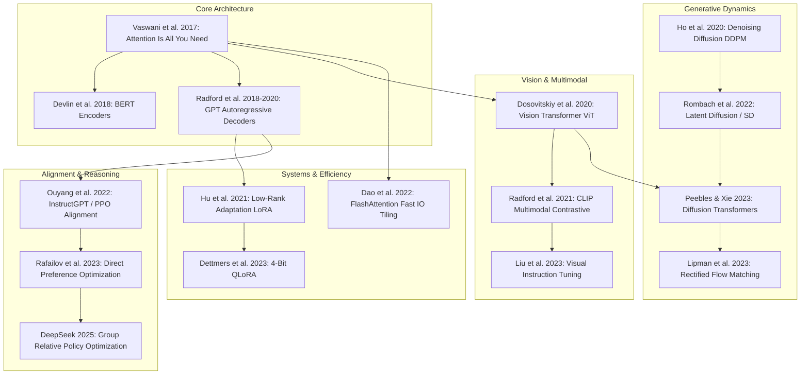

The explosive acceleration of artificial intelligence research over the past decade can appear chaotic and fragmented. Every week brings hundreds of preprints to arXiv, accompanied by social media hype announcing incremental benchmarks and ephemeral fine-tunes.

However, beneath the surface turbulence of generative AI, the underlying technological bedrock is governed by a remarkably cohesive lineage of foundational papers. Modern large multimodal systems do not invent mechanisms from scratch; they compose, scale, and optimize a small set of mathematical and architectural breakthroughs established between 2017 and 2024.

This source audit maps the **Canonical AI Architectural Lineage** across seven core disciplines: sequence attention, visual patch tokenization, contrastive multimodal alignment, latent diffusion dynamics, parameter-efficient adaptation, memory-bound GPU kernels, and preference alignment.


## Which Foundational Architectures Form the Bedrock of Modern Generative AI?

When analyzing why models like GPT-4o, Claude 3.5, Sora, and Gemini operate with human-like visual, linguistic, and reasoning fluency, one discovers that modern deep learning has converged onto a unified, compute-efficient paradigm.

In the pre-2017 era, artificial intelligence research was severely balkanized:
- **Natural Language Processing** relied on recurrent architectures (LSTMs, GRUs) plagued by vanishing gradients and sequential compute bottlenecks.
- **Computer Vision** was dominated by convolutional neural networks (ResNet, VGG) constrained by local receptive fields.
- **Speech Processing** depended on Hidden Markov Models (GMM-HMM) and connectionist temporal classification (CTC).
- **Generative Modeling** struggled with the training instability and mode collapse of Generative Adversarial Networks (GANs).

```
Pre-2017 Balkanized Deep Learning:
[NLP: Sequential LSTMs]   [CV: Local Convolutions]   [Speech: HMMs]   [GenAI: Unstable GANs]
(Incompatible abstractions, non-transferable representations, fragmented hardware optimization)

Modern Unified Architecture Stack:
┌────────────────────────────────────────────────────────────────────────┐
│ Unified Scalable Backbone: Multi-Head Scaled Dot-Product Self-Attention│
├────────────────────────────────────────────────────────────────────────┤
│ Universal Tokenization: Text Byte-Pairs + Spacetime Image/Video Patches│
├────────────────────────────────────────────────────────────────────────┤
│ Hardware Acceleration: IO-Aware FlashAttention Memory Tiling           │
├────────────────────────────────────────────────────────────────────────┤
│ Multimodal Alignment: Shared InfoNCE Joint Embedding Spaces            │
├────────────────────────────────────────────────────────────────────────┤
│ Generative Dynamics: Rectified Flow Matching & Diffusion Transformers  │
└────────────────────────────────────────────────────────────────────────┘
```

The convergence began with Vaswani et al. in 2017 and accelerated as computer vision, audio synthesis, and multimodal learning abandoned domain-specific inductive biases in favor of isotropic transformer stacks.

## The Canonical Lineage: From Attention to Modern World Models

The diagram below maps how foundational research papers connect across evolutionary generations:



## Deconstructing the Seven Algorithmic Pillars

To understand how these components interact in modern systems, we audit each architectural milestone against its original mathematical formulation.

### 1. Sequence Processing: Scaled Dot-Product Self-Attention
- **Seminal Reference**: Vaswani, A., et al. (2017). *Attention Is All You Need*. NeurIPS 2017.
- **Architectural Contribution**: Replaced recurrent connections with parallelizable matrix operations across arbitrary sequence positions:

$$\text{Attention}(Q, K, V) = \text{softmax}\left( \frac{Q K^T}{\sqrt{d_k}} \right) V$$

By projecting input tokens into Query ($Q$), Key ($K$), and Value ($V$) subspaces, the attention mechanism computes pairwise associative relationships in constant $O(1)$ sequential operations, unlocking massive parallel training across distributed GPU clusters.

### 2. Visual Representation: Patch Projection in Vision Transformers (ViT)
- **Seminal Reference**: Dosovitskiy, A., et al. (2020). *An Image is Worth 16x16 Words: Transformers for Image Recognition at Scale*. ICLR 2021.
- **Architectural Contribution**: Demonstrated that convolutional inductive biases are unnecessary when training on large-scale datasets (JFT-300M). An image $x \in \mathbb{R}^{H \times W \times C}$ is reshaped into a sequence of flattened 2D patches $x_p \in \mathbb{R}^{N \times (P^2 \cdot C)}$, linearly projected to dimension $D$, and processed identically to linguistic word tokens.

### 3. Cross-Modal Grounding: Contrastive Language-Image Pre-training (CLIP)
- **Seminal Reference**: Radford, A., et al. (2021). *Learning Transferable Visual Models From Natural Language Supervision*. ICML 2021.
- **Architectural Contribution**: Replaced single-modality softmax classification with symmetric InfoNCE contrastive loss over dual encoders:

$$\mathcal{L}_{\text{CLIP}} = -\frac{1}{2N} \sum_{i=1}^N \left( \log \frac{\exp(I_i \cdot T_i / \tau)}{\sum_j \exp(I_i \cdot T_j / \tau)} + \log \frac{\exp(T_i \cdot I_i / \tau)}{\sum_j \exp(T_i \cdot I_j / \tau)} \right)$$

This mapped text descriptions and visual scenes into a shared metric embedding space, creating the zero-shot semantic foundation underpinning DALL-E, Stable Diffusion, and modern multimodal LLMs.

### 4. Generative Synthesis: Diffusion Transformers and Flow Matching
- **Seminal References**: 
  - Ho, J., Jain, A., & Abbeel, P. (2020). *Denoising Diffusion Probabilistic Models*. NeurIPS 2020.
  - Peebles, W., & Xie, S. (2023). *Scalable Diffusion Models with Transformers*. ICCV 2023.
- **Architectural Contribution**: Shifted generative modeling from adversarial games (GANs) to stable thermodynamic reverse-time stochastic differential equations, subsequently replacing convolutional U-Nets with isotropic transformer blocks (DiT). Detailed in our technical audit on [Diffusion Transformers (DiT): The Architectural Backbone of Sora and Video Generation](/posts/deepdive-series-2/).

### 5. Memory-Bound Acceleration: FlashAttention IO-Aware Kernel Tiling
- **Seminal Reference**: Dao, T., et al. (2022). *FlashAttention: Fast and Memory-Efficient Exact Attention with IO-Awareness*. NeurIPS 2022.
- **Architectural Contribution**: Recognized that modern GPUs are memory-bandwidth bound rather than compute bound. Instead of materializing the massive $N \times N$ attention matrix in slow High Bandwidth Memory (HBM), FlashAttention tiles matrix blocks into fast on-chip SRAM, computing softmax scaling incrementally via online scaling tricks. This delivered 2x to 4x training speedups while reducing memory from quadratic $O(N^2)$ to linear $O(N)$.

### 6. Parameter-Efficient Fine-Tuning: Low-Rank Adaptation (LoRA)
- **Seminal Reference**: Hu, E. J., et al. (2021). *LoRA: Low-Rank Adaptation of Large Language Models*. ICLR 2022.
- **Architectural Contribution**: Established that task-specific parameter updates $\Delta W$ have low intrinsic rank. Freezing base weights and training decomposed matrices $B \cdot A$ allows enterprise teams to adapt billion-parameter models on single GPUs, outperforming generic frontier models on domain tasks, as detailed in our audit on [LoRA vs Frontier Models: When Specialized 7B Adapters Outperform GPT-4](/posts/lora-better-gpt4/).

### 7. Human Alignment: Direct Preference Optimization (DPO)
- **Seminal Reference**: Rafailov, R., et al. (2023). *Direct Preference Optimization: Your Language Model is Secretly a Reward Model*. NeurIPS 2023.
- **Architectural Contribution**: Proved that the optimal policy under the Bradley-Terry preference model can be derived in closed form, eliminating the instability of training separate reward models and reinforcement learning (PPO) loops in favor of a stable binary cross-entropy loss over chosen and rejected pairs. See [LLaMA-Factory Architecture: Unified Post-Training Across 100+ LLMs](/posts/llama-factory/) for implementation mechanics.

## Canonical Papers Architecture & Systems Impact Matrix

| Domain | Breakthrough Paper | Key Paradigm Shift | Realized Systems Impact |
| :--- | :--- | :--- | :--- |
| **Attention** | Vaswani et al. (2017) | Recurrent step $\to$ Parallel Matrix Self-Attention | Foundation of all modern LLMs |
| **Vision** | Dosovitskiy et al. (2020) | Convolutions $\to$ 2D Patch Linear Embeddings | Scaled visual representation learning |
| **Multimodal** | Radford et al. (2021) | Softmax Labels $\to$ Dual InfoNCE Joint Latent Space | Enabled text-guided image generation |
| **Diffusion** | Peebles & Xie (2023) | Conv U-Net $\to$ Spacetime Latent Patch Transformer | Unlocked Sora-class video generation |
| **Kernels** | Dao et al. (2022) | Quadratic HBM Storage $\to$ SRAM Tiling Optimization | Extended context windows to 1M+ tokens |
| **Adaptation** | Hu et al. (2021) | Full Fine-Tuning $\to$ Low-Rank Delta Decomposition | Democratized local enterprise tuning |
| **Alignment** | Rafailov et al. (2023) | Complex PPO Loops $\to$ Direct Policy Loss Optimization | Standardized open-source model alignment |

Review our broader systems taxonomy in [The LLM Systems Hierarchy: From Prompt Engineering to Autonomous Agents](/posts/llm-course-trying/) for how these components assemble into enterprise software.

## How Deep Learning Architectures Converged Across 2026

Across 2025 and 2026, the artificial intelligence landscape experienced structural consolidation:

```
2017-2022: Proliferation of Specialized Models  2023-2024: Cross-Modality Adoption   2026: Universal Token Architectures
┌─────────────────────────────────────────┐     ┌───────────────────────────────┐   ┌───────────────────────────────────┐
│ Modality-Specific Encoders (BERT/ResNet)│────▶│ Multimodal Transformers (CLIP)│──▶│ Native Any-to-Any Autoregressive  │
│ Separate Generative Architectures (GANs)│     │ Diffusion-Transformer Fusion  │   │ Test-Time Compute Reasoning (GRPO)│
│ High-Precision FP16 Training Bounds     │     │ FlashAttention-2 / FP8 Kernels│   │ Micro-Scaling FP4 / Native Hardware│
└─────────────────────────────────────────┘     └───────────────────────────────┘   └───────────────────────────────────┘
```

1. **The Native Multimodal Transformer**: In early architectures, visual understanding required gluing separate frozen vision encoders (such as CLIP ViT-L) to language models via linear projection layers (LLaVA style). In 2026, foundation models natively ingest interleaved text, images, video patches, and raw audio waveforms into a single autoregressive decoder without external vision encoders.
2. **Test-Time Compute and Search**: The traditional focus on pre-training scaling laws (compute $\propto$ parameters $\times$ tokens) expanded to include **inference scaling laws**. As demonstrated by DeepSeek-R1 and OpenAI's reasoning models, spending extra compute during generation (generating thousands of tokens of internal chain-of-thought, self-correction, and Monte Carlo tree search) yields dramatic breakthroughs in formal mathematics, code generation, and systems engineering.
3. **Sub-8-Bit Hardware Kernel Standardization**: Following FlashAttention-3 and FP8 standardization, 2026 hardware accelerators standardized on Microscaling (MX) FP4 formats. Training and inference engines execute low-rank matrix multiplications with hardware-accelerated dynamic scaling factors, quadrupling memory bandwidth density on silicon.

## Key Takeaways

- **Convergence on Self-Attention**: All major modalities—natural language, 2D images, 3D video volumes, and audio waveforms—are now tokenized as discrete or continuous vectors processed by scaled dot-product attention.
- **Hardware-Aware Kernel Design**: Algorithmic breakthroughs like FlashAttention proved that understanding physical silicon memory hierarchies (SRAM vs HBM) is just as vital as mathematical formulation.
- **Monotonic Compute Scaling**: Architectures with fewer hand-crafted inductive biases (such as ViT and DiT) consistently outperform convolutional and recurrent counterparts when scaled with massive compute and data.
- **Alignment Democratization**: The transition from unstable RLHF pipelines to closed-form objectives like DPO and GRPO has enabled open-source research to match commercial frontier performance.

## New Questions

- As attention sequences scale to millions of tokens for high-frame-rate video and long-horizon agent trajectories, will quadratic attention remain viable through FlashAttention-3, or will linear state-space models (Mamba/S4) become necessary?
- What are the mathematical limits of synthetic reasoning distillation before smaller student models suffer from model collapse due to lack of novel environmental entropy?
- Will the integration of continuous diffusion prediction directly inside autoregressive token decoders eliminate the distinction between language generation and image synthesis?

## References

1. Vaswani, A., Shazeer, N., Parmar, N., Uszkoreit, J., Jones, L., Gomez, A. N., Kaiser, L., & Polosukhin, I. (2017). *Attention Is All You Need*. Advances in Neural Information Processing Systems (NeurIPS 2017). https://arxiv.org/abs/1706.03762 (accessed 2026-10-18).
2. Dosovitskiy, A., et al. (2020). *An Image is Worth 16x16 Words: Transformers for Image Recognition at Scale*. International Conference on Learning Representations (ICLR 2021). https://arxiv.org/abs/2010.11929 (accessed 2026-10-18).
3. Radford, A., et al. (2021). *Learning Transferable Visual Models From Natural Language Supervision*. International Conference on Machine Learning (ICML 2021). https://arxiv.org/abs/2103.00020 (accessed 2026-10-18).
4. Dao, T., Fu, D. Y., Ermon, S., Rudra, A., & Ré, C. (2022). *FlashAttention: Fast and Memory-Efficient Exact Attention with IO-Awareness*. Advances in Neural Information Processing Systems (NeurIPS 2022). https://arxiv.org/abs/2205.14135 (accessed 2026-10-18).
