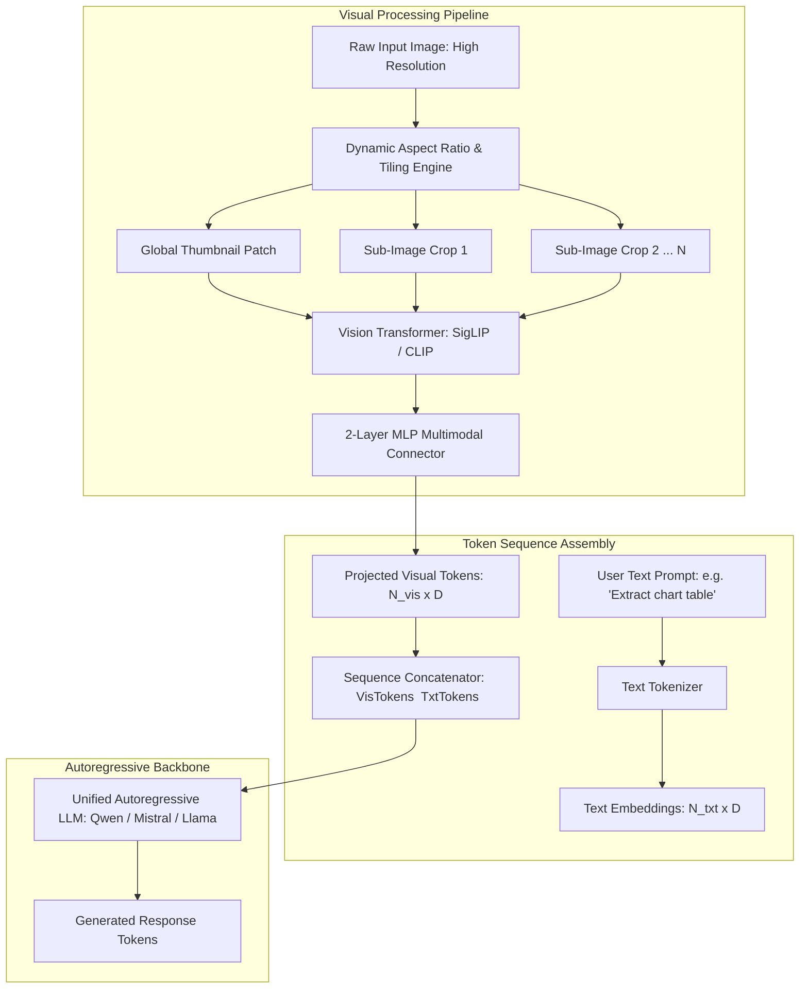

The expansion of foundation models from unimodal text comprehension to multimodal perception marks one of the most critical structural transitions in modern deep learning. While early vision-language architectures attempted to bridge vision and language through rigid heuristic pipelines, the modern era of **Vision-Language Models (VLMs)** centers on a core systems question: how should visual representations extracted from a high-dimensional image encoder interface with the internal self-attention mechanisms of an autoregressive Large Language Model (LLM)?

Between 2022 and 2024, the research community split into two opposing architectural schools:
1. **Gated Cross-Attention Architectures**: Pioneered by DeepMind’s Flamingo and Hugging Face’s Idefics-1, which maintain frozen language model layers while inserting dedicated cross-attention layers that attend to visual features.
2. **Fully Autoregressive Token Fusion**: Exemplified by LLaVA, PaliGemma, Qwen-VL, and Idefics-2, which project visual patch tokens directly into the LLM’s text embedding space, treating visual tokens identically to text tokens within a single unified self-attention sequence.

Through systematic empirical ablation studies—culminating in the Hugging Face Idefics-2 benchmark by Hugo Laurençon, Léo Tronchon, and collaborators—the architectural debate was decisively settled. This source audit analyzes the mathematical and operational mechanics of cross-attention versus autoregressive fusion, examines dynamic aspect ratio tiling, and evaluates the dominating role of the language backbone in multimodal performance.


## Why Did Autoregressive Token Fusion Displace Cross-Attention in Modern VLMs?

To understand why the industry converged on fully autoregressive fusion, one must inspect how information flows through the two competing architectures.

In a **Gated Cross-Attention** model (such as Flamingo or Idefics-1), the pre-trained LLM weights remain strictly frozen. Visual features from a pre-trained Vision Transformer (ViT) are passed through a Perceiver Resampler to produce a fixed number of visual latent vectors (e.g., 64 tokens). These visual tokens are then injected into the language model via newly initialized gated cross-attention layers inserted between existing transformer blocks:

$$y = x + \tanh(\alpha) \cdot \text{CrossAttention}(x, \text{VisualFeatures})$$

where $\alpha$ is a learnable gating scalar initialized to zero.

```
Cross-Attention Architecture (Flamingo / Idefics-1)
[Image] ──▶ [Vision Encoder] ──▶ [Perceiver Resampler] ──┐
                                                          ▼
[Text Tokens] ──▶ [Self-Attention Block] ──▶ [Gated Cross-Attention Block] ──▶ [Next Block]
(High parameter overhead, frozen LLM backbone, fragile multimodal LoRA fine-tuning)

Fully Autoregressive Architecture (LLaVA / Idefics-2)
[Image] ──▶ [Vision Encoder] ──▶ [MLP / Linear Projector] ──▶ [Visual Tokens] ──┐
                                                                                ▼
[Text Tokens] ────────────────────────────────────────────────────────────▶ [Unified Concatenated Sequence]
                                                                                │
                                                                                ▼
                                                                 [Standard Autoregressive LLM]
(Zero new layer overhead, full bidirectional multimodal self-attention, simple PEFT adaptation)
```

While cross-attention theoretically preserves the pristine language capabilities of the frozen text model, it introduces major operational liabilities:
- **Architectural Bloat**: Inserting cross-attention layers throughout a 70B parameter LLM adds billions of new parameters that must be trained from scratch.
- **Inference Inefficiency**: Key-Value (KV) caching mechanisms become complicated because the model must maintain separate caches for self-attention and cross-attention states.
- **Sub-optimal Representation Transfer**: In the Idefics-2 ablation studies, when fine-tuning the entire system end-to-end or using Low-Rank Adaptation (LoRA), **the fully autoregressive model substantially outperformed the cross-attention model across standard VLM benchmarks** (such as VQAv2, DocVQA, TextVQA, and MathVista).

By projecting visual patches directly into the token embedding dimension via a simple multi-layer perceptron (MLP connector), the language model’s native self-attention layers attend bidirectionally between text tokens and visual tokens, facilitating deeper cross-modal reasoning.

## The Architectural Topology of Modern Autoregressive VLMs

The modern autoregressive VLM pipeline is composed of three modular components: a vision encoder, a multimodal projector, and an autoregressive decoder backbone.



### 1. Vision Backbones and the SigLIP Shift
Early VLMs relied on OpenAI's CLIP ViT-L/14 trained with standard softmax cross-entropy over paired images and text. However, standard CLIP suffers from saturation issues under dense text and fine-grained visual details.

Modern architectures (including Idefics-2 and PaliGemma) standardized on **SigLIP (Sigmoid Loss for Language-Image Pre-training)**. SigLIP replaces the global softmax normalization across batches with independent pairwise sigmoid losses:

$$\mathcal{L}_{\text{SigLIP}} = -\sum_{i=1}^B \sum_{j=1}^B \left( y_{ij} \log \sigma(x_{ij}) + (1 - y_{ij}) \log(1 - \sigma(x_{ij})) \right)$$

where $y_{ij} = 1$ if $i = j$ and $-1$ otherwise. SigLIP eliminates the need for all-gather communication across distributed GPU nodes, stabilizing training at massive batch sizes and significantly improving spatial feature grounding for small text and charts.

### 2. High-Resolution Handling via Sub-Image Tiling
Standard Vision Transformers require fixed square input resolutions (e.g., $224 \times 224$ or $378 \times 378$). Forcing a high-resolution $1920 \times 1080$ document or architectural diagram into a tiny square downsamples fine text into unreadable pixel blur.

To solve this without quadratic computational explosion, Idefics-2 and LLaVA-NeXT implement **Dynamic Sub-Image Tiling**:
1. The original aspect ratio is analyzed, and the image is divided into a grid of non-overlapping sub-image crops (e.g., $2 \times 2$ or $1 \times 3$) matching the native resolution of the ViT.
2. In addition to the local crops, an overall low-resolution thumbnail of the entire image is generated to preserve global scene semantics.
3. Each sub-image is independently processed by the ViT, producing 64 to 320 tokens per tile.
4. Special row-break delimiter tokens (`\n`) are interleaved into the token stream, preserving 2D spatial topology when serialized into the 1D LLM sequence.

This allows the model to process 4x to 8x higher pixel density while maintaining linear computational scaling relative to patch counts.

## Empirical Ablation Insights from Idefics-2

The exhaustive empirical ablations conducted by the Idefics-2 team established several foundational design rules for multimodal engineering:

| Architectural Variable | Evaluated Choices | Empirical Finding | Performance Impact |
| :--- | :--- | :--- | :--- |
| **Fusion Mechanism** | Gated Cross-Attention vs Fully Autoregressive | Autoregressive fusion wins across all tasks | +5% to +12% accuracy gain |
| **Language Backbone** | LLaMA-1-7B vs Mistral-7B | Quality of language backbone dominates VLM performance | +7% overall benchmark jump |
| **Projector Type** | Linear Layer vs 2-Layer GeLU MLP vs Perceiver | 2-Layer MLP provides optimal balance of parameter efficiency and accuracy | Faster convergence over linear |
| **Fine-Tuning Strategy** | Vision Frozen + LLM Frozen vs Full End-to-End LoRA | Unfreezing both vision encoder and LLM via LoRA yields peak performance | Crucial for OCR and spatial reasoning |
| **Resolution Strategy** | Fixed $378 \times 378$ vs Dynamic Multi-Crop Tiling | Tiling preserves high-frequency text in documents and infographics | +15% on DocVQA and ChartQA |

The most profound realization from these ablations is that **a VLM is primarily a language model that has learned to read visual tokens**. Upgrading the text backbone from an early checkpoint to a superior instruction-tuned model yields larger performance dividends than doubling the parameter count of the vision encoder.

This aligns directly with our cross-disciplinary audit in [Foundational AI Architectures: Mapping the Canonical Papers of Modern Deep Learning](/posts/top-papers-ai/) and post-training parameter optimization detailed in [LLaMA-Factory Architecture: Unified Post-Training Across 100+ LLMs](/posts/llama-factory/).

## Comparative Benchmark Matrix Across Open-Source VLMs

| Model Architecture | Parameters | Vision Backbone | Fusion Mechanism | Max Resolution Handling | Key Architectural Differentiator |
| :--- | :--- | :--- | :--- | :--- | :--- |
| **Flamingo / Idefics-1** | 9B – 80B | CLIP ViT-L | Gated Cross-Attention | Fixed square downsampling | Preserves frozen language weights |
| **LLaVA-1.5** | 7B / 13B | CLIP ViT-L/14 | 2-Layer MLP Autoregressive | Fixed $336 \times 336$ | Simple, lightweight instruction tuning |
| **Idefics-2** | 8B | SigLIP SO400M | Autoregressive Concatenation | Dynamic Tiling ($980 \times 980$) | NaViT flexible aspect ratio + full LoRA |
| **Qwen-VL-Chat** | 9.6B | Openclip ViT-bigG | Autoregressive + Position Embeds | Dynamic $448 \times 448$ Tiling | Native bounding-box coordinate grounding |
| **PaliGemma** | 3B | SigLIP 400M | Linear Projector Autoregressive | Fixed $224 / 448 / 896$ | Compact edge deployment, Gemma-2B base |

As demonstrated in the comparison table, by late 2024, cross-attention had been entirely phased out of competitive open-source releases in favor of autoregressive visual token concatenation.

## How Vision-Language Models Evolved Across 2026

Between 2024 and 2026, the Vision-Language landscape transitioned from static image captioning toward real-time temporal and agentic interaction.

```
2023-2024: Image-Text Glue Layers     2025: Native Dynamic Patching    2026: Native Interleaved Any-to-Any
┌───────────────────────────────┐     ┌──────────────────────────────┐  ┌───────────────────────────────────┐
│ LLaVA / Idefics-2 Tiling      │────▶│ Qwen2-VL Dynamic 3D RoPE     │─▶│ Native Multimodal Decoders        │
│ External SigLIP + MLP Connect │     │ Video Token Compression      │  │ GUI-Grounded Autonomous Agents    │
│ Static Document Question-Ans  │     │ 4K Resolution Processing     │  │ Real-Time Streaming Audio/Vision  │
└───────────────────────────────┘     └──────────────────────────────┘  └───────────────────────────────────┘
```

1. **Native Dynamic 3D Rotary Embeddings (Qwen2-VL & Beyond)**: Fixed sub-image tiling grids introduced artificial boundaries at crop edges. In 2025–2026, architectures replaced rigid tiling with native variable-resolution ViT encoders using 3D RoPE. Images and video frames are tokenized directly into dynamic 3D positional grids matching their exact native aspect ratio, compressing visual sequences without spatial distortion.
2. **GUI-Grounded Autonomous Agents**: The primary commercial application of VLMs evolved from document retrieval into computer vision-based agent control. Models are trained on dense pixel coordinate datasets (screen clicks, bounding box annotations, browser DOM interactions), allowing autonomous agents to control operating systems directly from screen pixels, as explored in [The LLM Systems Hierarchy: From Prompt Engineering to Autonomous Agents](/posts/llm-course-trying/).
3. **From Image-Text to Unified Any-to-Any Models**: The historical paradigm of tacking a pre-trained vision encoder onto an existing text LLM reached obsolescence in flagship 2026 systems (such as Gemini 2.0 and native open-weights multimodal architectures). Models are pre-trained from step zero on interleaved tokens spanning text, image patches, video streams, and audio spectrograms, achieving fluid cross-modal synthesis and zero-shot reasoning.

## Key Takeaways

- **Autoregressive Supremacy**: Concatenating visual patch tokens directly into the LLM’s input sequence outperforms gated cross-attention across multimodal benchmarks while simplifying serving infrastructure.
- **Language Backbone Dominance**: The perceptual reasoning and contextual accuracy of a VLM are fundamentally bounded by the quality and instruction compliance of its underlying text LLM.
- **SigLIP Over CLIP**: Sigmoid contrastive pre-training stabilizes large-batch training and delivers superior feature discrimination for fine-grained text and document layout tasks.
- **Dynamic Multi-Crop Tiling**: Resolving high-resolution images by decomposing them into sub-image crops preserves small text without incurring quadratic full-frame self-attention compute costs.

## New Questions

- Will external visual encoders be completely abandoned in favor of patchifying raw pixel tokens directly into foundational transformer decoders from step zero?
- How can VLMs mitigate the "visual needle in a haystack" problem when processing multi-hour video streams containing millions of visual tokens?
- As VLMs increasingly execute GUI mouse and keyboard actions, what formal sandboxing guardrails are required to prevent prompt injection attacks embedded in visual UI elements?

## References

1. Laurençon, H., Tronchon, L., Cord, M., & Sanh, V. (2024). *What matters when building vision-language models?* arXiv preprint arXiv:2405.02246. https://arxiv.org/abs/2405.02246 (accessed 2026-10-18).
2. Liu, H., Li, C., Wu, Q., & Lee, Y. J. (2023). *Visual Instruction Tuning (LLaVA)*. Advances in Neural Information Processing Systems (NeurIPS 2023). https://arxiv.org/abs/2304.08485 (accessed 2026-10-18).
3. Alayrac, J. B., et al. (2022). *Flamingo: a Visual Language Model for Few-Shot Learning*. Advances in Neural Information Processing Systems (NeurIPS 2022). https://arxiv.org/abs/2204.14198 (accessed 2026-10-18).
4. Zhai, X., Mustafa, B., Kolesnikov, A., & Beyer, L. (2023). *Sigmoid Loss for Language Image Pre-Training (SigLIP)*. International Conference on Computer Vision (ICCV 2023). https://arxiv.org/abs/2303.15343 (accessed 2026-10-18).
