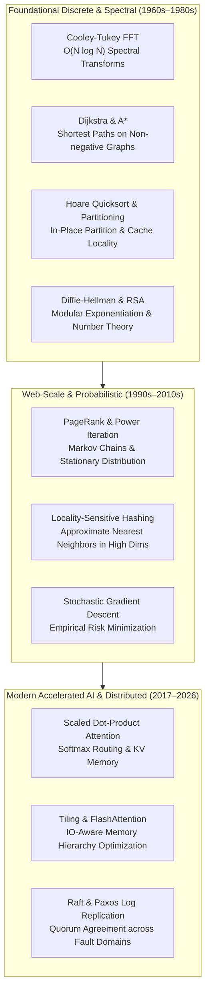

{: .light .w-75 .shadow .rounded-10 w='1212' h='668' }

## Which Computational Algorithms Form the Bedrock of Modern Systems?

The modern software landscape often conceals algorithmic primitives beneath towering layers of framework abstraction, managed container runtimes, and high-level declarative interfaces. Modern machine learning practitioners configure PyTorch pipelines, cloud architects deploy cluster managers, and database administrators tune transactional engines—often without directly interacting with the fundamental mathematical algorithms orchestrating the execution beneath. Yet every distributed query planner, neural training loop, and cryptographic handshake relies directly upon a compact cluster of foundational computational discoveries.

Historically, listicles have enumerated classic algorithms such as Quicksort or RSA as historical curiosities. However, an architectural audit reveals that modern computing does not merely preserve these algorithms; it continually re-derives them. When Transformer models route context across hundreds of thousands of tokens, they invoke matrix-multiplication kernels that descend directly from Strassen's matrix decomposition and Fast Fourier transforms. When autonomous agents route tasks through dense dependency graphs, they build upon Dijkstra's shortest-path invariants. 

Understanding these foundational techniques requires evaluating their mathematical formulations, asymptotic complexity, hardware bottlenecks, and contemporary adaptations in modern large-scale systems.



---

## 1. Fast Fourier Transform: Compressing the Continuous Domain

Published by James Cooley and John Tukey in 1965 (rediscovering methods known to Carl Friedrich Gauss in 1805), the Fast Fourier Transform (FFT) reduced the computational complexity of evaluating the Discrete Fourier Transform (DFT) from $\mathcal{O}(N^2)$ to $\mathcal{O}(N \log N)$. 

The continuous transform projects time-domain or spatial-domain discrete sequences into frequency spectra:

$$X_k = \sum_{n=0}^{N-1} x_n \cdot e^{-i 2\pi k n / N}, \quad k \in \{0, \dots, N-1\}$$

By factoring the transformation matrix into sparse butterfly stages via symmetry and periodicity of complex roots of unity, the Cooley-Tukey divide-and-conquer strategy transformed signal processing, speech synthesis, and seismic analysis.

In contemporary AI architectures, FFT algorithms serve two primary roles:
1. **Sub-Quadratic Sequence Mixing**: Long-context architectural variants such as FNet and Monarch Matrices utilize multi-dimensional FFT transforms instead of attention matrices to mix hidden token representations in $\mathcal{O}(N \log N)$ time with zero learnable parameters.
2. **Convolutional Acceleration**: Convolutional neural layers with large kernel sizes leverage the convolution theorem—computing spatial convolutions as pointwise products in the frequency domain—to achieve massive latency improvements on tensor processing units.

---

## 2. Dijkstra's Algorithm: Optimal Graph Routing Under Constraints

Edsger W. Dijkstra formulated his shortest-path algorithm in 1956 to demonstrate the computational capacity of the ARMAC computer. Designed for directed graphs with non-negative edge weights $w(u, v) \ge 0$, Dijkstra’s algorithm maintains a min-priority queue of tentative distances:

$$\text{dist}[v] = \min_{(u, v) \in E} \left(\text{dist}[u] + w(u, v)\right)$$

Using a Fibonacci heap implementation, the asymptotic runtime achieves $\mathcal{O}(|E| + |V| \log |V|)$. 

While initially deployed in telecommunication network routing protocols such as Open Shortest Path First (OSPF) and Intermediate System to Intermediate System (IS-IS), Dijkstra's principles govern modern infrastructure in multiple domains:
- **Distributed Service Meshes**: Dynamic latency-weighted packet routing in systems like Envoy and Cilium.
- **Agentic Task Decomposition**: Directed Acyclic Graph (DAG) scheduling engines in workflow runtimes evaluate optimal pipeline execution paths against latency and resource bounds. As detailed in our review of [Transformer attention complexity](/posts/deepdive-series-3/), graph representations of compute pipelines allow compilers to minimize memory spillover across GPU clusters.

---

## 3. Quicksort and In-Place Partitioning: Cache-Conscious Selection

Formulated by Tony Hoare in 1959, Quicksort demonstrates the supremacy of cache-conscious memory layout over pure operation count. While MergeSort delivers guaranteed $\mathcal{O}(N \log N)$ worst-case time, Quicksort’s inner loop performs contiguous memory access during array partitioning around a selected pivot element:

$$\text{Partition}(A, p, r): \quad \forall i < q, A[i] \le A[q] \quad \text{and} \quad \forall j > q, A[j] \ge A[q]$$

By avoiding memory allocations and maximizing hardware prefetch buffer efficiency, dual-pivot variants (such as Yaroslavskiy's implementation in modern runtimes) consistently outperform theoretical alternatives.

In high-throughput database systems, partitioning primitives derived from Quicksort drive vectorized query execution engines (e.g., DuckDB, ClickHouse). Partitioning contiguous columnar arrays into cache-sized chunks ensures that SIMD instructions operate without incurring translation lookaside buffer (TLB) thrashing or L3 cache misses.

---

## 4. Asymmetric Cryptography: The RSA Primitive and Discrete Logarithms

Ron Rivest, Adi Shamir, and Leonard Adleman introduced the RSA cryptosystem in 1977, transforming distributed information exchange by decoupling encryption from decryption. The security of RSA hinges on the integer factorization problem for composite moduli $n = p \cdot q$:

$$c \equiv m^e \pmod n, \quad m \equiv c^d \pmod n$$

Where Euler's totient function $\phi(n) = (p-1)(q-1)$ enables private exponent derivation through the modular inverse $d \equiv e^{-1} \pmod{\phi(n)}$.

While elliptic curve cryptography (ECC) has supplanted RSA in bandwidth-constrained microservices, modular arithmetic and discrete logarithm hardness remain foundational to:
- **Zero-Knowledge Proofs (ZK-SNARKs)**: Enabling verifiable off-chain compute validation without disclosing underlying transaction inputs.
- **Distributed Key Generation (DKG)**: Securing validator quorums across decentralized consensus nodes, directly impacting fault-tolerant cluster architectures as discussed in our [Kubernetes cluster design audit](/posts/what-is-kubernetes/).

---

## 5. PageRank: Stationary Distributions over Massive Stochastic Matrices

Larry Page and Sergey Brin formulated PageRank in 1998 as an eigenvector centrality algorithm for directed web graphs. Modeling user navigation as a Markov chain with random teleportation probability $1 - d$ (typically $d = 0.85$), PageRank defines the stationary distribution vector $\mathbf{r}$ over transition matrix $\mathbf{M}$:

$$\mathbf{r} = d \mathbf{M} \mathbf{r} + \frac{1 - d}{N} \mathbf{1}$$

By ensuring that the irreducible, aperiodic Google matrix satisfies the Perron-Frobenius theorem, PageRank computes $\mathbf{r}$ via power iteration:

$$\mathbf{r}^{(t+1)} = \mathbf{A} \mathbf{r}^{(t)}$$

In contemporary AI, PageRank derivatives underpin:
- **Graph Neural Networks (GNNs)**: Random walk positional encodings and personalized PageRank layers propagate feature representations through knowledge graphs.
- **Retrieval-Augmented Generation (RAG)**: Graph-RAG engines utilize personalized PageRank over extracted entity-relationship graphs to surface topologically relevant documents prior to context injection.

---

## 6. Locality-Sensitive Hashing: High-Dimensional Nearest Neighbors

Introduced by Piotr Indyk and Rajeev Motwani in 1998, Locality-Sensitive Hashing (LSH) resolved the curse of dimensionality for approximate nearest neighbor (ANN) search. Traditional spatial index structures like k-d trees degrade to linear scans when dimensionality $d > 50$. LSH designs hash functions $h(v)$ such that collision probability corresponds directly to vector similarity:

$$\Pr[h(u) = h(v)] = \text{sim}(u, v)$$

For cosine similarity (Charikar’s SimHash), random hyperplanes project vectors into binary hash buckets:

$$h_r(x) = \text{sign}(r \cdot x), \quad r \sim \mathcal{N}(0, I)$$

Modern vector databases (e.g., Milvus, Qdrant) and retrieval pipelines build upon LSH and hierarchical navigable small world (HNSW) graphs to conduct billion-scale semantic similarity searches in milliseconds, serving as the foundational indexing layer for LLM agent memory systems.

---

## 7. Stochastic Gradient Descent: Navigating High-Dimensional Loss Surfaces

Herbert Robbins and Sutton Monro pioneered stochastic approximation in 1951, laying the groundwork for Stochastic Gradient Descent (SGD). In modern deep learning, the true loss gradient over an entire dataset of size $N$ is computationally intractable:

$$\nabla L(\theta) = \frac{1}{N} \sum_{i=1}^N \nabla \ell_i(\theta)$$

SGD replaces the exact gradient with an unbiased mini-batch estimator $B \subset \{1, \dots, N\}$:

$$\theta_{t+1} = \theta_t - \eta_t \frac{1}{|B|} \sum_{i \in B} \nabla \ell_i(\theta_t)$$

Combined with adaptive momentum (AdamW, Adafactor), SGD forms the numerical backbone of generative AI. The stochastic noise introduced by mini-batch sampling acts as implicit regularization, enabling optimizer trajectories to escape saddle points and settle into flat minima that generalize well across unseen test distributions.

---

## 8. Scaled Dot-Product Attention: Dynamic Relational Routing

Introduced by Vaswani et al. in 2017, Scaled Dot-Product Attention redefined sequence modeling by replacing sequential recurrence (RNNs) with parallelized, data-dependent routing:

$$\text{Attention}(Q, K, V) = \text{softmax}\left(\frac{Q K^T}{\sqrt{d_k}}\right) V$$

Rather than propagating hidden state vectors through temporal recurrence steps, attention computes pairwise affinities across all sequence positions simultaneously. As explored in our deep dive on [Transformer dual-engine mechanics](/posts/deepdive-series-5/), attention acts as a dynamic routing bus that coordinates contextual tokens before feeding them into feed-forward associative memories.

```
Token Queries (Q) ──┐
                     ├──► [ Q @ K^T / sqrt(d_k) ] ──► [ Softmax Weights ] ──► [ MatMul with V ] ──► Out
Token Keys (K) ────┘                                                             ▲
                                                                                 │
Token Values (V) ────────────────────────────────────────────────────────────────┘
```

The quadratic computational complexity $\mathcal{O}(N^2)$ and memory traffic $\mathcal{O}(N^2)$ motivated architectural breakthroughs like FlashAttention (Dao et al.), which reformulates the attention algorithm using fused GPU SRAM tiling to minimize high-bandwidth memory (HBM) round-trips.

---

## Empirical Comparison of Foundational Algorithms

| Algorithm Class | Primary Pioneer(s) | Asymptotic Time Complexity | Memory / Space Complexity | Primary Bottleneck in 2026 Systems |
| :--- | :--- | :--- | :--- | :--- |
| **Cooley-Tukey FFT** | Cooley, Tukey (1965) | $\mathcal{O}(N \log N)$ | $\mathcal{O}(N)$ in-place | Inter-node butterfly shuffle bandwidth |
| **Dijkstra Shortest Path** | Dijkstra (1956) | $\mathcal{O}(\|E\| + \|V\| \log \|V\|)$ | $\mathcal{O}(\|V\|)$ | Priority queue lock contention, pointer chasing |
| **Hoare Quicksort** | Hoare (1959) | $\mathcal{O}(N \log N)$ avg | $\mathcal{O}(\log N)$ stack | Branch misprediction, L1 cache spill |
| **RSA Cryptosystem** | Rivest, Shamir, Adleman (1977) | $\mathcal{O}(k^3)$ modular exp | $\mathcal{O}(k)$ bitwidth | Montgomery multiplication arithmetic ALU |
| **PageRank Power Iteration** | Page, Brin (1998) | $\mathcal{O}(k \cdot (\|V\| + \|E\|))$ | $\mathcal{O}(\|V\|)$ dense vector | Sparse matrix-vector (SpMV) DRAM bandwidth |
| **Locality-Sensitive Hashing** | Indyk, Motwani (1998) | $\mathcal{O}(d \cdot K \cdot L)$ | $\mathcal{O}(N \cdot L)$ table footprint | High memory footprint for multi-table hash indices |
| **Mini-Batch SGD (AdamW)** | Robbins, Monro / Kingma, Ba | $\mathcal{O}(\text{Params} \cdot \text{Tokens})$ | $\mathcal{O}(\text{Params})$ optimizer state | GPU HBM capacity and AllReduce networking |
| **Scaled Dot-Product Attention** | Vaswani et al. (2017) | $\mathcal{O}(N^2 \cdot d)$ | $\mathcal{O}(N^2 + N \cdot d)$ | IO memory bandwidth (mitigated via FlashAttention tiling) |

---

## How Foundational Algorithms Evolved Across 2026

Across 2026, the primary pressure reshaping algorithmic design has shifted from arithmetic operation minimization (FLOPs) toward memory hierarchy optimization and hardware co-design:

1. **IO-Aware Algorithmic Tiling**: As arithmetic throughput on Tensor Cores outpaced memory bandwidth by an order of magnitude, classical algorithms were rewritten to prioritize operational intensity. FlashAttention-3 and FlashDecoding exemplify algorithms where mathematical formulas are decomposed specifically to fit within L1 cache and SRAM footprints.
2. **Deterministic Parallel Compilation**: Hand-crafted assembly implementations of algorithms like FFT and Quicksort have increasingly given way to domain-specific compilers (e.g., OpenAI Triton, Mojo, MLIR). Compilers synthesize optimal tiling, layout transformations, and memory padding directly from algorithmic descriptions.
3. **Hybrid Attention-State Space Hybrids**: To escape the quadratic scaling of standard attention without losing retrieval fidelity, 2026 models integrate hybrid recurrence-attention models (such as Mamba-2, Griffin, and Jamba). These architectures fuse classical linear Kalman filter / state-space models with sparse attention blocks, delivering constant-memory inference generation while retaining dynamic associative recall.

---

## Key Takeaways

- **Arithmetic vs. Memory Hierarchy**: Modern system performance is dominated by IO bandwidth and cache locality rather than pure operation counts; algorithms that minimize HBM round-trips consistently outperform theoretically optimal but cache-hostile alternatives.
- **The Power of Symmetries**: From the butterfly steps of Cooley-Tukey FFT to the tiling blocks of FlashAttention, exploiting mathematical symmetries enables drastic reductions in memory access overhead.
- **Continuous Evolution in AI Systems**: Foundational algorithms do not retire; they are continuously integrated into larger distributed stacks—PageRank guides Graph-RAG retrieval, Dijkstra orchestrates agent task DAGs, and SGD trains foundational weights.

---

## New Questions

- How will post-quantum cryptography (e.g., lattice-based ML-KEM and stateless hash-based signatures) reshape distributed RPC latency compared to classical RSA and elliptic-curve handshakes?
- Will hybrid linear-attention architectures completely replace dense softmax attention for trillion-parameter foundation models, or will memory-bound hardware innovations perpetuate the dominance of tiled attention?

---

## References

- Cooley, J. W., & Tukey, J. W. (1965). *An Algorithm for the Machine Calculation of Complex Fourier Series*. Mathematics of Computation, 19(90), 297–301. [https://www.ams.org/journals/mcom/1965-19-090/S0025-5718-1965-0178586-1/](https://www.ams.org/journals/mcom/1965-19-090/S0025-5718-1965-0178586-1/) (accessed 2026-10-18).
- Dijkstra, E. W. (1959). *A Note on Two Problems in Connexion with Graphs*. Numerische Mathematik, 1, 269–271. [https://doi.org/10.1007/BF01386390](https://doi.org/10.1007/BF01386390) (accessed 2026-10-18).
- Page, L., Brin, S., Motwani, R., & Winograd, T. (1999). *The PageRank Citation Ranking: Bringing Order to the Web*. Stanford InfoLab Technical Report. [Stanford InfoLab record (2023 archived copy)](https://web.archive.org/web/20230219170930/http://ilpubs.stanford.edu:8090/422/) (accessed 2026-10-18).
- Vaswani, A., Shazeer, N., Parmar, N., Uszkoreit, J., Jones, L., Gomez, A. N., Kaiser, Ł., & Polosukhin, I. (2017). *Attention Is All You Need*. Advances in Neural Information Processing Systems, 30. [https://arxiv.org/abs/1706.03762](https://arxiv.org/abs/1706.03762) (accessed 2026-10-18).
- Dao, T., Fu, D. Y., Ermon, S., Rudra, A., & Ré, C. (2022). *FlashAttention: Fast and Memory-Efficient Exact Attention with IO-Awareness*. Advances in Neural Information Processing Systems, 35. [https://arxiv.org/abs/2205.14135](https://arxiv.org/abs/2205.14135) (accessed 2026-10-18).
