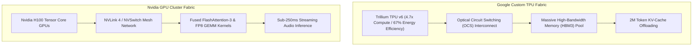

## Why Did Spring 2024 Mark the Structural Shift from Cascaded Pipelines to Native Multimodality?

In May 2024, the artificial intelligence landscape experienced a synchronized architectural inflection point. Within a 48-hour window, OpenAI hosted its Spring Update unveiling **GPT-4o** ("omni"), followed immediately by Google I/O 2024, where DeepMind presented **Gemini 1.5 Pro (2M context)**, **Gemini 1.5 Flash**, and **Project Astra**. Beyond competitive public relations and marketing claims, these twin announcements represented the definitive death of cascaded multimodal systems in favor of **native end-to-end tokenization**.

Historically, voice assistants and visual query engines operated via fragmented, three-stage pipelines:
1. **Automated Speech Recognition (ASR)**: A dedicated audio model (e.g., Whisper) converted spoken acoustic waveforms into discrete text transcripts.
2. **Autoregressive Text Modeling**: A primary large language model processed the transcribed text tokens and generated a text response.
3. **Text-to-Speech (TTS)**: A separate acoustic synthesis model synthesized speech audio from the generated text string.

While functionally serviceable, this cascaded paradigm incurred severe systemic penalties. Acoustic metadata—including speaker pitch, emotional timbre, vocal hesitations, laughter, sarcasm, and ambient background noise—was completely discarded at the ASR boundary. Furthermore, serial pipe execution compounded latency: processing speech recognition, waiting for full autoregressive token emission, and buffering audio generation resulted in total response latencies exceeding 1,200ms to 2,500ms, shattering conversational turn-taking dynamics.

```mermaid
flowchart TD
    subgraph Cascaded["Legacy Cascaded Pipeline (1200ms - 2500ms Latency)"]
        AcousticIn["User Audio Stream"] --> ASR["Whisper / Conformer ASR Engine"]
        ASR --> TextTokens["Flat Text Transcript (Lost Tone, Emotion, Prosody)"]
        TextTokens --> LLM["Autoregressive LLM (Text Forward Pass)"]
        LLM --> OutText["Generated Text Output"]
        OutText --> TTS["Tacotron / VITS Acoustic Synthesizer"]
        TTS --> VoiceOut["Synthesized Voice Output"]
    end

    subgraph NativeOmni["Native Multimodal Transformer (232ms - 320ms Latency)"]
        StreamIn["Continuous Audio, Video & Text Tokens"] --> UnifiedTokenizer["Omni-Modal Neural Audio/Vision Codec"]
        UnifiedTokenizer --> SharedTransformer["Unified Transformer Backbone (Joint Latent Representation)"]
        SharedTransformer --> DirectGeneration["Direct Streaming Audio Latents & Text Embeddings"]
        DirectGeneration --> InstantVoice["Low-Latency Expressive Audio & Video Streaming"]
    end
```



By unifying vision, audio waveforms, and text tokens into a shared high-dimensional representation space, both OpenAI and Google transitioned from textual translation to continuous sensory perception.

---

## Architectural Comparison: OpenAI GPT-4o vs Google Gemini 1.5 Pro

While both research organizations converged on native multimodal processing, their architectural emphases and hardware execution strategies revealed distinct engineering trade-offs. As analyzed in our post on [GPT-4o Release Dynamics](/posts/gpt4o-release/), OpenAI targeted conversational real-time human interaction, whereas Google capitalized on infrastructure scale to dominate long-context retrieval and dense multimodal video ingestion.

```
Key Capability Matrix: Spring 2024 Frontier Deployments
-------------------------------------------------------------------------------------------------
Dimension                OpenAI GPT-4o                      Google Gemini 1.5 Pro
-------------------------------------------------------------------------------------------------
Primary Architectural Goal Real-time sub-300ms omni-dialogue Extreme-scale multimodal context
Audio Processing         Native end-to-end tokenization     Direct audio ingestion & processing
Vision Encoding          Joint cross-attention / patch tokens Continuous video frame sampling
Maximum Context Window   128,000 tokens                     2,000,000 tokens (production GA)
Measured Latency         Average 232ms audio turnaround      600ms - 1,400ms time-to-first-token
Compute Infrastructure   Nvidia H100 / HGX Superclusters    Google Trillium TPU v6 & TPU v5p
Specialized Ecosystem    macOS Native Desktop App, Voice API Project Astra, NotebookLM Audio Overviews
-------------------------------------------------------------------------------------------------
```

### 1. OpenAI GPT-4o: Human conversational Latency Calibration

The core breakthrough of GPT-4o lay in human-parity latency. Human conversational turn-taking exhibits an average response latency of approximately 250ms. By training a single transformer across text, visual patches, and discrete audio codec tokens simultaneously, GPT-4o achieved an average response latency of **232 milliseconds**, with minimum response times dipping below 160ms.

Because the model processed audio directly, it demonstrated real-time prosody modulation:
- Adjusting pitch, speaking rate, and breathing cadence based on explicit user instruction.
- Detecting emotional state from vocal acoustic features (e.g., breathlessness, trembling, laughter).
- Handling conversational interruptions instantaneously by monitoring incoming audio stream tokens mid-generation.

### 2. Google Gemini 1.5 Pro: The 2-Million Token MoE Engine

Google addressed multimodality from the perspective of context volume and archival comprehension. Leveraging a sparse Mixture-of-Experts (MoE) architecture, Gemini 1.5 Pro expanded the active context boundary to **2,000,000 tokens**.

In empirical evaluations detailed by Reid et al. (2024), Gemini 1.5 Pro achieved near-perfect retrieval ($>99\%$ recall) on needle-in-a-haystack benchmarks across modalities:
- Ingesting up to 1 hour of raw 30fps video clips and pinpointing micro-events with sub-second timestamp accuracy.
- Processing 11 hours of raw continuous audio recordings without transcription errors.
- Analyzing 30,000 lines of complex software repositories or entire legal libraries in a single forward pass.

To accompany the heavy Pro tier, Google deployed **Gemini 1.5 Flash**, a lightweight distillation designed for sub-second, cost-efficient edge serving.

---

## The Hardware Foundation: Custom Silicon vs Commodity GPU Clusters

The divergent capabilities of GPT-4o and Gemini 1.5 were dictated by underlying silicon choices. In our research review on [Top Papers in Modern AI](/posts/top-papers-ai/), memory bandwidth and interconnect topology were identified as the governing constraints on multimodal attention layers.



Google's announcement of **Trillium (TPU v6)** delivered a 4.7-fold increase in peak compute per chip and 67% improved energy efficiency over TPU v5e. Utilizing internal Optical Circuit Switching (OCS), Google scaled Gemini 1.5 clusters to support massive cross-attention maps required for 2M token sequences. Conversely, OpenAI utilized dense Nvidia H100 clusters running fused CUDA kernels to maximize FP8 tensor core utilization during real-time streaming inference.

---

## How Omni-Modal Assistant Architectures Evolved Across 2026

Between 2024 and 2026, the prototype experiences showcased in Spring 2024 matured into pervasive multi-agent systems. In our analysis of [Vision-Language Model Evolution](/posts/vision-language-model/), early visual question answering evolved from static image inspection to continuous spatial awareness:

### 1. Project Astra to Continuous Spatial Computing
Google's Project Astra—initially an experimental research video demo showing glasses tracking code on whiteboards and misplaced items—graduated into standard spatial computing operating systems. In 2026, on-device multimodal agents maintain persistent 3D spatial scene graphs, tracking objects and ambient environment states continuously with negligible battery draw.

### 2. Native Multi-Modal Codec Standardization
While early 2024 omni models relied on proprietary internal representations, the open-source community introduced standardized omni-codecs (such as SNAC and Mimi in Kyutai's Moshi, and open Qwen2-Audio frameworks). Lightweight open models can run full end-to-end voice and visual inference on client laptops without cloud latency.

### 3. Test-Time Computation in Real-Time Speech
In early 2024, native speech was purely reflexive; models could not "pause and deliberate" before uttering words without producing awkward conversational silence. In 2026, hybrid architectures (such as Gemini 2.0 Flash Thinking and reasoning models) decouple deep test-time search from immediate conversational turn acknowledgment, utilizing synthetic vocal fillers and adaptive streaming to maintain natural dialogue while executing deep internal tree search.

---

## Key Takeaways

- **Cascaded ASR-LLM-TTS pipelines are obsolete**: Native multimodal tokenization eliminates error propagation, preserves vocal prosody, and slashes latency down to human conversational speed ($<250$ms).
- **GPT-4o prioritized real-time human interaction**: OpenAI calibrated omni-modal execution for sub-second expressive speech, conversational interruption, and desktop screen sharing.
- **Gemini 1.5 Pro dominated long-horizon context**: Google established the 2M token context boundary, achieving near-perfect needle retrieval across hours of video and audio.
- **Silicon infrastructure determines capability**: Google's TPU v6 Trillium optical fabric enabled massive context windows, while Nvidia GPU clusters optimized low-latency FP8 streaming.
- **2026 systems integrate spatial awareness and reasoning**: Modern omni-modal agents maintain persistent real-time 3D perception and synthesize test-time reasoning into fluid speech generation.

---

## New Questions

1. How do native multimodal transformers prevent cross-modal catastrophic forgetting when audio and visual token distributions diverge sharply from pretraining text corpora?
2. What cryptographic watermarking protocols are effective against zero-latency real-time voice cloning in end-to-end omni-modal architectures?
3. Can 2M+ token multimodal context windows fully replace external vector databases for episodic agent memory, or does quadratic attention cost remain prohibitive at scale?

---

## References

- OpenAI. (2024). *Hello GPT-4o: Introducing Omni-Modal Real-Time Intelligence*. OpenAI Research Publication. Available at: <https://openai.com/index/hello-gpt-4o/> (accessed 2026-10-18).
- Reid, M., Savinov, N., Zheng, D., Lepikhin, D., Lillicrap, T., Xu, J., et al. (2024). *Gemini 1.5: Unlocking Multimodal Understanding Across Millions of Tokens of Context*. arXiv preprint arXiv:2403.05530. Available at: <https://arxiv.org/abs/2403.05530> (accessed 2026-10-18).
- Google DeepMind. (2024). *Project Astra: An Universal AI Assistant for Everyday Life*. Google Technology Announcement. Available at: <https://deepmind.google/technologies/project-astra/> (accessed 2026-10-18).
- Radford, A., Kim, J. W., Xu, T., Brockman, G., McLeavey, C., & Sutskever, I. (2023). *Robust Speech Recognition via Large-Scale Weak Supervision*. In International Conference on Machine Learning (ICML), 28492-28518. Available at: <https://arxiv.org/abs/2212.04356> (accessed 2026-10-18).
