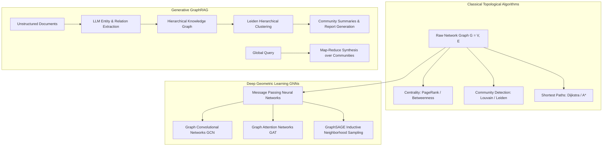

Most machine learning algorithms are designed to operate on Euclidean data structures: structured tabular rows, uniform image pixel grids, or sequential token arrays. However, the most critical phenomena in enterprise systems—financial transaction fraud, corporate ownership hierarchies, supply chain interdependencies, social communication networks, and complex codebases—are fundamentally non-Euclidean. They exist as **relational graphs**.

Attempting to force non-Euclidean network relationships into flat vectors or tabular rows inevitably discards topological context: connectivity density, multi-hop pathways, bottleneck bridge nodes, and modular community clusters.

Graph analytics addresses this representational failure. By formalizing entities as nodes and relationships as typed edges, graph algorithms and **Graph Neural Networks (GNNs)** enable systems to model structural dependencies directly. Furthermore, with the rise of enterprise generative AI, graph analytics has converged with information retrieval to create **GraphRAG**—a retrieval paradigm that overcomes the blindness of flat vector similarity search when answering complex global questions.


## Why Does Relational Graph Topology Outperform Flat Vector Embeddings?

To understand the necessity of graph-structured computing, consider the mathematical limitations of flat dense vector search (such as cosine similarity over text chunks).

In traditional vector retrieval, each text passage is embedded independently into a latent space $\mathbb{R}^D$. If a user asks a global or multi-hop relational question—such as *"Trace how money laundered through subsidiary shell companies in jurisdiction X influenced the executive board of parent company Y"*:
- Standard vector search retrieves chunks containing the words "money laundered", "subsidiary", or "executive board".
- The vector space preserves no explicit structural linkages between company X and company Y if they are mentioned in separate documents.
- The retrieval engine is blind to intermediate nodes (e.g., intermediary holding trusts or shared beneficial owners).

```
Flat Vector Space (Isolated Point Cloud)
[Chunk A: Company X]    [Chunk B: Trust Z]    [Chunk C: Company Y]
(No topological connectivity; retrieval relies strictly on lexical/semantic proximity)

Relational Knowledge Graph (Explicit Topological Structure)
[Node: Company X] ──(Owns 40%)──▶ [Node: Trust Z] ──(Controls Board)──▶ [Node: Company Y]
(Multi-hop path traversals, centrality scoring, and community clustering preserve provenance)
```

Graph analytics preserves the geometry of relationships. By computing topological metrics—such as **betweenness centrality**, **PageRank**, and **Louvain community partitions**—an analytical system identifies systemic hubs, bridge nodes, and tightly knit clusters that are invisible to flat metric embeddings.

## The Algorithmic Hierarchy of Graph Computing

Graph analytics spans three distinct computational paradigms: classical structural algorithms, deep geometric representation learning (GNNs), and generative graph retrieval (GraphRAG).



### 1. Classical Network Topology and Centrality
Classical graph theory quantifies node importance and cluster boundaries using deterministic algebraic operations:
- **Degree Centrality**: Measures direct connectivity ($C_D(v) = \text{deg}(v)$).
- **Betweenness Centrality**: Quantifies how often a node falls on the shortest path between all pairs of other nodes in the network:

$$C_B(v) = \sum_{s \neq v \neq t} \frac{\sigma_{st}(v)}{\sigma_{st}}$$

where $\sigma_{st}$ is the total number of shortest paths from node $s$ to node $t$, and $\sigma_{st}(v)$ is the number of those paths passing through $v$. Nodes with high betweenness act as critical information brokers or system bottlenecks.
- **PageRank**: Computes stationary probability distributions under a random walk with restart probability $(1 - d)$:

$$PR(u) = \frac{1 - d}{N} + d \sum_{v \in B_u} \frac{PR(v)}{L(v)}$$

### 2. Deep Geometric Learning: The Message Passing Framework
Graph Neural Networks generalize convolutions to non-grid topologies through iterative **Message Passing**. For a node $v$ with feature vector $h_v^{(l)}$ at layer $l$, the computation proceeds through three phases:

```
Message Passing Architecture:
Neighbors N(v) ──▶ [MESSAGE Computation: M(h_u, h_v, e_uv)]
                         │
                         ▼
                   [AGGREGATE: Permutation-Invariant Sum/Mean/Max]
                         │
                         ▼
                   [UPDATE: Non-linear Activation σ(W · [h_v, Aggregated])] ──▶ Next Layer h_v^(l+1)
```

1. **Message**: Neighbors $u \in \mathcal{N}(v)$ generate messages based on their current state and edge attributes: $m_{u \to v}^{(l)} = \text{MSG}(h_u^{(l)}, h_v^{(l)}, e_{uv})$.
2. **Aggregation**: Messages from all neighbors are gathered using a permutation-invariant operator (sum, mean, or attention-weighted sum):

$$\bar{m}_v^{(l)} = \bigoplus_{u \in \mathcal{N}(v)} m_{u \to v}^{(l)}$$

3. **Update**: The target node updates its internal representation by combining its prior state with the aggregated neighborhood vector:

$$h_v^{(l+1)} = \text{UPDATE}\left( h_v^{(l)}, \bar{m}_v^{(l)} \right)$$

In **Graph Convolutional Networks (GCN)**, aggregation uses normalized symmetric laplacian weights. In **Graph Attention Networks (GAT)**, neighbor contributions are modulated dynamically using self-attention coefficients $\alpha_{uv}$, mirroring the attention principles analyzed in our foundational audit on [Foundational AI Architectures: Mapping the Canonical Papers of Modern Deep Learning](/posts/top-papers-ai/).

In **GraphSAGE**, Hamilton et al. introduced inductive neighborhood sampling, enabling GNNs to generalize to unseen nodes without retraining on the entire graph structure.

## Code Implementation: GNN Message Passing in PyTorch Geometric

Below is an implementation of a two-layer Graph Attention Network (GAT) using PyTorch Geometric (`torch_geometric`), showing how multi-head self-attention aggregates neighborhood features over irregular graph topologies:

```python
import torch
import torch.nn as nn
import torch.nn.functional as F
from torch_geometric.nn import GATConv

class EnterpriseGAT(nn.Module):
    """
    Two-layer Graph Attention Network for node classification 
    and relational link prediction on non-Euclidean graphs.
    """
    def __init__(self, in_features: int, hidden_dim: int, num_classes: int, heads: int = 8):
        super().__init__()
        # First layer with multi-head attention
        self.conv1 = GATConv(in_features, hidden_dim, heads=heads, dropout=0.2)
        
        # Second layer averaging multi-head outputs for classification
        self.conv2 = GATConv(hidden_dim * heads, num_classes, heads=1, concat=False, dropout=0.2)
        
    def forward(self, x: torch.Tensor, edge_index: torch.Tensor) -> torch.Tensor:
        # x: Node feature matrix [N, in_features]
        # edge_index: Graph connectivity matrix [2, E] (COO format)
        
        # Layer 1: Multi-head message passing with ELU activation
        x = F.dropout(x, p=0.2, training=self.training)
        x = F.elu(self.conv1(x, edge_index))
        
        # Layer 2: Final readout projection
        x = F.dropout(x, p=0.2, training=self.training)
        x = self.conv2(x, edge_index)
        
        return F.log_softmax(x, dim=1)
```

By formatting edges as coordinate lists (`edge_index`), PyTorch Geometric executes sparse matrix multiplications on GPU silicon, bypassing dense $N \times N$ adjacency matrices and scaling to graphs with millions of nodes.

## The Convergence: From Graph Analytics to Microsoft GraphRAG

In early 2024, researchers at Microsoft published **GraphRAG** (Edge et al.), demonstrating how classical graph algorithms resolve the fundamental failure mode of semantic search in Retrieval-Augmented Generation.

Standard vector RAG excels at localized "needle-in-a-haystack" queries (e.g., *"What is the warranty policy for product X?"*). However, vector RAG fails catastrophically on holistic, dataset-wide queries (e.g., *"What are the primary recurring themes and systemic corruption risks identified across the entire document corpus?"*).

```
Vector RAG vs GraphRAG Query Synthesis:
Vector RAG: Query ──▶ Top-k Chunks (Missing 98% of corpus) ──▶ Hallucinated or Incomplete Answer
GraphRAG:   Corpus ──▶ Entity/Relationship Extraction ──▶ Leiden Community Hierarchy
            Query  ──▶ Parallel Community Summaries ──▶ Map-Reduce Synthesis ──▶ Comprehensive Answer
```

GraphRAG operates through an automated graph analytics pipeline:
1. **Entity and Relationship Extraction**: Large language models parse raw documents, extracting typed entities (people, organizations, locations) and directed claims between them.
2. **Graph Construction and Resolution**: Extracted entities and relationships are merged into an authoritative knowledge graph, with synonym nodes resolved.
3. **Hierarchical Community Detection (Leiden Algorithm)**: The graph is partitioned into hierarchical clusters using the Leiden community detection algorithm. Nodes with dense mutual interactions are grouped into modular communities at multiple levels of granularity.
4. **Community Summarization**: An LLM generates a comprehensive summary report for every community cluster ahead of time.
5. **Global Query Execution**: When answering broad analytical queries, GraphRAG dispatches map tasks across community summaries in parallel, using a reduce step to synthesize a grounded, cited global overview.

This architectural shift directly solves the context window limitations and chunk fragmentation issues discussed in our evaluation of [LangChain vs LlamaIndex: Architectural Patterns for RAG and Autonomous Agents](/posts/langchain-llama/) and [The LLM Systems Hierarchy: From Prompt Engineering to Autonomous Agents](/posts/llm-course-trying/).

## Comparative Evaluation: Graph Analytics vs Vector Retrieval

| Architectural Dimension | Flat Vector Embeddings (HNSW) | Classical Graph Analytics (PageRank/Louvain) | Modern GraphRAG Pipeline |
| :--- | :--- | :--- | :--- |
| **Data Representation** | Dense continuous vectors in $\mathbb{R}^D$ | Symbolic adjacency lists and sparse matrices | Hybrid: Knowledge graph + dense embeddings |
| **Query Strength** | Local semantic similarity | Structural centrality, flow, clustering | Global thematic summarization & multi-hop reasoning |
| **Failure Mode** | Semantic drift, blind to multi-hop links | Requires pre-structured schemas | High ingestion compute cost (LLM extraction) |
| **Scalability** | Billions of vectors via ANN indices | Millions of edges via sparse GPU matrices | Tens of thousands of documents per graph build |
| **Interpretability** | Black-box cosine distance | Complete structural auditability | Fully cited entity and relationship provenance |

## How Graph Analytics and Knowledge Graphs Evolved Across 2026

Between 2024 and 2026, the graph analytics ecosystem underwent a fundamental infrastructure transformation:

```
2023-2024: Isolated Graph Databases       2025: GraphRAG Emergence         2026: Hybrid Engines & Agentic Graphs
┌───────────────────────────────────┐     ┌────────────────────────────┐   ┌────────────────────────────────────┐
│ Neo4j / NetworkX / PyG            │────▶│ Microsoft GraphRAG v1.0    │──▶│ Embedded In-Memory Graphs (Kùzu)   │
│ Manual Cypher Query Crafting      │     │ Offline Community Reports  │   │ cuGraph GPU-Accelerated Clustering │
│ Separated from Vector Search      │     │ High Extraction Token Cost │   │ Agent Memory Knowledge Graphs (mem0│
└───────────────────────────────────┘     └────────────────────────────┘   └────────────────────────────────────┘
```

1. **Embedded In-Process Graph Engines (Kùzu & Memgraph)**: Maintaining massive standalone graph database clusters introduced severe DevOps latency. By 2026, applications adopted embedded in-process graph databases (such as Kùzu, modeled on DuckDB's in-process ergonomics). Agents query relational graphs via columnar storage with sub-millisecond local latency.
2. **GPU-Accelerated Graph Analytics (RAPIDS cuGraph)**: Running community detection (Leiden, Louvain) on million-node networks using single-threaded CPU libraries (NetworkX) was a major bottleneck. cuGraph migrated graph traversals and spectral clustering to NVIDIA CUDA and unified memory, yielding 50x to 100x speedups during offline GraphRAG ingestion.
3. **Agent Memory as Dynamic Knowledge Graphs**: Autonomous multi-agent systems increasingly replace naive chat history buffers with living knowledge graphs (using frameworks like mem0 and Letta). As agents interact with users and external tools, an extraction worker incrementally updates entity relationships, enabling agents to remember long-term episodic facts without context window bloat.

## Key Takeaways

- **Non-Euclidean Relational Modeling**: Graph analytics preserves structural dependencies, community clustering, and multi-hop pathways that flat vector embeddings inherently discard.
- **Message Passing Foundation**: GNNs (GCN, GAT, GraphSAGE) generalize convolution to irregular graphs through permutation-invariant neighborhood aggregation and multi-head self-attention.
- **GraphRAG Resolves Global Queries**: Combining LLM entity extraction with hierarchical community detection (Leiden) allows GraphRAG to synthesize dataset-wide answers that vector similarity search fails to capture.
- **Embedded Columnar Modernization**: In 2026, graph infrastructure converged with in-process columnar engines and GPU acceleration, delivering real-time graph reasoning to autonomous agents.

## New Questions

- How can dynamic, streaming data updates be incorporated into GraphRAG hierarchies without requiring full community re-clustering and expensive summary re-generation?
- What are the formal scaling limits of multi-hop GNN message passing before over-smoothing collapses node representations into identical mean vectors?
- Will neuro-symbolic reasoning models eliminate the need for external graph databases by maintaining dynamic internal knowledge topologies during test-time compute?

## References

1. Kipf, T. N., & Welling, M. (2017). *Semi-Supervised Classification with Graph Convolutional Networks (GCN)*. International Conference on Learning Representations (ICLR 2017). https://arxiv.org/abs/1609.02907 (accessed 2026-10-18).
2. Veličković, P., Cucurull, G., Casanova, A., Romero, A., Liò, P., & Bengio, Y. (2018). *Graph Attention Networks (GAT)*. International Conference on Learning Representations (ICLR 2018). https://arxiv.org/abs/1710.10903 (accessed 2026-10-18).
3. Hamilton, W., Ying, Z., & Leskovec, J. (2017). *Inductive Representation Learning on Large Graphs (GraphSAGE)*. Advances in Neural Information Processing Systems (NeurIPS 2017). https://arxiv.org/abs/1706.02216 (accessed 2026-10-18).
4. Edge, D., Trinh, H., Cheng, N., Bradley, J., Chao, A., Mody, A., Truitt, S., & Larson, J. (2024). *From Local to Global: A Graph RAG Approach to Query-Focused Summarization*. arXiv preprint arXiv:2404.16130. https://arxiv.org/abs/2404.16130 (accessed 2026-10-18).
