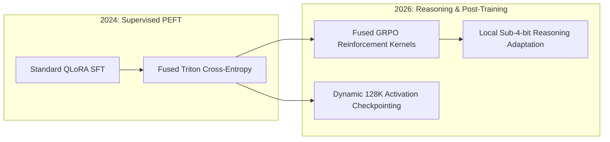

## Why Does Manual Backpropagation Derivation Outperform PyTorch Autograd in Low-Rank Adaptation?

The democratization of parameter-efficient fine-tuning (PEFT) reached an operational bottleneck in late 2023. While Low-Rank Adaptation (LoRA) and 4-bit Quantized LoRA (QLoRA) theoretically reduced the number of trainable parameters to less than 1% of the model's total footprint, practitioners training Llama-3, Mistral, or Gemma models still encountered sudden Out-Of-Memory (OOM) errors on consumer-grade hardware. Standard PyTorch execution pipelines suffered from severe memory bloat caused by automatic differentiation (Autograd).

When PyTorch executes a forward pass, its Autograd engine constructs a dynamic computation graph, eagerly caching intermediate activation tensors for every elementary operation—layer normalizations, rotary positional embeddings, gating multiplications, and cross-entropy logits—so that gradients can be computed during the backward pass. In an autoregressive transformer, storing these unquantized intermediate activation maps across long sequence lengths ($4,096$ to $8,192$ tokens) consumes substantially more VRAM than the actual model parameters.

In May 2024, Unsloth AI (founded by Daniel and Michael Han) achieved over 1 million monthly downloads on Hugging Face by introducing an uncompromising systems-level refactor: **replacing PyTorch Autograd with hand-derived mathematical backpropagation kernels written in OpenAI Triton**.

```mermaid
flowchart TD
    subgraph StandardPyTorch["Standard PyTorch + PEFT Engine"]
        FwdPass1["Forward Pass: RMSNorm -> RoPE -> QKV -> SwiGLU -> CrossEntropy"]
        FwdPass1 --> CacheStore["Autograd Activation Caching (Massive VRAM Spike)"]
        CacheStore --> BwdPass1["Backward Pass: Multiple Unfused CUDA Kernel Invocations"]
        BwdPass1 --> MemSpike["High VRAM Footprint + Memory Bandwidth Stalling"]
    end

    subgraph UnslothArchitecture["Unsloth Hand-Derived Triton Architecture"]
        FwdPass2["Fused Forward Pass (In-SRAM Shared Memory Execution)"]
        FwdPass2 --> CompactState["Minimal State Retention (No Redundant Intermediates)"]
        CompactState --> BwdPass2["Hand-Derived Triton Backward Kernel (Direct Gradient Accumulation)"]
        BwdPass2 --> Efficiency["70% VRAM Reduction + 2x-5x Training Acceleration"]
    end
```



By manually solving the symbolic matrix derivatives for every transformer layer and fusing the forward and backward computations into custom GPU block layouts, Unsloth eliminated redundant VRAM allocations, delivering a $2\times$ to $5\times$ fine-tuning speedup with up to $70\%$ less memory consumption—with zero degradation in mathematical precision or downstream accuracy.

---

## The Core Kernel Innovations Behind Unsloth

To achieve these efficiency leaps, Unsloth restructured the four most memory-intensive operations in transformer fine-tuning:

```
VRAM Allocation Profile During 4-bit QLoRA Fine-Tuning:
-------------------------------------------------------------------------------------------------
Component                     Standard PyTorch + BitsAndBytes    Unsloth Fused Triton Engine
-------------------------------------------------------------------------------------------------
Base Model Weights (4-bit)    ~5.5 GB (Llama-3-8B)                ~5.5 GB (Llama-3-8B NF4)
LoRA Adapter Weights          ~0.2 GB                             ~0.2 GB
Autograd Activation Cache     ~14.8 GB (Seq Len 4096, Batch 2)    ~3.9 GB (Peak In-SRAM Execution)
Optimizer States (AdamW 8-bit) ~1.2 GB                             ~1.2 GB
Temporary Gradient Buffers    ~4.1 GB                             ~0.8 GB (Fused Accumulation)
-------------------------------------------------------------------------------------------------
Total Peak VRAM Required      ~25.8 GB (Requires 32GB+ A100/H100) ~11.6 GB (Runs on 16GB RTX 4080/T4)
-------------------------------------------------------------------------------------------------
```

### 1. Fused Cross-Entropy Loss with Logit Streaming

In classical Hugging Face training loops, the final layer projection maps hidden states $[B, S, D]$ into the full vocabulary dimension $[B, S, V]$ (where $V = 128,256$ for Llama 3). Materializing this intermediate float32 logit tensor requires:
$$\text{Memory} = 2 \times 4096 \times 128256 \times 4\text{ bytes} \approx 4.2\text{ GB}$$
just to evaluate the cross-entropy loss against target labels.

Unsloth replaced this allocation with a **chunked, streaming Triton cross-entropy kernel**. The projection and softmax normalization are computed in tile chunks within high-speed GPU SRAM (`Shared Memory`), computing loss values and backward gradients on-the-fly without ever storing the full vocabulary-sized logit tensor in global GPU DRAM:

```python
# Conceptual representation of Unsloth streaming loss execution
import torch
import triton
import triton.language as tl

@triton.jit
def _chunked_cross_entropy_kernel(
    logits_ptr, targets_ptr, loss_out_ptr,
    stride_b, stride_s, vocab_size,
    BLOCK_SIZE: tl.constexpr
):
    """
    Computes cross-entropy loss over vocabulary blocks in SRAM,
    avoiding DRAM allocation for [Batch, SeqLen, VocabSize].
    """
    row_idx = tl.program_id(0)
    # Stream over vocabulary blocks, maintain online maximum and running sum of exponentials
    # Compute loss directly without materializing full logit matrix in global memory
```

### 2. Hand-Derived Backward Pass for SwiGLU

The SwiGLU activation function computes:
$$\text{SwiGLU}(x) = \left(x W_{\text{gate}} \cdot \sigma(x W_{\text{gate}})\right) \odot (x W_{\text{up}})$$
In PyTorch Autograd, five separate intermediate tensors are saved: $x W_{\text{gate}}$, $\sigma(x W_{\text{gate}})$, their product, $x W_{\text{up}}$, and the element-wise Hadamard product.

Unsloth engineers derived the exact analytical gradient with respect to $x$:
$$\frac{\partial \mathcal{L}}{\partial x} = \left(\frac{\partial \mathcal{L}}{\partial \text{out}} \odot (x W_{\text{up}}) \odot \sigma'(x W_{\text{gate}})\right) W_{\text{gate}}^\top + \left(\frac{\partial \mathcal{L}}{\partial \text{out}} \odot \text{Swish}(x W_{\text{gate}})\right) W_{\text{up}}^\top$$
They wrote a single Triton kernel that recomputes intermediate activation elements in-register during the backward pass, completely bypassing global DRAM read/write roundtrips.

### 3. Fused RoPE and In-Place RMSNorm

Rotary Positional Embeddings (RoPE) require slicing query and key vectors into even and odd indices and applying trigonometric rotations. PyTorch generates multiple memory-copying strided tensor allocations. Unsloth's fused RoPE kernel executes the 2D rotations in-place in SRAM registers immediately after the projection gemm.

---

## Integration with the Hugging Face Ecosystem

A critical reason for Unsloth's rapid community adoption was seamless drop-in compatibility with the standard Hugging Face pipeline (`transformers`, `peft`, `trl`, and `SFTTrainer`). As discussed in our analysis of [Unsloth Local Fine-Tuning Optimization](/posts/unsloth-local-api-guide/) and [LLaMA-Factory Workflows](/posts/llama-factory/), developers were not forced to rewrite data collators or switch to proprietary formats.

```python
from unsloth import FastLanguageModel
import torch

# 1. Load model with fused Triton patches enabled
model, tokenizer = FastLanguageModel.from_pretrained(
    model_name="unsloth/llama-3-8b-bnb-4bit",
    max_seq_length=4096,
    dtype=None,  # Auto-detection
    load_in_4bit=True,
)

# 2. Attach optimized QLoRA target modules
model = FastLanguageModel.get_peft_model(
    model,
    r=16,
    target_modules=["q_proj", "k_proj", "v_proj", "o_proj", "gate_proj", "up_proj", "down_proj"],
    lora_alpha=16,
    lora_dropout=0,  # Optimized to 0 for maximum kernel fusion
    bias="none",
    use_gradient_checkpointing="unsloth",  # 70% VRAM reduction checkpointing
)
```

Setting `lora_dropout = 0` enabled Unsloth to fuse the LoRA scaling and addition ($W x + \frac{\alpha}{r} B A x$) directly into the base GEMM kernels, avoiding auxiliary tensor additions during both training and inference.

---

## How Efficient Fine-Tuning Kernels and Post-Training Evolved Across 2026

Between 2024 and 2026, parameter-efficient fine-tuning evolved beyond static supervised fine-tuning (SFT) into complex reinforcement learning post-training loops:

### 1. From SFT to Online RL (GRPO and DPO Optimization)
In 2024, Unsloth focused primarily on supervised fine-tuning. By 2026, frontier post-training shifted to Group Relative Policy Optimization (GRPO) and Direct Preference Optimization (DPO), popularized by reasoning models like DeepSeek-R1. Unsloth adapted its Triton kernel suite to support online trajectory generation, reward computation, and reference model KL-divergence penalties on single consumer GPUs.

### 2. Dynamic 4-Bit and 2-Bit Quantized Training (QLoRA to BitNet)
As detailed in our research on [LoRA vs Full Parametric Fine-Tuning](/posts/lora-better-gpt4/), 4-bit NormalFloat (NF4) quantization laid the groundwork for extreme low-bit training. In 2026, fine-tuning engines natively support 2-bit and ternary post-training adapters, allowing 70B parameter models to be adapted on standard 24GB VRAM workstations without quantization perplexity collapse.



### 3. Long-Context Activation Checkpointing (128K Context)
Modern reasoning traces routinely exceed 32,000 tokens. Unsloth's selective activation recomputation expanded into hierarchical offloading: streaming activation states between GPU HBM and host system memory via PCIe Gen 5, enabling long-context reasoning fine-tuning without multi-node cluster requirements.

---

## Key Takeaways

- **PyTorch Autograd is the primary bottleneck in PEFT**: Eager intermediate activation caching consumes significantly more memory than LoRA parameters or quantized weights.
- **Manual backward derivation enables zero-copy execution**: Hand-deriving gradients in OpenAI Triton eliminates memory round-trips and redundant tensor materialization.
- **Chunked loss evaluation eliminates logit explosion**: Computing cross-entropy in SRAM tiles prevents multi-gigabyte DRAM allocations for large vocabulary sizes.
- **Drop-in Hugging Face compatibility drove widespread adoption**: Seamless integration with `SFTTrainer` allowed teams to accelerate existing pipelines without code rewrites.
- **2026 post-training expands into reinforcement learning**: Modern custom kernel engines optimize GRPO, online reference modeling, and 128K context reasoning traces on consumer hardware.

---

## New Questions

1. How do custom Triton kernels interact with dynamic speculative decoding verifiers during combined fine-tuning and inference serving?
2. What are the numerical gradient variance boundaries when fusing LoRA adapters into sub-4-bit quantized base weights during multi-task reinforcement learning?
3. Can compiler-based graph capture frameworks (such as TorchDynamo and Inductor) fully match the memory efficiency of hand-written analytical Triton backpropagation kernels?

---

## References

- Han, D., & Han, M. (2024). *Unsloth: Fast and Memory-Efficient Language Model Fine-Tuning*. Open Source Software & Technical Documentation. Available at: <https://github.com/unslothai/unsloth> (accessed 2026-10-18).
- Dettmers, T., Pagnoni, A., Holtzman, A., & Zettlemoyer, L. (2024). *QLoRA: Efficient Finetuning of Quantized LLMs*. Advances in Neural Information Processing Systems (NeurIPS), 36, 10088-10115. Available at: <https://arxiv.org/abs/2305.14314> (accessed 2026-10-18).
- Hu, E. J., Shen, Y., Wallis, P., Allen-Zhu, Z., Li, Y., Wang, S., Wang, L., & Chen, W. (2022). *LoRA: Low-Rank Adaptation of Large Language Models*. In International Conference on Learning Representations (ICLR). Available at: <https://arxiv.org/abs/2106.09685> (accessed 2026-10-18).
- Tillet, P., Kung, H. T., & Cox, D. (2019). *Triton: An Intermediate Language and Compiler for Tiled Neural Network Computations*. In Proceedings of the 3rd ACM SIGPLAN International Workshop on Machine Learning and Programming Languages, 10-19. Available at: <https://www.eecs.harvard.edu/~htk/publication/2019-mapl-tillet-kung-cox.pdf> (accessed 2026-10-18).
