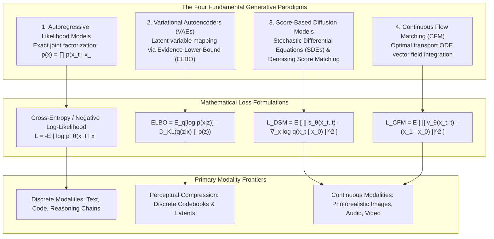

{: .light .w-75 .shadow .rounded-10 w='1212' h='668' }

## Which Mathematical Primitives Underpin the Generative AI Taxonomy?

In mainstream media and introductory marketing material, "Generative AI" is routinely treated as a monolithic technology synonymous with chat interfaces and automated text prediction. Buzzword glossaries reduce complex theoretical breakthroughs into superficial catchphrases—defining terms like "tokens," "embeddings," and "hallucination" in isolation without illuminating the mathematical mechanisms that generate data.

In technical computer science and machine learning, generative modeling addresses a precise probabilistic objective: given a collection of samples $x$ drawn from an unknown, high-dimensional empirical data distribution $p_{\text{data}}(x)$, train a parameterized neural network $p_\theta(x)$ to approximate this distribution, enabling the efficient sampling of novel, high-fidelity synthetic artifacts.

Achieving this objective has produced four mathematically distinct generative paradigms: Autoregressive Sequence Models, Variational Autoencoders (VAEs), Score-Based Diffusion Models (SDEs), and Continuous Normalizing Flows (Flow Matching). Understanding modern artificial intelligence requires evaluating how these mathematical foundations dictate sampling speed, density estimation tractability, and architectural trade-offs.



---

## 1. Autoregressive Sequence Models: Exact Likelihood Factorization

Autoregressive models approach generative modeling through the probabilistic chain rule. Any joint probability distribution over a sequence of $T$ discrete tokens $\mathbf{x} = (x_1, x_2, \dots, x_T)$ can be factored exactly without structural approximation:

$$p(\mathbf{x}) = \prod_{t=1}^T p(x_t \mid x_1, x_2, \dots, x_{t-1}) = \prod_{t=1}^T p(x_t \mid \mathbf{x}_{<t})$$

The parameterized neural network $f_\theta(\mathbf{x}_{<t})$ processes prefix context tokens, projecting the final hidden layer into a categorical probability distribution over vocabulary $\mathcal{V}$ via the softmax operator:

$$p_\theta(x_t = v \mid \mathbf{x}_{<t}) = \frac{\exp(z_v / \tau)}{\sum_{j \in \mathcal{V}} \exp(z_j / \tau)}$$

Where $z = W_{\text{unembed}} h_t$ and $\tau$ is sampling temperature.

### Mechanics and Trade-offs
- **Exact Tractability**: Unlike GANs or diffusion models, autoregressive models evaluate exact log-likelihoods during training, enabling straightforward empirical risk minimization via standard cross-entropy loss, as explored in our study of [LLM architecture archetypes](/posts/llm-types/).
- **The Autoregressive Generation Tax**: While training is parallelized across all sequence tokens using causal lower-triangular attention masks, generation is strictly sequential: producing $N$ tokens requires $N$ forward passes, making decoding memory-bandwidth bound.

---

## 2. Variational Autoencoders (VAEs) and Latent Spaces

Directly modeling raw high-dimensional continuous data (such as 4K video or multi-megapixel images) at the pixel level introduces extreme computational bloat. Variational Autoencoders (Kingma & Welling, 2013) project high-dimensional data $x \in \mathcal{X}$ into a lower-dimensional latent representation $z \in \mathcal{Z}$.

Because the true marginal data likelihood $p_\theta(x) = \int p_\theta(x \mid z) p(z) dz$ is computationally intractable, VAEs introduce a variational inference network $q_\phi(z \mid x)$ and maximize the **Evidence Lower Bound (ELBO)**:

$$\log p_\theta(x) \ge \mathbb{E}_{z \sim q_\phi(z \mid x)} \left[ \log p_\theta(x \mid z) \right] - \mathbb{D}_{\text{KL}}\left( q_\phi(z \mid x) \,\|\, p(z) \right)$$

```
Input Image (x) ────► [ Encoder q_phi(z|x) ] ────► Latent Mean (mu) & Variance (sigma)
                                                               │
                                                   [ Reparameterization Trick ]
                                                               │
Output Image (x_hat) ◄── [ Decoder p_theta(x|z) ] ◄────────── z = mu + sigma * epsilon
```

By enforcing a standard Gaussian prior $p(z) = \mathcal{N}(0, \mathbf{I})$ via the Kullback-Leibler divergence penalty $\mathbb{D}_{\text{KL}}$, the latent space becomes continuous and smooth. In modern visual architectures (e.g., Stable Diffusion, FLUX), the frozen VAE decoder acts as an 8x spatial perceptual compressor, allowing downstream generative models to operate within a compact latent grid.

---

## 3. Score-Based Diffusion Models: Reversing Brownian Entropy

Pioneered by Sohl-Dickstein et al. (2015) and formalized by Song & Ermon (2019) and Ho et al. (2020), diffusion models frame generation as reversing a thermodynamic diffusion process.

### The Forward and Reverse SDEs
The forward process gradually corrupts a clean data sample $x_0 \sim p_{\text{data}}$ into isotropic Gaussian noise via a Stochastic Differential Equation (SDE):

$$dx = f(x, t) dt + g(t) dw$$

Where $w$ is a standard Wiener process (Brownian motion). Brian Anderson (1982) demonstrated that this forward diffusion process can be reversed in time:

$$dx = \left[ f(x, t) - g(t)^2 \nabla_x \log p_t(x) \right] dt + g(t) d\bar{w}$$

The term $\nabla_x \log p_t(x)$ is the **score function**—the gradient of the log probability density with respect to the data vector. Denoising Score Matching trains a neural network $s_\theta(x_t, t)$ to predict this gradient without calculating the intractable partition function:

$$\mathcal{L}_{\text{DSM}}(\theta) = \mathbb{E}_{t, x_0, \epsilon} \left[ \| \epsilon - \epsilon_\theta(x_t, t) \|^2 \right]$$

Sampling corresponds to starting from pure noise $x_T \sim \mathcal{N}(0, \mathbf{I})$ and integrating backward along the reverse SDE over 20 to 50 discrete time steps, reconstructing sharp high-frequency edges from entropy.

---

## 4. Continuous Normalizing Flows and Flow Matching

While diffusion models deliver state-of-the-art sample quality, their stochastic curved trajectories require dozens of neural network evaluations to integrate. 

Introduced by Lipman et al. (2022) and Albergo & Vanden-Eijnden (2022), **Continuous Flow Matching (CFM)** replaces stochastic diffusion SDEs with deterministic Ordinary Differential Equations (ODEs) that transport probability distributions along straight trajectories:

$$\frac{d \phi_t(x)}{dt} = v_t(\phi_t(x)), \quad \phi_0(x) \sim p_0, \quad \phi_1(x) \sim p_1$$

### Optimal Transport (OT) Displacement
By utilizing Optimal Transport displacement interpolation, the ground-truth vector field connecting noise sample $x_0 \sim \mathcal{N}(0, \mathbf{I})$ and data sample $x_1 \sim p_{\text{data}}$ becomes a straight line:

$$\psi_t(x) = (1 - t) x_0 + t x_1, \quad \frac{d \psi_t(x)}{dt} = x_1 - x_0$$

The neural vector field $v_\theta(x_t, t)$ is trained via a simple regression objective:

$$\mathcal{L}_{\text{CFM}}(\theta) = \mathbb{E}_{t, x_0, x_1} \left[ \| v_\theta(\psi_t(x_0), t) - (x_1 - x_0) \|^2 \right]$$

Because ODE trajectories are linear, numerical solvers (such as Euler or Midpoint solvers) integrate the vector field in as few as **4 to 8 steps**, achieving 10x faster generation than traditional diffusion models, as demonstrated in our architectural analysis of [Alibaba's FunAudioLLM speech engine](/posts/llm-fun-audio-alibaba/).

---

## Taxonomic Matrix: Comparing Generative Architectures

| Generative Paradigm | Core Mathematical Primitive | Exact Density Evaluation? | Sampling Complexity (NFE) | Primary Strengths | Primary Architectural Failure Mode |
| :--- | :--- | :--- | :--- | :--- | :--- |
| **Autoregressive (Transformer)** | Chain rule factorization: $\prod p(x_t \mid x_{<t})$ | **Yes (Exact log-likelihood)** | $\mathcal{O}(T)$ sequential steps | Perfect discrete reasoning, scalable pre-training | Quadratic attention KV-cache memory traffic |
| **Variational Autoencoder (VAE)** | Latent variable inference via ELBO | Approximate (Variational bound) | $\mathcal{O}(1)$ single forward pass | Extremely fast latent compression | Perceptual blurriness in pixel space |
| **Generative Adversarial Net (GAN)** | Minimax zero-sum game: $\min_G \max_D V(D, G)$ | No (Implicit distribution) | $\mathcal{O}(1)$ single forward pass | Real-time edge inference, sharp textures | Severe mode collapse, training instability |
| **Score-Based Diffusion (SDE)** | Reverse Brownian motion: $\nabla_x \log p_t(x)$ | Approximate (via probability flow ODE)| 20 – 50 sampling steps | Exceptional distribution coverage, no mode collapse | High inference latency, curved trajectories |
| **Flow Matching (CFM)** | Optimal transport vector field: $\frac{dx}{dt} = v_t(x)$ | **Yes (via instantaneous change of variables)** | **4 – 10 ODE steps** | Straight trajectories, fast sampling, stable loss | Requires large batch sizes for optimal transport |

As established in our historical review of [foundational algorithms](/posts/10-core-algorithms/), generative AI architectures succeed by translating continuous physical and mathematical symmetries into cache-efficient tensor operations.

---

## How Generative AI Architectures Evolved Across 2026

Entering 2026, the theoretical boundaries separating these four paradigms began to dissolve into hybrid unified architectures:

1. **Diffusion-Transformer (DiT) Unification**: Pure convolutional UNet backbones have been completely replaced by Diffusion Transformers (DiT). By treating visual latent patches and audio codes as token sequences, models leverage standard Transformer scaling laws while retaining continuous score-matching dynamics.
2. **Sub-Step Flow Matching via Distillation**: Techniques like Consistency Models and Rectified Flow 2-step distillation allow foundation visual generators to synthesize photorealistic 4K frames in a single forward pass, matching GAN latency while preserving diffusion diversity.
3. **Any-to-Any Autoregressive Foundation Models**: Discrete tokenizers for audio (Mimi, SNAC) and visual patches (VQ-VAE / VQ-GAN) enable single autoregressive decoders to process interleaved text, audio, and visual tokens natively, as analyzed in our review of [frontier LLM research trends](/posts/llm-research-trend/).

---

## Key Takeaways

- **Generative AI Is Not Monolithic**: Generative systems are governed by distinct mathematical formulations: autoregression for discrete tokens, diffusion for continuous score matching, and flow matching for optimal transport ODEs.
- **Latent Compression Enables Scalability**: High-resolution continuous generation is feasible only because VAEs compress raw sensor pixels into compact, continuous latent manifolds.
- **Flow Matching Dominates Continuous Modalities**: By straightening generation trajectories, optimal transport flow matching delivers diffusion-grade fidelity with a fraction of the computational sampling cost.

---

## New Questions

- Will discrete autoregressive sequence modeling eventually subsume continuous flow matching for visual generation, or will continuous ODEs retain a permanent efficiency advantage?
- How can generative diffusion architectures incorporate formal deductive reasoning constraints without incurring exponential test-time sampling latency?

---

## References

- Vaswani, A., Shazeer, N., Parmar, N., Uszkoreit, J., Jones, L., Gomez, A. N., Kaiser, Ł., & Polosukhin, I. (2017). *Attention Is All You Need*. Advances in Neural Information Processing Systems, 30. [https://arxiv.org/abs/1706.03762](https://arxiv.org/abs/1706.03762) (accessed 2026-10-18).
- Kingma, D. P., & Welling, M. (2013). *Auto-Encoding Variational Bayes*. International Conference on Learning Representations (ICLR 2014). [https://arxiv.org/abs/1312.6114](https://arxiv.org/abs/1312.6114) (accessed 2026-10-18).
- Ho, J., Jain, A., & Abbeel, P. (2020). *Denoising Diffusion Probabilistic Models*. Advances in Neural Information Processing Systems, 33, 6840–6851. [https://arxiv.org/abs/2006.11239](https://arxiv.org/abs/2006.11239) (accessed 2026-10-18).
- Song, Y., Sohl-Dickstein, J., Kingma, D. P., Kumar, A., Ermon, S., & Poole, B. (2020). *Score-Based Generative Modeling through Stochastic Differential Equations*. International Conference on Learning Representations (ICLR 2021). [https://arxiv.org/abs/2011.13456](https://arxiv.org/abs/2011.13456) (accessed 2026-10-18).
- Lipman, Y., Chen, R. T., Ben-Hamu, H., Nicklas, M., & Le, M. (2022). *Flow Matching for Generative Modeling*. International Conference on Learning Representations (ICLR 2023). [https://arxiv.org/abs/2210.02747](https://arxiv.org/abs/2210.02747) (accessed 2026-10-18).
