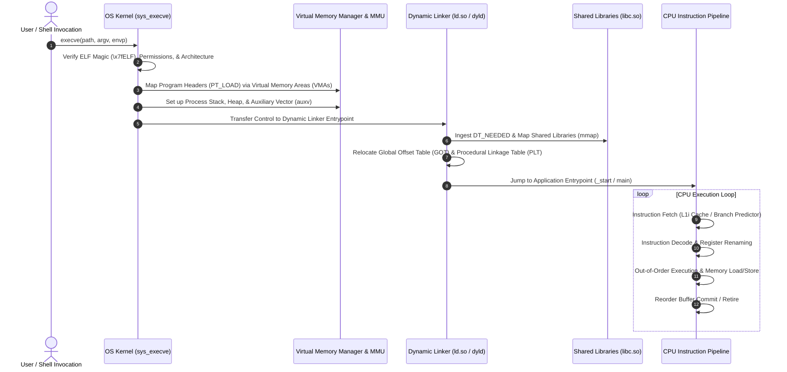
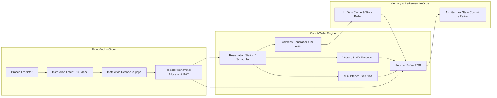

To a software engineer working in a high-level interpreted or managed language, executing a program appears deceptively simple: one invokes a binary in a terminal (`./app`) or double-clicks an icon in a desktop shell, and the software begins executing instructions.

Behind this simple facade lies one of the most intricate coordination mechanisms in modern computer science. Transforming inert bytes stored on a non-volatile block device (NVMe SSD) into coordinated electrical state transitions across microscopic CPU transistors requires continuous cooperation between compiler toolchains, binary linkers, kernel system call handlers, virtual memory managers, and out-of-order superscalar processor architectures.

Understanding the deep systems mechanics of program execution is not merely an academic exercise. In modern software engineering—particularly when engineering low-latency AI inference servers, autonomous agent execution sandboxes, and compiled native tools—mastering process lifecycle mechanics is essential for diagnosing memory leaks, page faults, dynamic linking collisions, and processor cache thrashing.


## What Happens Between the execve System Call and the First CPU Instruction?

The journey of program execution begins with a command invocation dispatched to the host operating system. In POSIX-compliant kernels (such as Linux and macOS), a new process is not spawned in a single atomic step; it relies on the classical UNIX dichotomy of **forking** and **executing**.

```
Shell Process (PID 100) ──▶ fork() ──▶ Child Process Cloned (Copy-on-Write Pages)
                                              │
                                              ▼
                                       execve("./binary", argv, envp)
                                              │
                                              ▼
                                 [Kernel Takes Over Context]
                                 - Flushes old address space
                                 - Parses ELF / Mach-O Headers
                                 - Maps virtual memory segments (mmap)
                                 - Initializes stack with argc, argv, auxv
                                 - Passes execution control to Dynamic Linker (ld.so)
```

When a user executes a command, the shell process calls `fork()`, instructing the kernel to duplicate the caller's process control block (PCB), file descriptors, and virtual memory mappings using **Copy-on-Write (CoW)** optimizations. The child process then invokes the `execve()` system call, passing the binary path, arguments (`argv`), and environment variables (`envp`).

At this moment, the kernel wipes the old address space clean and begins parsing the binary image according to the platform's standardized binary specification: **Executable and Linkable Format (ELF)** on Linux, **Mach-O** on macOS, and **Portable Executable (PE)** on Windows.

## The Architectural Topology of Process Initialization

To trace the transition from disk bytes to active CPU execution, consider the end-to-end lifecycle:



### 1. ELF Binary Parsing and Memory Segment Mapping
An ELF binary is organized into a file header, a **Program Header Table**, and an optional **Section Header Table**. The kernel loader ignores human-readable sections (like `.text`, `.data`, `.rodata`) and focuses strictly on **Segments** defined by the Program Header Table:
- `PT_LOAD`: Declares a contiguous region of the binary that must be loaded into memory. Typically, a binary specifies at least two `PT_LOAD` segments:
  1. An executable and read-only segment containing machine instructions (`r-x`).
  2. A read-write segment containing initialized global variables (`rw-`).
- `PT_INTERP`: Contains a null-terminated string specifying the path to the dynamic linker (e.g., `/lib64/ld-linux-x86-64.so.2`).
- `PT_DYNAMIC`: Houses the dynamic linking array containing metadata tables (`DT_NEEDED`, `DT_SYMTAB`, `DT_STRTAB`, `DT_JMPREL`).

Crucially, modern kernels do not read the entire multi-megabyte binary from disk into physical RAM during `execve`. Instead, the kernel calls internal memory mapping primitives (`do_mmap()`), registering virtual memory addresses in the process’s virtual memory area (VMA) tree. Actual physical memory pages are allocated lazily via **Demand Paging** when the CPU encounters the first page fault.

## Virtual Memory, Page Tables, and the MMU Translation Hierarchy

Modern operating systems execute processes within an isolated **Virtual Address Space**, preventing one errant process from corrupting physical memory belonging to the kernel or adjacent applications.

```
Virtual Memory Address (e.g., 0x00007fff5bf0a000)
┌─────────────┬─────────────┬─────────────┬─────────────┬─────────────────┐
│ Page Map L4 │ Page Dir Ptr│ Page Direct │ Page Table  │ Physical Offset │
│   (9 bits)  │   (9 bits)  │   (9 bits)  │   (9 bits)  │    (12 bits)    │
└──────┬──────┴──────┬──────┴──────┬──────┴──────┬──────┴────────┬────────┘
       │             │             │             │               │
       ▼             ▼             ▼             ▼               ▼
    CR3 Reg ────▶ PML4 ───────▶ PDPT ────────▶ PDT ─────────▶ PT ──▶ Physical Page
```

In standard x86-64 4-level paging:
1. The CPU register `CR3` holds the physical address of the active process's root page directory (PML4).
2. The 48-bit virtual address is split into four 9-bit indices and a 12-bit page offset.
3. The hardware **Memory Management Unit (MMU)** traverses the 4-level page table tree to resolve the physical Frame Number (PFN).
4. **Translation Lookaside Buffer (TLB)**: Because traversing four levels of RAM latency per memory access would degrade compute throughput by 80%, the MMU caches recent virtual-to-physical translations in a fast hardware associative cache called the TLB.

When a thread attempts to read or execute code from an unmapped page, the MMU raises a hardware interrupt known as a **Major Page Fault**. The kernel traps the fault, reads the required 4KB page block from the NVMe disk into physical RAM, updates the process page table entry (PTE), flushes the relevant TLB entry, and commands the CPU to retry the faulting instruction transparently.

## Dynamic Linking, Relocations, and the PLT/GOT Mechanism

The vast majority of software binaries are dynamically linked rather than statically compiled. Compiling static copies of `glibc`, OpenSSL, or graphics drivers into every binary bloats disk footprints and prevents system-wide security patching.

Dynamic linking introduces a profound architectural puzzle: how can pre-compiled machine code invoke library functions (like `printf()` or `malloc()`) whose physical memory addresses are completely unknown until runtime?

The operating system solves this through **Position Independent Code (PIC)** and the coordination between the **Procedure Linkage Table (PLT)** and the **Global Offset Table (GOT)**:

```
First Call to printf() (Lazy Binding Lifecycle):
1. Code calls printf@plt
2. PLT reads entry in GOT: *GOT initially points back to PLT instruction!*
3. PLT pushes relocation index and jumps to dynamic linker resolver (ld.so)
4. Dynamic linker locates printf in libc.so memory space
5. Linker overwrites GOT entry with actual physical address of printf
6. Subsequent calls to printf@plt jump directly to printf without linker intervention!
```

```
Caller Code               Procedure Linkage Table (PLT)          Global Offset Table (GOT)
┌────────────────┐        ┌────────────────────────────┐         ┌─────────────────────────┐
│ call printf@plt│───────▶│ jmp *GOT[printf]           │────────▶│ [Addr of printf() in RAM│
└────────────────┘        │ push relocation_index      │         │  (Updated by ld.so)     │
                          │ jmp dl_runtime_resolve     │         └─────────────────────────┘
                          └────────────────────────────┘
```

1. **The Global Offset Table (GOT)**: Located in the read-write data segment, the GOT is a table of absolute memory addresses populated by the dynamic linker (`ld.so`).
2. **The Procedure Linkage Table (PLT)**: Located in the executable code segment, the PLT contains short trampoline stubs for each external library symbol.
3. **Lazy Binding (`LD_BIND_NOW`)**: Historically, to accelerate startup times, Linux resolved functions lazily upon their first invocation. In modern security-hardened environments, **Full RELRO (Relocation Read-Only)** is enforced: all symbols are resolved upfront during process initialization, and the GOT is subsequently remapped to read-only memory, preventing malicious exploit payloads from overwriting function pointers.

## Inside the Silicon: The Modern CPU Execution Pipeline

Once dynamic linking concludes, the linker jumps execution control to the runtime initialization entrypoint (`_start`), which initializes standard I/O streams, registers thread-local storage (TLS), executes constructors, and finally calls `main()`.

At this point, physical silicon takes over. A modern microprocessor (such as an Intel Raptor Lake, AMD Zen 5, or Apple Silicon M-series) does not process instructions sequentially like an elementary Turing machine. It employs a **superscalar, deeply pipelined, out-of-order execution engine**:



The execution pipeline functions through four primary stages:

1. **Branch Prediction and Speculative Fetch**: Before instructions are even decoded, advanced TAGE (Tagged Geometric History Length) branch predictors evaluate conditional jumps (`je`, `jne`, `call`). The fetch engine pulls 32 to 64 bytes of raw machine code from the L1 instruction cache speculatively. If a branch prediction fails, the speculative instructions are flushed from the pipeline, incurring a 15–20 cycle latency penalty.
2. **Instruction Decoding into Micro-Operations ($\mu$ops)**: Complex CISC x86 instructions are translated by hardware decoders into simpler, RISC-like micro-operations ($\mu$ops). Frequently executed $\mu$op sequences are cached in a dedicated decoded $\mu$op cache, bypassing the decode stage entirely on subsequent iterations.
3. **Register Renaming and the Out-of-Order Engine**: Architectural registers (e.g., `RAX`, `RBX`, `R12`) are dynamically mapped onto a much larger physical register file (often exceeding 250+ physical registers) using Register Alias Tables (RAT). This eliminates false data dependencies (Write-After-Read and Write-After-Write hazards). Micro-ops are queued in the **Reservation Station**, where they execute as soon as their required operands become available—regardless of program order.
4. **Reorder Buffer (ROB) and In-Order Retirement**: While micro-ops execute out-of-order across parallel integer ALUs and vector floating-point units, state changes cannot be made visible to the software out of order. Completed operations are logged in a circular FIFO queue called the **Reorder Buffer (ROB)**. Instructions commit and write their results back to architectural registers strictly in original program order, preserving precise exception semantics.

## Process Termination and Resource Reclamation

When the application completes its task, it executes an exit path (either explicitly returning an integer from `main()` or calling the `exit()` library function):

```c
// POSIX Process Cleanup and Termination
#include <stdlib.h>
#include <unistd.h>

void terminate_system_cleanly(int exit_code) {
    // 1. Flush and close user-space stdio buffers (stdout, stderr)
    // 2. Execute functions registered via atexit()
    // 3. Dispatch the sys_exit_group system call
    exit(exit_code);
}
```

The kernel executes the final cleanup protocol:
1. **Closing File Descriptors**: Decrements reference counters on open file objects, releasing sockets, pipes, and inode locks.
2. **VMA Unmapping**: Deallocates the process's page table hierarchy, returning physical RAM pages to the kernel's buddy allocator free lists.
3. **The Zombie State**: The process control block is not immediately destroyed. The process enters the `TASK_ZOMBIE` state, retaining its Process ID (PID) and termination status until its parent process invokes `wait()` or `waitpid()`. If the parent dies without reaping the child, the system init daemon (PID 1 / systemd) adopts the zombie and reaps it automatically.

## How Process Execution Evolved for AI Workloads and Sandboxes Across 2026

Between 2024 and 2026, the traditional operating system process execution paradigm was fundamentally challenged by the explosion of **autonomous AI agent execution** and **heterogeneous tensor acceleration**:

```
2020-2023: Heavy VM & Container Isolation   2024: Seccomp & eBPF Filtering   2026: WASI Micro-Runtimes & UVM
┌──────────────────────────────────────┐     ┌─────────────────────────────┐  ┌────────────────────────────────────┐
│ Docker / Containerd Namespaces       │────▶│ Linux Landlock & Seccomp-BPF│─▶│ WebAssembly WASI Component Model  │
│ 100ms-500ms Cold-Start Latency       │     │ Kernel System Call Tracing  │  │ Sub-Millisecond Agent Sandboxing   │
│ Discrete CPU-GPU Memory Copying      │     │ Dynamic Hardware Enclaves   │  │ Unified Virtual Memory Heterogeneity│
└──────────────────────────────────────┘     └─────────────────────────────┘  └────────────────────────────────────┘
```

1. **Sub-Millisecond Micro-Sandboxing via WebAssembly (WASI)**: Autonomous software agents (such as code generators and autonomous terminal operators) must execute untrusted, dynamically synthesized code thousands of times per hour. Traditional Linux process isolation via Docker or microVMs (Firecracker) introduces 50ms to 200ms of cold-start virtualization overhead. Modern systems leverage WebAssembly (WASM) runtimes with WASI (WebAssembly System Interface). An agent compiles and launches an isolated execution sandbox in under 500 microseconds, with zero access to host system calls unless explicitly delegated by capability handles.
2. **Kernel Sandboxing with Linux Landlock and Seccomp**: For native CLI execution—as explored in our architectural audit on [CLI-Anything Agent-Native Interfaces](/posts/cli-anything-agent-native-interfaces/)—process execution utilizes unprivileged kernel sandboxing via Linux Landlock and BPF-based system call filtering. An agent process restricts its own filesystem access rules and network dispatches directly within the kernel before executing arbitrary scripts, preventing data exfiltration at zero virtualization cost.
3. **Unified Virtual Memory (UVM) for Heterogeneous Compute**: As models execute large-scale matrix operations across unified memory architectures (such as Apple Silicon and NVIDIA Grace Hopper), the traditional boundary between CPU virtual memory and GPU device memory has dissolved. Through Unified Virtual Memory (UVM) drivers and hardware page migration engines, CPU threads and GPU tensor cores share a unified 64-bit virtual address pointer space, completely eliminating user-space memory copies between host RAM and VRAM. This mirrors the real-time memory optimizations discussed in [WebGL to WebGPU: The Architectural Evolution of Real-Time Browser Graphics](/posts/web-gl/) and [The LLM Systems Hierarchy: From Prompt Engineering to Autonomous Agents](/posts/llm-course-trying/).

## Key Takeaways

- **Lazy Demand Paging**: Operating systems do not load binaries into physical memory during invocation; `execve` maps virtual memory areas (VMAs), and the MMU brings pages into RAM via major page faults only when accessed.
- **Position Independence and Dynamic Linking**: Position Independent Code (PIC) utilizes the Global Offset Table (GOT) and Procedure Linkage Table (PLT) to resolve shared library functions dynamically without mutating read-only code segments.
- **The Out-of-Order Superscalar Engine**: Modern CPUs decode complex instructions into micro-ops ($\mu$ops), reordering execution across parallel execution units and retiring instructions in-order via the Reorder Buffer to preserve precise state.
- **Modern Agent Isolation**: Production agent harnesses in 2026 have shifted from heavy containerization to sub-millisecond WebAssembly micro-runtimes and kernel-level Landlock sandboxing.

## New Questions

- As heterogeneous architectures combine CPU out-of-order cores with matrix-multiply accelerator units on a shared die, how will OS schedulers prevent memory contention in the shared L3 cache?
- Can capability-based WebAssembly runtimes achieve parity with native glibc binary execution speeds for heavy I/O and compiled scientific computing tasks?
- What microarchitectural side-channel vulnerabilities (similar to Spectre and Meltdown) remain exploitable when multiple untrusted AI agent processes share an out-of-order processor core?

## References

1. Bovet, D. P., & Cesati, M. (2005–2024). *Understanding the Linux Kernel: From Process Management to Memory Addressing*. O'Reilly Media. https://www.kernel.org/doc/html/latest/ (accessed 2026-10-18).
2. Drepper, U. (2011). *How To Write Shared Libraries: Position Independent Code and Dynamic Linker Optimization*. Red Hat Technical Documentation. https://www.akkadia.org/drepper/dsohowto.pdf (accessed 2026-10-18).
3. Hennessy, J. L., & Patterson, D. A. (2017–2024). *Computer Architecture: A Quantitative Approach (6th Edition)*. Morgan Kaufmann / Elsevier. https://www.elsevier.com/books/computer-architecture/hennessy/978-0-12-811905-1 (accessed 2026-10-18).
4. Kerrisk, M. (2010–2026). *The Linux Programming Interface: A Linux and UNIX System Programming Handbook*. No Starch Press. https://man7.org/tlpi/ (accessed 2026-10-18).
