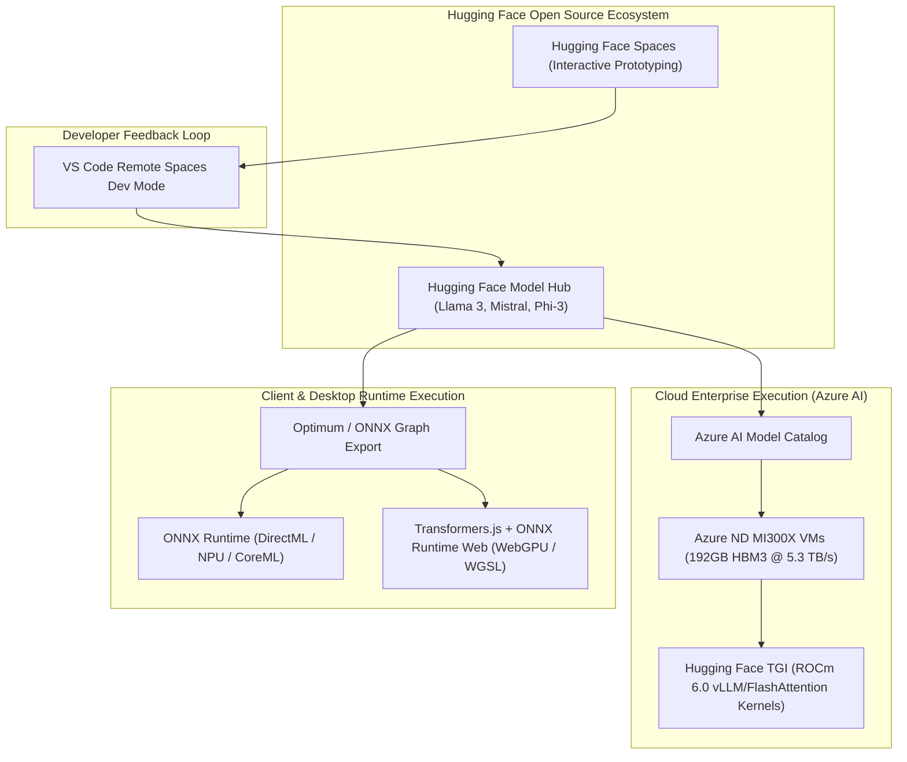
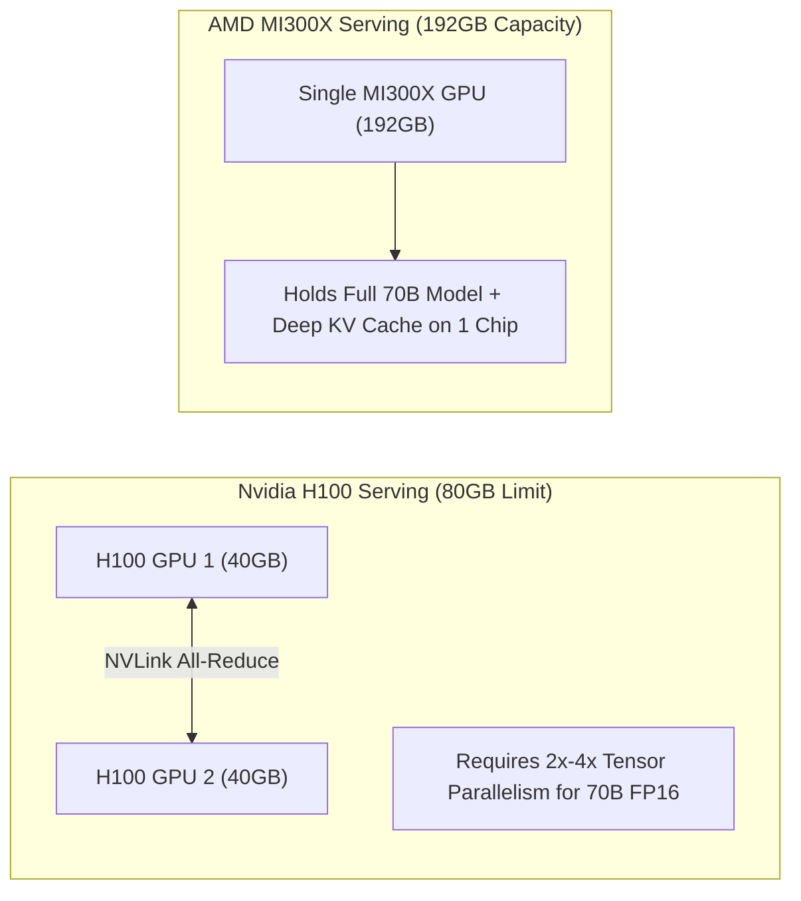
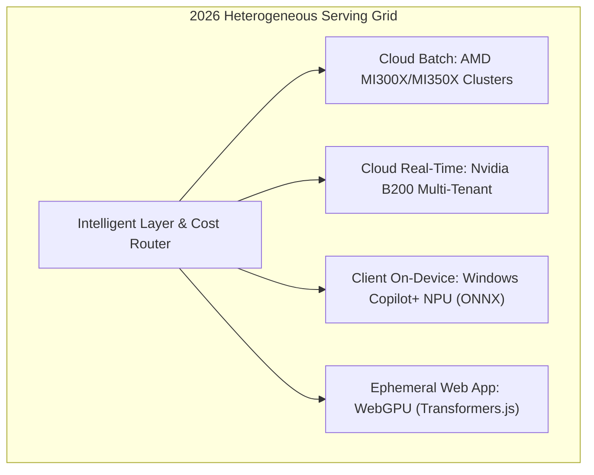

## Why Did the Microsoft and Hugging Face Alliance Target Silicon Diversification Beyond Nvidia?

Throughout 2023 and early 2024, the enterprise generative AI sector faced an acute systemic vulnerability: absolute hardware centralization. Nearly the entire foundation model ecosystem—from training runs to production inference serving—depended on Nvidia's proprietary CUDA computing stack and Hopper H100 GPUs. Prolonged hardware allocation wait times, extreme cloud GPU pricing premiums, and single-vendor lock-in threatened the operational economics of enterprise AI deployment.

At Microsoft Build in May 2024, Satya Nadella announced a significant expansion of Microsoft's strategic partnership with Hugging Face. While commercial press coverage framed the announcement as a routine developer tooling update, the underlying technical contract established an ambitious cross-platform objective: **decoupling modern transformer inference from CUDA exclusivity across cloud, desktop, and client browser environments**.

The collaboration unified three critical software-hardware abstraction layers:
1. **Hyperscale Cloud Serving on AMD Instinct MI300X**: Deploying Hugging Face's Text Generation Inference (TGI) natively on Azure ND MI300X virtual machines powered by AMD ROCm 6.0.
2. **Standardized Graph Compilation via ONNX Runtime**: Translating Hugging Face PyTorch weights into optimized, hardware-agnostic Open Neural Network Exchange (ONNX) execution graphs.
3. **Client-Side Edge Acceleration with WebGPU and Transformers.js**: Eliminating backend server hops by running compact foundation models (such as the Phi-3 family) directly within client browser tabs using W3C standard WebGPU compute shaders.



By engineering native translation pathways across AMD ROCm, Microsoft ONNX, and browser-standard WebGPU, the alliance established a viable alternative to single-vendor hardware dependency.

---

## Technical Deep-Dive: Hyperscale Serving on AMD Instinct MI300X

The central infrastructure milestone of the expanded partnership was the production integration of Hugging Face Text Generation Inference (TGI) on **AMD Instinct MI300X** accelerators within Microsoft Azure (the ND MI300X v5 VM family).

### The Memory Bandwidth Imperative in Autoregressive Serving

Autoregressive token generation during the memory-bound decode phase is severely constrained by High Bandwidth Memory (HBM) bandwidth rather than raw compute FLOPS. Every generated token requires streaming the full model weight tensor and the accumulated Key-Value (KV) cache from memory into processing registers:

$$\text{Decode Latency Floor} = \frac{\text{Model Weights Size (GB)} + \text{KV Cache Size (GB)}}{\text{Memory Bandwidth (GB/s)}}$$

The MI300X architecture challenged Nvidia H100 SXM5 on these specific memory vectors:

| Hardware Specification | Nvidia H100 SXM5 | AMD Instinct MI300X | Delta Advantage |
| :--- | :--- | :--- | :--- |
| **HBM3 Capacity** | 80 GB | **192 GB** | **$+140\%$ (2.4x)** |
| **Peak Memory Bandwidth** | 3.35 TB/s | **5.3 TB/s** | **$+58\%$ (1.58x)** |
| **Single-Node Capacity (8 GPUs)** | 640 GB | **1,536 GB** | **$+140\%$ (2.4x)** |
| **FP16 / BF16 Tensor TFLOPS** | ~989 TFLOPS | **~1,307 TFLOPS** | **$+32\%$** |
| **Software Platform** | CUDA 12 / TensorRT-LLM | ROCm 6.0 / HIP / TGI | Open-Source ROCm |

Because a single MI300X GPU contains 192 GB of unified HBM3 memory, engineering teams can host an entire unquantized 70B parameter model (which occupies ~140 GB in FP16) on a **single GPU**, completely eliminating inter-GPU tensor parallelism communication overhead (All-Reduce over NVLink/Infinity Fabric) for medium-scale serving.



### Porting TGI to AMD ROCm via HIP

Historically, running PyTorch models on AMD silicon required complex code modifications. The collaboration between Hugging Face and Microsoft embedded official AMD ROCm container images directly into Azure's managed model registry. Hugging Face engineers ported TGI's high-performance PagedAttention and FlashAttention kernels using AMD's HIP (Heterogeneous-Compute Interface for Portability), achieving throughput parity with tuned CUDA deployments.

---

## Client-Side Edge Inference: ONNX Runtime, WebGPU, and Phi-3

Silicon independence extends beyond the cloud datacenter to client workstations, laptops, and mobile devices. In our related study on [Phi-3 WebGPU In-Browser Execution](/posts/phi3-webgpu/), we analyzed how small language models run entirely without server infrastructure.

### The ONNX Optimum Compilation Pipeline

Microsoft's ONNX Runtime serves as a cross-platform inference engine capable of targeting diverse execution providers:
- **DirectML**: Hardware-accelerated inference across DirectX 12 consumer GPUs (AMD Radeon, Intel Arc, Nvidia GeForce).
- **QNN / OpenVINO**: Direct hardware targeting for Qualcomm Snapdragon NPUs and Intel Core Ultra processors.
- **ONNX Runtime Web (Wasm / WebGPU)**: Zero-install client execution in web browsers.

Through `optimum-cli`, models published on Hugging Face are automatically validated and converted into quantized ONNX graphs:

```bash
# Automated conversion of Hugging Face transformer to INT4 ONNX format
optimum-cli export onnx \
    --model microsoft/Phi-3-mini-4k-instruct \
    --task text-generation-with-past \
    --quantize int4 \
    --device cpu \
    phi3_onnx_int4/
```

### Browser Execution with Transformers.js

Hugging Face's `transformers.js` leverages ONNX Runtime Web to bind directly to standard WebGPU interfaces. When a client navigates to a web application, the browser downloads quantized weights, compiles WGSL (WebGPU Shading Language) compute pipelines directly onto the local GPU, and streams tokens locally at zero marginal hosting cost.

This capability was demonstrated through the open release of Microsoft's **Phi-3 family** (Mini 3.8B, Small 7B, Medium 14B), trained using high-quality synthetic textbook data curated to match the reasoning density of 10x larger models.

---

## Cross-Platform Ecosystems in Relation to Previous Cloud Deployments

The Microsoft-Hugging Face alliance represented a structural evolution from earlier cloud collaborations, such as the [Nvidia-Hugging Face Cloud Endpoints Initiative](/posts/nvidia-hugginface-endpoint-release/) and the [Hugging Face AWS Integration](/posts/huggingface-cookbook/). While earlier partnerships focused on provisioning proprietary GPU instances within single cloud silos, the Microsoft alliance established horizontal portability:

| Strategic Axis | AWS Hugging Face (2021-2023) | Nvidia Hugging Face (2023) | Microsoft Hugging Face (2024) |
| :--- | :--- | :--- | :--- |
| **Primary Compute** | AWS SageMaker (Trainium/Inferentia) | Nvidia DGX Cloud / NeMo | Azure AMD MI300X + Nvidia + NPU |
| **Local Runtime** | Basic Python Wheel | CUDA / TensorRT Containers | ONNX Runtime + WebGPU + DirectML |
| **Model Scope** | Standard Transformer Hub | Proprietary Megatron Models | Open Weights + Phi-3 Small Language Models |
| **Developer Surface** | AWS Console / IAM | DGX Cloud Interface | VS Code Spaces Dev Mode Integration |

---

## How Open-Source Multi-Hardware Acceleration Evolved Across 2026

Between 2024 and 2026, the foundational multi-hardware investments initiated by Microsoft and Hugging Face reshaped enterprise infrastructure:

### 1. AMD ROCm Production Maturity
In 2024, AMD ROCm was viewed as a secondary alternative requiring constant upstream debugging. By 2026, ROCm 7 and subsequent releases reached operational parity in major serving frameworks (vLLM, SGLang, and TGI). Tier-1 cloud providers routinely offer AMD Instinct clusters alongside Nvidia Blackwell systems, stabilizing market pricing.

### 2. NPU Standardization in Windows Copilot+ Systems
The integration of ONNX Runtime with Qualcomm Snapdragon X Elite and AMD/Intel neural processing units (NPUs) transformed client AI. In 2026, local semantic search, speech processing, and background agent reasoning operate continuously on dedicated 45+ TOPS NPUs without consuming battery or GPU resources.



### 3. Open Model Governance and Weight Provenance
By embedding VS Code directly into Hugging Face Spaces (Dev Mode), Microsoft bridged the gap between cloud prototype sandboxes and local enterprise repositories, setting the industry benchmark for verifiable AI supply chains.

---

## Key Takeaways

- **Silicon diversification broke the CUDA monopoly**: The Microsoft-Hugging Face alliance established enterprise-grade serving on AMD Instinct MI300X hardware.
- **192 GB HBM3 memory reshaped 70B parameter serving**: The MI300X's memory capacity allowed entire 70B models to reside on a single accelerator without tensor parallel latency.
- **ONNX Runtime established true cross-platform portability**: Graph optimization decouples model definitions from proprietary drivers, enabling execution across DirectML, NPUs, and WebGPU.
- **Small language models enabled zero-cost client inference**: Phi-3 paired with Transformers.js demonstrated fast, private, serverless execution directly inside web browsers.
- **Heterogeneous hardware grids define 2026 operations**: Modern production pipelines dynamically route workloads across AMD cloud clusters, client NPUs, and browser shaders based on latency and cost.

---

## New Questions

1. How do kernel compilation latencies in AMD ROCm hipBLAS compare to Nvidia CUDA cuBLAS during dynamic batch size spikes in high-concurrency production serving?
2. What are the memory bandwidth bottlenecks of client-side unified memory architectures (e.g., Apple M-series and Intel Lunar Lake) when executing multi-turn 128K context windows in ONNX WebGPU?
3. To what extent does cross-hardware quantization (INT4 AWQ vs FP4) introduce model output drift when serving identical model weights across heterogeneous GPU architectures?

---

## References

- Hugging Face. (2024). *Accelerating Open-Source AI with Microsoft: From Cloud to Client*. Hugging Face Official Blog. Available at: <https://huggingface.co/blog/microsoft-collaboration> (accessed 2026-10-18).
- Microsoft Azure. (2024). *Azure Announces General Availability of ND MI300X V5 Virtual Machines for AI Workloads*. Microsoft Azure Infrastructure Technical Report. Available at: <https://azure.microsoft.com/en-us/blog/> (accessed 2026-10-18).
- AMD. (2023). *AMD Instinct MI300X Accelerator Architecture Whitepaper*. Advanced Micro Devices Inc. Technical Publication. Available at: <https://www.amd.com/en/products/accelerators/instinct/mi300.html> (accessed 2026-10-18).
- Abdin, M., Jacobs, S. A., Awan, A. A., Aneja, J., Awadallah, A., Awadalla, H., Bach, N., Bahree, A., Bakhtiari, A., Behl, H., et al. (2024). *Phi-3 Technical Report: A Highly Capable Language Model Locally on Your Phone*. arXiv preprint arXiv:2404.14219. Available at: <https://arxiv.org/abs/2404.14219> (accessed 2026-10-18).
