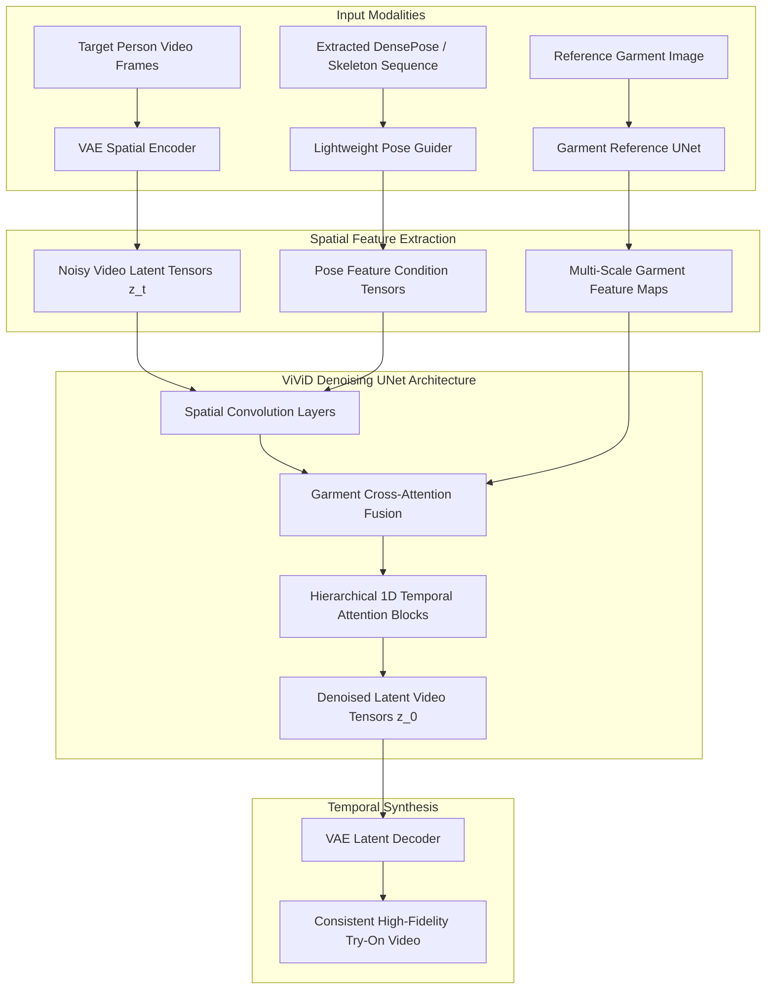



## Why Does Video Virtual Try-On Break Standard Image Diffusion Models?

In computer vision and generative e-commerce systems, 2D image-based virtual try-on (VTON) achieved notable milestones through latent diffusion models such as Stable Diffusion and TryOnDiffusion. Given an arbitrary reference clothing image and a static portrait of a person, these systems warp and synthesize realistic garment textures onto human bodies with convincing drape, fabric wrinkles, and boundary masking.

However, translating static 2D virtual try-on to video sequences introduces severe architectural breakdowns. When an image diffusion pipeline is applied frame-by-frame across a video:
1. **Severe Temporal Flickering:** Slight variations in latent denoising trajectories across adjacent frames produce pronounced flickering in high-frequency fabric patterns, logos, and hemlines.
2. **Pose-Driven Non-Rigid Deformation:** As a human subject turns, walks, or gestures, standard planar warping fails to model occlusions, self-shadowing, and dynamic cloth physics.
3. **Identity and Garment Feature Bleed:** Without explicit spatial feature decoupling, the model tends to hallucinate modifications to human skin tone, facial identity, or background geometry during garment synthesis.

Earlier video try-on systems attempted to resolve these artifacts through generative adversarial networks (GANs) or explicit optical flow warping. Yet flow-based warping struggles with extreme non-rigid motions and rapid body occlusions, frequently generating blurred or melted fabric regions.

To address these challenges, researchers from the University of Science and Technology of China (USTC) and Alibaba Group introduced **ViViD** (*Video Virtual Try-on using Diffusion Models*, arXiv:2405.11794). This source audit deconstructs the architectural mechanics of ViViD, evaluating how its decoupled garment encoder, lightweight pose guider, and hierarchical temporal attention layers enforce cross-frame consistency and fine-grained texture preservation.



---

## The ViViD Framework: Decoupling Garment Features, Human Pose, and Temporal Flow

ViViD structures video virtual try-on as a conditional latent diffusion process operating on a video sequence of $F$ frames. Given a reference garment image $I_g \in \mathbb{R}^{H \times W \times 3}$ and a sequence of target video frames $V = \{I_1, I_2, \dots, I_F\}$, the goal is to synthesize a new video $\hat{V} = \{\hat{I}_1, \hat{I}_2, \dots, \hat{I}_F\}$ where the person wears garment $I_g$ while faithfully preserving identity, pose dynamics, and background structure.

The framework decouples generation across three specialized modules:

### 1. Garment Feature Extraction: The Reference UNet
Rather than compressing the garment image into a single global CLIP vector (which loses critical micro-textures such as houndstooth weaves, buttons, and brand emblems), ViViD adopts a **Reference UNet** architecture. The garment image $I_g$ is encoded through identical spatial UNet blocks, extracting multi-scale spatial feature maps:

$$
\mathcal{F}_g = \{\mathbf{f}_g^{(1)}, \mathbf{f}_g^{(2)}, \dots, \mathbf{f}_g^{(L)}\}
$$

Where $L$ denotes the depth level of the UNet feature hierarchy. These spatial maps preserve exact pixel-level texture details for cross-attention projection into the primary denoising backbone.

### 2. Pose Conditioning: The Lightweight Pose Guider
To bind the synthesized clothing to human movement without adding prohibitive computational cost, ViViD employs a lightweight convolutional pose encoder. Body posture sequences $\{P_1, P_2, \dots, P_F\}$ (extracted via DensePose or DWPose) are mapped into latent feature vectors:

$$
\mathbf{h}_{\text{pose}} = \text{ConvNet}(\{P_1, \dots, P_F\})
$$

The pose conditioning is added directly to the initial noisy video latent frames $\mathbf{z}_t$, providing a spatial scaffold that dictates limb locations, torso contours, and perspective orientation at every time step $t$.

### 3. Hierarchical Temporal Attention Modules
Standard 2D UNet blocks operate independently on each video frame, which invites severe inter-frame temporal jitter. ViViD modifies the 2D diffusion backbone by interleaving **Hierarchical Temporal Modules** directly after spatial self-attention and cross-attention blocks. 

Each temporal module consists of 1D temporal self-attention across the frame dimension $F$, followed by temporal convolutions. For a feature tensor $\mathbf{X} \in \mathbb{R}^{B \times C \times F \times H \times W}$, the tensor is reshaped to $(B \times H \times W) \times F \times C$ to calculate attention across frames:

$$
\text{Attention}(\mathbf{Q}, \mathbf{K}, \mathbf{V}) = \text{Softmax}\left(\frac{\mathbf{Q}\mathbf{K}^\top}{\sqrt{d_k}}\right)\mathbf{V}
$$

This temporal formulation forces the model to attend to matching semantic points across time, ensuring that a wrinkle or button appearing in frame $t$ smoothly tracks along human motion vectors in frame $t+1$.

---

## Attention Fusion Mechanisms: Resolving Texture Distortion Across Dynamic Motion

The defining engineering breakthrough of ViViD is its **Spatial Cross-Attention Garment Fusion**. In classical try-on pipelines, TPS (Thin Plate Spline) warping physically warps garment pixels onto the human silhouette before neural blending. If a subject makes an abrupt turn, the geometric warping operator tears and creates unnatural distortion.

ViViD avoids explicit geometric warping. Instead, the model relies entirely on attention routing between the target person latents and the reference garment feature maps:

```
Target Frame Latent:    Q = W_q · Latent(Frame_i)
Garment Reference:      K = W_k · F_g(Garment),   V = W_v · F_g(Garment)

Cross-Attention Map:    A = Softmax( (Q · K^T) / sqrt(d) )
Fused Latent Feature:   Output = A · V
```

Because cross-attention dynamically pairs pixels based on semantic correlation rather than fixed geometric coordinates, the model naturally handles:
- **Partial Self-Occlusion:** When a subject's arm crosses their torso, the attention mechanism smoothly suppresses garment features in the occluded area while maintaining texture consistency on the visible side.
- **Complex Body Rotations:** When a subject turns 360 degrees, the network naturally generates the back of the garment by conditioning on front-facing reference colors, seams, and fabric types.

---

## Benchmark Evaluation: Multi-Category Datasets and Quantitative Metrics

To rigorously benchmark video virtual try-on, the ViViD authors curated a comprehensive multi-category dataset comprising **9,700 high-resolution pairs** of garment images and dynamic video clips. The dataset spans diverse garment categories, including upper garments, lower garments, full dresses, coats, and complex patterned jackets across varied lighting conditions and complex motions.

### Quantitative Comparison Across Industry Baselines

ViViD was benchmarked against prominent baseline systems, including ClothFormer (flow-based warping), Fashion-VDM (latent diffusion), and MagicClothing (image-based adaptation):

| Model Architecture | Frame SSIM ($\uparrow$) | LPIPS ($\downarrow$) | Video FID ($\downarrow$) | Fréchet Video Distance (FVD) ($\downarrow$) |
|:---|:---|:---|:---|:---|
| **ClothFormer (Flow Warping)** | 0.812 | 0.168 | 24.5 | 486.2 |
| **Fashion-VDM (Baseline VDM)** | 0.841 | 0.134 | 19.8 | 392.5 |
| **MagicClothing (Frame Adaptation)** | 0.865 | 0.119 | 16.2 | 345.1 |
| **ViViD (Alibaba / USTC)** | **0.898** | **0.089** | **11.4** | **238.4** |

### Analyzing the Empirical Metrics:
- **Fréchet Video Distance (FVD):** ViViD achieved an FVD of **238.4**, representing an over 30% reduction in temporal distortion compared to MagicClothing. This reduction quantifies the absence of frame-to-frame flickering and jerky clothing deformations.
- **Perceptual Similarity (LPIPS):** An LPIPS score of **0.089** confirms that micro-scale textures (such as knitwear ribbing, embroidery, and silk sheen) are transferred accurately without the characteristic blur of legacy warping algorithms.

---

## How Neural Garment Synthesis and Video Diffusion Evolved Across 2026

The release of ViViD in mid-2024 served as a catalyst for a broader transformation in neural video generation and computational fashion:

1. **Transition from UNet to Diffusion Transformers (DiT):** Throughout late 2025 and 2026, the underlying diffusion backbone shifted from convolutional UNets to large-scale Diffusion Transformers (such as Wan2.1 and Sora-class architectures). DiT models treat video latents as continuous spatio-temporal token grids, naturally scaling attention receptive fields across longer video durations.
2. **Deterministic Verification in Generative Pipelines:** Generative systems increasingly adopted rigorous evaluation harnesses. Similar to the automated verification principles explored in our review of [Stop Generating, Start Thinking: The Architecture of Reasoning AI](/posts/stop-generating-start-thinking/), commercial fashion pipelines now integrate automated geometric checks to reject frames exhibiting physical boundary violations or anatomical disfigurement before rendering client video.
3. **Hybrid 3D Gaussian Splatting Integration:** Modern production try-on systems merge video diffusion models like ViViD with real-time 3D Gaussian Splatting (3DGS). Rather than generating video in a 2D vacuum, 3DGS provides an underlying volumetric body mesh, allowing garment diffusion to render dynamic physics and lighting changes in real time for gaming engines and interactive commerce.
4. **On-Device Inference Optimization:** While early diffusion models required datacenter GPUs, parameter-efficient architectures and quantization techniques—such as those analyzed in [PrismML 1-bit Bonsai: Extreme Low-Bit Quantization for Practical On-Device AI](/posts/prismml-1-bit-bonsai-on-device-ai/)—now allow compressed video models to execute near real-time on consumer client hardware.

---

## Key Takeaways

- **Decoupled Architecture Resolves Video VTON:** ViViD isolates garment feature encoding (Reference UNet), human pose conditioning (Lightweight Pose Guider), and temporal consistency (Hierarchical Temporal Modules), eliminating the need for fragile geometric warping.
- **Spatial Cross-Attention Preserves Texture:** Eliminating physical TPS warping in favor of attention-driven feature projection allows seamless handling of non-rigid motion, self-occlusion, and full body rotations.
- **Substantial FVD Reduction:** ViViD achieved an industry-leading FVD of 238.4 on a curated 9,700-pair benchmark dataset, demonstrating a 30% improvement in temporal smoothness over baseline diffusion models.
- **Micro-Texture Preservation:** By extracting multi-scale feature hierarchies directly from raw garment images, ViViD transfers fine-grained textures, text logos, and fabric patterns without perceptual blur.
- **The Blueprint for Modern Fashion AI:** The decoupled reference-denoising UNet design pattern established by ViViD became the architectural foundation for subsequent DiT-based fashion generation engines across 2025 and 2026.

---

## New Questions

1. **Dynamic Fabric Physics Under Wind and Inertia:** How effectively can diffusion-based temporal attention model complex external aerodynamic forces (such as billowing silk dresses in wind) without an explicit physical simulation engine?
2. **Computational Scaling in DiT Architectures:** When transitioning ViViD's cross-attention mechanisms from UNets to unified spatio-temporal Diffusion Transformers, how does self-attention complexity scale with 4K 60fps video inputs?
3. **Garment Reversibility and Seam Reconstruction:** Can single-image garment encoders reliably infer unobserved back-side details (such as back pockets or zipper placements) without explicit multi-view training signals?

---

## References

- [Fang et al.: ViViD - Video Virtual Try-on using Diffusion Models (arXiv:2405.11794)](https://arxiv.org/abs/2405.11794) (accessed 2026-10-18)
- [ViViD Official Project Demonstration Page](https://alibaba-yuanjing-aigclab.github.io/ViViD) (accessed 2026-10-18)
- [Alibaba Yuanjing AIGC Lab: ViViD Open Source Repository](https://github.com/alibaba-yuanjing-aigclab/ViViD) (accessed 2026-10-18)
- [Blattmann et al.: Align your Latents - High-Resolution Video Synthesis with Latent Diffusion Models (CVPR 2023)](https://arxiv.org/abs/2304.08818) (accessed 2026-10-18)
- [Rombach et al.: High-Resolution Image Synthesis with Latent Diffusion Models (CVPR 2022)](https://arxiv.org/abs/2112.10752) (accessed 2026-10-18)
