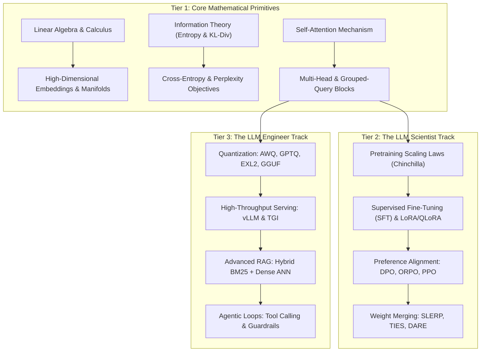
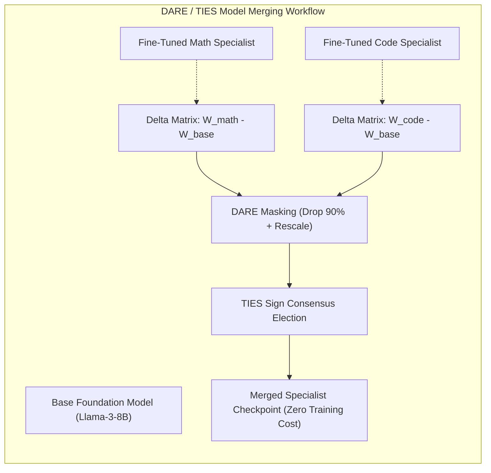
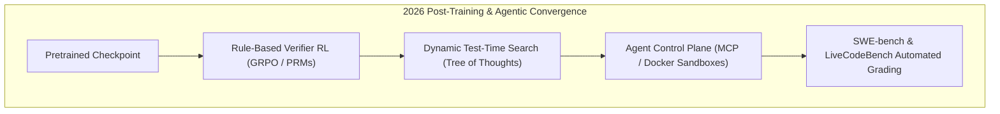

## Why Did the Open-Source LLM Ecosystem Require a Bifurcated Scientist vs Engineer Competency Taxonomy?

Between 2023 and 2024, machine learning education experienced a profound structural divergence. For over a decade, standard data science curricula adhered to a monolithic progression: linear regression, classical statistical learning (Scikit-Learn), convolutional computer vision (ResNet), and recurrent sequence modeling (LSTM). When transformer foundation models emerged as general-purpose cognitive compute engines, this legacy pedagogy collapsed. Software developers were suddenly tasked with deploying multi-gigabyte models into production without understanding GPU memory bottlenecks, while research scientists struggled to integrate dynamic agent tool calling into deterministic backend pipelines.

In May 2024, Maxime Labonne's open-source **LLM Course** reached 30,000 GitHub stars, establishing itself as the community reference curriculum for foundation model engineering. The primary technical contribution of the curriculum was not merely compiling tutorial links, but formalizing an explicit **tripartite competency taxonomy**:
1. **LLM Fundamentals**: The mathematical, linear algebraic, and algorithmic primitives governing autoregressive sequence prediction.
2. **The LLM Scientist Track**: Pretraining datasets, synthetic corpus curation, parameter-efficient fine-tuning (PEFT), preference alignment (DPO, PPO), and architectural merging (MergeKit).
3. **The LLM Engineer Track**: Low-bit quantization (AWQ, GPTQ, GGUF), high-throughput serving architectures (vLLM PagedAttention), context retrieval (RAG), and agentic tool dispatch.



By decoupling model research from application engineering while grounding both in rigorous mathematical fundamentals, this taxonomy provided engineering organizations with a clear roadmap for building production-grade foundation model systems.

---

## Deconstructing the Scientist Track: Alignment, Merging, and Synthetic Data

While traditional machine learning treated model training as standard stochastic gradient descent on fixed human-labeled datasets, the **LLM Scientist** operates within a complex post-training ecosystem. In our related survey on [Practical LLM Course Implementations](/posts/llm-course-trying/), we observed how fine-tuning shifted from blunt parameter updates to delicate preference steering.

### 1. Preference Optimization: From PPO to Direct Preference Optimization (DPO)

Classical Reinforcement Learning from Human Feedback (RLHF) required training a separate reward model, freezing the reference policy, and optimizing the target policy via Proximal Policy Optimization (PPO). This setup was notoriously unstable, requiring four distinct foundation model instances in GPU memory simultaneously.

Rafailov et al. (2023) introduced **Direct Preference Optimization (DPO)**, mathematically proving that the constrained RLHF objective can be solved via an exact closed-form reparameterization:

$$\mathcal{L}_{\text{DPO}}(\pi_\theta; \pi_{\text{ref}}) = -\mathbb{E}_{(x, y_w, y_l) \sim \mathcal{D}} \left[ \log \sigma \left( \beta \log \frac{\pi_\theta(y_w \mid x)}{\pi_{\text{ref}}(y_w \mid x)} - \beta \log \frac{\pi_\theta(y_l \mid x)}{\pi_{\text{ref}}(y_l \mid x)} \right) \right]$$

where $y_w$ represents the preferred completion, $y_l$ represents the dispreferred completion, $\pi_{\text{ref}}$ is the frozen baseline model, and $\beta$ controls KL-penalty regularization. DPO eliminated the separate reward model entirely, allowing scientists to align models directly on preference pairs using standard cross-entropy training pipelines.

### 2. Model Merging without Backpropagation

A breakthrough highlighted in Labonne's curriculum was **evolutionary model merging**. Utilizing toolkits like `MergeKit`, researchers combine the parameter matrices of independently fine-tuned models without executing a single training step:
- **SLERP (Spherical Linear Interpolation)**: Interpolates weights along high-dimensional hyperspherical arcs, preserving vector magnitudes.
- **TIES-Merging (Trimming, Electing Signs, and Merging)**: Prunes redundant parameters, resolves directional sign conflicts among gradients, and averages the retained updates (Yadav et al., 2023).
- **DARE (Drop And REscale)**: Sparsifies parameter delta matrices by up to $90\%$ and rescales remaining weights, combining diverse capabilities (e.g., coding, mathematics, and multilingual fluency) into a single unified checkpoint.



---

## Deconstructing the Engineer Track: Quantization, Serving, and Memory Footprints

For the **LLM Engineer**, the governing constraints are latency, throughput, and GPU High Bandwidth Memory (HBM). Building on principles explored in our review of [NLP Engineering Pathways](/posts/nlp-course-trying/), deploying a model into production requires precise memory accounting.

### The KV-Cache Bottleneck in Autoregressive Generation

In a standard transformer, caching key and value projections across $L$ layers, sequence length $S$, batch size $B$, and hidden dimension $D$ consumes:

$$\text{VRAM}_{\text{KV}} = 2 \times B \times S \times L \times D \times \text{BytesPerElement}$$

For a 70B model with 80 layers and dimension 8,192 running at batch size 32 with 8,192 context length in FP16:
$$\text{VRAM}_{\text{KV}} \approx 2 \times 32 \times 8192 \times 80 \times 8192 \times 2 \approx 687\text{ GB of KV-Cache alone}$$

To serve such workloads, the engineer must deploy:
1. **PagedAttention (vLLM)**: Slicing the continuous KV cache into virtual memory pages (Kwon et al., 2023), eliminating external memory fragmentation and increasing GPU utilization by up to $4\times$.
2. **Post-Training Quantization (PTQ)**: Compressing 16-bit floating-point weights into 4-bit integer representations using Activation-aware Weight Quantization (AWQ) or GPTQ, preserving salient outlier activation channels while reducing memory consumption by $75\%$.

```
Production Inference Trade-off Matrix:
-------------------------------------------------------------------------------------------------
Quantization Scheme   Target Hardware         Perplexity Delta    Latency Impact    Primary Use
-------------------------------------------------------------------------------------------------
Unquantized FP16      Multi-GPU Clusters      0.0 (Baseline)      High memory bound Cloud API Serving
AWQ (4-bit)           Nvidia Tensor Cores     < +0.1 PPL          2x-3x speedup     High-concurrency vLLM
GPTQ (4-bit)          Nvidia GPUs             < +0.15 PPL         1.8x-2.5x speedup Batch inference
GGUF (Q4_K_M)         CPU / Apple Metal       +0.2 PPL            Optimized for CPU Local llama.cpp / edge
EXL2 (4.0 bpw)        Consumer GPUs (RTX 4090)< +0.12 PPL         Ultra-fast decode Single-user workstations
-------------------------------------------------------------------------------------------------
```

---

## How Modern Post-Training and Agentic Curriculum Evolved Across 2026

Between 2024 and 2026, the boundary between the scientist and the engineer dissolved. As highlighted in our architecture guide on [Agentic Application Design Patterns](/posts/agentic-application-design-patterns/), modern models are no longer deployed as isolated text predictors:

### 1. Test-Time Compute and Reinforcement Learning (GRPO)
In 2024, post-training focused heavily on static preference datasets (DPO). In 2026, curriculums center on test-time computation and Group Relative Policy Optimization (GRPO), popularized by models like DeepSeek-R1. Models are trained using reinforcement learning against verifiable rule-based verifiers (compilers, math solvers, unit tests) rather than subjective human preference rubrics.

### 2. Autonomous Agentic Engineering
Modern LLM engineers no longer build simple prompt-chaining scripts. The engineering curriculum now mandates expertise in:
- Model Context Protocol (MCP) server integration.
- Sandboxed Docker execution environments.
- Dynamic tool routing and multi-agent consensus protocols.
- Structured output constraint compilers (e.g., Outlines, Instructor, and XGrammar).



---

## Key Takeaways

- **A bifurcated curriculum is essential for AI engineering**: Decoupling the LLM Scientist (training, alignment, merging) from the LLM Engineer (quantization, serving, orchestration) resolved industry talent mismatch.
- **Preference alignment evolved from PPO to DPO**: Closed-form mathematical reparameterization enabled stable, reward-model-free policy alignment on standard hardware.
- **Model merging provides zero-cost capability fusion**: Algorithms like TIES and DARE successfully combine domain-specialized weights without additional gradient descent.
- **KV cache management dictates serving economics**: PagedAttention and activation-aware 4-bit quantization are mandatory prerequisites for multi-tenant foundation model hosting.
- **2026 demands test-time compute mastery**: Modern curriculums prioritize rule-based reinforcement learning (GRPO), process reward verifiers, and agentic tool-use protocols.

---

## New Questions

1. How do evolutionary merging techniques (e.g., MergeKit) interact with models that possess significantly different internal layer representations despite sharing identical architectures?
2. What are the upper limits of post-training reinforcement learning when reward verifiers encounter deceptive alignment or reward hacking in complex reasoning domains?
3. To what extent does speculative decoding with small draft models alter the hardware memory-bandwidth vs compute ratio in enterprise vLLM clusters?

---

## References

- Labonne, M. (2024). *Large Language Model Course*. GitHub Repository and Educational Documentation. Available at: <https://github.com/mlabonne/llm-course> (accessed 2026-10-18).
- Rafailov, R., Sharma, A., Mitchell, E., Ermon, S., Manning, C. D., & Finn, C. (2023). *Direct Preference Optimization: Your Language Model is Secretly a Reward Model*. Advances in Neural Information Processing Systems (NeurIPS), 36, 53728-53741. Available at: <https://arxiv.org/abs/2305.18290> (accessed 2026-10-18).
- Kwon, W., Li, Z., Zhuang, S., Sheng, Y., Zheng, L., Yu, C. H., Gonzalez, J. E., Zhang, H., & Stoica, I. (2023). *Efficient Memory Management for Large Language Model Serving with PagedAttention*. In Proceedings of the 29th ACM Symposium on Operating Systems Principles (SOSP '23), 611-626. Available at: <https://arxiv.org/abs/2309.06180> (accessed 2026-10-18).
- Yadav, P., Tam, D., Choshen, L., Raffel, C., & Bansal, M. (2023). *TIES-Merging: Resolving Interference When Merging Models*. Advances in Neural Information Processing Systems (NeurIPS), 36, 717-733. Available at: <https://arxiv.org/abs/2306.01708> (accessed 2026-10-18).
- Lin, J., Tang, J., Tang, H., Yang, S., Chen, W. M., Wang, W. C., Xiao, G., Dang, X., Gan, C., & Han, S. (2024). *AWQ: Activation-aware Weight Quantization for LLM Compression and Acceleration*. In Machine Learning and Systems (MLSys). Available at: <https://arxiv.org/abs/2306.00978> (accessed 2026-10-18).
