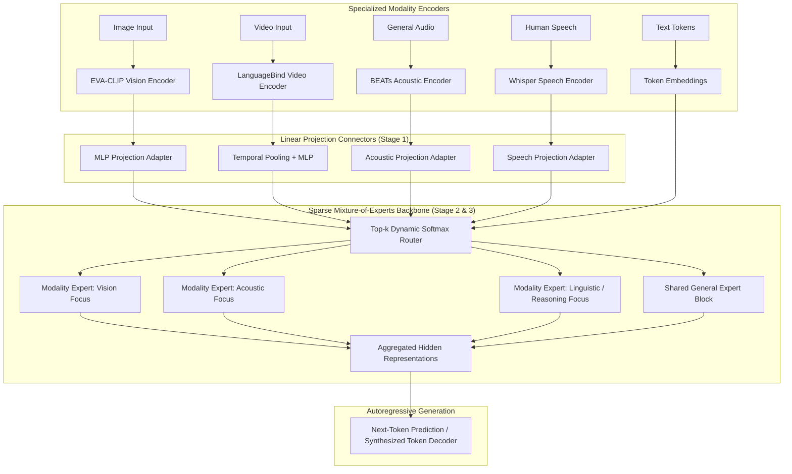
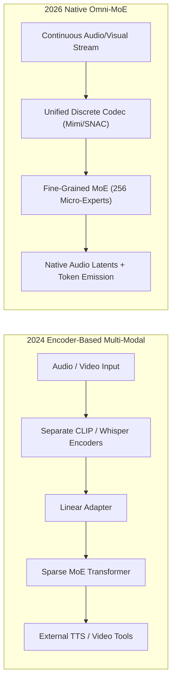

## Why Did Unified Multimodal Models Require Sparse Mixture-of-Experts Rather Than Dense Backbones?

When multimodal foundation models expanded beyond simple image captioning into unified systems capable of handling text, speech, audio, images, and video simultaneously, researchers encountered a fundamental representation barrier: **modality competition and cross-modal negative interference**. In dense transformer backbones, the massive volume and dense semantic supervision of text pretraining corpora inevitably dominate gradient updates. When visual patches and raw acoustic spectrogram tokens are projected directly into a shared dense feed-forward network (FFN), the network's parameters suffer from representational drift, degrading performance on nuanced visual reasoning or subtle acoustic nuances.

In May 2024, researchers from Harbin Institute of Technology (Shenzhen) and Tencent PCG released **Uni-MoE** (Zhu et al., 2024), an open-source multimodal architecture designed to address cross-modal competition directly. By replacing dense feed-forward blocks with **sparse Mixture-of-Experts (MoE)** layers and formalizing a **three-stage training curriculum**, Uni-MoE demonstrated that an open architecture could process five distinct modalities—audio, speech, image, text, and video—without catastrophic cross-modal degradation.



By routing incoming modality tokens dynamically to specialized sub-networks, Uni-MoE preserved domain-specific feature representations while maintaining a unified transformer backbone for cross-modal reasoning.

---

## Dissecting the Three-Stage Progressive Training Strategy

A core insight of the Uni-MoE architecture is that training an omni-modal MoE system from scratch end-to-end causes routing collapse: the gating router prematurely locks into text-dominant experts before multimodal alignment weights stabilize. To prevent this failure mode, Zhu et al. formulated a progressive, three-stage curriculum:

```
Uni-MoE Progressive Training Curriculum:
-------------------------------------------------------------------------------------------------
Phase       Trainable Parameters               Target Objective                   Data Composition
-------------------------------------------------------------------------------------------------
Stage 1     Modality Connectors (MLPs) only   Cross-Modality Latent Alignment    Paired Image/Audio/Video-Text
Stage 2     MoE FFN Layers & Router           Expert Activation & Specialization Modality-Specific Instruction Pairs
Stage 3     LoRA Adapters across Attention/FFN Multi-Task Unified Adaptation      Mixed Complex Multi-Modal Dialogue
-------------------------------------------------------------------------------------------------
```

### Stage 1: Cross-Modality Alignment (Connector Warmup)

In the initial stage, the base language model backbone (such as LLaMA or Mistral) and the upstream modality encoders are frozen. Only the linear projection connectors (two-layer MLPs with GELU activations) are updated:

$$\mathbf{H}_m = \text{MLP}_m\left(\mathbf{Z}_m\right), \quad m \in \{\text{image}, \text{video}, \text{audio}, \text{speech}\}$$

This maps diverse encoder representations $\mathbf{Z}_m$ into the identical latent embedding dimension $d_{\text{model}}$ of the transformer backbone, preventing violent gradient shocks to downstream attention layers.

### Stage 2: Expert Activation and Specialization

In Stage 2, the dense feed-forward networks (FFNs) of the transformer are converted into MoE blocks by duplicating weights into $N$ experts. To prevent experts from remaining identical copies, the authors feed modality-specific datasets sequentially, forcing specific expert subsets to specialize in visual, acoustic, or temporal video dynamics.

The gating mechanism computes routing probabilities via top-$k$ softmax:

$$p_i(x) = \text{Softmax}\left(\text{TopK}\left(x \cdot W_g, k\right)\right)_i$$

$$\mathbf{y} = \sum_{i \in \text{TopK}} p_i(x) \cdot \text{Expert}_i(x)$$

To guarantee that all experts receive balanced gradient updates and prevent dead experts, an auxiliary load-balancing loss $\mathcal{L}_{\text{aux}}$ is minimized:

$$\mathcal{L}_{\text{aux}} = \alpha \cdot N \sum_{i=1}^N f_i \cdot P_i$$

where $f_i$ is the fraction of tokens routed to expert $i$, and $P_i$ is the average routing probability assigned to expert $i$ across the batch.

### Stage 3: Low-Rank Adaptation (LoRA) for Mixed Multimodal Instruction

In the final stage, full parameter tuning becomes prohibitively expensive across multi-modal combinations. Uni-MoE attaches Low-Rank Adaptation (LoRA) matrices to the query, key, value, and expert FFN weights. Training on high-quality multi-turn conversational datasets enables the model to resolve cross-modal queries (e.g., explaining a visual video clip while responding to a user's spoken audio question).

---

## Architectural Comparison: Uni-MoE vs OpenAI GPT-4o

When Uni-MoE was published in late May 2024, developer discussions frequently asked whether its encoder-connector-MoE design matched OpenAI's proprietary **GPT-4o**. As analyzed in our comparative source audit of [Google I/O 2024 vs GPT-4o](/posts/googleio-chatgpt4o/) and our analysis of [GPT-4o Release Dynamics](/posts/gpt4o-release/), the architectural approaches diverge in several fundamental aspects:

| Architectural Dimension | Uni-MoE (Academic Open-Source) | OpenAI GPT-4o (Frontier Proprietary) |
| :--- | :--- | :--- |
| **Modality Ingestion** | Cascaded Encoders (EVA-CLIP, BEATs, Whisper) | Native Omni-Modal Discrete Neural Codec |
| **Backbone Architecture** | Sparse Mixture-of-Experts (MoE) with top-$k$ | Dense / Fine-Grained MoE with Native Tokens |
| **Speech Generation** | Text tokens to external TTS synthesizer | Direct Autoregressive Audio Waveform Latents |
| **Turn-Taking Latency** | Standard API batch latency ($800\text{ms} - 1,500\text{ms}$) | Human-conversational latency ($\approx 232\text{ms}$) |
| **Compute Accessibility** | Trainable on academic GPU clusters (LoRA) | Supercluster training across tens of thousands of H100s |

While Uni-MoE relies on pretrained frozen encoders and linear adapters to bridge modalities into an MoE backbone, GPT-4o is an end-to-end omni-modal transformer where audio, video, and text are tokenized natively from the input layer to the output head. Nonetheless, Uni-MoE established how academic teams can construct high-performing multi-modal assistants without requiring multi-billion-dollar pretraining budgets.

---

## How Unified Omni-Modal Sparse Architectures Evolved Across 2026

Between 2024 and 2026, the principles introduced by Uni-MoE matured into industry-standard open architectures. In our study on [Vision-Language Model Trajectories](/posts/vision-language-model/), multimodal scaling moved through three major technical transitions:

### 1. Fine-Grained Sparse Routing (DeepSeek-V3 / Qwen2-VL)
Early 2024 MoE designs relied on coarse routing (e.g., 8 total experts, activating top-2). Modern 2026 architectures utilize fine-grained routing with dozens or hundreds of micro-experts (e.g., 64 to 256 experts, activating top-8), coupled with dedicated shared experts that process universal linguistic grammar. This fine granularity completely resolves the modality competition problem observed in early models.

### 2. End-to-End Multimodal Codec Integration
Open-source models shifted away from external encoders (CLIP and Whisper). Modern architectures tokenize continuous audio and video directly into discrete acoustic/visual tokens (using neural audio codecs like Mimi or SNAC), training a single unified transformer backbone to emit both text and audio tokens simultaneously.



### 3. Test-Time Multimodal Reasoning
In 2026, omni-modal systems incorporate test-time compute. When presented with complex visual geometry or overlapping acoustic audio tracks, models generate intermediate reasoning traces (visual bounding box coordinates, acoustic event timestamps, step-by-step logic) before committing to a final generated answer.

---

## Key Takeaways

- **Sparse MoE prevents modality competition**: Allocating dedicated expert networks for vision, audio, speech, and text prevents gradient dominance by text corpora.
- **Three-stage progressive training avoids routing collapse**: Warming up linear connectors first, activating MoE experts second, and applying LoRA third ensures training stability.
- **Auxiliary load-balancing losses are mandatory**: Without strict load-balancing penalties, routers default to a small subset of general linguistic experts.
- **Uni-MoE established an academic roadmap for omni-models**: Splicing pretrained encoders into an MoE backbone matches frontier performance at a fraction of pretraining cost.
- **2026 architectures prioritize fine-grained routing and native codecs**: Coarse 8-expert models evolved into 256-micro-expert networks capable of streaming native audio and vision tokens.

---

## New Questions

1. How do fine-grained micro-expert routing policies handle sudden cross-modal transitions (e.g., shifting from silent text reading to intense background acoustic noise) without cache thrashing?
2. What are the memory bandwidth penalties of routing multimodal tokens with high visual token counts through sparse MoE layers compared to dense architectures?
3. To what extent do synthetic multimodal instruction datasets induce hallucination in acoustic prosody and emotional inference during real-time speech interaction?

---

## References

- Zhu, Y., Min, S., Deng, C., Shen, C., & Xu, Z. (2024). *Uni-MoE: Scaling Unified Multimodal LLMs with Mixture of Experts*. arXiv preprint arXiv:2405.11273. Available at: <https://arxiv.org/abs/2405.11273> (accessed 2026-10-18).
- Shazeer, N., Mirhoseini, A., Maziarz, K., Davis, A., Le, Q., Hinton, G., & Dean, J. (2017). *Outrageously Large Neural Networks: The Sparsely-Gated Mixture-of-Experts Layer*. In International Conference on Learning Representations (ICLR). Available at: <https://arxiv.org/abs/1701.06538> (accessed 2026-10-18).
- OpenAI. (2024). *GPT-4o System Card*. OpenAI Technical Publication. Available at: <https://openai.com/index/gpt-4o-system-card/> (accessed 2026-10-18).
- Liu, H., Li, C., Wu, Q., & Lee, Y. J. (2023). *Visual Instruction Tuning*. Advances in Neural Information Processing Systems (NeurIPS), 36, 34892-34916. Available at: <https://arxiv.org/abs/2310.03744> (accessed 2026-10-18).
- Chen, Y., Shen, C., Deng, C., & Zhu, Y. (2024). *Uni-MoE v2: Scaling Unified Multimodal LLMs with Mixture of Experts*. GitHub Repository. Available at: <https://github.com/HITsz-TMG/UMOE-Scaling-Unified-Multimodal-LLMs> (accessed 2026-10-18).
