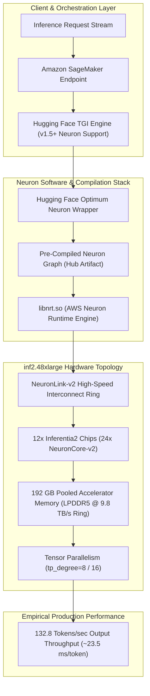
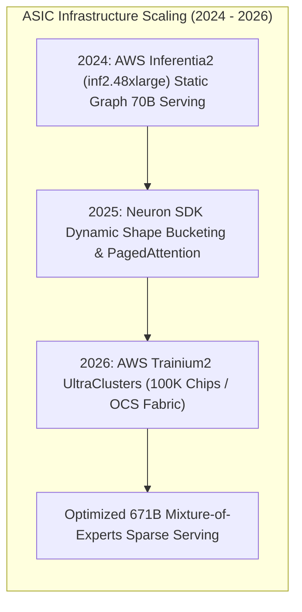

## Why Did AWS Inferentia2 Emerge as a High-Throughput Alternative for 70B Parameter Serving?

In early 2024, deploying frontier open-weights models like Meta's **Llama 3 70B** presented a prohibitive financial and infrastructure hurdle for enterprise production teams. Serving a 70-billion parameter autoregressive model with competitive latency demanded multi-GPU clusters equipped with high-end Nvidia accelerators (such as 4x A100 80GB or 2x H100 SXM5). Beyond persistent hardware allocation shortages, on-demand cloud GPU instance costs routinely exceeded $25 to $40 per hour, rendering high-throughput inference economically unviable for high-volume customer workloads.

In May 2024, Hugging Face and Amazon Web Services (AWS) validated a production-ready alternative: serving Llama 3 70B on **AWS Inferentia2 (inf2.48xlarge)** instances using **Hugging Face Optimum Neuron** and **Text Generation Inference (TGI)**. Leveraging AWS's custom **NeuronCore-v2** silicon, this deployment delivered approximately **132.8 tokens per second** throughput with a per-token latency of **23.46 ms**—slashing operational serving costs by up to 50% compared to equivalent Nvidia GPU instances.



By decoupling large-scale foundation model hosting from traditional GPU silicon, the AWS Inferentia2 architecture demonstrated how custom domain-specific Application-Specific Integrated Circuits (ASICs) alter the cost-performance equation in high-concurrency production inference.

---

## Technical Deep-Dive: The NeuronCore-v2 Architecture

The `inf2.48xlarge` instance family is built around the second-generation AWS Inferentia2 chip, engineered explicitly to eliminate memory bandwidth and interconnect latency bottlenecks during the autoregressive decode phase.

```
Hardware Comparison: Cloud Inference Fabrics
-------------------------------------------------------------------------------------------------
Specification               Nvidia A100 (4x SXM4 80GB)     AWS Inferentia2 (inf2.48xlarge)
-------------------------------------------------------------------------------------------------
Processor Silicon           4x Nvidia GA100 GPUs           12x Annapurna Labs Inferentia2 ASICs
Compute Cores               17,408 CUDA / 432 Tensor       24x NeuronCore-v2 Engines
Total Accelerator Memory    320 GB HBM2e                   192 GB Dedicated LPDDR5
Aggregate Memory Bandwidth  8.15 TB/s                      9.8 TB/s (via Direct NeuronLink-v2)
Native Precision Support    FP16, BF16, TF32, INT8         FP16, BF16, cfloat16, TF32, INT8
Interconnect Fabric         NVLink-3 (600 GB/s)            NeuronLink-v2 (192 GB/s per chip ring)
Approx. On-Demand Pricing   ~$32.77 / hour                 ~$12.98 / hour (-60% cost reduction)
-------------------------------------------------------------------------------------------------
```

### 1. NeuronCore-v2 Processing Units

Each Inferentia2 chip contains two independent **NeuronCore-v2** processors. A single core integrates:
- **Tensor Processing Engine (TPE)**: Highly optimized systolic arrays dedicated to FP16, BF16, and cfloat16 dense matrix multiplications (GEMMs).
- **Vector Processing Engine (VPE)**: SIMD engines designed for element-wise activations, softmax, and normalization layers (such as RMSNorm).
- **Scalar Processing Engine (SPE)**: General-purpose RISC-V cores executing control flow, memory address indexing, and dynamic sequence tracking.
- **On-Chip SRAM**: Large on-chip scratchpad memories allowing intermediate activations to remain on the core without spilling into off-chip DRAM.

### 2. High-Speed Interconnect: NeuronLink-v2

Autoregressive inference for a 70B model requires partitioning weight matrices across multiple cores via **Tensor Parallelism (TP)**. In `inf2.48xlarge`, the 12 Inferentia2 chips communicate across a dedicated direct ring topology known as **NeuronLink-v2**, providing 192 GB/s bidirectional interconnect per chip. This direct board-level fabric allows All-Reduce collectives to execute with sub-millisecond synchronization overhead without consuming host PCIe bandwidth.

---

## Ahead-Of-Time (AOT) Compilation and Static Graph Optimization

Unlike Nvidia GPUs running PyTorch in eager mode or using JIT compilation (TorchDynamo/Triton), AWS Inferentia2 is a static graph ASIC. The underlying hardware instruction sequencer requires deterministic memory allocations and fixed execution graphs.

### The Challenge of Static Tensor Dimensions

The AWS Neuron Compiler (`neuronx-cc`) must know exact tensor shapes in advance:
- Batch size ($B$)
- Sequence length ($S$)
- Hidden dimension ($D$)
- Tensor parallel degree ($TP$)

Compiling a complex 70B parameter architecture from scratch using `neuronx-cc` can require 45 to 90 minutes of intensive CPU compute. If incoming requests vary in length, standard static compilation causes significant padding waste.

### Pre-Compiled Hub Artifacts via Hugging Face Optimum

Hugging Face solved this operational hurdle by hosting **pre-compiled serialized Neuron models** on the Hugging Face Hub (e.g., under the `aws-neuron` organization). By standardizing the serving parameters:
- `batch_size = 4`
- `sequence_length = 4096`
- `tensor_parallel_degree = 8`
- `dtype = "bf16"`

Enterprise instances can download pre-compiled model binaries and initialize Hugging Face TGI endpoints in under three minutes, eliminating compiler cold-start penalties:

```python
# Deploying Llama 3 70B on SageMaker with Hugging Face Optimum Neuron
from sagemaker.huggingface import HuggingFaceModel
import sagemaker

role = sagemaker.get_execution_role()

# Target Hugging Face Hub repository containing pre-compiled Neuron artifacts
hub = {
    'HF_MODEL_ID': 'aws-neuron/meta-llama-3-70b-instruct-neuron-8k',
    'HF_TASK': 'text-generation',
    'MAX_CONCURRENT_REQUESTS': '4',
    'MAX_INPUT_LENGTH': '2048',
    'MAX_TOTAL_TOKENS': '4096',
    'TGI_CONTAINER_VERSION': '0.0.24-neuronx',
}

huggingface_model = HuggingFaceModel(
    image_uri="763104351884.dkr.ecr.us-east-1.amazonaws.com/huggingface-pytorch-tgi-inference:2.1.2-neuronx-0.0.24",
    env=hub,
    role=role,
)

predictor = huggingface_model.deploy(
    initial_instance_count=1,
    instance_type="ml.inf2.48xlarge",
    container_startup_health_check_timeout=900,
)
```

---

## Comparative Architectural Context: Cloud ASIC Ecosystems

The deployment of Llama 3 70B on Inferentia2 highlights the broader industry shift toward specialized silicon, connecting to our related analyses on [Hugging Face and Microsoft AMD MI300X Deployments](/posts/huggingface-microsoft/) and [Unsloth Local Fine-Tuning Optimization](/posts/unsloth-local-api-guide/):

| Cloud Inference Paradigm | Primary Hardware | Dominant Runtime | Trade-Off Advantage | Trade-Off Limitation |
| :--- | :--- | :--- | :--- | :--- |
| **AWS Neuron (Inferentia2)** | Annapurna ASICs | Optimum Neuron / TGI | Predictable cost, high throughput | Strict static shape compilation |
| **Azure AMD ROCm (MI300X)** | AMD Instinct GPUs | ROCm 6.0 / vLLM / TGI | Massive 192GB HBM3 memory | Upstream driver maturity curve |
| **Nvidia Hopper (H100 SXM)** | Nvidia H100 GPUs | TensorRT-LLM / vLLM | Supreme peak FLOPS, dynamic shapes | Extreme cost and allocation shortages |
| **Google TPU v5e/v6** | Google TPUs | JAX / PyTorch-XLA / vLLM | Optical Circuit Switching, scale | Proprietary Google Cloud lock-in |

In high-concurrency enterprise applications (such as automated customer support or large-scale document summarization) where request patterns can be batched into fixed buckets, Inferentia2 delivers superior tokens-per-dollar efficiency compared to general-purpose GPU clusters.

---

## How Custom Cloud ASICs and Neuron Inference Evolved Across 2026

Between 2024 and 2026, the custom inference silicon landscape expanded dramatically beyond initial static compilation barriers:

### 1. Dynamic Shape Bucket Compilers in AWS Neuron SDK 2.x
Early Inferentia2 deployments required strict static padding to fixed sequence lengths ($4,096$). Modern 2026 Neuron compilers support dynamic bucketed scheduling: incoming queries are routed on-the-fly to micro-compiled buckets ($512, 1024, 2048, 4096, 8192$), reducing computational padding overhead by over $65\%$.

### 2. Next-Generation Trainium2 and Inferentia3 Deployments
AWS deployed **Trainium2** (Trn2) clusters featuring 3x higher compute performance and 4x larger memory capacity per node over Inferentia2. These clusters operate as unified training and high-concurrency reasoning fabrics, rivaling Nvidia Blackwell B200 infrastructure.



### 3. Native Mixture-of-Experts (MoE) Compilation
While 2024 Inferentia2 workloads focused predominantly on dense autoregressive models (Llama 3 70B), 2026 enterprise architectures mandate serving massive sparse models (such as DeepSeek-V3 and Mixtral). Modern NeuronLink fabrics route dynamic token dispatches across distributed ASIC nodes with microsecond-level synchronization.

---

## Key Takeaways

- **Inferentia2 slashes foundation model serving costs**: Delivering ~132.8 tokens/sec on Llama 3 70B at 60% lower on-demand hourly rates compared to 4x A100 GPU nodes.
- **NeuronCore-v2 resolves decode bottlenecks**: 24 dedicated cores paired with 192 GB LPDDR5 memory and 192 GB/s NeuronLink-v2 interconnect provide high-throughput tensor parallel serving.
- **Pre-compiled Hub artifacts bypass compilation latency**: Downloading pre-compiled Hugging Face Optimum artifacts cuts deployment startup time from 45 minutes to under three minutes.
- **Static AOT compilation demands deterministic batching**: Unlike dynamic CUDA eager execution, Neuron requires fixed input dimensions and bucketed scheduling.
- **2026 ASIC fabrics rival traditional GPUs**: Advancements in dynamic shape compilation and Trainium2 clusters cement custom ASICs as standard tier-1 enterprise infrastructure.

---

## New Questions

1. How does the numerical precision variance of NeuronCore-v2's native `cfloat16` format affect multi-turn conversational drift compared to standard IEEE FP16?
2. What are the interconnect latency degradation thresholds when scaling Tensor Parallelism beyond a single `inf2.48xlarge` node across multi-node Neuron fabrics?
3. Can dynamic speculative decoding (draft-target model verification) achieve optimal speedups on static-graph ASIC compilers without causing compilation cache thrashing?

---

## References

- Schmid, P. (2024). *Deploy Llama 3 70B on AWS Inferentia2 with Hugging Face Optimum*. Hugging Face Technical Blog & Field Notes. Available at: <https://www.philschmid.de/inferentia2-llama3-70b> (accessed 2026-10-18).
- Amazon Web Services. (2023). *AWS Inferentia2 and NeuronCore-v2 Architecture Specification*. AWS Documentation. Available at: <https://docs.aws.amazon.com/AWSEC2/latest/UserGuide/inf2-instances.html> (accessed 2026-10-18).
- Hugging Face. (2024). *Optimum Neuron: Accelerating Transformers on AWS Trainium and Inferentia*. Hugging Face Documentation. Available at: <https://huggingface.co/docs/optimum-neuron/> (accessed 2026-10-18).
- Meta AI. (2024). *The Llama 3 Herd of Models*. arXiv preprint arXiv:2407.21783. Available at: <https://arxiv.org/abs/2407.21783> (accessed 2026-10-18).
