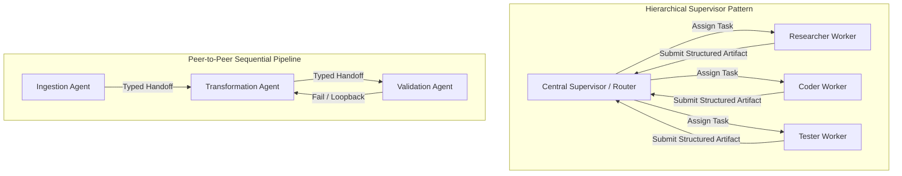
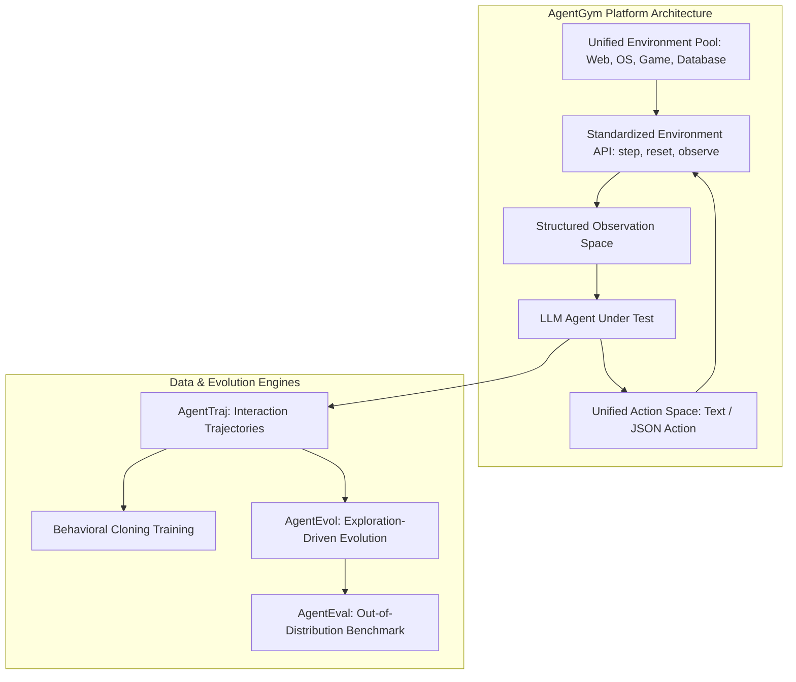

As artificial intelligence systems graduated from isolated conversational chatbots toward complex workflow automation, single-agent architectures encountered fundamental scaling barriers. A single LLM prompt attempting to simultaneously manage deep research, web scraping, code synthesis, security validation, and editorial publication collapses under cognitive context bloat. The model suffers from instruction drift, loses track of intermediate goals, and burns inference tokens on redundant replanning.

To solve this, the industry turned to **Multi-Agent Systems (MAS)**. By decomposing monolithic objectives into collaborative networks of specialized subagents—each equipped with dedicated persona boundaries, scoped toolsets, and private working memories—multi-agent architectures distribute cognitive load across modular workers.

However, moving from single-agent prompts to multi-agent networks introduces severe distributed systems vulnerabilities: role drift, blaming loops, deadlock cascades, and uncontrolled token consumption.

This source audit examines multi-agent orchestration frameworks (comparing static role-based runners like CrewAI and AutoGen with deterministic state machines), analyzes the **AgentGym** benchmark for standardizing agent training across digital environments, evaluates behavioral cloning over trajectory datasets (AgentTraj), and defines production SLA circuit breakers required to operate autonomous multi-agent loops reliably.


## How Do Multi-Agent Systems Prevent Role Drift and Coordination Deadlocks?

The fundamental challenge in multi-agent engineering lies in **coordination entropy**. When multiple non-deterministic language agents communicate in natural language, their interactions degrade rapidly without rigid protocol enforcement.

Researchers observe three recurring failure modes in poorly governed multi-agent networks:
1. **The Blaming Loop (Deadlock)**: Agent A requests clarification from Agent B; Agent B asserts that Agent A must provide tool inputs first; both agents spin in conversational circles until token context limits are exhausted.
2. **Role Drift**: An agent assigned as a strict "Security Reviewer" begins rewriting functional application code when exposed to the full conversation history, abandoning its adversarial auditing mandate.
3. **Cascading Hallucination**: A research agent emits an unsubstantiated premise; downstream drafting and editing agents accept the hallucination as verified ground truth, amplifying errors throughout subsequent execution turns.

```
Unconstrained Multi-Agent Chatter (High Entropy)
[Researcher Agent] ◀──(Natural Language Debate)──▶ [Reviewer Agent]
        │                                                 │
        ▼                                                 ▼
[Writer Agent]     ◀──(Role Drift & Blaming Loop)──▶  [Auditor Agent]
(No deterministic state transitions, unbounded token consumption, zero SLA boundaries)

Governed Multi-Agent StateGraph Architecture
┌────────────────────────────────────────────────────────────────────────┐
│ Supervisor Node: Routes tasks based on typed Pydantic state schemas    │
├────────────────────────────────────────────────────────────────────────┤
│ Scoped Worker Sandboxes: Isolated tools, private memory, zero bleed    │
├────────────────────────────────────────────────────────────────────────┤
│ Circuit Breakers: MAX_LOOPS, MAX_TOKENS, & Human-in-the-Loop Barriers │
├────────────────────────────────────────────────────────────────────────┤
│ Checkpointed State: Relational database persistence per transition turn│
└────────────────────────────────────────────────────────────────────────┘
```

Preventing coordination entropy requires shifting from open-ended natural language chatter to **governed, schema-enforced state transitions**. As established in our framework analysis on [LangChain vs LlamaIndex: Architectural Patterns for RAG and Autonomous Agents](/posts/langchain-llama/), production multi-agent systems require explicit graph definitions where valid sender-receiver edges, termination guards, and data handoff contracts are statically compiled.

## Orchestration Topologies: Hierarchical Supervisor vs Network Swarms

Multi-agent coordination generally follows one of three structural topologies:



### 1. The Hierarchical Supervisor Pattern
In the hierarchical supervisor pattern (prominent in enterprise frameworks and advanced LangGraph workflows), individual subagents never communicate directly with one another. All inter-agent traffic routes through a centralized Supervisor node:
- The Supervisor ingests the overarching user objective and decomposes it into discrete sub-tasks.
- Workers execute in sandboxed environments with zero access to peer conversation histories. They receive only the specific prompt and data payload necessary to complete their task.
- Workers return structured output artifacts (e.g., Pydantic schemas) back to the Supervisor.
- The Supervisor reviews the artifact against acceptance criteria, routing to subsequent workers or triggering bounded retries.

This pattern prevents role drift and context contamination because workers never absorb conversational bias from other agents.

### 2. Peer-to-Peer Sequential Pipelines (CrewAI Model)
In lightweight frameworks like CrewAI, agents operate in sequential or hierarchical pipelines mimicking human departmental teams (e.g., Researcher $\to$ Writer $\to$ Editor). Each agent is assigned a fixed role, backstory, and target goal:

```python
from crewai import Agent, Task, Crew, Process

# Role definitions with strict persona boundaries
researcher = Agent(
    role="Systems Infrastructure Auditor",
    goal="Identify memory leak vulnerabilities in compiled C++ daemon logs",
    backstory="You are an uncompromising systems reliability engineer.",
    verbose=True,
    allow_delegation=False, # Prevents unconstrained delegation loops
)

analyst = Agent(
    role="Security Policy Officer",
    goal="Verify memory fixes against kernel privilege compliance standards",
    backstory="You strictly evaluate patches against POSIX safety guidelines.",
    verbose=True,
    allow_delegation=False,
)

# Explicit sequential handoffs
audit_task = Task(
    description="Audit runtime logs for memory leaks and trace faulting PIDs",
    expected_output="A structured list of memory addresses and leaky modules",
    agent=researcher,
)

policy_task = Task(
    description="Evaluate proposed fixes against security constraints",
    expected_output="A signed compliance approval or rejection report",
    agent=analyst,
    context=[audit_task], # Explicit contextual dependency
)

crew = Crew(
    agents=[researcher, analyst],
    tasks=[audit_task, policy_task],
    process=Process.sequential,
)
```

While CrewAI provides rapid prototyping ergonomics, enterprise production harnesses require pairing these high-level roles with formal runtime constraints.

## The AgentGym Benchmark: Standardizing Environment Interaction

Historically, evaluating multi-agent systems suffered from benchmark fragmentation. One team evaluated agents on web navigation (WebArena), another on operating system bash commands (OSWorld), and another on household game planning (ALFWorld).

Introduced by Zhiheng Xi et al. in 2024, **AgentGym** established the first unified framework and benchmark suite designed to evaluate and evolve language agents across diverse, concurrent digital environments.



AgentGym decomposes agent engineering into four standardized pillars:
1. **Standardized Environment Interface**: Provides a uniform HTTP/RPC interface across 14 diverse environment suites spanning web browsing, bash terminal operation, multi-turn dialogue, and software debugging.
2. **AgentEval Benchmark**: An evaluation dataset containing thousands of challenging tasks requiring multi-step planning, tool calling, and long-horizon environmental feedback.
3. **AgentTraj & AgentTraj-L**: Massive trajectory corpora capturing expert interaction traces, providing ground-truth data for behavioral cloning and supervised fine-tuning.
4. **AgentEvol**: An algorithmic self-evolution method that allows agents to explore unlabelled environments autonomously, formulating internal self-reflections to improve task success rates beyond static training distributions.

Empirical results from AgentGym demonstrate that agents fine-tuned on diverse multi-environment trajectories generalize far better to novel software interfaces than models fine-tuned on single-domain task data.

For practical terminal interface design and agent interaction standards, review our source audit on [CLI-Anything Agent-Native Interfaces](/posts/cli-anything-agent-native-interfaces/).

## Production SLA Discipline: Circuit Breakers and Guardrails

Deploying multi-agent loops to production without strict operational service-level agreements (SLAs) guarantees catastrophic cost overruns and system hangs. When an agent enters an infinite retry loop or hallucinates cyclical tool calls, it can consume hundreds of dollars in API tokens in minutes.

Production multi-agent harnesses must enforce strict **SLA Guardrails**:

```python
from dataclasses import dataclass
from typing import Optional

@dataclass(frozen=True)
class AgentExecutionSLA:
    max_loops: int = 15              # Hard ceiling on iterative tool cycles
    max_tokens: int = 50_000         # Cumulative token ceiling per run
    max_cost_dollars: float = 2.50   # Budget boundary
    max_latency_seconds: float = 60  # Wall-clock timeout
    max_tool_calls_per_turn: int = 3 # Anti-flooding guard

class SLACircuitBreaker:
    def __init__(self, sla: AgentExecutionSLA):
        self.sla = sla
        self.current_loops = 0
        self.consumed_tokens = 0
        self.elapsed_time = 0.0

    def record_turn(self, tokens_used: int, elapsed_seconds: float) -> None:
        self.current_loops += 1
        self.consumed_tokens += tokens_used
        self.elapsed_time += elapsed_seconds
        
        # Enforce hard boundaries
        if self.current_loops > self.sla.max_loops:
            raise CircuitBreakerException("MAX_LOOPS SLA exceeded. Aborting agent run.")
        if self.consumed_tokens > self.sla.max_tokens:
            raise CircuitBreakerException("MAX_TOKENS SLA breached. Halting context.")
        if self.elapsed_time > self.sla.max_latency_seconds:
            raise CircuitBreakerException("TIMEOUT SLA exceeded. Rolling back state.")
```

Enforcing these boundaries ensures that failed agent trajectories terminate gracefully, persisting failure telemetry to audit logs rather than consuming unbounded enterprise resources.

This operational discipline directly reflects the layered capabilities analyzed in [The LLM Systems Hierarchy: From Prompt Engineering to Autonomous Agents](/posts/llm-course-trying/).

## Multi-Agent Architecture Capability Matrix

| System Dimension | Single Autonomous Agent | Peer-to-Peer Swarm (CrewAI) | Hierarchical Graph (LangGraph) | Trajectory-Tuned (AgentGym) |
| :--- | :--- | :--- | :--- | :--- |
| **Coordination Model** | Self-reflection loop | Sequential role-playing | State machine with explicit edges | Environment policy execution |
| **Role Drift Resistance** | Poor (context saturation) | Moderate (persona backstories) | High (isolated worker sandboxes) | Highest (trajectory-trained policy) |
| **State Persistence** | Memory buffer | Shared crew context | ACID database checkpointer | Unified environment state |
| **Failure Recovery** | Naive retry | Manual retry loops | Deterministic fallback nodes | Environmental self-correction |
| **Token Cost / Task** | Low–Medium | High (conversation duplication) | Controlled (scoped payloads) | Optimized via targeted weights |
| **SLA Boundary Control** | Script-level loops | Framework timeout flags | Fine-grained circuit breakers | Native environment termination |

## How Multi-Agent Coordination Evolved Across 2026

Between 2024 and 2026, multi-agent engineering transitioned from experimental prompt scripts into formal distributed systems architecture:

```
2023-2024: Conversational Chatters     2025: StateGraph Runtimes        2026: Agent-to-Agent (A2A) Protocols
┌─────────────────────────────────┐    ┌───────────────────────────┐    ┌───────────────────────────────────┐
│ CrewAI / AutoGen v0.1           │───▶│ LangGraph & Semantic Kernel│───▶│ Linux Foundation AAIF A2A Protocol│
│ Natural Language Role-Play      │    │ Graph Checkpointing       │    │ Ephemeral Subagent Worker Pools   │
│ Unbounded Context Duplication   │    │ Deterministic Routing     │    │ Cryptographic Agent Identity (DID)│
└─────────────────────────────────┘    └───────────────────────────┘    └───────────────────────────────────┘
```

1. **Standardized Agent-to-Agent (A2A) Protocols**: Uncontrolled natural language JSON formatting between agents was superseded by the Linux Foundation's Agent-to-Agent (A2A) standard. Agents negotiate capabilities, exchange typed schema payloads, and hand off operational authority using cryptographically signed decentralized identifiers (DIDs), preventing impersonation and data exfiltration across organizational boundaries.
2. **Ephemeral Micro-Agent Delegation Pools**: Rather than maintaining long-lived, monolithic agent personas that accumulate memory leaks and conversational bias, modern systems instantiate ephemeral micro-agents on the fly. An orchestrator spawns a fresh subagent with a 500-token prompt, delegates a single unit of work (e.g., verifying a git diff or extracting a table), harvests the output, and immediately terminates the worker instance.
3. **Automated Trajectory Alignment with GRPO**: Following the release of AgentGym and DeepSeek-R1, multi-agent teams are no longer aligned solely via manual prompt engineering. Models undergo Group Relative Policy Optimization (GRPO) on multi-agent execution traces, learning optimal handoff timing, concise peer communication, and verification strategies directly through reinforcement learning rewards.

## Key Takeaways

- **Cognitive Decomposition**: Multi-agent systems prevent the context bloat and instruction drift inherent in single-agent prompts by distributing responsibilities across specialized, sandboxed subagents.
- **Coordination Governance**: Open natural language debate between agents inevitably leads to blaming loops and deadlocks; production architectures mandate hierarchical supervisors and deterministic state machines.
- **Standardized Environments via AgentGym**: Rigorous multi-agent evaluation requires unified action and observation spaces across heterogeneous web, OS, and software tools.
- **Mandatory Production SLAs**: Deploying autonomous multi-agent loops requires hard circuit breakers (`MAX_LOOPS`, `MAX_TOKENS`, `MAX_COST`) to prevent runaway API spend and system hangs.

## New Questions

- When multiple subagents collaborate in an asynchronous graph, what distributed consensus algorithms (similar to Raft or Paxos) are required to maintain state consistency across concurrent database writes?
- How can multi-agent systems detect and mitigate adversarial collusion or subtle reward-hacking when subagents verify and grade each other's work?
- As foundation models internalize long-horizon reasoning natively, at what threshold does the communication overhead of multi-agent networks exceed the benefits of single-model planning?

## References

1. Xi, Z., Chen, W., Guo, X., He, W., Ding, Y., Liao, B., et al. (2024). *AgentGym: Evolving Large Language Model-based Agents across Diverse Environments*. arXiv preprint arXiv:2406.04151. https://arxiv.org/abs/2406.04151 (accessed 2026-10-18).
2. Wu, Q., Bansal, G., Zhang, J., Wu, Y., Li, B., Zhu, E., Jiang, L., Zhang, X., & Wang, C. (2023). *AutoGen: Enabling Next-Gen LLM Applications via Multi-Agent Conversation*. arXiv preprint arXiv:2308.08155. https://arxiv.org/abs/2308.08155 (accessed 2026-10-18).
3. Chase, H., & LangChain Engineering. (2024–2026). *LangGraph: Multi-Agent Workflows and StateGraph Orchestration*. LangChain Project Documentation. https://langchain-ai.github.io/langgraph/ (accessed 2026-10-18).
4. Linux Foundation AAIF. (2025–2026). *Agent-to-Agent (A2A) Protocol Specification for Horizontal Inter-Agent Messaging*. Linux Foundation Standards. https://www.linuxfoundation.org/ (accessed 2026-10-18).
