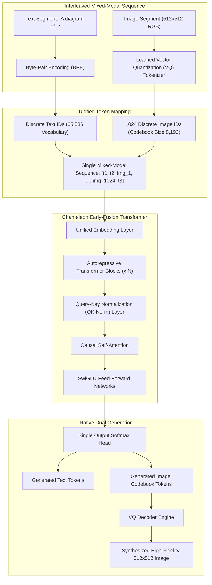
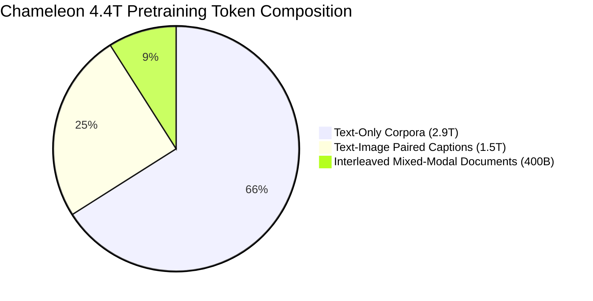
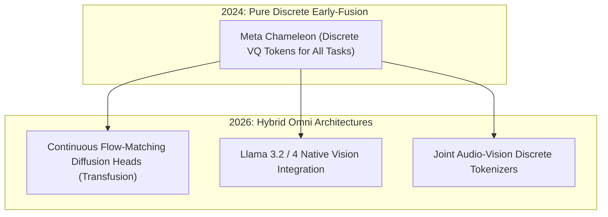

## Why Did Early-Fusion Tokenization in Chameleon Break the Dominance of Separate Encoders?

Prior to mid-2024, virtually all Vision-Language Models (VLMs)—including LLaVA, Flamingo, BLIP-2, and commercial systems—adhered to a **late-fusion cross-encoder paradigm**. These architectures paired a frozen continuous visual encoder (such as CLIP or SigLIP) with a linear projection connector that fed continuous visual prefix vectors into an autoregressive text large language model. While effective for basic image question answering, this asymmetric approach suffered from structural limitations:
1. **Unidirectional Modality Flow**: Models could consume visual information to emit text, but could not synthesize or edit images natively within the same forward pass.
2. **Information Bottlenecks**: Compressing high-resolution visual scenes through fixed patch projections discarded spatial granularities essential for interleaved document reasoning.
3. **Representational Asymmetry**: The underlying transformer never learned a unified metric space where text tokens and image elements were treated as first-class peers.

In May 2024, Meta AI introduced **Chameleon**, a family of **mixed-modal early-fusion foundation models** (released in 7B and 34B parameter scales). Chameleon abolished the separate vision encoder and linear adapter entirely. Instead, Chameleon unified text and images into a **single discrete token vocabulary**, training a single decoder-only transformer from scratch to consume and emit arbitrary interleaved sequences of text and visual tokens.



By formulating visual comprehension and visual generation as identical next-token prediction problems, Chameleon established a symmetric foundation for omni-modal foundation models.

---

## Architectural Deep-Dive: Discrete Tokenization and QK-Normalization

Unifying continuous visual pixel manifolds with discrete linguistic tokens in an early-fusion transformer introduces severe training instability. The Chameleon team solved these challenges through two foundational systems: a custom vector-quantized image tokenizer and Query-Key Normalization.

### 1. The Learned Image Tokenizer

To represent images within an autoregressive sequence, Chameleon trained an image tokenizer based on Vector Quantization (VQ-VAE / VQ-GAN principles):
- **Input Dimension**: $512 \times 512$ RGB images.
- **Compression Ratio**: $16\times$ spatial downsampling, producing a fixed grid of $32 \times 32 = 1,024$ discrete tokens per image.
- **Codebook Capacity**: An 8,192-entry codebook, with discrete codebook indices mapped directly into the model's unified vocabulary table ($65,536$ total tokens).
- **Perceptual and Semantic Loss**: Trained with a combination of L1 reconstruction loss, LPIPS perceptual loss, and discriminator adversarial loss to preserve fine edges and typographic text rendered within images.

```
Token Vocabulary Allocation in Chameleon:
-------------------------------------------------------------------------------------------------
Vocabulary Slice              Token Range             Primary Function
-------------------------------------------------------------------------------------------------
Text BPE Subwords             0 to 57,343             Multilingual text, code, and special symbols
Image Codebook Tokens         57,344 to 65,535        1,024 visual tokens representing 512x512 canvas
Special Structural Tokens     Reserved indices        <image_start>, <image_end>, document breaks
-------------------------------------------------------------------------------------------------
```

### 2. The Training Instability Problem and QK-Normalization

In pure text language models, attention logits scale smoothly via $\frac{Q K^\top}{\sqrt{d_k}}$. However, when text tokens (which possess relatively constrained norm distributions) attend to image tokens (which reflect dense spatial correlations and exhibit large vector magnitudes), the dot-product values explode. This causes the softmax function to saturate, driving gradients to near-zero and triggering divergence spikes mid-pretraining.

To guarantee mathematical stability across 4.4 trillion tokens, Chameleon deployed **Query-Key Normalization (QK-Norm)** (Dehghani et al., 2023):

$$\text{Attn}(Q, K, V) = \text{Softmax}\left(\frac{\text{RMSNorm}(Q) \cdot \text{RMSNorm}(K)^\top}{\sqrt{d_k}}\right) V$$

By normalizing the query and key projections per attention head before computing dot-products, the maximum logit magnitude is strictly bounded:

$$|q_i \cdot k_j| \le \|\text{RMSNorm}(q_i)\| \cdot \|\text{RMSNorm}(k_j)\| = 1$$

This architectural modification completely eliminated gradient explosions, enabling stable mixed-modal pretraining across large compute clusters.

---

## Pretraining Recipe: 4.4 Trillion Token Curriculum

Chameleon was pretrained on an extensive multi-stage dataset totaling **4.4 trillion tokens**, structured across distinct developmental phases:



### Stage 1: Broad Pretraining (80% of Compute)
The first phase established core linguistic fluency and foundational visual grounding:
- **2.9 Trillion Text Tokens**: Multilingual web text, academic corpora, and code repositories.
- **1.5 Trillion Tokens from Text-Image Pairs**: Approximately 1.4 billion curated image-caption pairs where image tokens followed caption tokens.
- **400 Billion Tokens of Native Interleaved Web Documents**: Scraped web articles where images were naturally interleaved between paragraphs, teaching the model contextual cross-modal transitions.

### Stage 2: Quality Filtering and Annealing (20% of Compute)
In the second pretraining phase, the dataset was filtered for high educational value, reducing low-quality scraped web pairs. High-resolution synthetic reasoning traces and instruction-dense corpora were injected, and learning rates were systematically annealed to sharpen generation fidelity.

---

## Comparative Analysis: Early-Fusion vs Sparse MoE Architectures

Chameleon's dense early-fusion strategy contrasts sharply with the sparse modular designs examined in our audit of [Uni-MoE Architecture](/posts/architecture-gpt4o/) and our historical review of [Vision-Language Model Evolution](/posts/vision-language-model/):

| Dimension | Late-Fusion (LLaVA / Flamingo) | Sparse Modular (Uni-MoE) | Dense Early-Fusion (Chameleon) |
| :--- | :--- | :--- | :--- |
| **Vision Mechanism** | Frozen CLIP / SigLIP Encoder | Multiple Modality Encoders | Discrete VQ Tokenizer (1024 tokens) |
| **Backbone Routing** | Dense text-only forward pass | Sparse MoE routing to experts | Single dense transformer with QK-Norm |
| **Image Generation** | Incapable (Requires external Stable Diffusion) | Incapable (Text-only generation) | **Native direct token generation** |
| **Training Complexity** | Low (Train linear adapter only) | Medium (3-stage progressive curriculum) | **Extremely high (Pretrained from scratch)** |
| **Modality Interference** | Minimal (Encoders are frozen) | Mitigated via specialized experts | **Controlled via QK-Norm & Data Curriculum** |

While late-fusion and sparse MoE frameworks allow practitioners to assemble multimodal assistants using off-the-shelf components, Chameleon demonstrated that achieving genuine bidirectional omni-modality requires pretraining on discrete interleaved tokens from day one.

---

## How Native Mixed-Modal Early-Fusion Evolved Across 2026

Between 2024 and 2026, the discrete early-fusion paradigm established by Chameleon evolved along two primary engineering branches:

### 1. Hybrid Discrete-Continuous Diffusion Heads (Janus and Transfusion)
While Chameleon proved that autoregressive discrete tokenization excels at interleaved document understanding and layout generation, discrete VQ tokens sometimes produce visual artifacts (blurriness or repetitive textures) in photorealistic generation compared to diffusion models. In 2026, architectures like DeepSeek Janus and Meta's Transfusion decoupled visual generation: the model processes discrete tokens for comprehension, but predicts continuous diffusion latents via flow-matching heads for final pixel synthesis.

### 2. Integration into Production Open Foundation Models (Llama 3.2 to 4)
Chameleon's architectural discoveries—specifically QK-Normalization and interleaved mixed-modal training—were directly adopted into Meta's flagship Llama series (Llama 3.2 Vision and subsequent generations), transitioning open models from pure text decoders to universal sensory processors.



### 3. Unified Real-Time Visual Agents
In autonomous agent workflows, early-fusion models eliminate latency associated with external image generation tool calls. An agent generating a technical report can interleave architectural diagrams, UI mockups, and explanatory prose in a single forward pass without secondary rendering APIs.

---

## Key Takeaways

- **Early-fusion unifies comprehension and generation**: Discretizing images into codebook tokens enables bidirectional multimodal interaction within a single decoder-only transformer.
- **QK-Normalization resolves mixed-modal gradient explosions**: Normalizing query and key vectors before attention computation stabilizes training across interleaved text and image tokens.
- **Discrete image tokenization requires large codebooks**: Chameleon's 8,192-entry codebook and 1,024-token spatial grid preserve typography and fine edge boundaries.
- **Interleaved pretraining corpora are critical**: Sourcing 400 billion tokens of natively interleaved web articles taught the model natural multi-modal turn-taking and context switching.
- **2026 architectures pair autoregressive reasoning with continuous flow-matching**: Modern successors blend discrete token comprehension with continuous diffusion heads for photorealistic visual synthesis.

---

## New Questions

1. How do discrete autoregressive image tokenizers compare to continuous diffusion latents in computational energy efficiency during large-scale video generation?
2. To what extent does cross-entropy loss over discrete image codebooks correlate with human perceptual evaluation benchmarks compared to score-matching objectives?
3. What are the context-window memory scaling limits when document sequences contain dozens of high-resolution images consuming 1,024 tokens each?

---

## References

- Chameleon Team, Meta AI. (2024). *Chameleon: Mixed-Modal Early-Fusion Foundation Models*. arXiv preprint arXiv:2405.09818. Available at: <https://arxiv.org/abs/2405.09818> (accessed 2026-10-18).
- Dehghani, M., Djolonga, J., Mustafa, B., Schneider, P., Beyer, L., Kolesnikov, A., Fahes, M., Liu, Y., Ramapuram, J., Gelly, S., et al. (2023). *Scaling Vision Transformers to 22 Billion Parameters*. In International Conference on Machine Learning (ICML), 7480-7512. Available at: <https://arxiv.org/abs/2302.05442> (accessed 2026-10-18).
- Van den Oord, A., Vinyals, O., & Kavukcuoglu, K. (2017). *Neural Discrete Representation Learning*. Advances in Neural Information Processing Systems (NeurIPS), 30. Available at: <https://arxiv.org/abs/1711.00937> (accessed 2026-10-18).
- Touvron, H., Martin, L., Stone, K., Albert, P., Almahairi, A., Babaei, Y., Bashlykov, N., Batra, S., Bhargava, P., Bhosale, S., et al. (2023). *Llama 2: Open Foundation and Fine-Tuned Chat Models*. arXiv preprint arXiv:2307.09288. Available at: <https://arxiv.org/abs/2307.09288> (accessed 2026-10-18).
