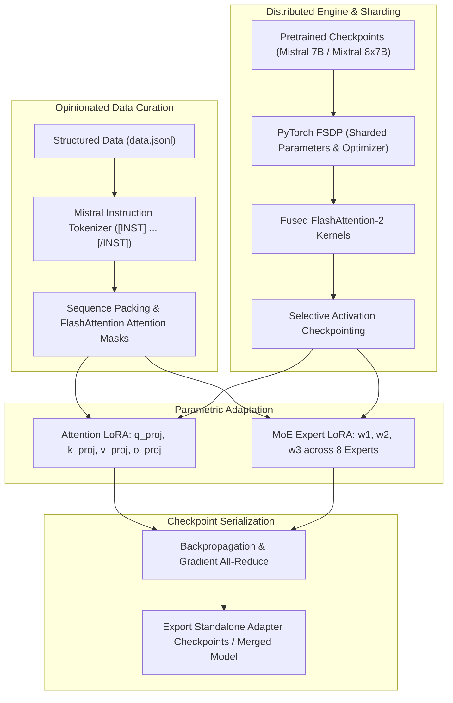
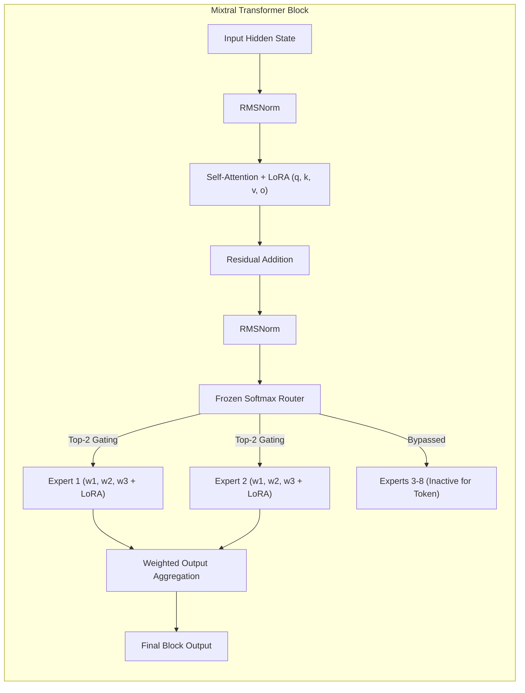
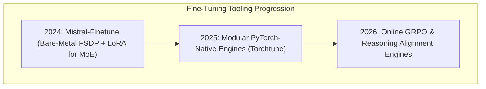

## Why Did Mistral AI Release an Opinionated, Hardware-Specialized Fine-Tuning Codebase?

By May 2024, open-weights foundation models had expanded into large, heterogeneous architectures. While Meta's Llama family adhered to dense transformer blocks, Mistral AI pioneered high-performance Sparse Mixture-of-Experts with **Mixtral 8x7B** (46.7 billion total parameters, 12.9 billion active per token) and subsequently **Mixtral 8x22B**. However, engineering teams attempting to fine-tune these sparse models using general-purpose libraries (such as Hugging Face `transformers` paired with naive `peft` and `accelerate` configurations) frequently encountered severe operational instability.

General-purpose fine-tuning abstraction layers introduced substantial overhead:
1. **Module Hierarchy Thrashing**: Wrapping thousands of individual linear projections across 32 layers and 8 experts per block inside dynamic PyTorch hooks generated excessive Python interpreter latency.
2. **Memory Fragmentation**: Inefficient Key-Value cache management and unpadded dynamic tensor collators caused Out-Of-Memory (OOM) failures during PyTorch Fully Sharded Data Parallel (FSDP) gradient synchronization.
3. **Template Inconsistencies**: Mistral's specific instruction formatting requirements (e.g., precise positioning of `[INST]` and `[/INST]` tokens, bos/eos handling, and multi-turn prefix masking) were frequently corrupted by generic chat templates.

In response, Mistral AI released **`mistral-finetune`**, an intentionally stripped-down, highly opinionated, official fine-tuning codebase. Rather than attempting to support every model architecture across diverse hardware, Mistral-finetune focused strictly on one objective: providing memory-optimal, hardware-accelerated Low-Rank Adaptation (LoRA) and full fine-tuning for Mistral 7B, Mixtral 8x7B, and Mixtral 8x22B across single-node multi-GPU A100 and H100 clusters.



By constraining the scope to native PyTorch primitives, fused FlashAttention-2, and strict JSONL schemas, Mistral-finetune achieved unmatched compute efficiency on enterprise silicon.

---

## Technical Deep-Dive: LoRA Optimization on Sparse Mixture-of-Experts

Applying Low-Rank Adaptation (LoRA) to a dense model like Mistral 7B involves injecting rank-decomposition matrices into standard multi-head attention projections:

$$W_{\text{eff}} = W_0 + \Delta W = W_0 + \frac{\alpha}{r} B A, \quad B \in \mathbb{R}^{d \times r}, A \in \mathbb{R}^{r \times k}, \quad r \ll \min(d, k)$$

However, fine-tuning a Sparse MoE architecture like Mixtral 8x7B introduces architectural nuances. In each transformer block, the feed-forward network (FFN) is replaced by 8 distinct expert networks, modulated by a parametric gating router.

### Which Parameters Must Be Adapted in Sparse MoE?

Mistral-finetune established an optimized parameter targeting strategy:

```
Parametric Allocation in Mixtral 8x7B LoRA:
-------------------------------------------------------------------------------------------------
Target Module Group           Tensor Names               Trainable Status   Rationale
-------------------------------------------------------------------------------------------------
Self-Attention Projections    q_proj, k_proj, v_proj, o_proj Enabled (r=8/16) Adapts global reasoning & context
MoE Gating Router             gate                       Frozen             Preserves established routing distribution
Feed-Forward Experts (x8)     w1 (gate), w2 (down), w3 (up) Enabled (r=8/16) Specializes domain expert representations
Normalization Layers          rms_norm                   Frozen             Maintains numerical stability
Embedding & LM Head           embed_tokens, lm_head      Frozen             Prevents catastrophic representation collapse
-------------------------------------------------------------------------------------------------
```

By freezing the gating router while attaching low-rank adapters directly to the eight feed-forward expert matrices ($w_1, w_2, w_3$) across all 32 layers, the model retains its pre-trained routing stability while allowing individual experts to absorb new domain knowledge. This architecture trains approximately **1.2% to 2.5%** of the model's total weight capacity, drastically reducing optimizer memory footprint.



---

## Memory Scaling and Hardware Topologies

Mistral-finetune was architected specifically for high-bandwidth enterprise clusters (Nvidia A100 80GB and H100 80GB SXM). The memory distribution across multi-GPU nodes is governed by PyTorch Fully Sharded Data Parallel (FSDP):

| Model Architecture | Parameter Count | GPU Configuration | Sharding Strategy | Peak Memory per GPU |
| :--- | :--- | :--- | :--- | :--- |
| **Mistral 7B** | 7.2B | 1x A100 (80GB) | None (Single GPU) | ~24.5 GB (Batch 4, Seq 4096) |
| **Mistral 7B** | 7.2B | 4x RTX 4090 (24GB) | FSDP FULL_SHARD | ~16.2 GB per GPU |
| **Mixtral 8x7B** | 46.7B | 8x A100 (80GB) | FSDP FULL_SHARD | ~48.2 GB per GPU |
| **Mixtral 8x22B** | 141B | 8x H100 (80GB) | FSDP + Activation Offload | ~74.8 GB per GPU |

### Native FlashAttention-2 and Sequence Packing

To maximize tensor core utilization, Mistral-finetune incorporates native FlashAttention-2 (Dao, 2023). Rather than padding variable-length dialogues to fixed sequence lengths—which wastes compute on padding tokens—the data collator concatenates multiple conversational turns into a single contiguous 1D array (`seq_len = 4096` or `8192`), tracking cumulative document boundaries via an auxiliary `cu_seqlens` index tensor. This eliminates redundant memory allocations and accelerates epoch completion times by up to $2.8\times$.

---

## The Role of Dedicated Frameworks vs Generic Multi-Architecture Libraries

The release of Mistral-finetune illustrated a fundamental tension in machine learning systems design: **broad generalization versus specialized execution**. Connecting to our earlier source audits of [Unsloth Kernel Acceleration](/posts/huggingface-unsloth/) and [LLaMA-Factory Workflows](/posts/llama-factory/), developers must choose between versatile multi-model abstractions and model-specialized engines:

```
Fine-Tuning Framework Comparison:
-------------------------------------------------------------------------------------------------
Axis                     Hugging Face TRL / Peft    LLaMA-Factory           Mistral-Finetune
-------------------------------------------------------------------------------------------------
Architectural Scope      Universal (Any Model)      Broad (100+ Models)     Strictly Mistral & Mixtral
Codebase Complexity      High (Deep abstraction)    Medium (Modular UI/CLI) Minimalist (Bare-metal PyTorch)
MoE Fine-Tuning Support  Generic linear wrapping    Standard LoRA           Native FSDP Sharded MoE
Data Schema Constraint   Permissive / Multi-format  Permissive YAML         Strict Opinionated JSONL
Target Infrastructure    Consumer to Cloud          Single-GPU to Multi-GPU High-end Multi-GPU Clusters
-------------------------------------------------------------------------------------------------
```

While libraries like LLaMA-Factory provide extensive web UIs and broader model support, Mistral-finetune established the performance ceiling for teams operating dedicated Mistral infrastructure on enterprise compute.

---

## How Dedicated Model Fine-Tuning Toolkits Evolved Across 2026

Between 2024 and 2026, the paradigm of standalone fine-tuning scripts underwent significant consolidation:

### 1. The Rise of PyTorch-Native Modular Toolkits (Torchtune)
Meta's open-source `torchtune` project validated Mistral-finetune's design philosophy: abandoning bloated dependency graphs in favor of clean, hackable, PyTorch-native recipes. In 2026, enterprise ML teams routinely fork modular, single-file training recipes rather than maintaining monolithic multi-framework wrappers.

### 2. From Supervised SFT to Direct Reinforcement Learning (GRPO)
In 2024, fine-tuning toolkits focused almost exclusively on Supervised Fine-Tuning (SFT) and basic DPO. By 2026, modern fine-tuning engines natively integrate Group Relative Policy Optimization (GRPO) and rule-based verifier execution loops directly within the FSDP sharding fabric, enabling domain teams to train reasoning models locally.



### 3. Automated Adapter Fusion and Quantized Serving
Modern 2026 workflows automate the post-training lifecycle. Upon completing a training run, fine-tuning engines automatically merge low-rank adapters into base weights, evaluate perplexity against verification sets, and emit quantized AWQ and GGUF checkpoints for immediate serving in vLLM or edge runtimes.

---

## Key Takeaways

- **Mistral-finetune eliminated framework abstraction bloat**: Native PyTorch execution delivered stable, memory-efficient fine-tuning for complex Sparse MoE models.
- **MoE adaptation requires targeted parameter selection**: Attaching LoRA adapters to attention projections and feed-forward expert matrices while freezing the gating router ensures training stability.
- **Sequence packing maximizes GPU tensor core utilization**: Packing variable-length dialogues into contiguous arrays using FlashAttention-2 slashes training latency by up to $2.8\times$.
- **FSDP memory sharding enables Mixtral training**: Fully Sharded Data Parallelism distributes parameters and optimizer states across 8x A100/H100 GPUs, preventing OOM failures.
- **Specialized toolkits set the foundation for 2026 post-training**: The success of opinionated, minimalist frameworks inspired modern modular toolkits and distributed GRPO reasoning engines.

---

## New Questions

1. How do gradient variance and expert load imbalances differ when fine-tuning Sparse MoE models with LoRA versus full parameter fine-tuning?
2. What are the throughput trade-offs of sequence packing versus dynamic bucketed batching when training across multi-node InfiniBand networks?
3. To what extent does adapter weight merging in Sparse MoE architectures alter the router's expert assignment entropy on out-of-distribution reasoning benchmarks?

---

## References

- Mistral AI. (2024). *Mistral-finetune: Memory-Efficient Fine-Tuning for Mistral Models*. Official GitHub Repository and Technical Guide. Available at: <https://github.com/mistralai/mistral-finetune> (accessed 2026-10-18).
- Jiang, A. Q., Sablayrolles, A., Roux, A., Mensch, A., Savary, B., Bamford, C., Chaplot, D. S., de las Casas, D., Hanna, E. B., Bressand, F., et al. (2024). *Mixtral of Experts*. arXiv preprint arXiv:2401.04088. Available at: <https://arxiv.org/abs/2401.04088> (accessed 2026-10-18).
- Hu, E. J., Shen, Y., Wallis, P., Allen-Zhu, Z., Li, Y., Wang, S., Wang, L., & Chen, W. (2022). *LoRA: Low-Rank Adaptation of Large Language Models*. In International Conference on Learning Representations (ICLR). Available at: <https://arxiv.org/abs/2106.09685> (accessed 2026-10-18).
- Dao, T. (2023). *FlashAttention-2: Faster Attention with Better Parallelism and Work Partitioning*. In International Conference on Learning Representations (ICLR). Available at: <https://arxiv.org/abs/2307.08691> (accessed 2026-10-18).
