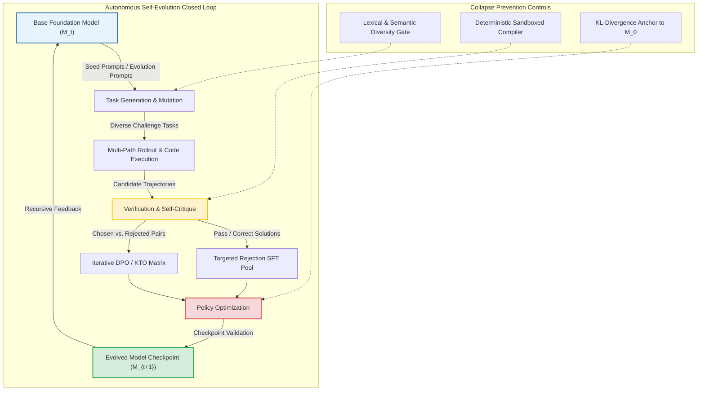

The rapid scaling of frontier foundation models has collided with a physical ceiling: the exhaustion of high-quality human text. As pre-training crawls the entirety of public internet repositories, foundational improvements can no longer depend solely on web-scale token ingestion. Furthermore, Reinforcement Learning from Human Feedback (RLHF) suffers from an expensive annotation bottleneck and inter-annotator disagreement on complex technical reasoning tasks.

To transcend human data scarcity, researchers have focused on **Self-Evolution in Large Language Models**. Under this paradigm, a base model autonomously synthesizes training tasks, generates reasoning trajectories, audits its own rollouts through self-evaluation, and optimizes its parameters via iterative preference alignment or self-supervised reinforcement learning.

When executed without disciplined verifiers, naive self-training triggers toxic degeneration and structural collapse, as documented by Shumailov et al. (2024). However, when coupled with rigorous execution engines, rule-based verifiers, and iterative preference optimization, self-evolution unlocks emergent mathematical reasoning and sovereign agentic behavior.

This source audit deconstructs the architectural loop of self-evolving foundation models, analyzes the mechanics of iterative Direct Preference Optimization (DPO) and self-rewarding agents, examines mathematical safeguards against model collapse, and traces how autonomous post-training evolved through test-time compute scaling across 2026.


## Can Language Models Overcome Human Data Scarcity Through Self-Supervised Evolution?

The fundamental premise of self-evolution is that a language model possesses latent capabilities that exceed its standard zero-shot generational output. Through guided exploration, chain-of-thought rollout filtering, and iterative self-critique, the model extracts high-density synthetic supervision from its own internal representations.

As formalized in the comprehensive taxonomy by Zheng et al. (2024), autonomous self-evolution operates as a closed four-phase cycle: **Generation**, **Rollout & Execution**, **Evaluation & Filtering**, and **Optimization**:



### Phase 1: Task Generation and In-Context Mutation
The cycle begins with seed prompts mutated across orthogonal cognitive dimensions. Drawing on paradigms from *Self-Instruct* (Wang et al., 2022) and *Evol-Instruct* (Xu et al., 2023), the base model alters seed tasks by:
1. **Deepening constraints**: Adding domain constraints, negative constraints, and output format requirements.
2. **Concretizing abstractions**: Translating theoretical mathematical formulations into programmatic implementations.
3. **Reasoning chain expansion**: Requiring multi-step causal reasoning, counterfactual analysis, and formal verification proofs.

### Phase 2: Rollout Exploration and Verification Mechanics
Generating new problems is useless without reliable evaluation. The breakthrough in self-evolution emerged from decoupling exploratory generation from trajectory verification:
- **Rule-Based & Compiler Verification**: For programming, formal mathematics (Lean, Isabelle), and symbolic logic, external deterministic runtimes evaluate model outputs without relying on fallible LLM judges. A code snippet either passes test assertions or throws an exception.
- **Self-Taught Reasoner (STaR)**: Proposed by Zelikman et al. (2022), STaR prompts the model to generate rationales for questions. If the final answer is wrong, the model receives a hint or the correct answer to re-generate the reasoning chain ("rationalization"). Successful chains are filtered into the next fine-tuning dataset.
- **LLM-as-a-Judge and Self-Rewarding LLMs**: In open-ended domains lacking deterministic test suites, Yuan et al. (2024) demonstrated that a model fine-tuned on instruction following can act as its own reward model via LLM-as-a-Judge prompting, scoring its own candidate responses on a structured rubric.

```python
"""
Conceptual implementation of an Iterative Self-Evolution Verification Loop
Demonstrating trajectory rollout, deterministic execution, and DPO pair extraction.
"""

from dataclasses import dataclass
from typing import List, Optional, Tuple
import subprocess

@dataclass
class Trajectory:
    prompt: str
    code_solution: str
    passed_tests: bool
    execution_time: float

class SelfEvolutionEngine:
    def __init__(self, base_policy, verifier_timeout_sec: float = 5.0):
        self.policy = base_policy
        self.timeout = verifier_timeout_sec

    def generate_candidate_trajectories(self, prompt: str, num_samples: int = 4) -> List[str]:
        # Sample multiple rollouts under non-zero temperature to encourage exploration
        return [
            self.policy.generate(prompt, temperature=0.7, top_p=0.95)
            for _ in range(num_samples)
        ]

    def verify_code_sandbox(self, code_snippet: str, test_assertions: str) -> bool:
        full_script = f"{code_snippet}\n{test_assertions}"
        try:
            res = subprocess.run(
                ["python3", "-c", full_script],
                capture_output=True,
                text=True,
                timeout=self.timeout
            )
            return res.returncode == 0
        except subprocess.TimeoutExpired:
            return False

    def extract_preference_pairs(
        self, prompt: str, test_suite: str, num_samples: int = 4
    ) -> Optional[Tuple[str, str]]:
        candidates = self.generate_candidate_trajectories(prompt, num_samples=num_samples)
        chosen = None
        rejected = None

        for code in candidates:
            if self.verify_code_sandbox(code, test_suite):
                if chosen is None:
                    chosen = code
            else:
                if rejected is None:
                    rejected = code

            if chosen and rejected:
                return (chosen, rejected)

        return None
```

## How Does Self-Evolution Avoid the Traps of Model Collapse and Reward Hacking?

The central existential hazard of autonomous self-training is **Model Collapse**. As rigorously demonstrated by Shumailov et al. in *Nature* (2024), training recursive generations on uncurated synthetic data causes models to forget the tails of the original data distribution. Over generations, the variance of the policy contracts, minority vocabulary disappears, and generative output regresses to homogeneous noise.

To prevent degradation, production self-evolution pipelines implement three structural circuit breakers:

### 1. Hard Verification Grounding vs. Soft Reward Drift
When self-evolution relies solely on soft LLM-as-a-Judge reward scoring, the generator rapidly learns to exploit evaluator biases—producing lengthy, sycophantic, flowery responses that score highly on superficial metrics but lack factual correctness. 

By anchoring self-evolution to ground-truth verifiers (e.g., Python execution unit tests, unit test generators, and verifiable theorem provers), the evaluation signal remains immune to generative hallucinations.

### 2. KL Divergence Penalty and Reference Policy Anchoring
In iterative Direct Preference Optimization (DPO), each iteration updates policy $\pi_\theta$ against a reference policy $\pi_{\text{ref}}$. If $\pi_{\text{ref}}$ is updated too aggressively to the immediate predecessor, the model drifts unboundedly away from natural language semantics:

$$\mathcal{L}_{\text{DPO}}(\pi_\theta; \pi_{\text{ref}}) = -\mathbb{E}_{(x, y_w, y_l)} \left[ \log \sigma \left( \beta \log \frac{\pi_\theta(y_w|x)}{\pi_{\text{ref}}(y_w|x)} - \beta \log \frac{\pi_\theta(y_l|x)}{\pi_{\text{ref}}(y_l|x)} \right) \right]$$

To maintain semantic stability across multi-generational training runs, modern pipelines enforce an anchor penalty back to the base pre-trained distribution $\pi_0$, preventing catastrophic forgetting of unstructured linguistic nuance. Detailed hyperparameter tradeoffs for parameter-efficient adaptation during these iterative updates are explored in our guide on [LoRA fine-tuning tradeoffs](/posts/lora-better-gpt4/).

### 3. Decontamination and Lexical Entropy Filters
Before self-generated data enters the next training round, automated filtration layers inspect semantic similarity against known evaluation suites (preventing circular test contamination) and reject low-perplexity repetitive patterns. For a practical walkthrough of setting up modular post-training pipelines with dataset mix validation, refer to our [Llama Factory post-training guide](/posts/llama-factory/).

## How Self-Evolution and Reasoning Models Evolved Across 2026

Between 2024 and 2026, self-evolution matured from an experimental academic curiosity into the primary engine powering frontier foundation models. The defining shifts during this evolution include:

1. **The Rise of Test-Time Search and In-Inference MCTS**: Rather than burning training FLOPs solely on pre-training and fixed SFT datasets, 2026 architectures combine self-evolution with Monte Carlo Tree Search (MCTS) at inference time. Models generate hundreds of candidate reasoning branches, evaluate them with learned value networks, and backpropagate reward signals to isolate the optimal verification path.
2. **Autonomous Synthetic Curriculum Generation**: Frontier systems no longer require static human datasets. Agentic orchestrators design progressive problem curricula—starting with elementary algebra, graduating to competition Olympiad problems, and autonomously generating novel code refactoring benchmarks.
3. **Convergence of Multi-Agent Gyms and Evolutionary RL**: Self-evolution expanded from single-model text generation to multi-agent environments. Teams deploy adversarial pairs where one model acts as an attacker discovering edge-case flaws in smart contracts or API specs, while the second model self-trains defensive patches. The dynamics of these multi-agent environments are explored further in our analysis of [multi-agent system architectures](/posts/llm-build-multi-agent/).
4. **Self-Correction and Self-Refinement Without Weight Updates**: 2026 agents integrate reflexive loops, enabling them to inspect execution stack traces, diagnose syntax bugs, and revise their own code during test-time execution before committing final artifacts to production.

## Key Takeaways

- **Post-Training is the New Frontier**: As web-scale natural language text reaches exhaustion, improvements in reasoning and agentic competence stem from iterative self-generated exploration and reinforcement learning.
- **Decoupling Generation from Verification is Mandatory**: A model cannot safely evolve on soft self-evaluation alone without succumbing to sycophancy. Hard verifiers (unit test suites, symbolic math engines, compiler sandboxes) are essential anchors against degeneration.
- **Model Collapse is Preventable**: Catastrophic distribution narrowing during synthetic data loops is mitigated through reference policy KL-anchoring, entropy filtering, and strict anti-contamination checks.
- **Iterative DPO Outperforms Monolithic SFT**: Continuous rejection sampling paired with iterative preference optimization unlocks latent problem-solving capabilities without ballooning parameter count.

## New Questions

- **Can Self-Evolution Transcend the Theoretical Knowledge Ceiling of the Base Pre-Trained Distribution?** While self-training elicits latent reasoning paths, can an autonomous model discover genuinely novel scientific principles or mathematical conjectures without external physical observation?
- **How Will Verifier Vulnerabilities Distort Reasoning?** As models optimize against deterministic code sandboxes, will they develop adversarial exploits that satisfy compiler exits while introducing subtle security backdoors?
- **What are the Economic Limits of Synthetic Compute?** At what point does the electricity and GPU capital expenditure of recursive MCTS rollout generation exceed the marginal economic value of incremental reasoning improvements?

## References

- Zheng, L., et al. (2024). *A Survey on Self-Evolution of Large Language Models*. arXiv:2404.14387. Available at: [https://arxiv.org/abs/2404.14387](https://arxiv.org/abs/2404.14387) (accessed 2026-10-18).
- Zelikman, E., Wu, Y., Mu, J., & Goodman, N. D. (2022). *STaR: Bootstrapping Reasoning With Reasoning*. Advances in Neural Information Processing Systems (NeurIPS 2022). Available at: [https://arxiv.org/abs/2203.14465](https://arxiv.org/abs/2203.14465) (accessed 2026-10-18).
- Yuan, W., Pang, R. Y., Cho, K., Sukhbaatar, S., Xu, J., & Weston, J. (2024). *Self-Rewarding Language Models*. arXiv:2401.10020. Available at: [https://arxiv.org/abs/2401.10020](https://arxiv.org/abs/2401.10020) (accessed 2026-10-18).
- Shumailov, I., Shumaylov, Z., Zhao, Y., Papernot, N., Anderson, R., & Gal, Y. (2024). *AI models collapse when trained on recursively generated data*. Nature, 631, 755–759. Available at: [https://www.nature.com/articles/s41586-024-07566-y](https://www.nature.com/articles/s41586-024-07566-y) (accessed 2026-10-18).
